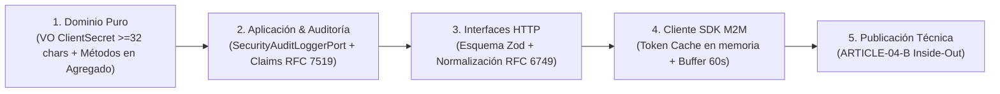

# Plan de Refactorización Integral sobre US-04 (OAuth2 Client Credentials & Scoped Grant)

* **Story Relacionada:** [`US-04: Client Credentials & Scoped Access Token Grant`](./US-04-client-credentials-scoped-grant.md)
* **Épica:** [`EPIC-02: Client Registry & Service Authorization`](../README.md)
* **ADR Relacionado:** [`ADR-0004: Client Registry and Service Authorization`](../../../../docs/adr/0004-client-registry-authorization.md)
* **Rama de Trabajo:** `feat/US-04-client-credentials`
* **Estándar:** RFC 6749 (The OAuth 2.0 Authorization Framework, Sección 4.4 y 5)

---

## 1. Visión y Objetivos de la Refactorización

Tras la auditoría arquitectónica realizada en la sesión de `/grill-me`, este bucle de refactorización eleva la robustez técnica, seguridad y ergonomía de consumo de **US-04** antes de ejecutar el *squash-merge* hacia `main`:

---

## 2. Desglose de Pasos Atómicos (Inside-Out) con Checkboxes

### **Paso 1: Dominio Puro (Value Object `ClientSecret` y Agregado `ClientApplication`)**
* **Objetivo:** Eliminar la dependencia de strings planos para secretos de cliente y centralizar las invariantes de concesión M2M dentro de la entidad raíz.
- [x] **1.1. Crear Value Object `ClientSecret`:**
  - Archivo: `src/contexts/identity/domain/value_objects/client_secret/value.ts`.
  - Invariantes: valida longitud mínima estricta de **32 caracteres** (según ADR-0004), no vacío, normalizado y con método de comparación `equals()`.
- [x] **1.2. Enriquecer Agregado `ClientApplication`:**
  - Archivo: `src/contexts/identity/domain/entities/client_application/aggregate.ts`.
  - Métodos de negocio: `validateClientCredentialsGrant(secret, hashProvider)` y `filterAuthorizedScopes(requestedScopes)`.
- [x] **1.3. Adaptar Fixtures de Pruebas:**
  - Actualizar fixtures en suites existentes para utilizar secretos válidos $\ge 32$ caracteres (e.g. `ValidSecret123!_SuperSecureSecretForTesting_2026`).
- [x] **1.4. Tests Unitarios del Value Object:**
  - Archivo: `tests/unit/identity/domain/client_registry/test_client_secret.ts`.

---

### **Paso 2: Capa de Aplicación (Claims RFC 7519 y Puerto de Auditoría de Seguridad)**
* **Objetivo:** Cumplir con la anatomía estándar de claims JWT (RFC 7519) y registrar eventos de auditoría para monitorización de seguridad.
- [x] **2.1. Definir Secondary Port `SecurityAuditLoggerPort`:**
  - Archivo: `src/contexts/identity/application/ports/security/audit_logger.ts`.
  - Método: `logEvent(event: SecurityAuditEvent): Promise<void>`.
  - Tipos de eventos: `client_authenticated` y `client_authentication_failed` (`clientId`, `timestamp`, `reason`, `ip`).
- [x] **2.2. Implementar Adaptador en Memoria `InMemorySecurityAuditLogger`:**
  - Archivo: `src/contexts/identity/infrastructure/logging/memory_security_audit_logger.ts`.
- [x] **2.3. Actualizar `AuthenticateClientM2MCommandHandler`:**
  - Archivo: `src/contexts/identity/application/commands/authenticate_client_m2m/handler.ts`.
  - Inyectar `SecurityAuditLoggerPort` y registrar eventos de éxito y fallo.
  - Generar claims estándar RFC 7519: `iss`, `aud`, `sub`, `client_id`, `scope`, `token_type: 'Bearer'`, y `jti` (UUID único).
- [x] **2.4. Tests Unitarios de Aplicación:**
  - Actualizar `tests/unit/identity/application/oauth2/test_authenticate_client_m2m_handler.ts`.

---

### **Paso 3: Capa de Interfaces HTTP (Validación Declarativa Zod)**
* **Objetivo:** Estandarizar la validación de entrada HTTP con esquemas Zod protegiendo el controlador y mapeando errores a RFC 6749.
- [x] **3.1. Definir Esquema Zod `OAuth2TokenRequestSchema`:**
  - Archivo: `interfaces/http/rest/v1/oauth2/schemas.ts`.
  - Validar tipos, strings requeridos y grant_type.
- [x] **3.2. Refactorizar `OAuth2TokenController`:**
  - Archivo: `interfaces/http/rest/v1/oauth2/token_controller.ts`.
  - Aplicar validación Zod y transformar issues en códigos RFC 6749 (`invalid_request` / `unsupported_grant_type`).
- [x] **3.3. Tests de Integración:**
  - Ejecutar y verificar `tests/integration/identity/interfaces/test_oauth2_token_m2m.ts`.

---

### **Paso 4: Cliente SDK M2M (`OAuth2M2MClient` con Caché y Auto-Renovación)**
* **Objetivo:** Dotar al SDK de cliente de una caché inteligente en memoria para evitar llamadas redundantes de microservicios al Identity Provider.
- [x] **4.1. Implementar `getValidToken(params)` en `OAuth2M2MClient`:**
  - Archivo: `interfaces/http/client/oauth2_m2m_client.ts`.
  - Caché en memoria con **buffer de renovación anticipada de 60 segundos** antes de `expires_in`.
  - Conservar `requestToken(params)` para forzar renovación fresca explícita.
- [x] **4.2. Pruebas E2E del SDK:**
  - Extender `tests/e2e/m2m/client_credentials_flow.spec.ts` con casos de Cache Hit, Expiración y Refresco Forzado.

---

### **Paso 5: Artículo Técnico sobre las Refactorizaciones**
* **Objetivo:** Documentar la evolución arquitectónica, patrones implementados y análisis comparativo *Before vs After*.
- [x] **5.1. Redactar Artículo Técnico:**
  - Archivo: `.agent/publications/ARTICLE-04-B-refactoring-client-credentials.md`.
- [x] **5.2. Actualizar Matriz de Trazabilidad:**
  - Archivo: `.agent/memory/TRACEABILITY_MATRIX.md`.

---

## 3. Criterio de Verificación de Regresión

Cada paso se ejecutará con sus commits atómicos (separando tests de implementación) y la verificación continua de que la suite completa (157+ tests) mantenga su estado 100% verde sin desvíos.

