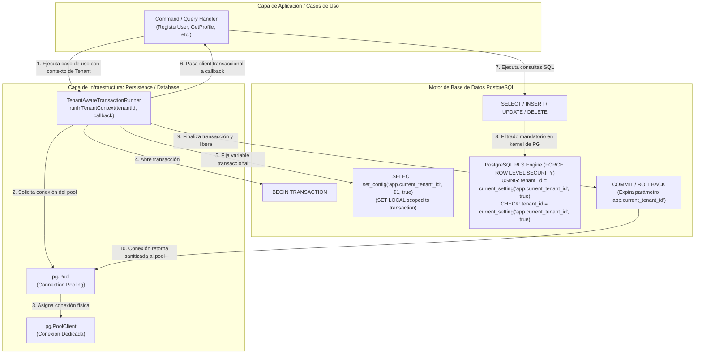

# Plan de Implementación Guiado por Tests en 4 Capas para US-05

**User Story:** [US-05: Database Tenant Session Context & RLS Policies Migration](US-05-tenant-session-rls-migration.md)  
**Épica:** EPIC-03 (PostgreSQL Row-Level Security Isolation Engine)  
**Rama:** `feat/US-05-rls-runner` (creada a partir de `main` en `c576f27`)  
**ADR Relacionado:** [ADR-0005: PostgreSQL Row-Level Security Strategy](../../../docs/adr/0005-postgresql-rls-strategy.md)  
**Estándar / Principio:** Defense in Depth & Zero-Trust Data Isolation at Database Engine Level (PostgreSQL RLS + `SET LOCAL`)

---

## 1. Visión y Flujo Arquitectónico

---

## 2. Invariantes del Dominio y Reglas Técnicas Críticas

1. **Activación Mandatoria e Implacable (`FORCE ROW LEVEL SECURITY`):**
   - Todas las tablas con discriminador multitenant (`users`, etc.) deben tener `ENABLE ROW LEVEL SECURITY` y `FORCE ROW LEVEL SECURITY` para evitar que usuarios propietarios o conexiones con permisos eludan el filtro.
2. **Política Simétrica (`USING` y `WITH CHECK`):**
   - `USING (tenant_id = current_setting('app.current_tenant_id', true)::text)`: Filtra filas visibles en `SELECT`, `UPDATE` y `DELETE`.
   - `WITH CHECK (tenant_id = current_setting('app.current_tenant_id', true)::text)`: Impide insertar o actualizar registros con un `tenant_id` que no coincida con la sesión activa.
3. **Fail-Closed por Defecto:**
   - Si no se invoca `set_config('app.current_tenant_id', ...)`, el segundo parámetro `true` en `current_setting(..., true)` devuelve `NULL`, haciendo que cualquier consulta retorne exactamente 0 filas y cualquier mutación sea rechazada.
4. **Ciclo de Vida Transaccional Puro (`SET LOCAL` / `set_config(..., is_local = true)`):**
   - El valor de `app.current_tenant_id` se destruye inmediatamente al invocar `COMMIT` o `ROLLBACK`. Al volver la conexión física al `pg.Pool`, queda totalmente limpia, previniendo fuga de estado o contaminación cruzada entre peticiones concurrentes.

---

## 3. Desglose del Ciclo en 2 Fases y 8 Pasos Atómicos

### Fase 1: Apertura de Capas (Top-Down / Red Phase)

* [x] **Paso 1 (Apertura Capa 4 - E2E Concurrencia y Resistencia en Connection Pool) [RED]:**
  * **Archivo:** `tests/e2e/security/tenant_rls_isolation.spec.ts`
  * **Objetivo:** Simular 50 transacciones concurrentes alternando entre tenants (`alpha-corp` y `beta-corp`) sobre un pool compartido. Verificar que no exista fuga de estado (state pollution), que las conexiones recicladas estén desinfectadas y que las operaciones concurrentes mantengan aislamiento estricto.
  * **Comando:** `npm run test:e2e tests/e2e/security/tenant_rls_isolation.spec.ts` $\rightarrow$ 🔴 **FAIL** (módulo `TenantAwareTransactionRunner` inexistente).

* [x] **Paso 2 (Apertura Capa 3 - Aceptación BDD Living Documentation) [RED]:**
  * **Archivos:**
    * `tests/acceptance/features/tenant_rls_isolation.feature` (Escenarios Gherkin: Aislamiento estricto de datos con RLS, reciclaje seguro de conexiones en pool sin estado residual, y comportamiento Fail-Closed ante omisión de contexto).
    * `tests/acceptance/step_defs/test_tenant_rls_isolation_steps.ts`.
  * **Objetivo:** Especificación ejecutable BDD que valida las garantías de negocio y seguridad documentadas en US-05.
  * **Comando:** `npm run test:acceptance tests/acceptance/step_defs/test_tenant_rls_isolation_steps.ts` $\rightarrow$ 🔴 **FAIL** (módulo `TenantAwareTransactionRunner` inexistente).

* [x] **Paso 3 (Apertura Capa 2 - Integración Motor PostgreSQL & Runner) [RED]:**
  * **Archivos:**
    * `tests/integration/security/test_rls_policies.ts` (Pruebas contra PostgreSQL validando las políticas DDL `USING` y `WITH CHECK`, inserciones cruzadas bloqueadas y visibilidad condicionada a `app.current_tenant_id`).
    * `tests/integration/security/test_tenant_aware_transaction_runner.ts` (Integración de `TenantAwareTransactionRunner` con `pg.Pool`, validando commits, rollbacks automáticos en excepciones y saneamiento de conexión).
  * **Comando:** `npm run test:integration tests/integration/security/` $\rightarrow$ 🔴 **FAIL** (módulo `TenantAwareTransactionRunner` inexistente).

* [x] **Paso 4 (Apertura Capa 1 - Pruebas Unitarias de Runner y Puertos) [RED]:**
  * **Archivo:** `tests/unit/identity/infrastructure/database/test_tenant_aware_transaction_runner.ts`
  * **Objetivo:** Probar con mocks exhaustivos la máquina de estados del runner: adquisición de cliente desde `pg.Pool`, emisión de `BEGIN`, `set_config('app.current_tenant_id', ..., true)`, delegación a callback, emisión de `COMMIT`, manejo de `ROLLBACK` ante errores y llamada garantizada a `client.release()` en bloque `finally`.
  * **Comando:** `npm run test:unit tests/unit/identity/infrastructure/database/` $\rightarrow$ 🔴 **FAIL** (módulo `TenantAwareTransactionRunner` inexistente).

---

### Fase 2: Clausura de Capas (Bottom-Up / Green Phase)

* [x] **Paso 5 (Clausura Capa 1 - Dominio & Runner Unitario) [GREEN]:**
  * **Archivos:**
    * `src/contexts/identity/application/ports/database/tenant_transaction_runner.ts` (Puerto secundario SPI).
    * `src/contexts/identity/infrastructure/persistence/database/tenant_aware_transaction_runner.ts` (Implementación con `pg.Pool`).
  * **Verificación:** `npm run test:unit tests/unit/identity/infrastructure/database/test_tenant_aware_transaction_runner.ts` $\rightarrow$ 🟢 **PASS** (20 suites, 126 tests 100% GREEN).

* [x] **Paso 6 (Clausura Capa 2 - Integración & Migración DDL 007) [GREEN]:**
  * **Archivos:**
    * `infrastructure/local/initdb.d/007-enable-postgresql-rls.sql` (Migración DDL que aplica `ALTER TABLE users ENABLE ROW LEVEL SECURITY; FORCE ROW LEVEL SECURITY;` y crea la política `tenant_isolation_policy` en `identity_db` e `identity_test_db`).
    * Adaptación o utilidades de conexión en repositorios de persistencia.
  * **Verificación:** `npm run test:integration tests/integration/security/` $\rightarrow$ 🟢 **PASS** (8 suites, 47 tests 100% GREEN).

* [x] **Paso 7 (Clausura Capa 3 - Aceptación BDD) [GREEN]:**
  * Conexión de step definitions con el runner transaccional y la base de datos de pruebas configurada con RLS.
  * **Verificación:** `npm run test:acceptance tests/acceptance/step_defs/test_tenant_rls_isolation_steps.ts` $\rightarrow$ 🟢 **PASS** (5 suites, 16 tests 100% GREEN).

* [x] **Paso 8 (Clausura Capa 4 - E2E y Concurrencia de Pool) [GREEN]:**
  * Ejecución de la prueba de concurrencia e inmunidad contra filtración en pool de 50 peticiones simultáneas.
  * **Verificación:** `npm run test:e2e tests/e2e/security/tenant_rls_isolation.spec.ts` $\rightarrow$ 🟢 **PASS** (5 suites, 24 tests 100% GREEN).

---

## 4. Trazabilidad y Cierre

* [x] **Paso 9 (Documentación & Matriz de Trazabilidad):**
  * Actualización de `TRACEABILITY_MATRIX.md` (marcando US-05 como Completed con sus commits y archivos).
  * Actualización de `US-05-tenant-session-rls-migration.md`.
  * Redacción de publicación técnica `ARTICLE-05-tenant-session-rls-migration.md`.
* [x] **Paso 10 (Certificación de Pirámide Completa):**
  * Ejecutar suite integral `npm test && npm run test:acceptance && npm run test:e2e` para certificar 100% verde en todos los tests existentes más los nuevos de US-05, junto a `npm run build` (`tsc`).

