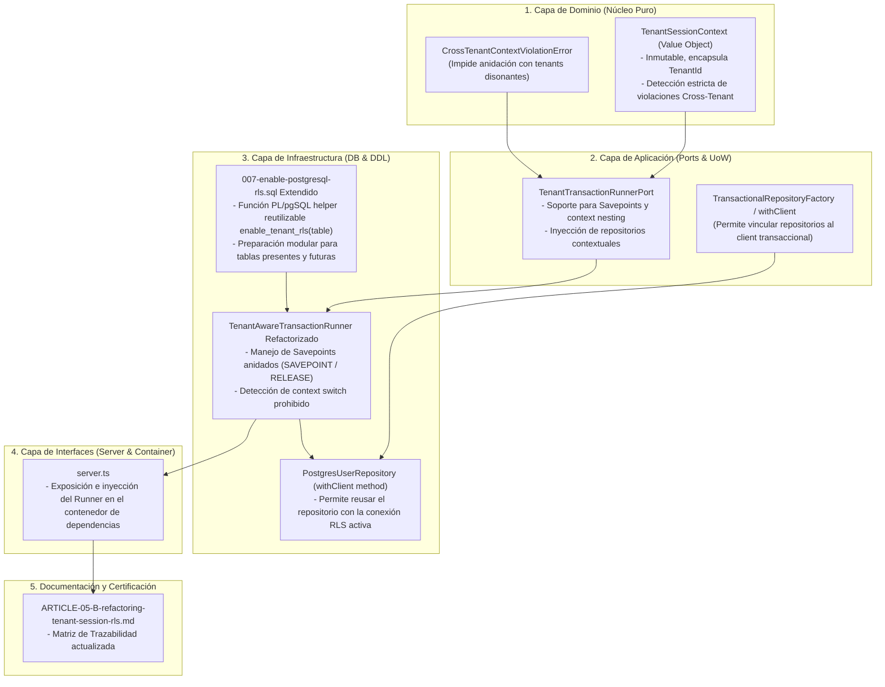

# Plan de Refactorización Integral Inside-Out sobre US-05 (PostgreSQL RLS & Tenant Transaction Runner)

**User Story:** [US-05: Database Tenant Session Context & RLS Policies Migration](US-05-tenant-session-rls-migration.md)  
**Épica:** EPIC-03 (PostgreSQL Row-Level Security Isolation Engine)  
**Rama de Trabajo:** `feat/US-05-rls-runner`  
**ADR Relacionado:** [ADR-0005: PostgreSQL Row-Level Security Strategy](../../../docs/adr/0005-postgresql-rls-strategy.md)  
**Filosofía:** Inside-Out Refactoring (Dominio $\rightarrow$ Aplicación $\rightarrow$ Infraestructura / DDL $\rightarrow$ Interfaces / Wiring $\rightarrow$ Documentación)

---

## 1. Visión y Objetivos de la Refactorización

---

## 2. Desglose en 5 Pasos Atómicos (Inside-Out)

### Paso 1: Capa de Dominio — Contexto de Sesión Inmutable (`TenantSessionContext`)
* **Archivos a crear/modificar:**
  * `src/contexts/identity/domain/value_objects/tenant_session_context/value.ts`: Objeto de valor inmutable que encapsula el `TenantId`, provee métodos de validación estricta, comparación de identidad y genera excepciones si se intenta conmutar a un tenant diferente en la misma sesión.
  * `src/contexts/identity/domain/exceptions/cross_tenant_violation.ts`: Excepción de dominio `CrossTenantContextViolationError` ante intentos de mezclar tenants en la misma pila transaccional.
  * `tests/unit/identity/domain/test_tenant_session_context.ts`: Pruebas unitarias completas.

### Paso 2: Capa de Aplicación — Repositorios Transaccionales y Puerto de Runner Enriquecido
* **Archivos a crear/modificar:**
  * `src/contexts/identity/application/ports/database/tenant_transaction_runner.ts`: Extensión de la firma para soportar `TenantSessionContext`, transacciones anidadas con savepoints y firma que facilita la inyección de repositorios.
  * `src/contexts/identity/infrastructure/persistence/repositories/user/repository.ts`: Añadir método `withClient(client: DatabaseClient): PostgresUserRepository` para permitir crear instancias efímeras del repositorio vinculadas a la conexión transaccional con RLS sin duplicar estado.
  * `tests/unit/identity/application/test_tenant_transaction_runner_port.ts` / actualización de pruebas unitarias de repositorios.

### Paso 3: Capa de Infraestructura — Savepoints Anidados en Runner y Función DDL Reutilizable
* **Archivos a crear/modificar:**
  * `src/contexts/identity/infrastructure/persistence/database/tenant_aware_transaction_runner.ts`:
    * Implementación de Savepoints (`SAVEPOINT sp_<id>` y `RELEASE SAVEPOINT sp_<id>`) si `runInTenantContext` es invocado dentro de un bloque del mismo tenant ya abierto.
    * Lanzamiento preventivo de `CrossTenantContextViolationError` si se intenta ejecutar una transacción anidada para `beta-corp` cuando el cliente ya está en `alpha-corp`.
  * `infrastructure/local/initdb.d/007-enable-postgresql-rls.sql`:
    * Definir una función almacenada en PostgreSQL: `CREATE OR REPLACE FUNCTION apply_tenant_rls(target_table regclass) ...` que centralice la creación de políticas simétricas `USING` y `WITH CHECK` y el forzado de RLS de forma limpia y reutilizable para cualquier tabla.
  * `tests/unit/identity/infrastructure/database/test_tenant_aware_transaction_runner.ts` & `tests/integration/security/test_tenant_aware_transaction_runner.ts`: Pruebas de savepoints y protección cross-tenant.

### Paso 4: Capa de Interfaces — Wiring del Runner en el Contenedor HTTP
* **Archivos a crear/modificar:**
  * `interfaces/http/server.ts`:
    * Integrar `TenantAwareTransactionRunner` en el container de la aplicación Express (`createApp({ ..., transactionRunner })`).
    * Proporcionar acceso opcional al runner para middlewares y controladores que orquesten operaciones multi-tenant atómicas.
  * `tests/integration/identity/interfaces/test_server_dependency_injection.ts`: Pruebas de integración del cableado.

### Paso 5: Documentación Técnica, Matriz de Trazabilidad y Certificación Integral
* **Archivos a crear/modificar:**
  * `.agent/publications/ARTICLE-05-B-refactoring-tenant-session-rls.md`: Publicación técnica del bucle de refactorización Inside-Out.
  * `.agent/memory/TRACEABILITY_MATRIX.md`: Actualización con los nuevos artefactos y commits.
  * Ejecución de la suite completa de pruebas: `npm test && npm run test:acceptance && npm run test:e2e` y `npm run build` con 100% GREEN.

---

## 3. Criterios de Aceptación y Checklist de Verificación

- [x] **Paso 1:** `TenantSessionContext` implementado en dominio con 0 dependencias externas y pruebas unitarias al 100%.
- [x] **Paso 2:** `PostgresUserRepository.withClient()` implementado y testeado permitiendo vincular repositorios a conexiones transaccionales RLS.
- [x] **Paso 3:** `TenantAwareTransactionRunner` soporta Savepoints y previene violaciones cruzadas con `CrossTenantContextViolationError`; migración DDL 007 enriquecida con helper PL/pgSQL.
- [x] **Paso 4:** Servidor Express y contenedor de dependencias integran el runner transaccional con soporte completo en TypeScript.
- [ ] **Paso 5:** Artículo `ARTICLE-05-B` redactado, matriz actualizada y certificación total de la pirámide de pruebas (100% verde).

