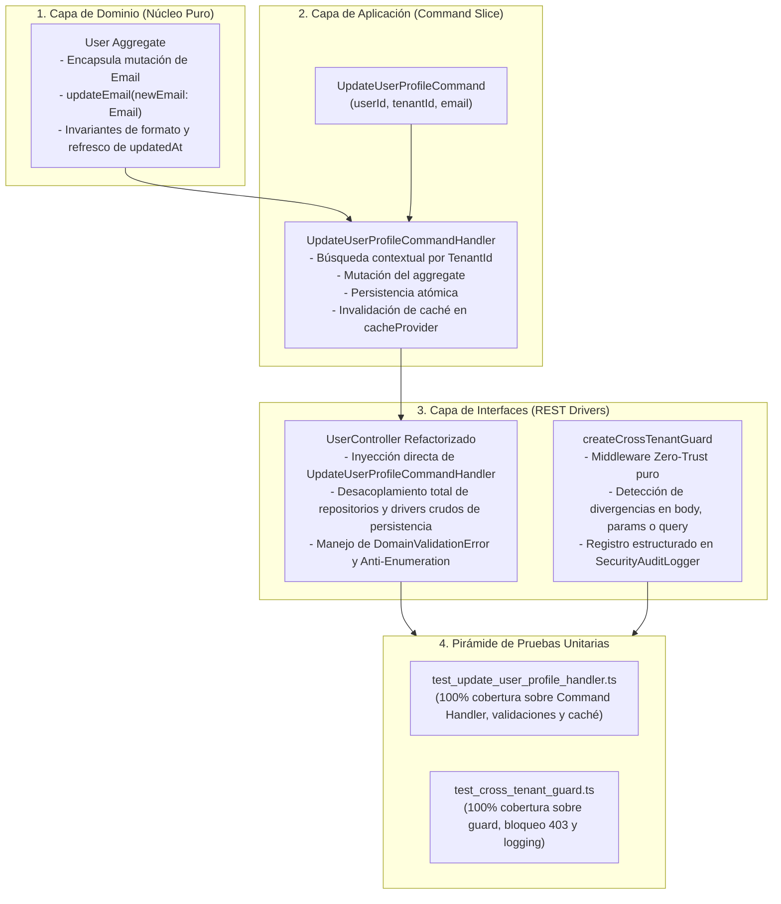

# Plan de Refactorización Integral Inside-Out sobre US-06 (Cross-Tenant Zero-Trust Guard & Anti-Enumeration)

**User Story:** [US-06: Cross-Tenant Zero-Trust Data Access Guard & Security Audit Logger](US-06-cross-tenant-zero-trust-guard.md)  
**Épica:** [EPIC-03: PostgreSQL Row-Level Security Isolation Engine](../README.md)  
**Rama de Trabajo:** `main`  
**ADRs Relacionados:** [ADR-0005: PostgreSQL Row-Level Security Strategy](../../../docs/adr/0005-postgresql-rls-strategy.md)  
**Filosofía:** Inside-Out Refactoring (Dominio $\rightarrow$ Aplicación $\rightarrow$ Interfaces / HTTP Controllers & Middlewares $\rightarrow$ Tests Unitarios $\rightarrow$ Documentación)

---

## 1. Visión y Objetivos de la Refactorización

---

## 2. Desglose en 4 Pasos Atómicos (Inside-Out)

### Paso 1: Capa de Dominio — Mutación de Entidad Rica (`User.updateEmail`)
* **Archivo modificado:** `src/contexts/identity/domain/entities/user/aggregate.ts`
* **Implementación:**
  * Método `updateEmail(newEmail: Email): void` que valida el objeto de valor, comprueba si el valor difiere, actualiza la propiedad interna y actualiza el timestamp `updatedAt`.
  * Preservación del encapsulamiento estricto sin setters públicos ni acceso directo a propiedades internas.

### Paso 2: Capa de Aplicación — Command & Command Handler (`UpdateUserProfileCommandHandler`)
* **Archivos creados:**
  * `src/contexts/identity/application/commands/update_user_profile/command.ts`: DTO inmutable `UpdateUserProfileCommand` (`userId`, `tenantId`, `email?`).
  * `src/contexts/identity/application/commands/update_user_profile/handler.ts`:
    * Valida `userId` y `tenantId` no vacíos.
    * Busca usuario acotado al tenant mediante `userRepository.findById(userId, tenantId)`.
    * Lanza error si no existe para mantener el contrato anti-enumeración.
    * Actualiza el email invocando el método de dominio `user.updateEmail()`.
    * Persiste la entidad con `userRepository.save(user)`.
    * Invalida la clave de caché `user_profile:${tenantId}:${userId}` en `CacheProviderPort`.
    * Retorna `UserProfileDTO` saneado.

### Paso 3: Capa de Interfaces — Refactorización y Desacoplamiento de `UserController`
* **Archivos modificados:**
  * `interfaces/http/rest/v1/identity/user_controller.ts`:
    * Se eliminan las dependencias directas de infraestructura `UserRepositoryPort` y `CacheProviderPort`.
    * Se inyecta `UpdateUserProfileCommandHandler` junto a `GetUserProfileQueryHandler`.
    * Método `updateUser` delega limpiamente en el command handler.
    * Mapeo estricto de excepciones de dominio: `DomainValidationError` a HTTP 400 Bad Request, y 'not found' a HTTP 404 Not Found.
  * `interfaces/http/server.ts`:
    * Instanciación de `UpdateUserProfileCommandHandler` e inyección limpia en el constructor de `UserController`.

### Paso 4: Pruebas Unitarias Aisladas y Validación de Cobertura
* **Archivos creados:**
  * `tests/unit/identity/application/test_update_user_profile_handler.ts`:
    * Actualización exitosa, persistencia e invalidación de clave de caché.
    * Ejecución sin proveedor de caché opcional.
    * Lanzamiento de error cuando el usuario no existe en el tenant.
    * Lanzamiento de `DomainValidationError` ante `userId` o `tenantId` vacíos o email malformado.
  * `tests/unit/identity/interfaces/test_cross_tenant_guard.ts`:
    * Paso limpio cuando no hay divergencia de tenant.
    * Paso cuando no se proveen parámetros de tenant en body/param/query.
    * Bloqueo 403 Forbidden y emisión de `cross_tenant_violation` ante discrepancias en `body.tenantId`, `params.tenantId` o `query.tenantId`.
    * Comportamiento defensivo fail-closed sin `SecurityAuditLoggerPort` inyectado.

---

## 3. Criterios de Aceptación y Checklist de Verificación

- [x] **Dominio:** `User.updateEmail(newEmail: Email)` encapsulado en el Aggregate Root actualizando `updatedAt`.
- [x] **Aplicación:** `UpdateUserProfileCommandHandler` implementado desacoplando la capa de interfaces de la persistencia y orquestando la invalidación de caché.
- [x] **Interfaces:** `UserController` refactorizado sin referencias a repositorios ni cachés directas, inyectando el Command Handler correspondiente.
- [x] **Servidor:** Contenedor de dependencias en `interfaces/http/server.ts` actualizado.
- [x] **Pruebas:** Cobertura unitaria exhaustiva añadida en `tests/unit/` (13 tests unitarios nuevos pasando, 100% verde en toda la pirámide).
