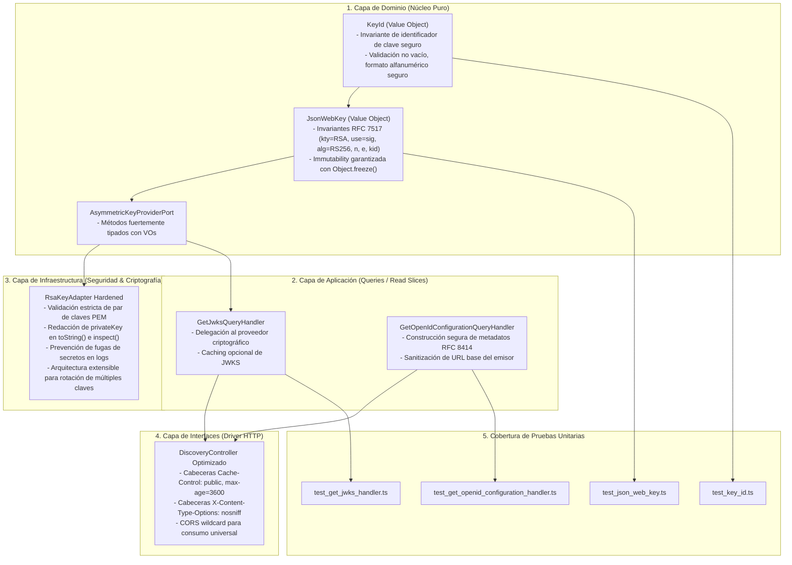

# Plan de Refactorización Integral Inside-Out sobre US-07 (Cryptographic Keypair Management, JWKS & OIDC Discovery)

**User Story:** [US-07: Cryptographic Keypair Management, JWKS and OpenID Discovery Endpoints](US-07-jwks-discovery-endpoints.md)  
**Épica:** [EPIC-04: OIDC Server & Sessions Engine](../README.md)  
**Rama de Trabajo:** `feat/US-07-jwks-discovery`  
**ADRs Relacionados:** [ADR-0004: Client Authentication](../../../docs/adr/0004-client-authentication-strategy.md), [ADR-0005: PostgreSQL RLS Isolation](../../../docs/adr/0005-postgresql-rls-strategy.md)  
**Filosofía:** Inside-Out Refactoring (Dominio $\rightarrow$ Aplicación $\rightarrow$ Infraestructura $\rightarrow$ Interfaces HTTP $\rightarrow$ Tests Unitarios $\rightarrow$ Documentación)

---

## 1. Visión y Arquitectura de la Refactorización

---

## 2. Desglose en 5 Pasos Atómicos (Inside-Out)

### Paso 1: Capa de Dominio — Value Objects Criptográficos (`KeyId` y `JsonWebKeyVO`)
* **Archivos creados:**
  * `src/contexts/identity/domain/value_objects/crypto/key_id.ts`:
    * Encapsula el identificador de clave (`kid`).
    * Valida que no esté vacío, sin espacios, con longitud mínima y caracteres seguros.
    * Inmutable (`Object.freeze`).
  * `src/contexts/identity/domain/value_objects/crypto/json_web_key.ts`:
    * Encapsula la estructura RFC 7517 de una clave pública RSA.
    * Valida invariantes estrictas: `kty === 'RSA'`, `use === 'sig'`, `alg === 'RS256'`, `e === 'AQAB'`, y presencia de módulo `n` y `kid`.
    * Previene la inclusión inadvertida de componentes privados (`d`, `p`, `q`, `dp`, `dq`, `qi`).

### Paso 2: Capa de Aplicación — Refactorización y Validación Defensiva de Handlers
* **Archivos modificados:**
  * `src/contexts/identity/application/queries/get_jwks/handler.ts`:
    * Tipado con soporte de DTO inmutable.
    * Verificación defensiva del proveedor criptográfico inyectado.
  * `src/contexts/identity/application/queries/get_openid_configuration/handler.ts`:
    * Sanitización robusta de la URL del emisor (validación de protocolo HTTP/HTTPS, eliminación de trailing slashes y fragmentos).

### Paso 3: Capa de Infraestructura — Endurecimiento Criptográfico de `RsaKeyAdapter`
* **Archivos modificados:**
  * `src/contexts/identity/infrastructure/security/rsa_key_adapter.ts`:
    * Implementación de métodos personalizados `toString()` y `[util.inspect.custom]()` para rediseñar la representación en consola/logs y ocultar `privateKeyPem` como `[REDACTED]`.
    * Validación defensiva de formato PEM durante la inicialización con claves externas.
    * Preparación de estructura multi-clave para futuras estrategias de rotación progresiva (US-09).

### Paso 4: Capa de Interfaces — Optimización HTTP y Cabeceras de Seguridad en `DiscoveryController`
* **Archivos modificados:**
  * `interfaces/http/rest/v1/oidc/discovery_controller.ts`:
    * Inclusión de cabeceras de optimización web:
      * `Cache-Control: public, max-age=3600, stale-while-revalidate=86400` para reducir sobrecarga en el IdP.
      * `X-Content-Type-Options: nosniff`.
    * Normalización consistente de `res.setHeader('Access-Control-Allow-Origin', '*')`.

### Paso 5: Suite de Pruebas Unitarias Aisladas (Pirámide de Pruebas)
* **Archivos creados:**
  * `tests/unit/identity/domain/crypto/test_key_id.ts`
  * `tests/unit/identity/domain/crypto/test_json_web_key.ts`
  * `tests/unit/identity/application/oidc/test_get_jwks_handler.ts`
  * `tests/unit/identity/application/oidc/test_get_openid_configuration_handler.ts`
  * Actualización de `tests/unit/identity/infrastructure/security/test_rsa_key_adapter.ts` para verificar la redacción segura de la clave privada en logs y depuración.

---

## 3. Criterios de Aceptación y Checklist de Verificación

- [x] **Dominio:** Value Objects `KeyId` y `JsonWebKeyVO` creados y protegidos contra parámetros privados o malformados.
- [x] **Aplicación:** Queries `GetJwksQueryHandler` y `GetOpenIdConfigurationQueryHandler` robustecidos contra URLs inválidas y nulos.
- [x] **Infraestructura:** `RsaKeyAdapter` redacta la clave privada en logs (`[REDACTED]`) y valida claves PEM externas.
- [x] **Interfaces:** `DiscoveryController` emite cabeceras `Cache-Control` y de seguridad defensiva.
- [x] **Pruebas:** 100% de la suite de pruebas pasando (Unit, Integration, BDD Acceptance, SDK) sin regresiones.

