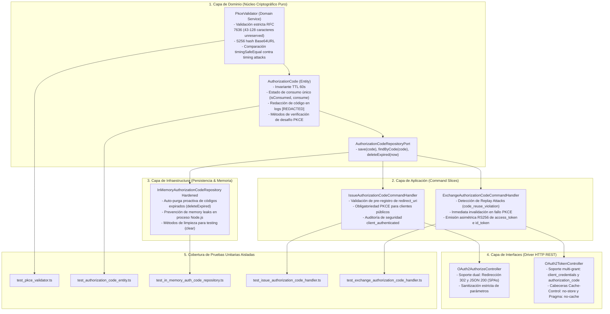

# Plan de Refactorización Integral Inside-Out sobre US-08 (OAuth2 Authorization Code Flow con PKCE)

**User Story:** [US-08: Flujo de Código de Autorización con PKCE y Consentimiento](US-08-auth-code-pkce-flow.md)  
**Épica:** [EPIC-04: OIDC Server & Sessions Engine](../README.md)  
**Rama de Trabajo:** `feat/US-08-auth-code-pkce`  
**Estándares RFC:** [RFC 6749 (OAuth 2.0)](https://datatracker.ietf.org/doc/html/rfc6749), [RFC 7636 (PKCE)](https://datatracker.ietf.org/doc/html/rfc7636), [OpenID Connect Core 1.0](https://openid.net/specs/openid-connect-core-1_0.html)  
**Filosofía:** Inside-Out Refactoring (Dominio $\rightarrow$ Aplicación $\rightarrow$ Infraestructura $\rightarrow$ Interfaces HTTP $\rightarrow$ Tests Unitarios $\rightarrow$ Documentación)

---

## 1. Visión y Arquitectura de la Refactorización

---

## 2. Desglose en 5 Pasos Atómicos (Inside-Out)

### Paso 1: Capa de Dominio — Endurecimiento Criptográfico y Redacción de Secretos
* **`PkceValidator` (`src/contexts/identity/domain/services/pkce_validator.ts`):**
  * Validación defensiva del formato del `code_verifier` según RFC 7636 Sección 4.1: exactamente entre 43 y 128 caracteres del conjunto `[A-Za-z0-9\-._~]`.
  * Verificación criptográfica con `crypto.timingSafeEqual` previa normalización de buffers para mitigar timing attacks basados en longitud de respuesta.
* **`AuthorizationCode` (`src/contexts/identity/domain/entities/authorization_code/entity.ts`):**
  * Inmutabilidad garantizada con `Object.freeze`.
  * Implementación de métodos personalizados `toString()` y `[util.inspect.custom]()` para rediseñar la representación en consola/logs y ocultar el valor sensible de `code` como `[REDACTED]`.
  * Métodos declarativos `isExpired(now?: Date)` y `isConsumed()`.

### Paso 2: Capa de Infraestructura — Auto-Purga de Expirados y Resiliencia en Memoria
* **`InMemoryAuthorizationCodeRepository` (`src/contexts/identity/infrastructure/persistence/repositories/authorization_code/in_memory_repository.ts`):**
  * Implementación de `deleteExpired(now?: Date): Promise<number>` para eliminar registros vencidos.
  * Mecanismo de lazy-purge durante `findByCode` y `save` para evitar acumulación excesiva de memoria (memory leak mitigation) en escenarios de alto tráfico.
  * Método auxiliar `clear()` para aislamiento de tests y benchmarking.

### Paso 3: Capa de Aplicación — Auditoría Forense y Mitigación de Replay Attacks
* **`IssueAuthorizationCodeCommandHandler`:**
  * Validación preventiva de estado activo del cliente y compatibilidad con el grant `authorization_code`.
  * Registro de auditoría `client_authenticated` con metadata enriquecida (`redirectUri`, `clientId`, `action`).
* **`ExchangeAuthorizationCodeCommandHandler`:**
  * Mitigación de ataques de reproducción (RFC 6749 Sección 4.1.2 y RFC 7636): si un código ya consumido es presentado nuevamente, se emite inmediatamente un evento de auditoría `code_reuse_violation`.
  * En caso de fallo en la verificación del desafío PKCE (`pkce_verification_failed`), el código es marcado como consumido de inmediato para impedir ataques de fuerza bruta sobre el `code_verifier`.
  * Emisión estricta de `id_token` firmado asimétricamente con RS256 conteniendo los claims estándar OIDC (`iss`, `sub`, `aud`, `exp`, `iat`, `nonce`).

### Paso 4: Capa de Interfaces — Normalización de Respuestas y Cabeceras HTTP
* **`OAuth2AuthorizeController`:**
  * Soporte dual: Redirección estándar HTTP 302 hacia `redirect_uri` y respuesta JSON 200 cuando se solicita explícitamente vía `Accept: application/json`.
  * Sanitización de parámetros query y body.
* **`OAuth2TokenController`:**
  * Asegurar cabeceras obligatorias según RFC 6749 Sección 5.1: `Cache-Control: no-store` y `Pragma: no-cache`.
  * Manejo unificado de excepciones de protocolo `OAuth2AuthenticationError`.

### Paso 5: Pirámide de Pruebas Unitarias Aisladas (100% Cobertura de Ramas)
* **Creación de tests unitarios dedicados:**
  1. `tests/unit/identity/domain/oauth2/test_pkce_validator.ts`: Prueba exhaustiva de vectores RFC 7636, caracteres válidos e inválidos, límites de longitud y comparación segura.
  2. `tests/unit/identity/domain/oauth2/test_authorization_code_entity.ts`: Prueba de invariantes, TTL, consumo único y redacción en logs.
  3. `tests/unit/identity/infrastructure/repositories/test_in_memory_auth_code_repository.ts`: Prueba de almacenamiento, recuperación, auto-purga de expirados y aislamiento.
  4. `tests/unit/identity/application/oauth2/test_issue_authorization_code_handler.ts`: Prueba de emisión, obligatoriedad PKCE en clientes públicos, rechazo de URI no registrada y auditoría.
  5. `tests/unit/identity/application/oauth2/test_exchange_authorization_code_handler.ts`: Prueba de canje exitoso por tokens RS256, rechazo por verifier inválido con consumo inmediato, detección de replay attacks y verificación de credenciales para clientes confidenciales.

---

## 3. Criterios de Aceptación de la Fase 2

1. **Cero Regresiones:** El 100% de la suite de pruebas (Unit, Integration, Acceptance y SDK) debe permanecer verde.
2. **Seguridad Endurecida:** Clave sensible `code` redactada en inspección/logs (`[REDACTED]`).
3. **Resiliencia de Memoria:** Los códigos de autorización expirados se depuran automáticamente.
4. **Separación de Commits:** Commits estrictamente separados entre producción/infraestructura y pruebas unitarias.
