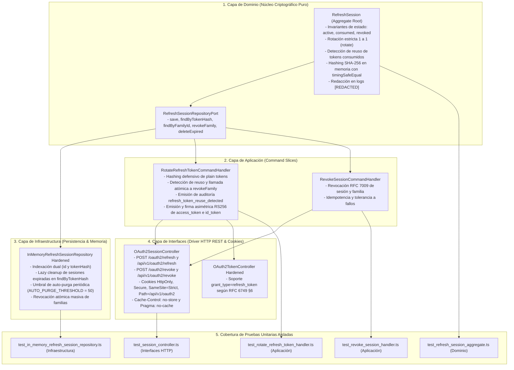

# Plan de Refactorización Integral Inside-Out sobre US-09 (Sliding Session Refresh Token Rotation con HttpOnly Cookies)

**User Story:** [US-09: Sliding Session Refresh Token Rotation with HttpOnly Cookies](US-09-refresh-token-rotation.md)  
**Épica:** [EPIC-04: OIDC / OAuth2 Authorization Server & Session Lifecycle](../README.md)  
**Rama de Trabajo:** `feat/US-09-refresh-token-rotation`  
**Estándares RFC:** [RFC 6749 (OAuth 2.0 §6)](https://datatracker.ietf.org/doc/html/rfc6749#section-6), [RFC 7009 (Token Revocation)](https://datatracker.ietf.org/doc/html/rfc7009), [OAuth 2.0 Security BCP (Token Family Revocation)](https://datatracker.ietf.org/doc/html/draft-ietf-oauth-security-topics)  
**Filosofía:** Inside-Out Refactoring (Dominio $\rightarrow$ Aplicación $\rightarrow$ Infraestructura $\rightarrow$ Interfaces HTTP $\rightarrow$ Tests Unitarios Aislados $\rightarrow$ Documentación)

---

## 1. Visión y Arquitectura de la Refactorización

---

## 2. Desglose en 5 Pasos Atómicos (Inside-Out)

### Paso 1: Hardening de la Capa de Dominio (`RefreshSession`)
* **Validación de Entropía:** Exigir que los tokens planos para hash contengan una longitud mínima segura ($\ge 32$ caracteres hexadecimales o base64).
* **Comparación en Tiempo Constante:** Implementar método auxiliar `verifyHash(plainToken: string, expectedHash: string): boolean` utilizando `crypto.timingSafeEqual` sobre los buffers ASCII para eliminar canales laterales de temporización (*timing attacks*, CWE-208).
* **Defensa de Inmutabilidad:** Congelar o aislar fechas y propiedades mutadas tras `rotate()` y `revoke()`.
* **Zero Leak Secrets:** Verificar que `toString()` y `[util.inspect.custom]()` redacten permanentemente los campos sensibles (`tokenHash=[REDACTED]`).

### Paso 2: Hardening de la Capa de Infraestructura (`InMemoryRefreshSessionRepository`)
* **Umbral de Auto-Purga Proactiva:** Implementar `AUTO_PURGE_THRESHOLD = 50`. Cada 50 operaciones `save()`, invocar automáticamente un barrido para limpiar sesiones expiradas o revocadas de más de 24 horas, impidiendo el crecimiento descontrolado de la memoria RAM.
* **Limpieza Perezosa (*Lazy Cleanup*):** En `findByTokenHash()`, si la sesión ha expirado, eliminarla atómicamente de `sessionsById` y `sessionIdsByHash` antes de retornar `null`.
* **Revocación de Familia en Memoria:** Garantizar que `revokeFamily(familyId, reason)` recorra y actualice el estado a `revoked` de todos los nodos de la familia de forma atómica.

### Paso 3: Hardening de la Capa de Aplicación (`RotateRefreshTokenCommandHandler` & `RevokeSessionCommandHandler`)
* **Validación Previa Estricta:** Rechazar peticiones con `refreshToken` vacío, con espacios o malformado con error estandarizado `invalid_request` (400).
* **Auditoría de Reuso Enriquecida:** Al detectar reuso (`isConsumed()`), emitir evento `refresh_token_reuse_detected` detallando `familyId`, `userId`, `clientId`, IP y timestamp.
* **Emisión Asimétrica Segura:** Firmar `access_token` e `id_token` con RS256 garantizando claims OIDC Core 1.0 (`sub`, `iss`, `aud`, `tenant_id`, `scope`).

### Paso 4: Hardening de la Capa de Interfaces HTTP (`OAuth2SessionController`)
* **Gestión Defensiva de Cookies:** Asegurar el envío de cabeceras `Set-Cookie` con directivas completas:
  - `HttpOnly`: Bloquea acceso desde JavaScript/DOM.
  - `SameSite=Strict`: Inmunidad total frente a CSRF.
  - `Secure`: HTTPS mandatorio (salvo desarrollo/testing).
  - `Path`: Delimitado a `/api/v1/oauth2` o `/oauth2`.
* **Cabeceras Anti-Caché:** Inclusión mandatoria de `Cache-Control: no-store` y `Pragma: no-cache` en todas las respuestas de token y sesión (RFC 6749 §5.1).

### Paso 5: Batería de Pruebas Unitarias Aisladas
* Implementar 5 suites de pruebas unitarias puras:
  1. [`tests/unit/identity/domain/session/test_refresh_session_aggregate.ts`](../../../tests/unit/identity/domain/session/test_refresh_session_aggregate.ts)
  2. [`tests/unit/identity/infrastructure/repositories/test_in_memory_refresh_session_repository.ts`](../../../tests/unit/identity/infrastructure/repositories/test_in_memory_refresh_session_repository.ts)
  3. [`tests/unit/identity/application/session/test_rotate_refresh_token_handler.ts`](../../../tests/unit/identity/application/session/test_rotate_refresh_token_handler.ts)
  4. [`tests/unit/identity/application/session/test_revoke_session_handler.ts`](../../../tests/unit/identity/application/session/test_revoke_session_handler.ts)
  5. [`tests/unit/identity/interfaces/test_session_controller.ts`](../../../tests/unit/identity/interfaces/test_session_controller.ts)
* Meta: Aumentar la pirámide de pruebas unitarias manteniendo el 100% de éxito en toda la suite.

