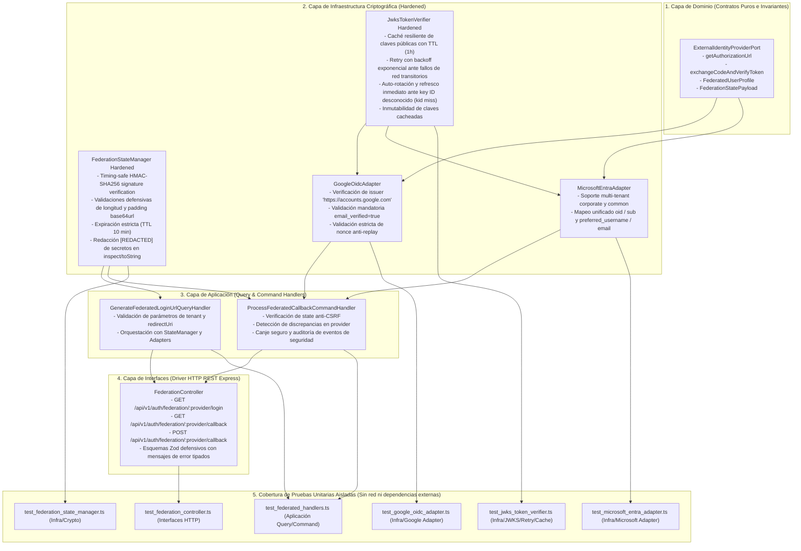

# Plan de Refactorización Integral Inside-Out sobre US-10 (Conectores OIDC Externos Google & Microsoft Entra ID)

**User Story:** [US-10: External OIDC Provider Connectors](US-10-external-oidc-connectors.md)  
**Épica:** [EPIC-05: Identity Federation & External IdP Brokerage](../README.md)  
**Rama de Trabajo:** `feat/US-10-external-oidc-connectors`  
**Estándares RFC:** [OpenID Connect Core 1.0](https://openid.net/specs/openid-connect-core-1_0.html), [RFC 7517 (JWK / JWKS)](https://datatracker.ietf.org/doc/html/rfc7517), [RFC 6749 (OAuth 2.0 State & Anti-CSRF)](https://datatracker.ietf.org/doc/html/rfc6749#section-10.12), [OAuth 2.0 Security BCP (Nonce & Replay Prevention)](https://datatracker.ietf.org/doc/html/draft-ietf-oauth-security-topics)  
**Filosofía:** Inside-Out Refactoring (Dominio $\rightarrow$ Aplicación $\rightarrow$ Infraestructura Criptográfica $\rightarrow$ Interfaces HTTP $\rightarrow$ Tests Unitarios Aislados $\rightarrow$ Trazabilidad)

---

## 1. Visión y Arquitectura de la Refactorización

---

## 2. Desglose de Mejoras y Endurecimiento Inside-Out

### Paso 1: Hardening de `JwksTokenVerifier` (Caché, Auto-Rotación y Retry con Backoff)
1. **Auto-refresco ante `kid` desconocido (*Cache Miss Revalidation*):**
   - Si un ID Token presenta un `kid` ausente en la caché, no fallar de inmediato si la caché tiene más de un umbral mínimo (p. ej. 10 segundos). Ejecutar un refresco forzado del JWKS para soportar la rotación de claves en caliente de Google o Microsoft sin tiempo de inactividad (*zero downtime key rollover*).
2. **Reintentos con Backoff Exponencial y Jitter:**
   - Implementar reintentos defensivos (hasta 3 intentos con pausas exponenciales de 100ms, 200ms, 400ms) ante errores transitorios de red (5xx, timeouts) al descargar JWKS.
3. **Resiliencia Fail-Safe:**
   - Si la llamada de refresco falla y hay claves previamente cacheadas, mantener la caché activa para no interrumpir el servicio de tokens previamente firmados con claves existentes.
4. **Redacción de Inspección:**
   - Implementar `[util.inspect.custom]()` para ocultar estructuras internas y garantizar cero fugas de datos.

### Paso 2: Hardening de `FederationStateManager`
1. **Validación Criptográfica Timing-Safe:**
   - Garantizar que la verificación del HMAC de firma utilice buffers de tamaño normalizado con `crypto.timingSafeEqual` para prevenir ataques de canal lateral (CWE-208).
2. **Validación de Integridad de Payload:**
   - Rechazar tokens con `expiresAt` en el pasado o `createdAt` en el futuro (desviación de reloj tolerable: 60 segundos).
   - Validar que los campos esenciales (`tenantId`, `redirectUri`, `provider`, `nonce`) sean cadenas no vacías.
3. **Redacción de Secretos en Logs:**
   - Mantener `[REDACTED]` en `toString()` y `util.inspect.custom`.

### Paso 3: Suites Unitarias Aisladas (6 Suites Dedicadas)
Construcción de pruebas unitarias 100% aisladas en memoria sin dependencias de red:
1. `tests/unit/identity/infrastructure/federation/test_federation_state_manager.ts` (Generación, verificación timing-safe, expiración, manipulación, clock skew).
2. `tests/unit/identity/infrastructure/federation/test_jwks_token_verifier.ts` (Caché JWK, exportación PEM, auto-refresco on kid miss, reintentos con backoff, firma RS256, tokens expirados/tampered).
3. `tests/unit/identity/infrastructure/federation/test_google_oidc_adapter.ts` (Generación de URL, canje y verificación de claims, email_verified, nonce, error propagation).
4. `tests/unit/identity/infrastructure/federation/test_microsoft_entra_adapter.ts` (Generación de URL, oid/sub claims, preferred_username/upn/email fallback, tenant resolution).
5. `tests/unit/identity/application/federation/test_federated_handlers.ts` (Handler de Query login URL y Command callback con registro de auditoría de seguridad).
6. `tests/unit/identity/interfaces/test_federation_controller.ts` (Controlador Express: validaciones Zod, formato JSON vs redirect 302, mapeo de errores HTTP 400/401).

---

## 3. Criterios de Aceptación del Refactoring (DoD)
- [ ] `JwksTokenVerifier` implementa auto-refresco en caliente ante clave desconocida (`kid miss`) y retry defensivo con backoff.
- [ ] `FederationStateManager` valida tolerancia de reloj y firmas con `timingSafeEqual`.
- [ ] 6 suites unitarias nuevas creadas y pasando al 100% en `tests/unit/identity/`.
- [ ] Cero regresiones en la pirámide completa de tests existentes (US-01 a US-09).
- [ ] Commits separados para código refactorizado y pruebas unitarias.
