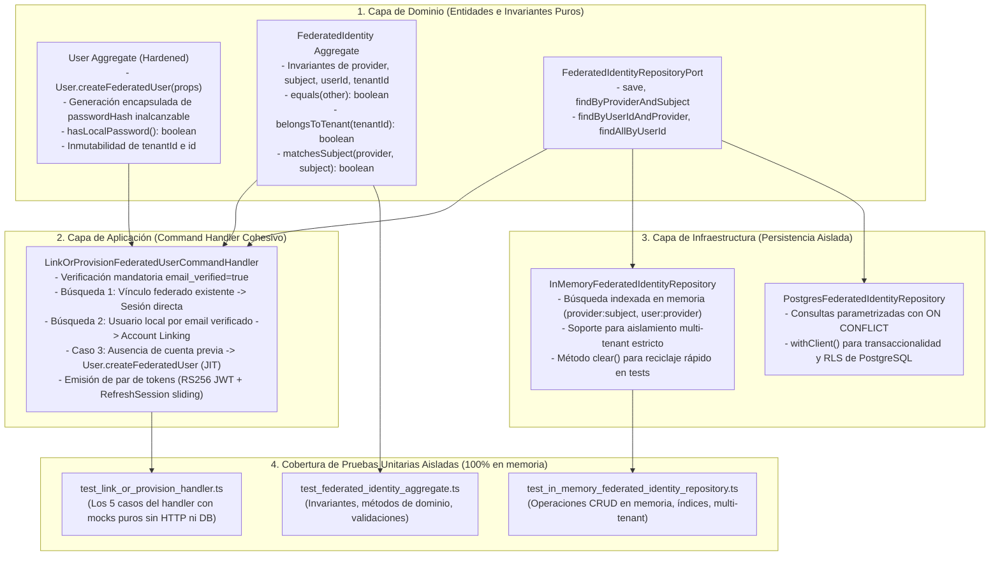

# Plan de Refactorización Integral Inside-Out sobre US-11 (Enlace de Cuentas Federadas y Provisión JIT)

**User Story:** [US-11: Federated Account Linking and JIT Provisioning](US-11-federated-account-linking.md)  
**Épica:** [EPIC-05: Identity Federation & External IdP Brokerage](../README.md)  
**Rama de Trabajo:** `feat/US-11-federated-account-linking`  
**Estándares RFC:** [OpenID Connect Core 1.0](https://openid.net/specs/openid-connect-core-1_0.html), [RFC 6749 (OAuth 2.0)](https://datatracker.ietf.org/doc/html/rfc6749), [OWASP Account Linking Cheat Sheet](https://cheatsheetseries.owasp.org/cheatsheets/Authentication_Cheat_Sheet.html)  
**Filosofía:** Inside-Out Refactoring (Dominio $\rightarrow$ Aplicación $\rightarrow$ Infraestructura Persistencia $\rightarrow$ Suites Unitarias Aisladas $\rightarrow$ Trazabilidad)

---

## 1. Visión y Arquitectura de la Refactorización

---

## 2. Desglose de Mejoras y Endurecimiento Inside-Out

### Paso 1: Endurecimiento de la Capa de Dominio (`User` y `FederatedIdentity`)
1. **Factory Method Semántico `User.createFederatedUser`:**
   - Encapsular la creación de usuarios aprovisionados Just-In-Time mediante identidades federadas.
   - Generar un hash criptográficamente aleatorio e inviable para autenticación local por contraseña:
     `$2b$12$FEDERATED_NO_LOCAL_PASSWORD_${crypto.randomUUID()}`
   - Añadir método helper `hasLocalPassword(): boolean` que compruebe si el usuario posee una contraseña local configurada o es estrictamente federado.
2. **Métodos Semánticos en `FederatedIdentity`:**
   - Incorporar `matchesSubject(provider: string, externalSubjectId: string): boolean`.
   - Incorporar `belongsToTenant(tenantId: TenantId): boolean`.
   - Garantizar inmutabilidad y protección contra valores nulos o cadenas en blanco.

### Paso 2: Refactorización del Caso de Uso (`LinkOrProvisionFederatedUserCommandHandler`)
1. **Cohesión y Desacoplamiento:**
   - Sustituir la lógica directa de generación de contraseñas arbitrarias por el factory method de dominio `User.createFederatedUser({ email, tenantId, id })`.
   - Simplificar el flujo de auditoría de seguridad para registrar claramente las tres ramas:
     - `federation_existing_link` (login directo de cuenta ya vinculada).
     - `federation_account_linked` (vinculación a usuario local preexistente).
     - `federation_jit_provisioned` (creación JIT de usuario + identidad federada).
2. **Garantía Anti-Cross-Tenant en Aplicación:**
   - Si una identidad federada ya registrada apunta a un `tenantId` distinto al provisto en la petición, abortar con error de seguridad y registrar auditoría `cross_tenant_violation`.

### Paso 3: Tres Suites Unitarias Aisladas (Nivel Unit de la Pirámide)
Construcción de suites unitarias sin sockets, sin HTTP y sin base de datos real:
1. `tests/unit/identity/domain/federation/test_federated_identity_aggregate.ts`:
   - Creación y reconstitución con invariantes válidos.
   - Lanzamiento de `DomainValidationError` ante `provider`, `externalSubjectId`, `userId` inválidos.
   - Verificación de métodos de negocio (`equals`, `belongsToTenant`, `matchesSubject`).
2. `tests/unit/identity/infrastructure/repositories/test_in_memory_federated_identity_repository.ts`:
   - Inserción y recuperación por clave compuesta `(provider, externalSubjectId)`.
   - Búsqueda por `(userId, provider, tenantId)`.
   - Búsqueda de todas las identidades de un usuario con aislamiento por tenant.
   - Comportamiento de actualización idempotente con `save`.
3. `tests/unit/identity/application/federation/test_link_or_provision_handler.ts`:
   - **Caso 1 (JIT Provisioning):** Usuario no existe $\rightarrow$ crea `User` con `createFederatedUser`, guarda `FederatedIdentity`, emite JWT y RefreshSession, retorna `isNewUser: true, linked: true`.
   - **Caso 2 (Account Linking):** Usuario local existe por email $\rightarrow$ reutiliza `User`, guarda `FederatedIdentity`, retorna `isNewUser: false, linked: true`.
   - **Caso 3 (Existing Link):** Identidad federada ya existe $\rightarrow$ autentica directamente, retorna `isNewUser: false, linked: false`.
   - **Caso 4 (Multi-Provider):** Usuario con Google vinculado ahora vincula Microsoft Entra ID $\rightarrow$ persiste segundo enlace exitosamente.
   - **Caso 5 (Rechazo Email no Verificado):** `emailVerified: false` $\rightarrow$ lanza excepción de seguridad y audita evento sin tocar repositorio.
   - **Caso 6 (Cross-Tenant Guard):** Identidad federada existente en otro tenant $\rightarrow$ lanza error y audita violación.

---

## 3. Criterios de Aceptación del Refactoring (DoD)
- [ ] `User.createFederatedUser` implementado en el aggregate `User` con hash de contraseña protegido y `hasLocalPassword()`.
- [ ] `LinkOrProvisionFederatedUserCommandHandler` actualizado para utilizar la fábrica de dominio semántica.
- [ ] 3 suites unitarias creadas en `tests/unit/identity/` ejecutándose y pasando al 100%.
- [ ] Cero regresiones en la suite de aceptación (`npm run test:acceptance`), integración (`npm run test:integration`) y SDK (`npm run test:sdk`).
