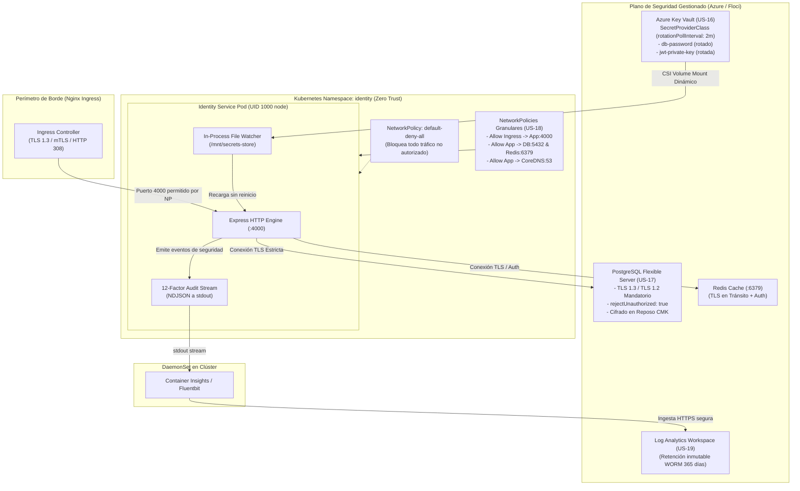

# EPIC-07: Fintech Compliance, Hardening & Security Standards

* **ID:** EPIC-07
* **Bounded Context:** `security` / `compliance` / `infrastructure` / `platform`
* **Estado:** Ready for Implementation
* **Arquitectura:** Zero Trust Network Segmentation / In-Flight & At-Rest Cryptography / Automated Key Rotation / Immutable Audit Logging
* **Topología de Referencia:** [`.agent/TREE.txt`](../../TREE.txt)
* **Plataforma de Ejecución:** Microsoft Azure / Kubernetes (AKS) / Floci ARM Emulator
* **Marcos Regulatorios:** PCI-DSS v4.0 · SOC 2 Type II · ISO/IEC 27001:2022 · Cloud Security Alliance (CSA-CCM)

> **Objetivo Estratégico:**  
> Implementar los controles de seguridad, aislamiento criptográfico, microsegmentación de red y preservación inmutable de auditoría exigidos en entornos bancarios y financieros (PCI-DSS v4.0 y SOC 2 Type II), complementados con la gobernanza y hardening de infraestructura de ISO/IEC 27001 y CSA-CCM.

---

## 1. Visión y Marco Normativo

En el desarrollo de plataformas de identidad y autenticación que prestan servicios a ecosistemas FinTech, bancarios o de misión crítica (*IDaaS*), la seguridad no puede ser un componente añadido a posteriori; debe constituir la columna vertebral de la arquitectura.

La **EPIC-07** establece una suite rigurosa de controles técnicos estructurados bajo un **Enfoque Progresivo de Dos Fases**:

1. **Fase Principal (Implementación Core - Fintech Bancario):**
   - **PCI-DSS v4.0:**
     - *Requisito 3.6:* Protección y gestión integral del ciclo de vida de claves criptográficas y secretos.
     - *Requisito 4.1:* Cifrado robusto de credenciales y datos sensibles de tarjetahabiente/usuario durante la transmisión sobre redes abiertas o internas.
     - *Requisito 10.2 & 10.5:* Registro sistemático de eventos de seguridad y salvaguarda inmutable contra alteración o borrado de bitácoras de auditoría.
   - **SOC 2 Type II (Trust Services Criteria):**
     - *CC6.1 & CC6.7:* Controles de acceso lógico, gestión de secretos en bóveda y cifrado integral en reposo y en tránsito.
     - *CC6.6:* Segmentación lógica de perímetro y control de flujos de red.
     - *CC7.2:* Monitoreo continuo de operaciones y detección de anomalías.
2. **Fase Complementaria (Gobernanza y Hardening de Infraestructura):**
   - **ISO/IEC 27001:2022:**
     - *Control A.13.1 (Network Security Management):* Segregación de redes en clústeres de contenedores mediante políticas de mínimo privilegio.
   - **Cloud Security Alliance (CSA-CCM v4):**
     - *Controles DCS (Data Center Security) & IVS (Infrastructure and Virtualization Security):* Hardening de Pods, microsegmentación Zero-Trust y mitigación de movimientos laterales.

---

## 2. Resumen Ejecutivo de Historias de Usuario

| Historia | Archivo de Especificación | Alcance y Entregable Técnico | Control Normativo | Estado |
| :--- | :--- | :--- | :--- | :--- |
| **US-16** | [`US-16-key-vault-csi-secret-rotation.md`](stories/US-16-key-vault-csi-secret-rotation.md) | Rotación inyectada de credenciales de PostgreSQL y claves JWT en memoria mediante Azure Key Vault CSI Driver (`rotationPollInterval: 2m`) con observador de archivos en proceso (*Zero-Downtime*). | **PCI-DSS Req 3.6** **SOC 2 CC6.1** | Ready |
| **US-17** | [`US-17-database-encryption-flexible-server.md`](stories/US-17-database-encryption-flexible-server.md) | Conexión obligatoria TLS 1.3/1.2 en `node-pg` con verificación estricta de certificado CA (`rejectUnauthorized: true`) y cifrado en reposo con Customer-Managed Key (CMK) en Azure PostgreSQL Flexible Server. | **PCI-DSS Req 4.1** **SOC 2 CC6.7** | Ready |
| **US-18** | [`US-18-k8s-zero-trust-network-policies.md`](stories/US-18-k8s-zero-trust-network-policies.md) | Aislamiento de red mediante Kubernetes NetworkPolicies modulares en Helm con política `Default-Deny` y listas blancas granulares para Ingress, App, Database, Redis y CoreDNS. | **ISO 27001 A.13.1** **SOC 2 CC6.6** | Ready |
| **US-19** | [`US-19-immutable-audit-log-analytics.md`](stories/US-19-immutable-audit-log-analytics.md) | Emisión de bitácoras de auditoría estructuradas (12-Factor stdout NDJSON) y reenvío inmutable hacia Azure Log Analytics Workspace con políticas de retención de cumplimiento. | **PCI-DSS Req 10.2/10.5** **SOC 2 CC7.2** | Ready |

---

## 3. Topología de Seguridad y Cumplimiento

---

## 4. Hoja de Ruta de Implementación Técnica

1. **Sprint 1: Criptografía y Ciclo de Vida de Secretos (US-16 & US-17):**
   - Implementación de `SecretWatcherService` en Node.js para detección de cambios en `/mnt/secrets-store/`.
   - Renovación dinámica de credenciales del pool de PostgreSQL y rollover de claves JWT sin destruir Pods.
   - Configuración estricta de TLS en `node-pg` (`rejectUnauthorized: true`, CA raíz) y hardening del módulo Terraform `modules/postgres` (`ssl_enforcement_enabled`).
2. **Sprint 2: Microsegmentación Zero Trust (US-18):**
   - Desarrollo de la plantilla declarativa `deployments/helm/identity-service/templates/networkpolicy.yaml`.
   - Parametrización en `values.yaml` y pruebas de aislamiento con vectores de tráfico denegado.
3. **Sprint 3: Auditoría Estructurada e Ingesta Inmutable (US-19):**
   - Formateador NDJSON bancario enriquecido (`timestamp`, `tenantId`, `actorId`, `traceId`, `complianceTag`).
   - Hardening del módulo Terraform `modules/log_analytics` para retención inmutable y auditoría de eventos.
4. **Sprint 4: Verificación Integral, Guías de Operación y Publicación:**
   - Elaboración de guías técnicas operativas (`GUIDELINE-17` a `GUIDELINE-20`).
   - Publicación del artículo técnico oficial de la épica (`ARTICLE-13-fintech-compliance-hardening.md`).

---

## 5. Definición de Hecho (Definition of Done - DoD)

- [ ] **Rotación de Secretos (US-16):** El observador de archivos detecta la actualización de secretos en `/mnt/secrets-store/` y refresca credenciales en memoria sin reiniciar el proceso ni provocar errores en peticiones activas.
- [ ] **Cifrado de Base de Datos (US-17):** `node-pg` rechaza conexiones en texto plano o con certificados inválidos (`rejectUnauthorized: true`) y Terraform confirma `ssl_enforcement_enabled` en PostgreSQL.
- [ ] **Network Policies (US-18):** El clúster bloquea tráfico no autorizado entre Pods y hacia el exterior, permitiendo únicamente los flujos explícitamente autorizados por selector y puerto.
- [ ] **Bitácoras Inmutables (US-19):** La aplicación emite eventos de auditoría en formato NDJSON estructurado con etiquetas PCI/SOC2, recolectados y persistidos en Log Analytics Workspace.
- [ ] **Trazabilidad Completa:** Historias registradas y vinculadas en [`TRACEABILITY_MATRIX.md`](../../memory/TRACEABILITY_MATRIX.md).
- [ ] **Cero Regresiones:** Todas las pruebas unitarias, de integración y de infraestructura pasan al 100%.
