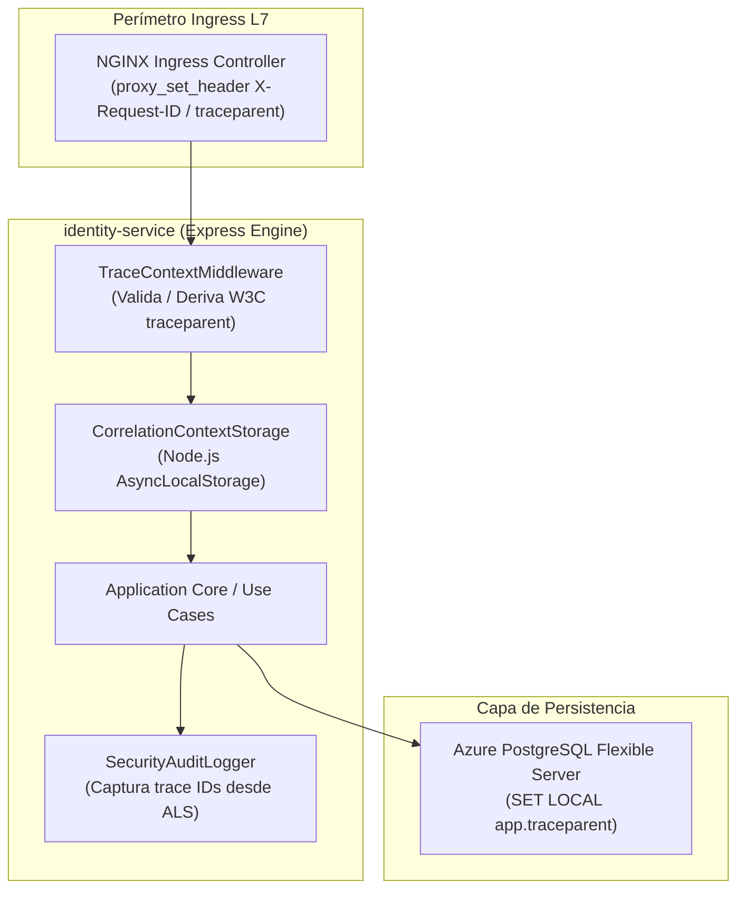

# EPIC-08: Distributed Observability & Request Correlation

* **ID:** EPIC-08
* **Bounded Context:** `observability` / `telemetry` / `infrastructure`
* **Estado:** Completed
* **Arquitectura:** W3C Distributed Tracing / OpenTelemetry Semantic Conventions / Node.js AsyncLocalStorage / Active Dependency Probing
* **Topología de Referencia:** [`.agent/TREE.txt`](../../TREE.txt)
* **Plataforma de Ejecución:** Microsoft Azure / Kubernetes (AKS) / NGINX Ingress / PostgreSQL
* **Estándares Técnicos:** W3C Trace Context (Recommendation 2021) · OpenTelemetry Specification · RFC 7230 / RFC 7231

> **Objetivo Estratégico:**  
> Garantizar la trazabilidad y observabilidad distribuida de extremo a extremo para cada petición entrante a `identity-service` sin dependencias de APMs propietarios externos, inyectando y propagando identificadores de traza estándar (W3C `traceparent` y `X-Request-ID`) a través del Ingress L7, el ciclo de vida asíncrono de Express y las conexiones de PostgreSQL, complementado con métricas de rendimiento OpenTelemetry y sondas activas de salud.

---

## 1. Visión y Marco Técnico

En arquitecturas distribuidas de microservicios y plataformas de identidad de alto tráfico, diagnosticar cuellos de botella, errores intermitentes o transacciones de base de datos lentas requiere que cada operación comparta un contexto de traza inmutable y correlacionado.

La **EPIC-08** implementa la infraestructura de observabilidad bajo 3 pilares esenciales:
1. **Correlación Distribuida (US-20):** Inyección, parseo y propagación del estándar W3C Trace Context (`traceparent`) y `X-Request-ID` desde el balanceador de carga hasta las consultas de PostgreSQL.
2. **Métricas Estructuradas OpenTelemetry (US-21):** Emisión de métricas estándar de latencia, rendimiento y Golden Signals en formato OpenTelemetry.
3. **Sondas Activas de Infraestructura y Readiness (US-22):** Endpoints `/health/liveness` y `/health/readiness` con verificación profunda y tolerante a fallos de dependencias (PostgreSQL, Azure Key Vault, Redis).

---

## 2. Resumen Ejecutivo de Historias de Usuario

| Historia | Archivo de Especificación | Alcance y Entregable Técnico | Estándar / Norma | Estado |
| :--- | :--- | :--- | :--- | :--- |
| **US-20** | [`US-20-distributed-request-id-tracing.md`](stories/US-20-distributed-request-id-tracing.md) | Inyección y propagación de `X-Request-ID` y W3C `traceparent` a través de Ingress, Express `AsyncLocalStorage` y PostgreSQL session context (`SET LOCAL app.traceparent`). | **W3C Trace Context** **RFC 7230** | Completed |
| **US-21** | [`US-21-opentelemetry-structured-metrics.md`](stories/US-21-opentelemetry-structured-metrics.md) | Instrumentación de métricas de rendimiento y Golden Signals con OpenTelemetry SDK en Node.js. | **OpenTelemetry** | Completed |
| **US-22** | [`US-22-infrastructure-health-readiness-probes.md`](stories/US-22-infrastructure-health-readiness-probes.md) | Sondas `/health/live` y `/health/ready` con chequeo activo no bloqueante de PostgreSQL y Key Vault. | **Kubernetes Probes** | Completed |

---

## 3. Topología de Observabilidad y Trazabilidad

