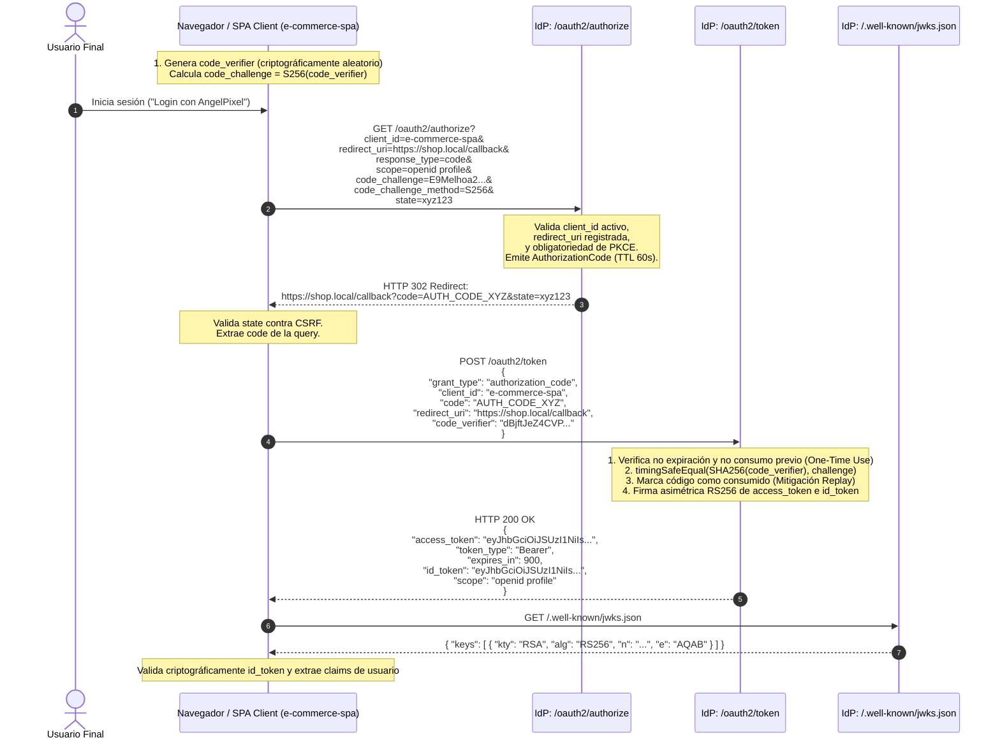

# Guía de Pruebas Interactivas: US-08 (OAuth2 Authorization Code Flow con PKCE)

> **Document ID:** `GUIDELINE-09-oauth2-authorization-code-pkce`  
> **Bounded Context:** `identity` / `oauth2` / `oidc` / `crypto`  
> **Historia de Usuario:** [US-08: Flujo de Código de Autorización con PKCE y Consentimiento](../epics/EPIC-04-oidc-server-sessions/stories/US-08-auth-code-pkce-flow.md)  
> **Estándares RFC:** [RFC 6749 (The OAuth 2.0 Authorization Framework)](https://datatracker.ietf.org/doc/html/rfc6749), [RFC 7636 (Proof Key for Code Exchange by OAuth Public Clients)](https://datatracker.ietf.org/doc/html/rfc7636), [OpenID Connect Core 1.0](https://openid.net/specs/openid-connect-core-1_0.html), [RFC 7519 (JSON Web Token - JWT)](https://datatracker.ietf.org/doc/html/rfc7519)  
> **Componentes Principales:**
> - `OAuth2AuthorizeController` ([`interfaces/http/rest/v1/oauth2/authorize_controller.ts`](../../interfaces/http/rest/v1/oauth2/authorize_controller.ts))
> - `OAuth2TokenController` ([`interfaces/http/rest/v1/oauth2/token_controller.ts`](../../interfaces/http/rest/v1/oauth2/token_controller.ts))
> - `IssueAuthorizationCodeCommandHandler` ([`src/contexts/identity/application/commands/issue_authorization_code/handler.ts`](../../src/contexts/identity/application/commands/issue_authorization_code/handler.ts))
> - `ExchangeAuthorizationCodeCommandHandler` ([`src/contexts/identity/application/commands/exchange_authorization_code/handler.ts`](../../src/contexts/identity/application/commands/exchange_authorization_code/handler.ts))
> - `PkceValidator` ([`src/contexts/identity/domain/services/pkce_validator.ts`](../../src/contexts/identity/domain/services/pkce_validator.ts))
> - `AuthorizationCode` ([`src/contexts/identity/domain/entities/authorization_code/entity.ts`](../../src/contexts/identity/domain/entities/authorization_code/entity.ts))
> - `InMemoryAuthorizationCodeRepository` ([`src/contexts/identity/infrastructure/persistence/repositories/authorization_code/in_memory_repository.ts`](../../src/contexts/identity/infrastructure/persistence/repositories/authorization_code/in_memory_repository.ts))
> - `OAuth2Resource` ([`sdks/typescript/src/resources/oauth2_resource.ts`](../../sdks/typescript/src/resources/oauth2_resource.ts))

---

## 1. Visión General del Flujo

Esta guía detalla los procedimientos exhaustivos y comandos paso a paso para interactuar, validar y verificar en un entorno local o de pruebas el **Flujo de Código de Autorización con PKCE (Proof Key for Code Exchange, RFC 7636)** y emisión de tokens asimétricos **RS256** (`access_token` e `id_token`), completado en **US-08**.

### El Problema de Seguridad en Clientes Públicos (SPA y Mobile)

En aplicaciones de página única (SPA en React, Angular, Vue) y aplicaciones móviles nativas (iOS, Android), el código se ejecuta en el dispositivo o navegador del usuario final. En este entorno:
1. **Incapacidad de Custodiar Secretos:** Los clientes públicos no pueden almacenar de forma segura un `client_secret`. Cualquier secreto compilado en la aplicación puede ser desensamblado o extraído mediante herramientas de desarrollo.
2. **Ataque de Interceptación de Código de Autorización:** Cuando el servidor de autorización redirige al usuario de vuelta a la aplicación con el `code` en la URL (`redirect_uri`), un software malicioso en el dispositivo (ej. registro malicioso de esquemas de URL o espionaje del historial de navegación) puede interceptar el `code`.
3. **Canje No Autorizado:** Si el flujo no requiriese un secreto ni una prueba dinámica, el atacante que robó el `code` podría canjearlo directamente en el endpoint de tokens y obtener los tokens de acceso de la víctima.

### La Solución: PKCE (RFC 7636)

PKCE resuelve este vector de ataque introduciendo un secreto dinámico y efímero generado por sesión en el cliente:
- **`code_verifier`:** Una cadena criptográfica aleatoria de alta entropía (43 a 128 caracteres del conjunto `[A-Za-z0-9-._~]`) que permanece estrictamente en la memoria del cliente legítimo.
- **`code_challenge`:** La transformación criptográfica del verificador: `BASE64URL(SHA256(ASCII(code_verifier)))`.
- **`code_challenge_method`:** El algoritmo criptográfico (`S256`).

Al solicitar la autorización, el cliente envía únicamente el `code_challenge`. Cuando posteriormente canjea el código en `/oauth2/token`, envía el `code_verifier` original. El servidor de autorización valida que `SHA256(code_verifier) === code_challenge`. Un atacante que haya interceptado el código de autorización en la redirección no podrá canjearlo porque desconoce el `code_verifier`.

---

## 2. Diagrama de Secuencia de Arquitectura (OIDC + PKCE)



---

## 3. Preparación del Entorno

### Paso 3.1: Levantar el Servicio de Identidad

Inicia el entorno de desarrollo mediante npm o Docker:

```bash
# Opción 1: Desarrollo local interactivo
npm run dev

# Opción 2: Contenedor Docker Compose
docker compose up -d identity-api
```

Verifica la disponibilidad del servidor en `http://localhost:4000`:

```bash
curl -I http://localhost:4000/.well-known/openid-configuration
```

Salida esperada:
```http
HTTP/1.1 200 OK
Content-Type: application/json; charset=utf-8
Access-Control-Allow-Origin: *
Cache-Control: public, max-age=3600, stale-while-revalidate=86400
```

---

## 4. Pruebas Interactivas Paso a Paso

### Prueba 4.1: Generación de Vectores PKCE (RFC 7636 Apéndice B)

En un cliente SPA, el `code_verifier` y `code_challenge` se generan dinámicamente utilizando la API Web Cryptography (`window.crypto.subtle`):

```typescript
// Script auxiliar de prueba en TypeScript / Node.js
import crypto from 'crypto';

// 1. Generar 32 bytes aleatorios y codificarlos en Base64URL (43 caracteres)
const codeVerifier = crypto.randomBytes(32).toString('base64url');
console.log('Code Verifier:', codeVerifier);

// 2. Calcular SHA-256 y codificar en Base64URL
const codeChallenge = crypto
  .createHash('sha256')
  .update(codeVerifier, 'ascii')
  .digest('base64url');
console.log('Code Challenge (S256):', codeChallenge);
```

Para las pruebas manuales siguientes, utilizaremos el vector de prueba normativo del RFC 7636:
- **`code_verifier`:** `dBjftJeZ4CVP-mB92K27uhbUJU1p1r_wW1gFWFOEjXk`
- **`code_challenge`:** `E9Melhoa2OwvFrEMTJguCHaoeK1t8URWbuGJSstw-cM`
- **`code_challenge_method`:** `S256`

---

### Prueba 4.2: Solicitar Código de Autorización (GET /oauth2/authorize)

Ejecuta una solicitud de autorización emulando un navegador que redirige a un cliente registrado (`e-commerce-spa`):

```bash
curl -i "http://localhost:4000/oauth2/authorize?\
response_type=code&\
client_id=e-commerce-spa&\
redirect_uri=https://shop.local/callback&\
scope=openid%20profile&\
code_challenge=E9Melhoa2OwvFrEMTJguCHaoeK1t8URWbuGJSstw-cM&\
code_challenge_method=S256&\
state=session-anti-csrf-999"
```

#### Respuesta Esperada (HTTP 302 Found):
```http
HTTP/1.1 302 Found
Location: https://shop.local/callback?code=SPLAP_AUTH_CODE_HERE&state=session-anti-csrf-999
Date: Mon, 09 Nov 2026 21:00:00 GMT
Connection: keep-alive
```

> **Modo API / JSON:** Si envías la cabecera `Accept: application/json` (o utilizas `POST /oauth2/authorize`), el IdP responde con `200 OK` y el payload JSON directamente:
> ```json
> {
>   "code": "A3fX9...kL2",
>   "redirect_uri": "https://shop.local/callback",
>   "state": "session-anti-csrf-999",
>   "callback_url": "https://shop.local/callback?code=A3fX9...kL2&state=session-anti-csrf-999"
> }
> ```

---

### Prueba 4.3: Canjear Código por Tokens RS256 (POST /oauth2/token)

Toma el valor del parámetro `code` recibido en la redirección anterior y realiza el canje enviando el `code_verifier` correspondiente:

```bash
# Reemplaza <CODIGO_OBTENIDO> por el código real obtenido en el paso anterior
AUTH_CODE="<CODIGO_OBTENIDO>"

curl -s -X POST http://localhost:4000/oauth2/token \
  -H "Content-Type: application/json" \
  -d "{
    \"grant_type\": \"authorization_code\",
    \"client_id\": \"e-commerce-spa\",
    \"code\": \"$AUTH_CODE\",
    \"redirect_uri\": \"https://shop.local/callback\",
    \"code_verifier\": \"dBjftJeZ4CVP-mB92K27uhbUJU1p1r_wW1gFWFOEjXk\"
  }" | jq .
```

#### Respuesta Esperada (HTTP 200 OK):
```json
{
  "access_token": "eyJhbGciOiJSUzI1NiIsImtpZCI6ImtleS1iOTAyYjEyM2ZmZTciLCJ0eXAiOiJKV1QifQ...",
  "token_type": "Bearer",
  "expires_in": 900,
  "id_token": "eyJhbGciOiJSUzI1NiIsImtpZCI6ImtleS1iOTAyYjEyM2ZmZTciLCJ0eXAiOiJKV1QifQ...",
  "scope": "openid profile"
}
```

#### Inspección de Claims del `id_token` (OpenID Connect):

Decodifica el segmento payload del `id_token`:

```bash
# Decodificar el segmento 2 (payload) del JWT
echo "<ID_TOKEN>" | cut -d. -f2 | base64 -d 2>/dev/null | jq .
```

Claims retornados:
```json
{
  "sub": "user-session-default",
  "iss": "http://localhost:4000",
  "aud": "e-commerce-spa",
  "tenantId": "tenant-session-default",
  "iat": 1794270000,
  "exp": 1794270900
}
```

---

## 5. Pruebas Negativas y Vectores de Penetración

### Vector 5.1: Verificador PKCE Erróneo (`invalid_grant`)

Si un cliente envía un `code_verifier` que no coincide con el `code_challenge` registrado durante la autorización:

```bash
# 1. Obtener código nuevo
CODE=$(curl -s "http://localhost:4000/oauth2/authorize?response_type=code&client_id=e-commerce-spa&redirect_uri=https://shop.local/callback&code_challenge=E9Melhoa2OwvFrEMTJguCHaoeK1t8URWbuGJSstw-cM&code_challenge_method=S256" -H "Accept: application/json" | jq -r .code)

# 2. Intentar canjear con un verifier incorrecto (pero de longitud válida 43+ chars)
curl -s -X POST http://localhost:4000/oauth2/token \
  -H "Content-Type: application/json" \
  -d "{
    \"grant_type\": \"authorization_code\",
    \"client_id\": \"e-commerce-spa\",
    \"code\": \"$CODE\",
    \"redirect_uri\": \"https://shop.local/callback\",
    \"code_verifier\": \"wrong_verifier_string_at_least_43_characters_long_for_testing\"
  }" | jq .
```

#### Respuesta Esperada (HTTP 400 Bad Request):
```json
{
  "error": "invalid_grant",
  "error_description": "code_verifier does not match code_challenge"
}
```

> **Comportamiento Defensivo:** El código de autorización es consumido de inmediato en el servidor ante el primer fallo para neutralizar intentos de fuerza bruta sobre el `code_verifier`.

---

### Vector 5.2: Detección de Ataque de Replay (`code_reuse_violation`)

Si un atacante o cliente intercepta y vuelve a presentar un código que ya fue canjeado con éxito:

```bash
# Reutilizar el mismo código AUTH_CODE canjeado en la Prueba 4.3
curl -s -X POST http://localhost:4000/oauth2/token \
  -H "Content-Type: application/json" \
  -d "{
    \"grant_type\": \"authorization_code\",
    \"client_id\": \"e-commerce-spa\",
    \"code\": \"$AUTH_CODE\",
    \"redirect_uri\": \"https://shop.local/callback\",
    \"code_verifier\": \"dBjftJeZ4CVP-mB92K27uhbUJU1p1r_wW1gFWFOEjXk\"
  }" | jq .
```

#### Respuesta Esperada (HTTP 400 Bad Request):
```json
{
  "error": "invalid_grant",
  "error_description": "Authorization code has already been consumed (replay attack detected)"
}
```

> **Registro de Auditoría:** El sistema emite inmediatamente un evento estructurado de seguridad:
> ```json
> {
>   "eventType": "code_reuse_violation",
>   "clientId": "e-commerce-spa",
>   "reason": "Authorization code has already been consumed (replay attack detected)",
>   "metadata": { "code": "...", "ip": "..." }
> }
> ```

---

### Vector 5.3: Cliente Público sin `code_challenge` (`invalid_request`)

Si una aplicación pública intenta iniciar un flujo de autorización omitiendo el desafío PKCE:

```bash
curl -s "http://localhost:4000/oauth2/authorize?\
response_type=code&\
client_id=e-commerce-spa&\
redirect_uri=https://shop.local/callback" | jq .
```

#### Respuesta Esperada (HTTP 400 Bad Request):
```json
{
  "error": "invalid_request",
  "error_description": "code_challenge is required for public clients (RFC 7636 PKCE)"
}
```

---

### Vector 5.4: Desajuste de `redirect_uri` no Registrada

Si un atacante intenta enviar un URI de redirección ajeno para robar el código:

```bash
curl -s "http://localhost:4000/oauth2/authorize?\
response_type=code&\
client_id=e-commerce-spa&\
redirect_uri=https://attacker-phishing.site/callback&\
code_challenge=E9Melhoa2OwvFrEMTJguCHaoeK1t8URWbuGJSstw-cM&\
code_challenge_method=S256" | jq .
```

#### Respuesta Esperada (HTTP 400 Bad Request):
```json
{
  "error": "invalid_request",
  "error_description": "The redirect_uri \"https://attacker-phishing.site/callback\" is not authorized for this client."
}
```

---

## 6. Integración con el SDK Oficial (`@angelpixel-core/identity-sdk`)

El SDK de TypeScript simplifica el flujo completo a dos llamadas fuertemente tipadas:

```typescript
import { IdentityServiceClient } from '@angelpixel-core/identity-sdk';

const client = new IdentityServiceClient({
  baseUrl: 'https://auth.angelpixel.io',
});

// Paso 1: Generar la URL segura para redirigir al usuario en el frontend
const authorizationUrl = client.oauth2.buildAuthorizationUrl({
  baseUrl: 'https://auth.angelpixel.io',
  clientId: 'e-commerce-spa',
  redirectUri: 'https://shop.local/callback',
  scope: 'openid profile email',
  state: 'random-anti-csrf-token',
  codeChallenge: 'E9Melhoa2OwvFrEMTJguCHaoeK1t8URWbuGJSstw-cM',
  codeChallengeMethod: 'S256',
  nonce: 'unique-session-nonce',
});

console.log('Redirigir navegador a:', authorizationUrl);
// window.location.href = authorizationUrl;

// Paso 2: En la ruta de callback (/callback), canjear el código
const tokens = await client.oauth2.exchangeAuthorizationCode({
  clientId: 'e-commerce-spa',
  code: callbackCodeFromQuery,
  redirectUri: 'https://shop.local/callback',
  codeVerifier: storedCodeVerifierFromSession,
});

console.log('Access Token (RS256):', tokens.access_token);
console.log('ID Token (OIDC):', tokens.id_token);
console.log('Expira en (segundos):', tokens.expires_in);
```

---

## 7. Tabla Resumen de Diagnóstico y Errores Comunes

| Código HTTP | Error OAuth2 (`error`) | Causa Frecuente | Solución Inmediata |
|---|---|---|---|
| `400` | `invalid_request` | Cliente público omitió `code_challenge`. | Incluir `code_challenge` y `code_challenge_method=S256`. |
| `400` | `invalid_request` | El `redirect_uri` no está en la lista blanca de la aplicación cliente. | Registrar la URL en `redirect_uris` del cliente en el registro IdP. |
| `400` | `invalid_grant` | `code_verifier` no corresponde criptográficamente al `code_challenge`. | Comprobar que se está enviando el mismo verifier que originó el hash S256. |
| `400` | `invalid_grant` | El código de autorización ya fue consumido (*Replay Attack*). | Los códigos son de uso único. Iniciar un nuevo flujo de autorización. |
| `400` | `invalid_grant` | El código de autorización ha superado su TTL (60 segundos). | Canjear el código inmediatamente tras recibir la redirección del navegador. |
| `400` | `unsupported_response_type` | Parámetro `response_type` distinto de `code`. | Enviar exactamente `response_type=code`. |
| `401` | `invalid_client` | El `client_id` no existe en el sistema o está desactivado. | Verificar el identificador o reactivar el cliente en la base de datos. |
| `401` | `invalid_client` | Cliente confidencial envió un `client_secret` incorrecto. | Corregir credenciales en Basic Auth o en el cuerpo de la petición. |
