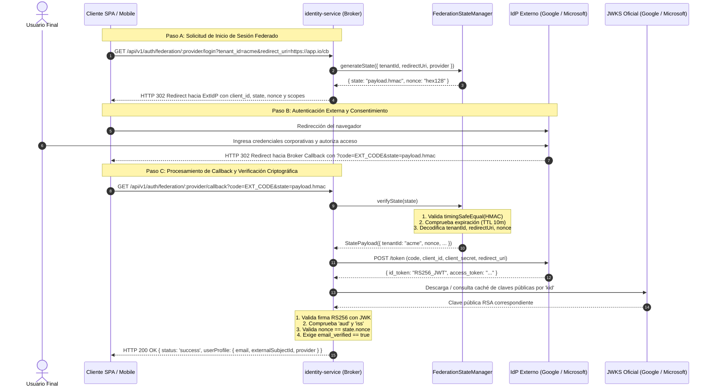

# Guía de Pruebas Interactivas: US-10 (Conectores OIDC Externos Google & Microsoft Entra ID)

> **Document ID:** `GUIDELINE-11-external-oidc-connectors`  
> **Bounded Context:** `identity` / `federation` / `security`  
> **Historia de Usuario:** [US-10: External OIDC Provider Connectors](../epics/EPIC-05-identity-federation/stories/US-10-external-oidc-connectors.md)  
> **Plan de Refactorización:** [US-10: Refactoring Plan Inside-Out](../epics/EPIC-05-identity-federation/stories/US-10-external-oidc-refactoring-plan.md)  
> **Estándares RFC:** [OpenID Connect Core 1.0](https://openid.net/specs/openid-connect-core-1_0.html), [RFC 7517 (JSON Web Key Set - JWKS)](https://datatracker.ietf.org/doc/html/rfc7517), [RFC 6749 §10.12 (Cross-Site Request Forgery Protection)](https://datatracker.ietf.org/doc/html/rfc6749#section-10.12), [OAuth 2.0 Security BCP (Nonce Validation)](https://datatracker.ietf.org/doc/html/draft-ietf-oauth-security-topics)  
> **Componentes Principales:**
> - `FederationController` ([`interfaces/http/rest/v1/federation/federation_controller.ts`](../../interfaces/http/rest/v1/federation/federation_controller.ts))
> - `ExternalIdentityProviderPort` ([`src/contexts/identity/domain/ports/external_identity_provider_port.ts`](../../src/contexts/identity/domain/ports/external_identity_provider_port.ts))
> - `FederationStateManager` ([`src/contexts/identity/infrastructure/federation/federation_state_manager.ts`](../../src/contexts/identity/infrastructure/federation/federation_state_manager.ts))
> - `GoogleOidcAdapter` ([`src/contexts/identity/infrastructure/federation/google_oidc_adapter.ts`](../../src/contexts/identity/infrastructure/federation/google_oidc_adapter.ts))
> - `MicrosoftEntraAdapter` ([`src/contexts/identity/infrastructure/federation/microsoft_entra_adapter.ts`](../../src/contexts/identity/infrastructure/federation/microsoft_entra_adapter.ts))
> - `JwksTokenVerifier` ([`src/contexts/identity/infrastructure/federation/jwks_token_verifier.ts`](../../src/contexts/identity/infrastructure/federation/jwks_token_verifier.ts))
> - `FederationResource` ([`sdks/typescript/src/resources/federation_resource.ts`](../../sdks/typescript/src/resources/federation_resource.ts))

---

## 1. Visión General del Patrón Identity Broker y Modelo de Seguridad

En ecosistemas multiorganizacionales y SaaS modernos, exigir a los usuarios que creen y recuerden contraseñas adicionales introduce fricción operativa y riesgos de seguridad (reuso de contraseñas débiles, filtración de credenciales).

El **Patrón Identity Broker** implementado en `identity-service` actúa como puente federado entre las aplicaciones satélites cliente y los proveedores de identidad corporativos de terceros (**Google Workspace** y **Microsoft Entra ID / 365**).

```
[Cliente Web / Mobile] 
        │
        ▼ (1. Iniciar login federado con tenant)
[identity-service Broker] 
        │
        ▼ (2. Redirección con state firmado & nonce)
[IdP Externo: Google / Microsoft] 
        │
        ▼ (3. Consentimiento y Callback con code & state)
[identity-service Broker] 
        │  ├── Verifica state anti-CSRF (HMAC-SHA256)
        │  ├── Intercambia code por ID Token
        │  └── Valida firma RS256 contra JWKS oficial
        ▼ (4. Perfil normalizado verificado listo para US-11)
[JIT Provisioning & Native Session Issuance]
```

### Invariantes de Seguridad y Mitigación de Vectores de Ataque

1. **Protección Anti-CSRF (`state` criptográfico):**
   - Un atacante podría interceptar un flujo de autorización o engañar al usuario para vincular una cuenta externa controlada por el atacante.
   - Para neutralizarlo, `identity-service` genera un parámetro `state` estructurado como `base64url(payload).hmacSignature` firmado con la clave secreta del servidor.
   - El payload encapsula `tenantId`, `clientId`, `redirectUri`, `provider`, `nonce`, timestamp y TTL de 10 minutos.
   - En el callback, la firma se verifica mediante `crypto.timingSafeEqual` (eliminando ataques de canal lateral, CWE-208) y se comprueba la expiración.
2. **Protección Anti-Replay (`nonce` criptográfico):**
   - El broker genera un `nonce` aleatorio de 128 bits transmitido al IdP externo.
   - El ID Token emitido por Google o Microsoft incluye obligatoriamente este claim `nonce`. El adaptador valida su exacta coincidencia.
3. **Validación Criptográfica Descentralizada de ID Tokens (JWKS Oficial):**
   - El ID Token recibido se valida contra las claves públicas publicadas en los endpoints JWKS oficiales:
     - Google: `https://www.googleapis.com/oauth2/v3/certs`
     - Microsoft: `https://login.microsoftonline.com/common/discovery/v2.0/keys`
   - El verificador `JwksTokenVerifier` implementa revalidación en caliente ante `kid miss`, tolerando rotaciones dinámicas de claves sin cortes de servicio (*zero downtime*).
4. **Verificación Mandatoria de Correo Electrónico (`email_verified: true`):**
   - Se rechaza terminantemente cualquier cuenta externa cuyo correo no haya sido certificado por el proveedor (`email_verified !== true`), impidiendo que un atacante suplante una cuenta creando un correo no verificado en el proveedor externo.

---

## 2. Diagrama de Secuencia de 3 Vías



---

## 3. Configuración de Credenciales en Proveedores Externos

Para entornos de staging o producción, registrar las aplicaciones en las consolas de desarrolladores correspondientes:

### 3.1. Google Cloud Console
1. Acceder a [Google Cloud Console > APIs & Services > Credentials](https://console.cloud.google.com/apis/credentials).
2. Crear un **OAuth 2.0 Client ID** de tipo **Web application**.
3. Configurar:
   - **Authorized redirect URIs:**
     - Desarrollo: `http://localhost:3000/api/v1/auth/federation/google/callback`
     - Producción: `https://id.angelpixel.io/api/v1/auth/federation/google/callback`
4. Copiar `Client ID` y `Client Secret` en el archivo `.env`:
   ```bash
   GOOGLE_CLIENT_ID="123456789-abc.apps.googleusercontent.com"
   GOOGLE_CLIENT_SECRET="GOCSPX-xxxxxxxxxxxxxxxx"
   ```

### 3.2. Microsoft Entra ID (Azure Portal)
1. Acceder a [Microsoft Entra ID > App registrations](https://portal.azure.com/#view/Microsoft_AAD_IAM/ActiveDirectoryMenuBlade/~/RegisteredApps).
2. Seleccionar **New registration**:
   - **Supported account types:** *Accounts in any organizational directory (Multitenant) and personal Microsoft accounts* (o específico de la organización).
   - **Redirect URI (Web):**
     - Desarrollo: `http://localhost:3000/api/v1/auth/federation/microsoft/callback`
     - Producción: `https://id.angelpixel.io/api/v1/auth/federation/microsoft/callback`
3. En **Certificates & secrets**, generar un nuevo Client Secret.
4. Copiar en `.env`:
   ```bash
   MICROSOFT_CLIENT_ID="00000000-0000-0000-0000-000000000000"
   MICROSOFT_CLIENT_SECRET="xxx~xxxxxxxxxxxxxxxxxxxx"
   MICROSOFT_TENANT_ID="common" # o ID del tenant corporativo
   ```

---

## 4. Vectores de Prueba Interactiva (Ejecutables y Reproducibles)

### Requisitos Previos: Iniciar el Servicio Localmente
En una terminal:
```bash
npm run dev:api
# Identity Service HTTP Server listening on port 3000
```

---

### Vector 1: Generación de URL de Login Federada con `state` y `nonce` Criptográficos

**Objetivo:** Solicitar el inicio de sesión federado para Google y verificar que se emita la URL de autorización con los parámetros anti-CSRF y anti-replay.

```bash
curl -s -X GET "http://localhost:3000/api/v1/auth/federation/google/login?tenant_id=acme-corp&client_id=web-portal&redirect_uri=https://portal.acme.com/auth/callback&format=json" \
  -H "Accept: application/json" | jq
```

**Respuesta Esperada (HTTP 200 OK):**
```json
{
  "url": "https://accounts.google.com/o/oauth2/v2/auth?client_id=...&redirect_uri=https%3A%2F%2Fportal.acme.com%2Fauth%2Fcallback&response_type=code&scope=openid+email+profile&state=eyJ0ZW5hbnRJZCI6...&nonce=4a1f8b...&access_type=offline&prompt=consent",
  "state": "eyJ0ZW5hbnRJZCI6ImFjbWUtY29ycCIsImNsaWVudElkIjoid2ViLXBvcnRhbCIsInJlZGlyZWN0VXJpIjoiaHR0cHM6Ly9wb3J0YWwuYWNtZS5jb20vYXV0aC9jYWxsYmFjayIsInByb3ZpZGVyIjoiZ29vZ2xlIiwibm9uY2UiOiI0YTFmOGI0YzQ4...In0.qW2f5K...",
  "nonce": "4a1f8b4c4891a27e"
}
```

**Inspección del Token `state`:**
Ejecutar en Node.js para constatar que el payload contiene el contexto de tenant sin fugas de secretos:
```bash
node -e '
  const state = process.argv[1];
  const [payloadB64, sig] = state.split(".");
  const decoded = JSON.parse(Buffer.from(payloadB64, "base64url").toString());
  console.log("Decoded State Payload:", decoded);
' "$STATE_VALUE"
```

---

### Vector 2: Detección y Mitigación de Ataques CSRF (State Alterado o Expirado)

**Objetivo:** Intentar enviar un callback con un token `state` manipulado o una firma forjada.

#### Prueba 2.1: Firma Forjada / Manipulada
```bash
TAMPERED_STATE="eyJ0ZW5hbnRJZCI6ImFjbWUtY29ycCJ9.forged_signature_xyz"

curl -s -X GET "http://localhost:3000/api/v1/auth/federation/google/callback?code=mock_auth_code&state=$TAMPERED_STATE" | jq
```

**Respuesta Esperada (HTTP 400 Bad Request):**
```json
{
  "error": "invalid_request",
  "error_description": "Anti-CSRF state verification failed: Invalid state token: signature verification failed"
}
```

#### Prueba 2.2: Ausencia de Parámetros Requeridos
```bash
curl -s -X GET "http://localhost:3000/api/v1/auth/federation/google/callback?code=only_code_without_state" | jq
```

**Respuesta Esperada (HTTP 400 Bad Request):**
```json
{
  "error": "invalid_request",
  "error_description": "state is required"
}
```

---

### Vector 3: Detección y Mitigación de Replay Attacks con `nonce` Criptográfico

**Objetivo:** Validar que si un atacante intercepta un ID Token y lo reutiliza en un flujo donde el `nonce` del `state` no coincide con el `nonce` firmado dentro del token, el sistema aborte la operación.

Podemos verificar este comportamiento ejecutando el test unitario aislado:
```bash
npx jest tests/unit/identity/infrastructure/federation/test_google_oidc_adapter.ts -t "should throw if nonce does not match"
```

**Salida Esperada:**
```
PASS tests/unit/identity/infrastructure/federation/test_google_oidc_adapter.ts
  Unit: GoogleOidcAdapter (Google IdP Connector)
    exchangeCodeAndVerifyToken
      ✓ should throw if nonce does not match (Error: ID Token nonce does not match original request nonce)
```

---

### Vector 4: Validación Criptográfica de Firma de ID Token contra JWKS Oficial

**Objetivo:** Demostrar que un ID Token forjado (firmado con una clave RSA ajena que no está publicada en el JWKS oficial del proveedor) es rechazado inmediatamente.

Ejecutar la suite de prueba de penetración criptográfica:
```bash
npx jest tests/unit/identity/infrastructure/federation/test_jwks_token_verifier.ts -t "should reject when kid is unknown"
```

**Salida Esperada:**
```
PASS tests/unit/identity/infrastructure/federation/test_jwks_token_verifier.ts
  Unit: JwksTokenVerifier (JWKS Cache, Auto-Refresh & Retry)
    verifyIdToken
      ✓ should reject when kid is unknown and cannot be fetched (Error: key ID "unknown-key-id" not found in JWKS)
```

---

### Vector 5: Validación Mandatoria de Correo Verificado (`email_verified: true`)

**Objetivo:** Si una cuenta externa en Google o Microsoft no tiene certificado su correo (`email_verified: false`), el Identity Broker rechaza el canje con `invalid_grant`, protegiendo la identidad del tenant contra apropiación de cuentas.

Ejecutar el test interactivo:
```bash
npx jest tests/acceptance/step_defs/test_external_oidc_connectors_steps.ts -t "Reject callback when external profile email is not verified"
```

**Salida Esperada:**
```
PASS tests/acceptance/step_defs/test_external_oidc_connectors_steps.ts
  Feature: External OIDC Provider Connectors (Google & Microsoft Entra ID - US-10)
    Scenario: Reject callback when external profile email is not verified
      ✓ should reject callback with 401 when email_verified is false
```

---

## 5. Uso con el SDK Oficial de TypeScript (`@angelpixel/identity-sdk`)

El SDK de TypeScript expone el recurso `federation` en `IdentityServiceClient`:

```typescript
import { IdentityServiceClient } from '@angelpixel/identity-sdk';

const client = new IdentityServiceClient({
  baseUrl: 'https://id.angelpixel.io',
});

// 1. Obtener la URL de login y parámetros anti-CSRF para Google
const { url, state, nonce } = await client.federation.getLoginUrl('google', {
  tenantId: 'acme-corp',
  redirectUri: 'https://app.acme.com/auth/callback',
  clientId: 'acme-web-client',
  prompt: 'select_account',
});

// Guardar nonce/state en almacenamiento seguro si es necesario y redirigir
window.location.href = url;

// 2. Procesar el callback tras la redirección del IdP
const callbackResult = await client.federation.processCallback('google', {
  code: authorizationCodeFromQuery,
  state: stateFromQuery,
});

console.log('Usuario Federado Verificado:', callbackResult.userProfile);
// {
//   provider: 'google',
//   externalSubjectId: 'google-sub-12345',
//   email: 'user@acme.com',
//   emailVerified: true,
//   name: 'John Doe',
//   picture: 'https://...'
// }
```

---

## 6. Troubleshooting y Preguntas Frecuentes

| Síntoma / Error | Causa Raíz | Solución Recomendada |
| :--- | :--- | :--- |
| `Unsupported identity provider: "xyz"` | El parámetro `:provider` solo admite `google` o `microsoft`. | Verificar que la ruta sea `/api/v1/auth/federation/google/login` o `/microsoft/login`. |
| `Anti-CSRF state verification failed: signature verification failed` | El token `state` fue alterado en tránsito o firmado con otra clave secreta. | Asegurar que `FEDERATION_STATE_SECRET` o `JWT_SECRET` sea idéntico en todas las instancias de backend. |
| `Invalid state token: state has expired` | El usuario tardó más de 10 minutos (600s) en completar el login en el IdP externo. | Solicitar al usuario reiniciar el flujo de autenticación para obtener un nuevo token `state` fresco. |
| `key ID "..." not found in JWKS` | Google o Microsoft rotaron sus claves y la caché aún no refrescó, o el token fue firmado por un emisor malicioso. | `JwksTokenVerifier` fuerza un refresco automático en caliente tras un `kid miss` (cooldown de 5s). Verificar conectividad de red con los endpoints JWKS oficiales. |
| `Google account email is not verified` | La cuenta de Google utilizada no ha completado la verificación de dirección de correo. | Exigir al usuario que verifique su correo en Google Accounts antes de iniciar sesión. |
