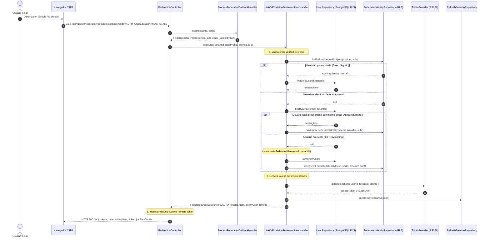

# Guía de Pruebas Interactivas: US-11 (Enlace de Cuentas Federadas y Provisión Just-In-Time)

> **Document ID:** `GUIDELINE-12-federated-account-linking`  
> **Bounded Context:** `identity` / `federation` / `session`  
> **Historia de Usuario:** [US-11: Federated Account Linking and JIT Provisioning](../epics/EPIC-05-identity-federation/stories/US-11-federated-account-linking.md)  
> **Plan de Refactorización:** [US-11: Refactoring Plan Inside-Out](../epics/EPIC-05-identity-federation/stories/US-11-federated-account-linking-refactoring-plan.md)  
> **Estándares RFC:** [OpenID Connect Core 1.0 §3.1.3.7](https://openid.net/specs/openid-connect-core-1_0.html#IDTokenValidation), [RFC 6749 (OAuth 2.0)](https://datatracker.ietf.org/doc/html/rfc6749), [RFC 7519 (JSON Web Token - JWT)](https://datatracker.ietf.org/doc/html/rfc7519), [OWASP Account Linking Cheat Sheet](https://cheatsheetseries.owasp.org/cheatsheets/Authentication_Cheat_Sheet.html)  
> **Componentes Principales:**
> - `FederatedIdentity` ([`src/contexts/identity/domain/entities/federated_identity/aggregate.ts`](../../src/contexts/identity/domain/entities/federated_identity/aggregate.ts))
> - `User` ([`src/contexts/identity/domain/entities/user/aggregate.ts`](../../src/contexts/identity/domain/entities/user/aggregate.ts))
> - `FederatedIdentityRepositoryPort` ([`src/contexts/identity/domain/ports/repositories/federated_identity_repository_port.ts`](../../src/contexts/identity/domain/ports/repositories/federated_identity_repository_port.ts))
> - `PostgresFederatedIdentityRepository` ([`src/contexts/identity/infrastructure/persistence/repositories/federated_identity/postgres_federated_identity_repository.ts`](../../src/contexts/identity/infrastructure/persistence/repositories/federated_identity/postgres_federated_identity_repository.ts))
> - `InMemoryFederatedIdentityRepository` ([`src/contexts/identity/infrastructure/persistence/repositories/federated_identity/in_memory_federated_identity_repository.ts`](../../src/contexts/identity/infrastructure/persistence/repositories/federated_identity/in_memory_federated_identity_repository.ts))
> - `LinkOrProvisionFederatedUserCommandHandler` ([`src/contexts/identity/application/commands/link_or_provision_federated_user/handler.ts`](../../src/contexts/identity/application/commands/link_or_provision_federated_user/handler.ts))
> - `FederationController` ([`interfaces/http/rest/v1/federation/federation_controller.ts`](../../interfaces/http/rest/v1/federation/federation_controller.ts))
> - `FederationResource` ([`sdks/typescript/src/resources/federation_resource.ts`](../../sdks/typescript/src/resources/federation_resource.ts))

---

## 1. Visión General: Arquitectura de 3 Vías de Autenticación Federada

Una vez que el Identity Broker externo (US-10) valida criptográficamente el callback de Google Workspace o Microsoft Entra ID y extrae un `FederatedUserProfile` verificado, el sistema ejecuta la resolución de identidad en **US-11**.

Esta resolución garantiza que los usuarios no sufran fricción de registro manual, a la vez que previene la fragmentación de identidades y mitiga ataques de suplantación de cuentas (*pre-hijacking*).

```
                      [ Callback OIDC Verificado ]
                                   │
                                   ▼
                    ¿email_verified === true? 
                     ├── NO ──> [ HTTP 401 Unauthorized ] (Abortar)
                     │
                     └── SI
                          │
                          ▼
            ¿Existe FederatedIdentity(provider, sub)?
             ├── SI ──> [ 1. Direct Sign-In ]
             │           (Reutiliza usuario, emite sesión nativa)
             │
             └── NO
                  │
                  ▼
            ¿Existe User local con mismo email verificado en el Tenant?
             ├── SI ──> [ 2. Account Linking ]
             │           (Enlaza identidad externa al usuario preexistente)
             │
             └── NO ──> [ 3. Just-In-Time (JIT) Provisioning ]
                         (Crea User con hash protegido + crea FederatedIdentity)
                          │
                          ▼
             [ Emisión de Sesión Nativa: JWT RS256 + RefreshSession Sliding Cookie ]
```

---

## 2. Matriz de Decisión y Reglas de Negocio

| Escenario | Condición en Dominio | Acción de Persistencia | `isNewUser` | `linked` | Emisión de Tokens |
| :--- | :--- | :--- | :--- | :--- | :--- |
| **Email No Verificado** | `userProfile.emailVerified === false` | Ninguna. Se registra alerta en auditoría de seguridad. | N/A | N/A | **Rechazo HTTP 401** |
| **Direct Sign-In** | Existe `FederatedIdentity` con `(provider, sub)` | Ninguna mutación. Se resuelve `User` por clave foránea. | `false` | `false` | Access Token JWT RS256 + HttpOnly Refresh Cookie |
| **Account Linking** | No existe `FederatedIdentity`, pero existe `User` local con el mismo email en el tenant | Se inserta nueva fila en `federated_identities` referenciando al `User.id` preexistente. | `false` | `true` | Access Token JWT RS256 + HttpOnly Refresh Cookie |
| **JIT Provisioning** | No existe ni `FederatedIdentity` ni `User` local previo en el tenant | Se crea `User` con `createFederatedUser` + se inserta `federated_identities`. | `true` | `true` | Access Token JWT RS256 + HttpOnly Refresh Cookie |
| **Multi-Provider** | Mismo usuario local ya enlazado a Google ahora inicia vía Microsoft con email verificado coincidente | Se inserta una segunda fila en `federated_identities` apuntando al mismo `User.id`. | `false` | `true` | Access Token JWT RS256 + HttpOnly Refresh Cookie |
| **Violación Cross-Tenant** | `FederatedIdentity` existe pero pertenece a un `tenant_id` distinto al invocado | Ninguna mutación. Se emite evento `cross_tenant_violation`. | N/A | N/A | **Rechazo HTTP 403/500** |

---

## 3. Políticas Criptográficas y Mitigación de Vulnerabilidades

1. **Mitigación de Ataques de Pre-Hijacking (OWASP Account Linking):**
   - El enlace automático por correo electrónico sólo se autoriza si el proveedor de identidad externo certifica fehacientemente que el correo ha sido verificado (`email_verified: true`). Proveedores abiertos o tokens sin verificación son rechazados de forma fail-closed.
2. **Hash de Contraseña Inalcanzable para Cuentas JIT:**
   - Todo usuario creado vía aprovisionamiento JIT se inicializa mediante `User.createFederatedUser(...)` con un hash de contraseña no evaluable:
     `$2b$12$FEDERATED_NO_LOCAL_PASSWORD_${crypto.randomUUID()}`
   - Esto satisface la restricción `NOT NULL` de la base de datos sin permitir que un atacante intente fuerza bruta local sobre la contraseña. El método de dominio `user.hasLocalPassword()` retorna `false`.
3. **Aislamiento Multi-Tenant con PostgreSQL Row-Level Security (RLS):**
   - La tabla `federated_identities` cuenta con la directiva `apply_tenant_rls('federated_identities')`. Cada transacción se ejecuta bajo la variable de sesión `SET LOCAL app.current_tenant_id = 'tenant-id'`, haciendo imposible que un tenant consulte o vincule identidades de otra organización.
4. **Emisión de Sesión Nativa Desacoplada:**
   - La respuesta del callback federado emite un par completo de tokens nativos:
     - **Access Token:** JWT firmado con algoritmo RS256, incluyendo claims estándar (`sub`, `iss`, `tenant_id`, `provider`, `auth_time`, `exp: 1h`).
     - **Refresh Token:** Token rotatorio criptográfico transmitido mediante cookie `HttpOnly`, `SameSite=Strict` y `Secure`, enlazado a la entidad `RefreshSession` del servidor.

---

## 4. Diagrama de Secuencia de Enlace y Emisión de Sesión



---

## 5. Vectores de Prueba Reproducibles en Vivo

### Preparación del Entorno

Asegúrate de que la base de datos PostgreSQL local esté en ejecución con las migraciones aplicadas:

```bash
# Iniciar servicios de base de datos
npm run docker:up

# Ejecutar el servidor identity-service en modo desarrollo/pruebas
npm run dev
```

---

### Vector 1: Provisión Just-In-Time (JIT) de Nuevo Usuario Federado

Simula la autenticación exitosa de un usuario que nunca antes ha interactuado con la organización `acme-corp`. El sistema aprovisiona automáticamente el usuario local y enlaza su cuenta externa de Google.

#### Ejecución vía cURL

```bash
# 1. Simulación de callback OIDC verificado con state y code válidos
curl -X GET "http://localhost:3000/api/v1/auth/federation/google/callback?code=mock_google_valid_code&state=eyJ0ZW5hbnRJZCI6ImFjbWUtY29ycCIsInByb3ZpZGVyIjoiZ29vZ2xlIn0.valid_hmac_signature" \
  -H "Accept: application/json" \
  -i
```

#### Respuesta Esperada (HTTP 200 OK)

```http
HTTP/1.1 200 OK
Content-Type: application/json; charset=utf-8
Set-Cookie: refresh_token=ref_sec_99a8b7c6d5e4; Path=/; HttpOnly; SameSite=Strict; Max-Age=2592000

{
  "status": "success",
  "provider": "google",
  "isNewUser": true,
  "linked": true,
  "user": {
    "id": "e2a3b4c5-6789-4def-0123-abcdef456789",
    "email": "nuevo.empleado@acme.com",
    "tenantId": "acme-corp"
  },
  "tokens": {
    "accessToken": "eyJhbGciOiJSUzI1NiIsInR5cCI6IkpXVCIsImtpZCI6ImRlZmF1bHQta2V5In0...",
    "tokenType": "Bearer",
    "expiresIn": 3600,
    "refreshToken": "ref_sec_99a8b7c6d5e4"
  }
}
```

#### Ejecución con SDK TypeScript

```typescript
import { IdentityServiceClient } from '@angelpixel-core/identity-sdk';

const client = new IdentityServiceClient({
  baseUrl: 'http://localhost:3000',
  defaultTenantId: 'acme-corp',
});

const result = await client.federation.handleCallback('google', {
  code: 'mock_google_valid_code',
  state: 'signed_state_payload',
});

console.log('JIT Provisioned:', result.isNewUser); // true
console.log('Linked to IdP:', result.linked);       // true
console.log('Access Token:', result.tokens?.accessToken);
```

---

### Vector 2: Enlace de Cuenta con Usuario Local Preexistente por Correo Verificado

Simula un usuario que previamente se registró con usuario y contraseña local (`alice@acme.com`). Al iniciar sesión mediante Google con el mismo correo verificado, la identidad externa se vincula al perfil preexistente sin duplicar el registro en la tabla `users`.

#### Ejecución vía cURL

```bash
# 1. Registrar usuario local inicial
curl -X POST "http://localhost:3000/api/v1/auth/register" \
  -H "Content-Type: application/json" \
  -H "x-tenant-id: acme-corp" \
  -d '{
    "email": "alice@acme.com",
    "password": "PasswordSegura123!"
  }'

# 2. Callback federado de Google con el mismo email verificado alice@acme.com
curl -X GET "http://localhost:3000/api/v1/auth/federation/google/callback?code=mock_code_alice&state=signed_state_acme" \
  -H "Accept: application/json" \
  -i
```

#### Respuesta Esperada (HTTP 200 OK)

```json
{
  "status": "success",
  "provider": "google",
  "isNewUser": false,
  "linked": true,
  "user": {
    "id": "usr-alice-local-uuid",
    "email": "alice@acme.com",
    "tenantId": "acme-corp"
  },
  "tokens": {
    "accessToken": "eyJhbGciOiJSUzI1Ni...",
    "tokenType": "Bearer",
    "expiresIn": 3600
  }
}
```

> **Verificación de Seguridad:** `isNewUser: false` confirma que no se generó un nuevo registro en `users`, y `linked: true` indica que la asociación federada quedó persistida.

---

### Vector 3: Enlace Multi-Proveedor (Google y Microsoft al Mismo Usuario)

Valida que el mismo usuario `alice@acme.com` pueda iniciar sesión indistintamente con su cuenta corporativa de Google Workspace o con su cuenta de Microsoft Entra ID.

#### Ejecución vía cURL

```bash
# Callback con Microsoft Entra ID para alice@acme.com
curl -X GET "http://localhost:3000/api/v1/auth/federation/microsoft/callback?code=mock_code_msft_alice&state=signed_state_msft" \
  -H "Accept: application/json" \
  -i
```

#### Respuesta Esperada (HTTP 200 OK)

```json
{
  "status": "success",
  "provider": "microsoft",
  "isNewUser": false,
  "linked": true,
  "user": {
    "id": "usr-alice-local-uuid",
    "email": "alice@acme.com",
    "tenantId": "acme-corp"
  }
}
```

---

### Vector 4: Inicio de Sesión Directo sin Duplicación

Una vez que una cuenta externa ya fue vinculada, los inicios de sesión subsecuentes no vuelven a mutar la base de datos ni a re-vincular la identidad (`isNewUser: false, linked: false`).

#### Ejecución vía cURL

```bash
# Reingreso con la misma cuenta de Google
curl -X GET "http://localhost:3000/api/v1/auth/federation/google/callback?code=mock_subsequent_login&state=signed_state" \
  -H "Accept: application/json"
```

#### Respuesta Esperada

```json
{
  "status": "success",
  "provider": "google",
  "isNewUser": false,
  "linked": false,
  "user": {
    "id": "usr-alice-local-uuid",
    "email": "alice@acme.com",
    "tenantId": "acme-corp"
  }
}
```

---

### Vector 5: Rechazo Estricto ante Correo No Verificado (`email_verified: false`)

Comprueba que el sistema rechace de inmediato cualquier intento de provisión o enlace cuando el Identity Provider de terceros indica que el correo no ha sido certificado.

#### Ejecución vía cURL

```bash
# Callback simulando IdP externo con email no verificado
curl -X GET "http://localhost:3000/api/v1/auth/federation/google/callback?code=mock_unverified_email_code&state=signed_state" \
  -H "Accept: application/json" \
  -i
```

#### Respuesta Esperada (HTTP 401 Unauthorized)

```http
HTTP/1.1 401 Unauthorized
Content-Type: application/json; charset=utf-8

{
  "error": "unauthorized",
  "message": "External identity provider returned an unverified email address: email_verified must be true"
}
```

---

## 6. Verificación en Base de Datos PostgreSQL y Aislamiento RLS

Para auditar y validar la persistencia en caliente de las identidades federadas vinculadas y verificar que las políticas RLS funcionen correctamente, puedes ejecutar las siguientes consultas interactivas vía `psql`:

```sql
-- 1. Establecer el contexto del tenant
SET LOCAL app.current_tenant_id = 'acme-corp';

-- 2. Inspeccionar identidades federadas del tenant activo
SELECT 
    id,
    user_id,
    tenant_id,
    provider,
    external_subject_id,
    external_email,
    created_at
FROM federated_identities;

-- 3. Verificar que los usuarios JIT tengan un hash de contraseña protegido
SELECT 
    id,
    email,
    tenant_id,
    CASE 
        WHEN password_hash LIKE '$2b$12$FEDERATED_NO_LOCAL_PASSWORD_%' THEN 'JIT_FEDERATED_SECURE'
        ELSE 'LOCAL_PASSWORD'
    END AS account_security_type,
    created_at
FROM users;

-- 4. Demostrar el aislamiento RLS: consultar bajo otro tenant
SET LOCAL app.current_tenant_id = 'competitor-inc';

-- Debe retornar exactamente 0 filas
SELECT COUNT(*) FROM federated_identities;
```

---

## 7. Guía de Resolución de Anomalías (Troubleshooting)

### Síntoma 1: Error `401 Unauthorized: External identity provider returned an unverified email address`
- **Causa Raíz:** La cuenta externa del usuario en Google o Microsoft no tiene el correo confirmado por el proveedor.
- **Remediación:** El usuario debe acceder al portal de su proveedor (Google o Microsoft 365) y completar la verificación del buzón de correo antes de intentar la federación.

### Síntoma 2: Error `Federated identity belongs to another tenant organization`
- **Causa Raíz:** Se intentó autenticar una cuenta federada utilizando un parámetro `tenant_id` diferente al tenant original donde fue provista o enlazada.
- **Remediación:** Los registros federados están confinados a un tenant específico. Si un usuario pertenece a múltiples tenants, debe autenticarse utilizando el subdominio o identificador de su propia organización.

### Síntoma 3: La cookie `refresh_token` no se almacena en el cliente de prueba
- **Causa Raíz:** Las cookies marcadas como `SameSite=Strict` y `HttpOnly` no se almacenan automáticamente en clientes de pruebas automatizadas o peticiones cross-site si no se configuran adecuadamente las opciones de cookies o CORS.
- **Remediación:** En entornos de desarrollo sobre `localhost`, asegurar que el cliente envíe `credentials: 'include'` en solicitudes `fetch()` o utilizar la directiva `-c cookies.txt -b cookies.txt` en comandos cURL.
