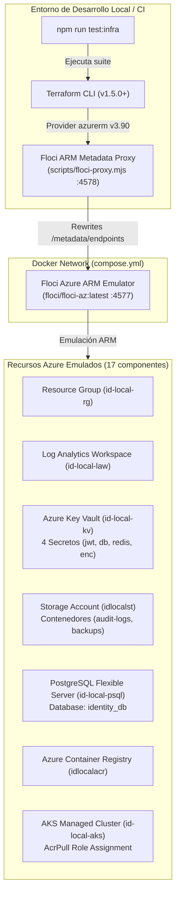

# Guía Técnica de Aprovisionamiento y Pruebas: US-12 (Terraform sobre Floci Azure ARM)

> **Document ID:** `GUIDELINE-13-terraform-floci-provisioning`  
> **Bounded Context:** `infrastructure` / `cloud-provisioning`  
> **Historia de Usuario:** [US-12: Terraform Azure Resources Provisioning over Floci](../epics/EPIC-06-cloud-infrastructure-and-container-orchestration/stories/US-12-terraform-azure-resources-provisioning.md)  
> **Arquitectura & Decisiones:** [ADR 0007: Cloud Infrastructure Topology](../../docs/adr/0007-cloud-infrastructure-topology.md)  
> **Componentes Principales:**
> - Orquestador Local: `compose.yml` (servicio `floci` con imagen `floci/floci-az:latest`)
> - Módulos Terraform Reutilizables:
>   - [`infrastructure/terraform/modules/aks/`](../../infrastructure/terraform/modules/aks/)
>   - [`infrastructure/terraform/modules/postgres/`](../../infrastructure/terraform/modules/postgres/)
>   - [`infrastructure/terraform/modules/keyvault/`](../../infrastructure/terraform/modules/keyvault/)
>   - [`infrastructure/terraform/modules/acr/`](../../infrastructure/terraform/modules/acr/)
>   - [`infrastructure/terraform/modules/storage/`](../../infrastructure/terraform/modules/storage/)
>   - [`infrastructure/terraform/modules/log_analytics/`](../../infrastructure/terraform/modules/log_analytics/)
> - Composición Local: [`infrastructure/terraform/environments/local/`](../../infrastructure/terraform/environments/local/)
> - Proxy de Metadatos ARM: [`scripts/floci-proxy.mjs`](../../scripts/floci-proxy.mjs)
> - Script de Verificación Automatizada: [`scripts/test-terraform-floci.sh`](../../scripts/test-terraform-floci.sh) (`npm run test:infra`)

---

## 1. Visión General: Topología de Infraestructura Emulada

Para validar la infraestructura en código (IaC) de `identity-service` de forma determinista y sin costes en la nube de Azure durante el desarrollo local y CI, se utiliza el emulador de alta fidelidad **Floci Azure ARM** (`floci/floci-az:latest`), orquestado junto a un proxy de metadatos ligero.



---

## 2. Ejecución Automatizada Rápida (Turnkey)

Para ejecutar la validación completa en un solo comando:

```bash
npm run test:infra
```

### Fases que ejecuta el script (`scripts/test-terraform-floci.sh`):
1. **Validación de Formato HCL:** Ejecuta `terraform fmt -check -recursive` asegurando estilo canónico.
2. **Salud del Contenedor:** Comprueba si `floci-azure-arm` está activo; si no, lo inicia mediante `npm run docker:cloud` y valida `GET http://localhost:4577/_floci/health`.
3. **Extracción y Proxy TLS:** Extrae certificados del contenedor a `infrastructure/local/floci/.tls/` y levanta el proxy en el puerto 4578.
4. **Validación Sintáctica:** Ejecuta `terraform validate` en el directorio `environments/local/`.
5. **Generación del Plan:** Ejecuta `terraform plan -no-color` verificando la creación de los 17 recursos de la topología sin errores.

---

## 3. Guía Paso a Paso para Ejecución Manual

### Paso 1: Levantar el Emulador Floci Azure ARM
```bash
npm run docker:cloud
# O directamente: docker compose --profile cloud up -d floci
```

Verificar que el emulador responde:
```bash
curl -f http://localhost:4577/_floci/health
# Respuesta esperada: {"status":"UP"}
```

### Paso 2: Configuración de Confianza TLS en macOS (Una sola vez)
Floci genera un certificado autofirmado con SAN `localhost`. Si el cliente o Terraform reporta `x509: certificate signed by unknown authority`, exportar y confiar en el certificado:

```bash
# Extraer certificado autofirmado de Floci
docker exec floci-azure-arm cat /app/data/tls/floci-az-selfsigned.crt > /tmp/floci-az.crt

# Agregar al llavero local de macOS
security add-trusted-cert -d -r trustRoot -k ~/Library/Keychains/login.keychain-db /tmp/floci-az.crt
rm /tmp/floci-az.crt
```

### Paso 3: Inicializar Terraform
```bash
cd infrastructure/terraform/environments/local
TF_CLI_CONFIG_FILE=/dev/null terraform init
```

### Paso 4: Validar y Formatear
```bash
TF_CLI_CONFIG_FILE=/dev/null terraform fmt -check -recursive ../..
TF_CLI_CONFIG_FILE=/dev/null terraform validate
```
*Salida esperada:* `Success! The configuration is valid.`

### Paso 5: Generar Plan de Infraestructura
Asegurar que el proxy de metadatos está activo en segundo plano:
```bash
# Desde la raíz del proyecto
node scripts/floci-proxy.mjs &
PROXY_PID=$!

# Ejecutar el plan
cd infrastructure/terraform/environments/local
TF_CLI_CONFIG_FILE=/dev/null terraform plan

# Detener el proxy al finalizar
kill $PROXY_PID
```

---

## 4. Matriz de Recursos Aprovisionados (Plan de 17 Recursos)

| Recurso Terraform | Módulo | Nombre del Recurso / Componente | Propósito |
| :--- | :--- | :--- | :--- |
| `azurerm_resource_group.this` | Root | `id-local-rg` | Agrupación lógica de recursos del entorno |
| `azurerm_log_analytics_workspace.this` | `log_analytics` | `id-local-law` | Centralización de auditoría y métricas de pods |
| `azurerm_storage_account.this` | `storage` | `idlocalst` | Almacenamiento seguro blob cifrado (TLS 1.2) |
| `azurerm_storage_container.this["audit-logs"]` | `storage` | `audit-logs` | Blobs para eventos de auditoría inmutables |
| `azurerm_storage_container.this["identity-backups"]` | `storage` | `identity-backups` | Backups periódicos cifrados de identidad |
| `azurerm_key_vault.this` | `keyvault` | `id-local-kv` | Gestión centralizada de secretos y llaves |
| `azurerm_key_vault_access_policy.admin` | `keyvault` | Política de Acceso | Permisos Get, List, Set, Delete para admin |
| `azurerm_key_vault_secret.this["jwt-secret"]` | `keyvault` | `jwt-secret` | Secreto de firma de tokens de sesión |
| `azurerm_key_vault_secret.this["database-url"]` | `keyvault` | `database-url` | Cadena de conexión JDBC/PostgreSQL |
| `azurerm_key_vault_secret.this["redis-url"]` | `keyvault` | `redis-url` | Endpoint de cache y tokens opacos |
| `azurerm_key_vault_secret.this["encryption-key"]` | `keyvault` | `encryption-key` | Llave AES-256 para cifrado en reposo |
| `azurerm_postgresql_flexible_server.this` | `postgres` | `id-local-psql` | Motor de persistencia PostgreSQL 16 con SSL |
| `azurerm_postgresql_flexible_server_database.this` | `postgres` | `identity_db` | Base de datos principal de inquilinos y usuarios |
| `azurerm_postgresql_flexible_server_configuration.ssl` | `postgres` | `require_secure_transport` | Forzado mandatorio de TLS/SSL |
| `azurerm_container_registry.this` | `acr` | `idlocalacr` | Registro privado Docker para imágenes de backend |
| `azurerm_kubernetes_cluster.this` | `aks` | `id-local-aks` | Clúster Kubernetes orquestador (1 nodo system) |
| `azurerm_role_assignment.acr_pull` | `aks` | Rol `AcrPull` | Permiso IAM para que el kubelet descargue de ACR |

---

## 5. Diagnóstico de Problemas Frecuentes (Troubleshooting)

### Problema 1: `retrieving metadata from endpoint: 'name' was nil`
* **Causa:** El provider `azurerm` v3.x consulta `https://<metadata_host>/metadata/endpoints?api-version=...`. El SDK de Go de Azure busca un entorno cuyo atributo `name` coincida con `"AzureCloud"`. El emulador Floci responde por defecto con `"name": "floci-az"`.
* **Solución:** Utilizar el proxy de metadatos `scripts/floci-proxy.mjs` en el puerto 4578, el cual intercepta `/metadata/endpoints` y devuelve la estructura de metadatos con `name: "AzureCloud"`, direccionando el resto de peticiones al emulador en el puerto 4577.

### Problema 2: `Invalid count argument: The "count" value depends on resource attributes that cannot be determined until apply`
* **Causa:** En `aks/main.tf`, una asignación `count = var.acr_id != null ? 1 : 0` falla en tiempo de plan si `acr_id` proviene de un recurso (`module.acr.registry_id`) cuyo ID solo se calcula tras el apply.
* **Solución:** Desacoplar la condición usando una variable booleana predecible:
  ```hcl
  variable "attach_acr" {
    type    = bool
    default = true
  }
  resource "azurerm_role_assignment" "acr_pull" {
    count = var.attach_acr ? 1 : 0
    ...
  }
  ```

### Problema 3: `Invalid value for "value" parameter: the given value is not sensitive, so this call is redundant`
* **Causa:** En `keyvault/main.tf`, llamar a `nonsensitive(toset(keys(var.secrets)))` arroja un error en Terraform 1.5+ si `var.secrets` no está explícitamente marcada como `sensitive = true`.
* **Solución:** Reemplazar por `for_each = toset(keys(var.secrets))`.

### Problema 4: `Error: Error reading ~/.terraform.d: operation not permitted`
* **Causa:** En entornos con políticas de sandbox estrictas, el binario de Terraform intenta acceder al directorio de configuración global del usuario.
* **Solución:** Anteponer la variable `TF_CLI_CONFIG_FILE=/dev/null` a cualquier invocación de Terraform (`TF_CLI_CONFIG_FILE=/dev/null terraform ...`).
