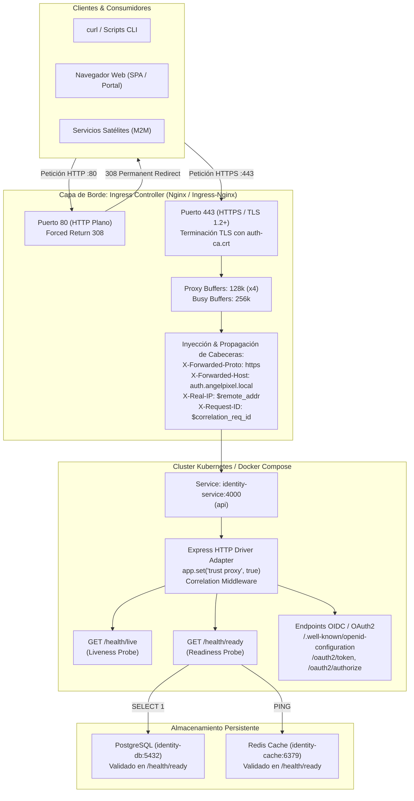

# Guía Técnica de Configuración y Pruebas: US-13 (Nginx Ingress Controller con Terminación TLS y Enrutamiento Local)

> **Document ID:** `GUIDELINE-14-nginx-ingress-tls-setup`  
> **Bounded Context:** `infrastructure` / `edge-ingress`  
> **Historia de Usuario:** [US-13: Nginx Ingress Controller con Terminación TLS y Enrutamiento Local](../epics/EPIC-06-cloud-infrastructure-and-container-orchestration/stories/US-13-nginx-ingress-tls-routing.md)  
> **Arquitectura & Decisiones:** [ADR 0007: Cloud Infrastructure Topology](../../docs/adr/0007-cloud-infrastructure-topology.md)  
> **Componentes Principales:**
> - Generación PKI Local: [`deployments/tls/generate-local-certs.sh`](../../deployments/tls/generate-local-certs.sh) (`npm run cert:generate`)
> - Manifiesto Kubernetes Ingress: [`deployments/ingress/ingress.yaml`](../../deployments/ingress/ingress.yaml)
> - Helm Chart Ingress Template: [`deployments/helm/identity-service/templates/ingress.yaml`](../../deployments/helm/identity-service/templates/ingress.yaml)
> - Configuración Nginx Ingress Local: [`deployments/ingress/nginx.conf`](../../deployments/ingress/nginx.conf)
> - Orquestador Docker Compose: [`compose.yml`](../../compose.yml) (servicio `ingress` con perfil `ingress`)
> - Health Probes & Trust Proxy: [`interfaces/http/server.ts`](../../interfaces/http/server.ts) (`GET /health/live`, `GET /health/ready`)
> - Script de Verificación Automatizada E2E: [`scripts/test-ingress-routing.sh`](../../scripts/test-ingress-routing.sh) (`npm run test:ingress`)

---

## 1. Visión General: Topología de Capa de Borde (Edge Ingress)

La capa de borde de `identity-service` implementa el patrón **Edge Gateway con Terminación TLS**. Centraliza la seguridad perimetral, la redirección forzada de tráfico plano, la descodificación TLS para el dominio canónico `auth.angelpixel.local` y el dimensionamiento de buffers para soportar tokens JWT y cabeceras voluminosas de OpenID Connect.



---

## 2. Comandos de Ejecución y Pruebas Rápidas (Turnkey)

### 2.1 Generación de Certificados TLS y Secret de Kubernetes
Genera la Autoridad Certificadora (CA) raíz, el certificado de dominio con extensiones SAN (`auth.angelpixel.local`, `localhost`, `127.0.0.1`), la cadena completa y el Secret de Kubernetes:
```bash
npm run cert:generate
```

### 2.2 Iniciar / Detener el Ingress Controller Local
Levanta la infraestructura completa junto al proxy de borde Nginx en los puertos `80` y `443`:
```bash
# Iniciar servicios con perfil ingress
npm run docker:ingress

# Detener contenedor de ingress
npm run docker:ingress:down
```

### 2.3 Ejecución de Pruebas Automatizadas E2E
Ejecuta la suite integral de verificación de enrutamiento, redirección 308, terminación TLS, sondas de salud y propagación de correlación:
```bash
npm run test:ingress
```

---

## 3. Vectores de Prueba y Verificación Manual

### Test Vector 1: Redirección Forzada HTTP -> HTTPS (Código 308)
Verifica que el tráfico en el puerto plano `80` es rechazado y redirigido permanentemente preservando el método HTTP y el cuerpo:

```bash
curl -sI -H "Host: auth.angelpixel.local" http://127.0.0.1:80/health/live
```
**Respuesta Esperada:**
```http
HTTP/1.1 308 Permanent Redirect
Location: https://auth.angelpixel.local/health/live
```

### Test Vector 2: Terminación TLS y Liveness Probe sobre HTTPS
Valida la terminación TLS con la CA raíz local y confirma que Express detecta el protocolo como `https` gracias a `trust proxy`:

```bash
curl -s \
  --cacert deployments/tls/certs/auth-ca.crt \
  --resolve auth.angelpixel.local:443:127.0.0.1 \
  https://auth.angelpixel.local/health/live
```
**Respuesta Esperada:**
```json
{
  "status": "UP",
  "checks": { "liveness": "OK" },
  "protocol": "https",
  "timestamp": "2026-11-13T02:43:14.133Z"
}
```

### Test Vector 3: Readiness Probe con Validación de Dependencias
Valida que el servicio confirma que PostgreSQL y Redis están en estado saludable antes de recibir tráfico de usuarios:

```bash
curl -s \
  --cacert deployments/tls/certs/auth-ca.crt \
  --resolve auth.angelpixel.local:443:127.0.0.1 \
  https://auth.angelpixel.local/health/ready
```
**Respuesta Esperada:**
```json
{
  "status": "UP",
  "checks": { "database": "OK", "cache": "OK" },
  "timestamp": "2026-11-13T02:43:14.175Z"
}
```

### Test Vector 4: OIDC Discovery y Propagación de `X-Request-ID`
Valida la propagación de extremo a extremo del identificador de correlación a través del Ingress y la disponibilidad del endpoint de descubrimiento:

```bash
curl -sI \
  --cacert deployments/tls/certs/auth-ca.crt \
  --resolve auth.angelpixel.local:443:127.0.0.1 \
  -H "X-Request-ID: trace-id-audit-99" \
  https://auth.angelpixel.local/.well-known/openid-configuration
```
**Respuesta Esperada:**
```http
HTTP/1.1 200 OK
X-Request-ID: trace-id-audit-99
Content-Type: application/json; charset=utf-8
```

---

## 4. Configuración en Entorno de Desarrollo Local

### 4.1 Resolución de Dominio en `/etc/hosts` (Opcional para Navegador Web)
Para navegar directamente a `https://auth.angelpixel.local` desde Google Chrome u otro navegador sin necesidad del flag `--resolve`:
```bash
sudo sh -c 'echo "127.0.0.1 auth.angelpixel.local" >> /etc/hosts'
```

### 4.2 Confianza de la Autoridad Certificadora Raíz en macOS Keychain
Para evitar advertencias de seguridad (`NET::ERR_CERT_AUTHORITY_INVALID`) en el navegador al abrir `https://auth.angelpixel.local`:
```bash
sudo security add-trusted-cert -d -r trustRoot -k /Library/Keychains/System.keychain deployments/tls/certs/auth-ca.crt
```

---

## 5. Despliegue en Kubernetes y Helm Chart

### 5.1 Despliegue Directo con `kubectl`
```bash
# 1. Crear el Secret TLS en el namespace
kubectl apply -f deployments/tls/identity-tls-secret.yaml

# 2. Aplicar el manifiesto Ingress
kubectl apply -f deployments/ingress/ingress.yaml
```

### 5.2 Despliegue mediante Helm (Foundation para US-14)
El chart ubicado en `deployments/helm/identity-service/` incluye la plantilla de Ingress habilitada en `values.yaml`:
```bash
helm template identity-service deployments/helm/identity-service/ -f deployments/helm/identity-service/values.yaml
```

---

## 6. Resolución de Problemas Frecuentes (Troubleshooting)

| Síntoma | Causa Raíz | Solución |
| :--- | :--- | :--- |
| `curl: (60) SSL certificate problem: unable to get local issuer certificate` | Se intentó conectar por HTTPS sin especificar la CA local. | Añadir `--cacert deployments/tls/certs/auth-ca.crt` al comando `curl` o importar la CA en el sistema operativo. |
| `bind: address already in use` en puerto 80 o 443 | Hay otro servidor web (Apache, Nginx local, Caddy) escuchando en los puertos estándar. | Detener el servicio en conflicto (`lsof -i :80` / `lsof -i :443`) antes de levantar el contenedor de Ingress. |
| `502 Bad Gateway` en `https://auth.angelpixel.local` | El contenedor `identity-api` no está en ejecución o la red de Docker no lo resuelve. | Ejecutar `docker compose --profile ingress up -d` para asegurar que tanto la API como el Ingress compartan la red `identity_default`. |
| `413 Request Entity Too Large` con tokens OIDC | Los buffers de proxy están insuficientemente dimensionados. | Verificar que `nginx.conf` y las anotaciones de Ingress incluyan `proxy_buffer_size 128k; proxy_buffers 4 128k;`. |
