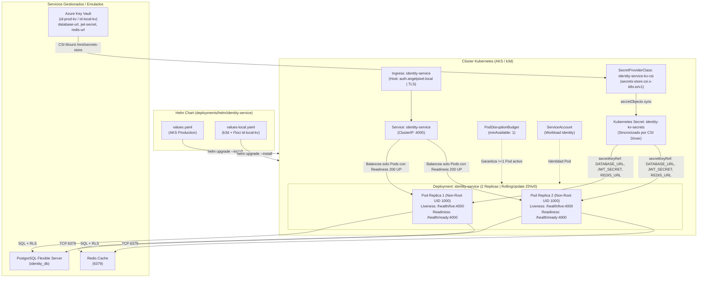

# Guía Técnica de Empaquetado y Orquestación en Kubernetes: US-14 (Helm Chart Parametrizable & Azure Key Vault CSI Driver)

> **Document ID:** `GUIDELINE-15-helm-k8s-deployment`  
> **Bounded Context:** `infrastructure` / `kubernetes-workloads`  
> **Historia de Usuario:** [US-14: Kubernetes Deployment with Parametric Helm Chart](../epics/EPIC-06-cloud-infrastructure-and-container-orchestration/stories/US-14-k8s-deployment-helm-manifests.md)  
> **Arquitectura & Decisiones:** [ADR 0007: Cloud Infrastructure Topology](../../docs/adr/0007-cloud-infrastructure-topology.md)  
> **Componentes Principales:**
> - Especificación del Chart: [`deployments/helm/identity-service/Chart.yaml`](../../deployments/helm/identity-service/Chart.yaml)
> - Valores Productivos (AKS): [`deployments/helm/identity-service/values.yaml`](../../deployments/helm/identity-service/values.yaml)
> - Valores Locales (`k3d` / `Floci`): [`deployments/helm/identity-service/values-local.yaml`](../../deployments/helm/identity-service/values-local.yaml)
> - Plantillas de Recursos:
>   - [`deployments/helm/identity-service/templates/deployment.yaml`](../../deployments/helm/identity-service/templates/deployment.yaml)
>   - [`deployments/helm/identity-service/templates/service.yaml`](../../deployments/helm/identity-service/templates/service.yaml)
>   - [`deployments/helm/identity-service/templates/ingress.yaml`](../../deployments/helm/identity-service/templates/ingress.yaml)
>   - [`deployments/helm/identity-service/templates/secret-provider-class.yaml`](../../deployments/helm/identity-service/templates/secret-provider-class.yaml)
>   - [`deployments/helm/identity-service/templates/poddisruptionbudget.yaml`](../../deployments/helm/identity-service/templates/poddisruptionbudget.yaml)
>   - [`deployments/helm/identity-service/templates/serviceaccount.yaml`](../../deployments/helm/identity-service/templates/serviceaccount.yaml)
>   - [`deployments/helm/identity-service/templates/hpa.yaml`](../../deployments/helm/identity-service/templates/hpa.yaml)
>   - [`deployments/helm/identity-service/templates/_helpers.tpl`](../../deployments/helm/identity-service/templates/_helpers.tpl)
> - Suite de Verificación Automatizada: [`scripts/test-helm-chart.sh`](../../scripts/test-helm-chart.sh) (`npm run test:helm`)

---

## 1. Visión General: Orquestación Resiliente y Zero-Downtime

El Helm Chart de `identity-service` empaqueta todos los recursos declarativos de Kubernetes necesarios para desplegar el proveedor de identidad OIDC tanto en **Azure Kubernetes Service (AKS)** como en clústeres locales (**k3d / kind**) conectados al emulador **Floci Azure ARM**.



---

## 2. Ejecución de Pruebas Automatizadas (Turnkey)

Para ejecutar la suite completa de linting estricto, renderizado de plantillas y auditoría de invariantes de seguridad, probes y CSI Driver:

```bash
npm run test:helm
```

El script [`scripts/test-helm-chart.sh`](../../scripts/test-helm-chart.sh) valida en 5 etapas:
1. Detección del motor Helm CLI (binario local o fallback transparente al contenedor oficial `alpine/helm:3.16.3`).
2. `helm lint --strict` sobre `values.yaml` y `values-local.yaml` con 0 errores y 0 advertencias.
3. Renderizado de manifiestos (`ServiceAccount`, `SecretProviderClass`, `Service`, `Deployment`, `PodDisruptionBudget`, `Ingress`).
4. Auditoría estructural mediante parser YAML de:
   - Estrategia `RollingUpdate` (`maxSurge: 25%`, `maxUnavailable: 0`) y `replicaCount: 2`.
   - Contexto de seguridad no-root (`runAsNonRoot: true`, `allowPrivilegeEscalation: false`, `drop: ["ALL"]`).
   - Sondas `/health/live` (`delay: 10s, period: 10s, fail: 3`) y `/health/ready` (`delay: 5s, period: 5s, fail: 2`).
   - Cuotas de cómputo (`requests: 100m/128Mi`, `limits: 500m/512Mi`).
   - Proyección de `DATABASE_URL`, `JWT_SECRET` y `REDIS_URL` desde `SecretProviderClass` (`id-local-kv`).
5. Renderizado condicional de `HorizontalPodAutoscaler` cuando `autoscaling.enabled=true`.

---

## 3. Comandos Manuales de Verificación y Despliegue

### 3.1 Linting Estricto del Chart
```bash
helm lint deployments/helm/identity-service --strict
helm lint deployments/helm/identity-service -f deployments/helm/identity-service/values-local.yaml --strict
```

### 3.2 Inspección de Manifiestos Renderizados (`helm template`)
```bash
# Renderizar manifiestos para entorno local (k3d + Floci)
helm template identity-service deployments/helm/identity-service \
  -f deployments/helm/identity-service/values-local.yaml

# Renderizar manifiestos para producción (AKS) con HPA habilitado
helm template identity-service deployments/helm/identity-service \
  --set autoscaling.enabled=true
```

### 3.3 Instalación / Upgrade en Clúster Kubernetes (`k3d` o `AKS`)
```bash
# 1. Asegurar que el Secret TLS exista en el namespace destino
kubectl apply -f deployments/tls/identity-tls-secret.yaml

# 2. Desplegar o actualizar el release con espera atómica de readiness
helm upgrade --install identity-service deployments/helm/identity-service \
  -f deployments/helm/identity-service/values-local.yaml \
  --namespace default \
  --wait \
  --timeout 120s
```

---

## 4. Comportamiento de las Probes de Salud (`Liveness` vs `Readiness`)

| Probe | Endpoint | Código Saludable | Código Degradado | Acción de Kubernetes ante Fallo |
| :--- | :--- | :--- | :--- | :--- |
| **Liveness Probe** | `GET /health/live` | `200 OK` (`status: "UP"`) | `500` / Timeout | Reinicia el contenedor cuando el event loop de Node.js se bloquea irremediablemente (`failureThreshold: 3`). |
| **Readiness Probe** | `GET /health/ready` | `200 OK` (`status: "UP"`) | `503 Service Unavailable` (`status: "DOWN"`) | Retira temporalmente la IP del Pod de los `Endpoints` del `Service` `identity-service` cuando PostgreSQL o Redis caen, **sin reiniciar el contenedor**, reincorporándolo automáticamente en cuanto las conexiones se recuperan (`failureThreshold: 2`). |

Para verificar las pruebas de integración de degradación `503 DOWN`:
```bash
npx jest --config jest.config.js tests/integration/identity/interfaces/test_health_probes.ts
```

---

## 5. Resolución de Problemas Frecuentes (Troubleshooting)

| Síntoma | Causa Raíz | Solución |
| :--- | :--- | :--- |
| `MountVolume.SetUp failed for volume "secrets-store-inline"` | El addon `secrets-store-csi-driver` no está instalado en el clúster local `k3d`. | Instalar el driver CSI en el clúster o desplegar con `--set keyVaultCSI.enabled=false` en clústeres efímeros sin CSI. |
| Pod permanece en `0/1 Running` (Readiness Probe failed: HTTP 503) | La base de datos PostgreSQL o Redis no son alcanzables desde el Pod con las URLs configuradas. | Inspeccionar `kubectl logs -l app.kubernetes.io/name=identity-service` y verificar el payload de `/health/ready` (`checks.database` y `checks.cache`). |
| Error `container has runAsNonRoot and image will run as root` | La imagen Docker fue construida sin directiva `USER node` (UID 1000). | Verificar que `podSecurityContext.runAsUser: 1000` esté activo en `values.yaml` y que el `Dockerfile` utilice un usuario no-root. |
