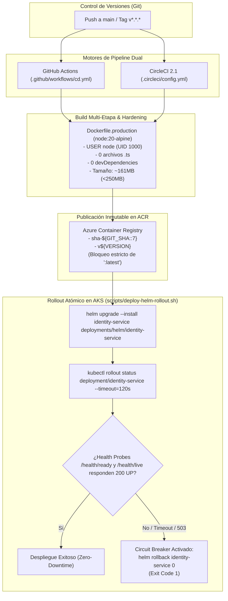

# Guía Técnica de Entrega Continua y Rollback: US-15 (Pipelines Duales GitHub Actions & CircleCI para ACR y AKS)

> **Document ID:** `GUIDELINE-16-cicd-azure-container-delivery`  
> **Bounded Context:** `infrastructure` / `cicd-automation`  
> **Historia de Usuario:** [US-15: CI/CD Pipeline Automation (GitHub Actions & CircleCI)](../epics/EPIC-06-cloud-infrastructure-and-container-orchestration/stories/US-15-cicd-pipeline-azure-integration.md)  
> **Arquitectura & Decisiones:** [ADR 0007: Cloud Infrastructure Topology](../../docs/adr/0007-cloud-infrastructure-topology.md)  
> **Componentes Principales:**
> - Dockerfile de Producción Multi-Etapa: [`Dockerfile.production`](../../Dockerfile.production)
> - Reglas de Exclusión Docker: [`.dockerignore`](../../.dockerignore)
> - Script de Despliegue y Circuit Breaker: [`scripts/deploy-helm-rollout.sh`](../../scripts/deploy-helm-rollout.sh)
> - Pipeline GitHub Actions: [`.github/workflows/cd.yml`](../../.github/workflows/cd.yml)
> - Pipeline CircleCI 2.1: [`.circleci/config.yml`](../../.circleci/config.yml)
> - Suite de Verificación E2E de CI/CD: [`scripts/test-cicd-pipeline.sh`](../../scripts/test-cicd-pipeline.sh) (`npm run test:cicd`)

---

## 1. Visión General: Estrategia Dual de Entrega Continua

Para garantizar máxima portabilidad, reproducibilidad y satisfacción rigurosa de las especificaciones corporativas, `identity-service` implementa una arquitectura dual de pipelines de entrega continua en **GitHub Actions** y **CircleCI 2.1**. Ambos pipelines comparten el mismo estándar de calidad, hardening del contenedor, etiquetado inmutable en **Azure Container Registry (ACR)** y circuit breaker con rollback automático en **Azure Kubernetes Service (AKS)** vía Helm.



---

## 2. Comandos Turnkey y Verificación Rápida

### 2.1 Ejecución de la Suite Completa de Verificación de CI/CD
Ejecuta la validación de los 3 escenarios BDD de US-15 (build no-root, sintaxis de pipelines duales, política de tags y simulación de rollback):
```bash
npm run test:cicd
```

### 2.2 Despliegue Manual o en Dry-Run mediante `deploy-helm-rollout.sh`
```bash
# Modo Dry-Run local (valida manifiestos y simula rollout exitoso)
bash scripts/deploy-helm-rollout.sh \
  --release identity-service \
  --namespace default \
  --registry idlocalacr.azurecr.io \
  --image-tag sha-$(git rev-parse --short=7 HEAD) \
  --values deployments/helm/identity-service/values-local.yaml \
  --timeout 120s \
  --dry-run

# Simulación de contingencia (Readiness probe falla 503 DOWN y activa helm rollback)
bash scripts/deploy-helm-rollout.sh \
  --dry-run \
  --simulate-probe-failure \
  --image-tag sha-test01
```

---

## 3. Especificación Técnica de los Pipelines

### 3.1 GitHub Actions (`.github/workflows/cd.yml`)
- **Trigger:** Pushes a `main`, creación de tags `v*.*.*` o `workflow_dispatch`.
- **Jobs:**
  1. `verify-and-lint-helm`: Compila TypeScript (`npm run build`), ejecuta tests unitarios (`npm run test:unit`) y valida el chart (`npm run test:helm`).
  2. `build-and-publish-acr`: Construye `Dockerfile.production`, audita usuario `node` y tamaño `< 250MB`, y publica en ACR con tags `sha-<hash>` y `v<semver>`.
  3. `deploy-aks-helm`: Autentica mediante `AKS_KUBECONFIG` (o modo dry-run), invocando `scripts/deploy-helm-rollout.sh`.

### 3.2 CircleCI 2.1 (`.circleci/config.yml`)
- **Orbs Utilizados:** `circleci/node@5.2.0`, `circleci/docker@2.6.0`, `circleci/azure-cli@1.2.2`, `circleci/helm@3.0.0`, `circleci/kubernetes@1.3.1`.
- **Workflow:**
  1. `quality-and-helm-gate`: Validación de compilación, suite unitaria y chart linting.
  2. `build-and-publish-acr`: Construcción multi-etapa con Docker layer caching y publicación ACR.
  3. `hold-production-approval`: Gate de aprobación manual de tipo `approval` restringido a la rama `main`.
  4. `deploy-aks-with-rollback`: Despliegue final a AKS con verificación de rollout y rollback automático.

---

## 4. Política de Seguridad y Hardening de Contenedores

| Criterio | Implementación | Validación Automatizada |
| :--- | :--- | :--- |
| **Usuario no privilegiado** | `USER node` (UID 1000) en etapa runner. | `docker run --entrypoint whoami ...` devuelve `node`. |
| **Aislamiento de código** | Sin archivos `.ts` y sin `devDependencies` en runtime. | `find /app/dist -name '*.ts'` devuelve 0 y `npm prune --omit=dev`. |
| **Tamaño optimizado** | Base `node:20-alpine` mínima con `dumb-init`. | Inspección de tamaño: **~161 MB** (< 250 MB). |
| **Inmutabilidad** | Prohibido el tag `latest` en entornos de despliegue. | `scripts/deploy-helm-rollout.sh` rechaza `:latest` con exit code 1. |
| **Resiliencia & Rollback** | Si `/health/ready` responde `503 DOWN` o expira timeout de 120s. | Disparo inmediato de `helm rollback identity-service 0`. |

---

## 5. Resolución de Problemas Frecuentes (Troubleshooting)

| Síntoma | Causa Raíz | Solución |
| :--- | :--- | :--- |
| `VIOLACIÓN DE POLÍTICA: La etiqueta mutable 'latest' está estrictamente prohibida` | Se pasó `--image-tag latest` al script de despliegue. | Proveer siempre un tag inmutable derivado del commit (`sha-<hash>`) o versión (`v1.0.0`). |
| Pipeline falla con `[CIRCUIT BREAKER] Fallo detectado durante el despliegue` | El despliegue de Kubernetes no alcanzó el estado de readiness en 120s (posible degradación de base de datos o Redis). | El script ya ejecutó `helm rollback` para restaurar la versión estable previa. Inspeccione los logs del contenedor fallido con `kubectl logs -l app.kubernetes.io/name=identity-service --previous` para diagnosticar el fallo en las dependencias. |
| CircleCI falla en paso `hold-production-approval` | El despliegue a producción requiere aprobación humana deliberada. | Acceda a la consola de CircleCI y apruebe manualmente el job `hold-production-approval` para la rama `main`. |
