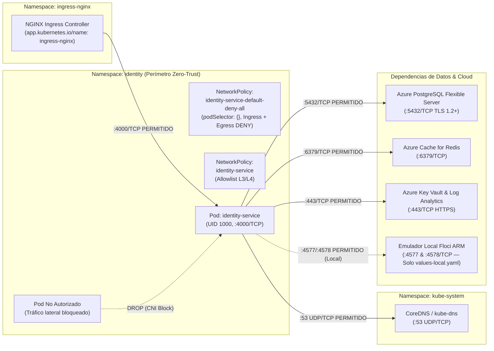
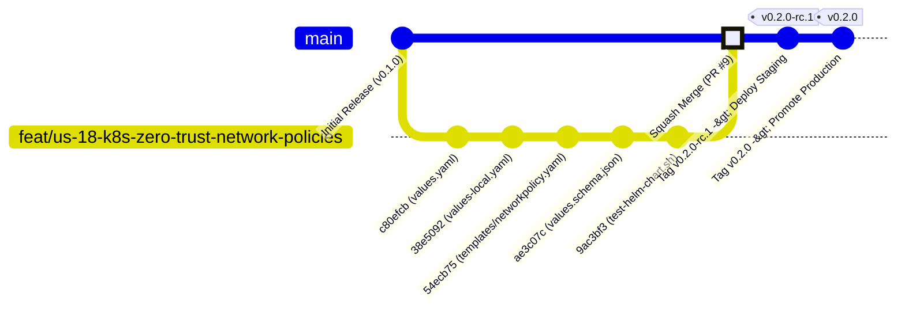

# Guía Técnica de Pruebas Interactivas: US-18 — Micro-Segmentación Zero-Trust con Kubernetes NetworkPolicies en Helm

> **Document ID:** `GUIDELINE-19-k8s-zero-trust-network-policies`  
> **Bounded Context:** `infrastructure` / `network-security`  
> **Historia de Usuario:** [US-18: Kubernetes Zero-Trust NetworkPolicies & Micro-Segmentation in Helm](../epics/EPIC-07-fintech-compliance-hardening-and-security-standards/stories/US-18-k8s-zero-trust-network-policies.md)  
> **Estándares Regulatorios:** ISO/IEC 27001:2022 (Control A.13.1) · SOC 2 Type II (CC6.6)  
> **Arquitectura & Decisiones:** [ADR 0007: Cloud Infrastructure Topology](../../docs/adr/0007-cloud-infrastructure-topology.md)  
> **Componentes Principales:**
> - Plantilla Zero-Trust: [`deployments/helm/identity-service/templates/networkpolicy.yaml`](../../deployments/helm/identity-service/templates/networkpolicy.yaml)
> - Valores Productivos (AKS): [`deployments/helm/identity-service/values.yaml`](../../deployments/helm/identity-service/values.yaml)
> - Valores Locales (Kind + Floci): [`deployments/helm/identity-service/values-local.yaml`](../../deployments/helm/identity-service/values-local.yaml)
> - Contrato JSON Schema Draft-07: [`deployments/helm/identity-service/values.schema.json`](../../deployments/helm/identity-service/values.schema.json)
> - Suite de Auditoría Automatizada: [`scripts/test-helm-chart.sh`](../../scripts/test-helm-chart.sh)

---

## 1. Visión General: Arquitectura de Micro-Segmentación Zero-Trust L3/L4

Por defecto, Kubernetes opera bajo un modelo de red plana (*Flat Network*) donde cualquier Pod puede conectarse hacia cualquier otro Pod o servicio del clúster sin restricciones. Para cumplir con **ISO/IEC 27001:2022 Control A.13.1** (segregación de redes) y **SOC 2 Type II CC6.6** (protección de perímetros lógicos), el chart Helm de `identity-service` impone una arquitectura dual de micro-segmentación L3/L4 a nivel del plugin CNI:

1. **Política `identity-service-default-deny-all` (*Default-Deny All*):** Selecciona todos los Pods del namespace (`podSelector: {}`) y bloquea por defecto la totalidad del tráfico entrante (`Ingress`) y saliente (`Egress`).
2. **Política `identity-service` (*Least-Privilege Allowlist*):** Selecciona exclusivamente los Pods de `identity-service` y abre únicamente los canales estrictamente necesarios para su operación.




---

## 2. Ejecución de Pruebas Automatizadas (Turnkey)

Para auditar y certificar de manera determinista la configuración Zero-Trust y descartar regresiones en toda la cadena de empaquetado e infraestructura, se dispone de tres suites automatizadas:

### 2.1. Suite de Empaquetado y Seguridad Helm (6 Etapas)
Ejecuta la validación sintáctica estricta, renderizado condicional, auditoría estructural AST de invariantes de red y pruebas negativas del esquema JSON:
```bash
npm run test:helm
```
*Cobertura:*
1. Comprobación del motor Helm CLI nativo (`v4.3.1+` o fallback en contenedor `alpine/helm:3.16.3`).
2. `helm lint --strict` para perfiles productivo (`values.yaml`) y local (`values-local.yaml`) con cero errores y advertencias.
3. Renderizado de los 7 tipos de manifiestos Kubernetes (incluyendo `kind: NetworkPolicy`).
4. Auditoría AST en Node.js de las 2 políticas (`default-deny-all` con `podSelector: {}` y allowlist con puertos `:53`, `:5432`, `:6379`, `:443` y `:4577`/`:4578`).
5. Renderizado condicional de `HorizontalPodAutoscaler` cuando `autoscaling.enabled=true`.
6. Rechazo estricto de 9 casos negativos de `values.schema.json` (incluyendo tipos no booleanos en `networkPolicy.enabled` y puertos fuera de rango IANA `> 65535`).


### 2.2. Suite de Infraestructura Cloud Terraform & Emulación Floci (5 Etapas)
Verifica que los módulos Terraform de Azure y los puertos de emulación Floci (`4577/TCP` HTTP y `4578/TCP` HTTPS proxy TLS) autorizados en `values-local.yaml` operan sin interrupción:
```bash
npm run test:infra
```
*Cobertura:*
1. Validación canónica de formato HCL (`TF_CLI_CONFIG_FILE=/dev/null terraform fmt -check -recursive`).
2. Diagnóstico de salud del contenedor `floci-azure-arm` en `http://localhost:4577/_floci/health`.
3. Levantamiento y verificación de liveness del proxy TLS en `https://localhost:4578/__proxy_health`.
4. Validación sintáctica y de esquemas de proveedores (`terraform validate`).
5. Ejecución del plan contra Floci (`terraform plan -no-color`), certificando los 19 recursos planificados (incluyendo PostgreSQL Flexible Server con TLS 1.2+ y cifrado CMK).


### 2.3. Suite de Integración de Health Probes & Reverse Proxy Support (8 Pruebas Jest)
Certifica que las sondas Kubernetes (`/health/live` y `/health/ready` en `:4000/TCP`) y el soporte de Reverse Proxy (`trust proxy` desde `ingress-nginx`) responden adecuadamente bajo el perímetro de red:
```bash
npx jest tests/integration/identity/interfaces/test_health_probes.ts
```
*Cobertura:*
1. Sonda de vida `GET /health/live` (`200 OK`, `status: "UP"`, `liveness: "OK"`).
2. Sonda de preparación `GET /health/ready` (`200 OK` con dependencias de persistencia y caché operativas).
3. Degradación selectiva de `/health/ready` a `503 DOWN` ante fallo de base de datos mientras `/health/live` permanece en `200 UP` (evita reinicios destructivos de Pod por Kubernetes).
4. Degradación de `/health/ready` a `503 DOWN` ante caída de Redis.
5. Diagnóstico combinado `GET /health` (`200 OK` con liveness, database y cache).
6. Reconocimiento transparente de protocolo seguro `https` vía cabecera `X-Forwarded-Proto` inyectada por Ingress NGINX.
7. Preservación intacta del identificador de trazabilidad distribuida `X-Request-ID`.
8. Autogeneración de `UUIDv4` para `X-Request-ID` cuando no es suministrado por el cliente.


---

## 3. Vectores de Prueba Interactiva y Validación Manual

A continuación se detallan los 5 vectores interactivos de auditoría de seguridad implementados para certificar la micro-segmentación Zero-Trust L3/L4 conforme a **ISO/IEC 27001:2022 Control A.13.1** y **SOC 2 Type II CC6.6**:

### Vector 1: Micro-Segmentación en Entorno Local con Soporte Floci (`values-local.yaml`)

**Propósito:** Confirmar que en entornos de desarrollo y emulación local (Kind + Floci ARM), el chart renderiza las políticas Zero-Trust permitiendo la comunicación local con los emuladores sin comprometer el modelo de defensa.

**Comando de Verificación:**
```bash
helm template identity-service deployments/helm/identity-service -f deployments/helm/identity-service/values-local.yaml
```
**Invariantes a Validar:**
- Se renderizan **2 manifiestos** `kind: NetworkPolicy`:
  1. `identity-service-default-deny-all` con `podSelector: {}` y `policyTypes: [Ingress, Egress]`.
  2. `identity-service` con `podSelector: { app.kubernetes.io/name: identity-service }`.
- La regla de `ingress` restringe la entrada a `:4000/TCP` originada únicamente por `ingress-nginx`.
- Las reglas de `egress` permiten `:53` (DNS), `:5432` (PostgreSQL), `:6379` (Redis), `:443` (HTTPS) y los puertos de emulación Floci `:4577` y `:4578` inyectados vía `customEgress`.

---

### Vector 2: Aislamiento Estricto y Protección del Perfil Productivo (`values.yaml`)

**Propósito:** Demostrar que los puertos de emulación local (`4577` y `4578`) **nunca se filtran al manifiesto de producción** en Azure Kubernetes Service (AKS), manteniendo el principio de mínimo privilegio (*least privilege*).

**Comando de Verificación:**
```bash
PROD_OUT=$(helm template identity-service deployments/helm/identity-service)
echo "NetworkPolicies en prod: $(echo "${PROD_OUT}" | grep -c '^kind: NetworkPolicy$')"
! echo "${PROD_OUT}" | grep -qE "port: (4577|4578)" && echo "✓ Cero puertos Floci (4577/4578) en producción."
```
**Salida Esperada:**
- Exactamente 2 `NetworkPolicy`.
- Cero coincidencias de puertos `4577` o `4578`.

---

### Vector 3: Desactivación Condicional Parcial (`defaultDeny.enabled=false`)

**Propósito:** Validar la flexibilidad del chart para entornos donde las políticas de red globales ya son gestionadas centralizadamente por el equipo de plataforma o por una solución como Cilium / Calico a nivel de clúster.

**Comando de Verificación:**
```bash
NO_DENY_OUT=$(helm template identity-service deployments/helm/identity-service --set networkPolicy.defaultDeny.enabled=false)
COUNT=$(echo "${NO_DENY_OUT}" | grep -c '^kind: NetworkPolicy$')
echo "Políticas renderizadas: ${COUNT}"
! echo "${NO_DENY_OUT}" | grep -q "identity-service-default-deny-all" && echo "✓ default-deny-all omitido correctamente."
```
**Salida Esperada:**
- Exactamente 1 `NetworkPolicy` correspondiente a la política de aplicación `identity-service`.

---

### Vector 4: Desactivación Maestra Global (`networkPolicy.enabled=false`)

**Propósito:** Certificar que la guarda maestra `{{- if .Values.networkPolicy.enabled }}` suprime por completo la generación de manifiestos `kind: NetworkPolicy` en clústeres que no cuenten con un plugin CNI compatible con directivas de red.

**Comando de Verificación:**
```bash
DISABLED_OUT=$(helm template identity-service deployments/helm/identity-service --set networkPolicy.enabled=false)
! echo "${DISABLED_OUT}" | grep -q '^kind: NetworkPolicy$' && echo "✓ 0 NetworkPolicies renderizadas."
echo "${DISABLED_OUT}" | grep -q '^kind: Deployment$' && echo "✓ Resto de recursos intactos."
```
**Salida Esperada:**
- Cero manifiestos `NetworkPolicy`.
- Todos los demás recursos (`Deployment`, `Service`, `Ingress`, etc.) se generan con normalidad.

---

### Vector 5: Validación Preventiva de Esquema JSON ante Malformaciones

**Propósito:** Demostrar que `values.schema.json` bloquea de forma determinista en tiempo de compilación o linting cualquier intento de desplegar valores no válidos (tipos erróneos o puertos fuera de los límites IANA).

**Comando de Verificación:**
```bash
# Caso A: Tipo no booleano en networkPolicy.enabled (debe fallar)
helm lint deployments/helm/identity-service --set networkPolicy.enabled="invalid"

# Caso B: Puerto fuera del rango IANA 1..65535 en networkPolicy.ingress.port (debe fallar)
helm lint deployments/helm/identity-service --set networkPolicy.ingress.port=70000
```
**Salida Esperada:**
- `helm lint` falla con código de salida distinto de cero (`status != 0`).
- Mensajes de error específicos:
  - `- at '/networkPolicy/enabled': got string, want boolean`
  - `- at '/networkPolicy/ingress/port': maximum: got 70,000, want 65,535`


---

## 4. Flujo Git y Estrategia de Promoción por Release Tags

A partir de `US-18`, el ciclo de integración y entrega continua adopta un modelo Trunk-Based estructurado con ramas de característica preservadas y promoción inmutable mediante etiquetas SemVer:



### 4.1. Convención de Ramas y Política de Merge

1. **Ramas de Característica Preservadas (`feat/*`):**
   - Cada historia de usuario se desarrolla en su propia rama `feat/us-XX-<slug>`.
   - Los commits intermedios representan unidades atómicas (Inside-Out TDD: dominio, aplicación, infraestructura, esquema y pruebas).
   - **Regla no destructiva:** Las ramas `feat/*` **no se eliminan** tras el merge (`--delete-branch=false`). Permanecen en el repositorio remoto como registro inmutable y auditable del historial fino de ingeniería.

2. **Integración en `main` mediante Squash & Merge:**
   - La integración hacia la rama principal `main` se realiza exclusivamente mediante **Squash Merge**:
     ```bash
     gh pr merge <PR_NUMBER> --squash --delete-branch=false
     ```
   - Esto mantiene el historial de `main` limpio, lineal y trazable a nivel de historia de usuario (un commit por historia), mientras el árbol detallado de commits permanece preservado en la rama `feat/*`.

### 4.2. Ciclo de Despliegue y Promoción Inmutable (Staging vs Production)

Para gobernar el ciclo de vida de los despliegues sin depender de ramas intermedias frágiles, se establece una estrategia basada en **Release Tags SemVer inmutables**:

| Tipo de Etiqueta Git | Patrón de Tag | Entorno Destino | Acción del Pipeline CD (`.github/workflows/cd.yml`) |
| :--- | :--- | :--- | :--- |
| **Pre-Release Tag** | `vX.Y.Z-rc.N` *(ej. `v0.2.0-rc.1`)* | **Staging (AKS)** | Compila la imagen Docker, ejecuta las puertas de seguridad y realiza el rollout en el clúster AKS de Staging con validación de health probes. |
| **Release Tag Oficial** | `vX.Y.Z` *(ej. `v0.2.0`)* | **Production (AKS)** | Promueve de forma determinista el **mismo artefacto de imagen inmutable** (`sha-<SHORT_SHA>`) hacia el clúster productivo con circuit breaker de rollback (120s). |

**Comandos de Operación:**
```bash
# Para desplegar a Staging (candidato a versión):
git tag -a v0.2.0-rc.1 -m "release(staging): candidate for US-18 zero-trust network policies"
git push origin v0.2.0-rc.1

# Para promover a Producción tras certificación exitosa en Staging:
git tag -a v0.2.0 -m "release(production): certified release for US-18 zero-trust network policies"
git push origin v0.2.0
```


---

## 5. Matriz de Troubleshooting y Diagnóstico CNI / Helm Schema

| Síntoma / Error Observado | Origen / Capa | Causa Raíz Probable | Acción Correctiva Inmediata |
| :--- | :--- | :--- | :--- |
| **`EAI_AGAIN` o timeout en resolución de nombres DNS** | Red CNI / Egress L4 | La regla de Egress hacia CoreDNS (`53/UDP` o `53/TCP`) está bloqueada o las etiquetas del Pod CoreDNS en `kube-system` no coinciden con `k8s-app: kube-dns`. | 1. Verificar etiquetas reales de CoreDNS: `kubectl get pods -n kube-system -l k8s-app=kube-dns`.<br>2. Asegurar que `networkPolicy.egress.dns.enabled: true` y ajustar `networkPolicy.egress.dns.selector` si el clúster usa etiquetas diferentes (ej. `k8s-app: coredns`). |
| **Timeout o Connection Reset (`504 Gateway Timeout`) en Ingress** | Red CNI / Ingress L3-L4 | El controlador NGINX Ingress no coincide con `controllerNamespaceSelector` o `controllerPodSelector` (`app.kubernetes.io/name: ingress-nginx`). | 1. Inspeccionar etiquetas del Ingress Controller: `kubectl get pods -n ingress-nginx --show-labels`.<br>2. Alinear los selectores en `values.yaml` (`networkPolicy.ingress.controllerNamespaceSelector` y `controllerPodSelector`). |
| **Timeout hacia PostgreSQL (`:5432`), Redis (`:6379`) o Key Vault (`:443`)** | Red CNI / Egress L4 | Una de las directivas de egress dedicadas está deshabilitada (`postgres.enabled`, `redis.enabled` o `azureHTTPS.enabled: false`). | 1. Verificar `networkPolicy.egress.*.enabled` en `values.yaml`.<br>2. Si el servicio de base de datos o caché reside fuera del clúster con IPs dedicadas, añadir la regla de salida en `networkPolicy.egress.customEgress`. |
| **Fallo de conexión hacia el emulador local Floci ARM (`:4577` o `:4578`)** | Configuración Helm | Se desplegó el chart en el entorno local utilizando `values.yaml` en vez de `values-local.yaml` (donde reside `customEgress` para Floci). | Desplegar o renderizar siempre suministrando el archivo de overrides locales: `helm ... -f deployments/helm/identity-service/values-local.yaml`. |
| **Error de linting: `networkPolicy.ingress.port: maximum: got ..., want 65535`** | Helm Engine / Schema | Se configuró un puerto que excede el límite máximo estándar IANA (`65535`). | Configurar un puerto TCP válido en el rango `1..65535` en `networkPolicy.ingress.port` o en `service.targetPort`. |
| **Error de linting: `networkPolicy.enabled: got string, want boolean`** | Helm Engine / Schema | Se pasó una cadena de texto (ej. `"true"` o `"invalid"`) en vez de un booleano primitivo YAML. | Asegurar que los interruptores `enabled` y `defaultDeny.enabled` se definan como booleanos puros (`true` o `false` sin comillas) en `values.yaml` o mediante `--set networkPolicy.enabled=true`. |
