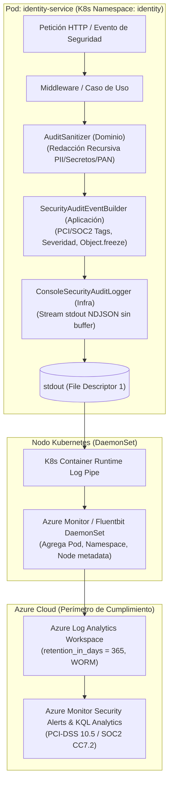

# Guía Técnica de Pruebas Interactivas: US-19 — Logging de Auditoría Estructurado (12-Factor NDJSON) e Ingesta Inmutable en Azure Log Analytics

> **Document ID:** `GUIDELINE-20-immutable-audit-log-analytics`  
> **Bounded Context:** `security` / `compliance` / `observability`  
> **Historia de Usuario:** [US-19: Structured Security Audit Logging (12-Factor stdout NDJSON) & Azure Log Analytics Ingestion](../epics/EPIC-07-fintech-compliance-hardening-and-security-standards/stories/US-19-immutable-audit-log-analytics.md)  
> **Estándares Regulatorios:** PCI-DSS v4.0 (Req 10.2 & 10.5) · SOC 2 Type II (CC7.2) · 12-Factor App (Principio XI: Logs)  
> **Arquitectura & Decisiones:** [ADR 0007: Cloud Infrastructure Topology](../../docs/adr/0007-cloud-infrastructure-topology.md)  
> **Componentes Principales:**
> - Puerto & Tipos Canónicos: [`src/contexts/identity/application/ports/security/audit_logger.ts`](../../src/contexts/identity/application/ports/security/audit_logger.ts)
> - Sanitizador Recursivo de Dominio: [`src/contexts/identity/domain/security/audit_sanitizer.ts`](../../src/contexts/identity/domain/security/audit_sanitizer.ts)
> - Constructor & Normalizador de Eventos: [`src/contexts/identity/application/security/audit_event_builder.ts`](../../src/contexts/identity/application/security/audit_event_builder.ts)
> - Adaptador 12-Factor stdout NDJSON: [`src/contexts/identity/infrastructure/logging/console_security_audit_logger.ts`](../../src/contexts/identity/infrastructure/logging/console_security_audit_logger.ts)
> - Middlewares HTTP: [`interfaces/http/middlewares/security_audit_logger.ts`](../../interfaces/http/middlewares/security_audit_logger.ts) y [`interfaces/http/middlewares/auth_middleware.ts`](../../interfaces/http/middlewares/auth_middleware.ts)
> - Hardening Terraform: [`infrastructure/terraform/modules/log_analytics/`](../../infrastructure/terraform/modules/log_analytics/) y [`infrastructure/terraform/environments/local/`](../../infrastructure/terraform/environments/local/)

---

## 1. Visión General: Arquitectura 12-Factor y Mandatos Regulatorios

En arquitecturas fintech críticas y de identidad multi-inquilino, el registro de eventos de seguridad no es un simple mecanismo de depuración, sino una **pista forense legally-binding** e inmutable sujeta a estrictos mandatos regulatorios internacionales.

### 1.1 Mandatos de Cumplimiento Regulatorio

1. **PCI-DSS v4.0 Requisito 10.2 (Eventos Auditables Mandatorios):**
   - **Req 10.2.1:** Registro de todo acceso y fallo de acceso individual a componentes del sistema (`AUTH_LOGIN_SUCCESS`, `AUTH_LOGIN_FAILURE`).
   - **Req 10.2.2:** Registro de acciones administrativas y elevación de privilegios (`ROLE_ASSIGNED`, `PRIVILEGE_ELEVATED`).
   - **Req 10.2.4:** Acceso a componentes de pistas de auditoría y configuración de seguridad.
   - **Req 10.2.5:** Fallos lógicos y violaciones de autorización cross-tenant (`CROSS_TENANT_VIOLATION`, `UNAUTHORIZED_RESOURCE_ACCESS`).
   - **Req 10.2.6:** Emisión, validación y revocación de credenciales y tokens criptográficos (`TOKEN_ISSUED`, `TOKEN_REVOKED`, `KEY_ROTATED`).

2. **PCI-DSS v4.0 Requisito 10.5 (Inmutabilidad y Retención WORM):**
   - Asegurar que los registros de auditoría no puedan ser alterados, borrados o deshabilitados (*Write Once, Read Many* / WORM).
   - Retención obligatoria de logs por un mínimo de **365 días (1 año)**, con al menos 90 días disponibles para análisis inmediato.

3. **SOC 2 Type II CC7.2 (Detección de Anomalías y Operación del Sistema):**
   - Monitoreo continuo de la infraestructura e ingestión centralizada para detectar accesos anómalos o intentos no autorizados de escalada horizontal entre inquilinos.

4. **12-Factor App (Principio XI: Logs):**
   - La aplicación no debe gestionar la persistencia, rotación, almacenamiento local en disco ni transmisión por red de sus propios archivos de registro.
   - La aplicación emite los eventos de seguridad como un **flujo continuo de eventos no bloqueante y formateado en NDJSON (Newline Delimited JSON)** directamente hacia `stdout`.
   - El plano de control de Kubernetes y los agentes DaemonSet (ej. Azure Monitor Container Insights o Fluentbit) capturan `stdout`, agregan contexto del Pod/Namespace y transportan los registros hacia Azure Log Analytics Workspace.




---

## 2. Contratos de Dominio y Capa de Aplicación

La arquitectura desacopla el registro de auditoría mediante un puerto canónico en la capa de aplicación (`SecurityAuditLogger`) y una fábrica normalizadora (`SecurityAuditEventBuilder`), asegurando que ningún log sea emitido con esquemas arbitrarios o estructuras desalineadas.

### 2.1 Esquema Canónico (`CanonicalSecurityAuditEvent`)

Todo evento procesado por el sistema implementa la interfaz `CanonicalSecurityAuditEvent`, agrupando los campos en metadatos lógicos de alta fidelidad:

```typescript
export interface CanonicalSecurityAuditEvent {
  readonly id: string;               // UUID v4 único del evento
  readonly timestamp: string;        // ISO 8601 UTC estricto (ej. 2026-11-16T04:00:00.000Z)
  readonly eventType: SecurityEventType;
  readonly severity: SecurityAuditSeverity; // 'ALERT' | 'WARN' | 'INFO'
  readonly status: SecurityAuditStatus;     // 'SUCCESS' | 'FAILURE' | 'DENIED'
  readonly actor: SecurityAuditActor;       // userId, tenantId, ip, userAgent
  readonly trace: SecurityAuditTrace;       // requestId, correlationId
  readonly compliance: SecurityAuditCompliance; // pciDssRequirements, soc2Controls
  readonly details: Record<string, unknown>;    // Payload sanitizado de dominio
}
```

#### Catálogo de Eventos Bancarios (`SecurityEventType`)
| Categoría de Evento | `SecurityEventType` | Severidad Predeterminada | Requisito PCI / SOC 2 |
| :--- | :--- | :--- | :--- |
| **Autenticación** | `AUTH_LOGIN_SUCCESS` | `INFO` | PCI 10.2.1 |
| | `AUTH_LOGIN_FAILURE` | `WARN` | PCI 10.2.1 / SOC2 CC7.2 |
| | `AUTH_LOGOUT` | `INFO` | PCI 10.2.1 |
| **Tokens & Criptografía** | `TOKEN_ISSUED` | `INFO` | PCI 10.2.6 |
| | `TOKEN_REFRESHED` | `INFO` | PCI 10.2.6 |
| | `TOKEN_REVOKED` | `INFO` | PCI 10.2.6 |
| | `KEY_ROTATED` | `INFO` | PCI 10.2.6 |
| **Aislamiento Multi-Tenant** | `CROSS_TENANT_VIOLATION` | `ALERT` | PCI 10.2.5 / SOC2 CC7.2 |
| | `UNAUTHORIZED_RESOURCE_ACCESS` | `ALERT` | PCI 10.2.5 / SOC2 CC7.2 |
| **Privilegios & RBAC** | `ROLE_ASSIGNED` | `INFO` | PCI 10.2.2 |
| | `PRIVILEGE_ELEVATED` | `WARN` | PCI 10.2.2 |
| **Federación & JIT** | `FEDERATED_LOGIN_SUCCESS` | `INFO` | PCI 10.2.1 |
| | `FEDERATED_LOGIN_FAILURE` | `WARN` | PCI 10.2.1 |

---

### 2.2 Normalizador y Constructor (`SecurityAuditEventBuilder`)

Para conciliar casos de uso legados que emitían estructuras con claves en `snake_case` (ej. `user_id`, `ip_address`, `tenant_id`) con el estándar canónico en `camelCase`, el `SecurityAuditEventBuilder` realiza:

1. **Resolución de Nombres Polimórficos:** Mapea automáticamente `user_id` -> `actor.userId`, `tenant_id` -> `actor.tenantId`, `ip_address` -> `actor.ip`, `request_id` -> `trace.requestId`, etc.
2. **Inferencia Determinista de Severidad y Estado:**
   - Si `eventType` es `CROSS_TENANT_VIOLATION` o `UNAUTHORIZED_RESOURCE_ACCESS`, se fuerza severidad `ALERT` y estado `DENIED`.
   - Si `eventType` es `AUTH_LOGIN_FAILURE` o contiene `FAILURE`, se asigna `WARN` y `FAILURE`.
   - En cualquier otro caso sin severidad explícita, se asigna `INFO` y `SUCCESS`.
3. **Inyección de Etiquetas Regulatorias:** Añade automáticamente las normas mínimas de PCI-DSS (`10.2.1`, `10.2.5`, `10.2.6`) y SOC 2 (`CC7.2`) combinándolas con etiquetas personalizadas si se especifican.
4. **Sanitización Previa de Detalles:** Ejecuta `AuditSanitizer.sanitize(details)` antes de congelar el evento.
5. **Inmutabilidad Absoluta (`Object.freeze`):** El evento devuelto queda completamente sellado contra modificaciones accidentales o maliciosas en tiempo de ejecución.


---

## 3. Sanitización Recursiva y Protección de Secretos (`AuditSanitizer`)

El estándar **PCI-DSS v4.0 (Req 3.4 & 10.5)** prohíbe taxativamente la presencia de datos de autenticación sensibles (SAD), contraseñas, números de tarjeta de crédito (PAN) y claves privadas en archivos o flujos de auditoría. Para garantizar esta protección sin degradar el rendimiento, el servicio de dominio `AuditSanitizer` implementa un algoritmo de purgado en profundidad.

```mermaid
flowchart TD
    RAW["Objeto / Payload Crudo"] --> TYPE{"Tipo de Dato"}
    TYPE -->|Primitivo No-String| RET["Retornar As-Is"]
    TYPE -->|String| STR["Inspección Heurística Regex\n(PEM, JWT, PAN, Query Params)"]
    TYPE -->|Objeto / Array| CIRC{"¿Referenciado en WeakSet?"}
    CIRC -->|Sí| RED_CIRC["Retornar '[CIRCULAR]'"]
    CIRC -->|No| REG_SET["Registrar en WeakSet"]
    REG_SET --> KEYS{"Para cada clave / elemento"}
    KEYS --> SENS{"¿isSensitiveKey(key)?"}
    SENS -->|Sí| RED["Asignar '[REDACTED]'"]
    SENS -->|No (o Benigno)| REC["Sanitizar Recursivamente Valor"]
    STR --> CLEAN["Cadena Purgada"]
    RED --> CLEAN_OBJ["Objeto Purgado"]
    REC --> CLEAN_OBJ
```

---

### 3.1 Purgado Basado en Nombres de Claves (`isSensitiveKey`)

El sanitizador inspecciona los nombres de las propiedades de los objetos ignorando mayúsculas/minúsculas y separadores (`_`, `-`):

1. **Exclusiones Benignas Prioritarias (Evitan Falsos Positivos):**
   Antes de evaluar patrones sensibles, se verifica si la clave pertenece a la lista blanca de términos operativos benignos:
   - `/status[_-]?code/i` (permite `statusCode: 200`, `status_code: 401`)
   - `/zip[_-]?code/i` (permite códigos postales)
   - `/country[_-]?code/i` (permite códigos de país ISO)
   - `/token[_-]?type/i` (permite `token_type: "Bearer"`)
   - `/token[_-]?tenant/i` (permite `tokenTenant: "alpha"`)

2. **Patrones de Claves Sensibles (Redacción Automática a `[REDACTED]`):**
   - **Contraseñas & Hashes:** `/passw(or)?d/i`, `/salt/i`, `/hash/i`
   - **Secretos & Llaves:** `/secret/i`, `/private[_-]?key/i`, `/apiKey/i`, `/client[_-]?secret/i`
   - **Tokens de Sesión / Auth:** `/(?:^|[a-z0-9_-])(?:access[_-]?|refresh[_-]?|id[_-]?|session[_-]?|auth[_-]?|secret[_-]?)?tokens?(?:[_-]?(?:value|secret|hash))?$/i`
   - **Datos de Tarjeta & Financieros (PCI-DSS):** `/pan\b/i`, `/cvv|cvc/i`, `/ssn/i`, `/account[_-]?number/i`
   - **Cabeceras de Autorización:** `/authorization/i`, `/bearer/i`, `/cookie/i`

---

### 3.2 Heurísticas en Cadenas de Texto No Estructuradas

Cuando un valor es una cadena de texto (incluso dentro de mensajes de error o URLs), se aplican filtros regex para neutralizar secretos embebidos:

| Tipo de Secreto | Patrón de Detección Heurística | Reemplazo Determinista |
| :--- | :--- | :--- |
| **Bloque PEM de Llave Privada** | `/-----BEGIN[ A-Z0-9_-]*PRIVATE KEY-----[\s\S]*?-----END[ A-Z0-9_-]*PRIVATE KEY-----/gi` | `[REDACTED_PRIVATE_KEY]` |
| **Bearer Token JWT** | `/(?:Bearer\s+)?(eyJ[a-zA-Z0-9_-]{10,}\.eyJ[a-zA-Z0-9_-]{10,}\.[a-zA-Z0-9_-]{10,})/g` | `[REDACTED_JWT]` |
| **PAN de Tarjeta de Crédito** | `/\b(?:\d[ -]*?){13,19}\b/g` (validando longitud numérica entre 13 y 19 dígitos) | `[REDACTED_PAN]` |
| **Parámetros de Query URL** | `/(password\|token\|secret\|api_key\|client_secret)=([^&]+)/gi` | `$1=[REDACTED]` |

---

### 3.3 Resiliencia ante Referencias Circulares (`WeakSet`)

Para evitar errores catastróficos de desbordamiento de pila (*Call Stack Overflow*) ante objetos con ciclos de referencia (muy comunes en instancias complejas de frameworks como Express `req`), el sanitizador rastrea los objetos visitados en un `WeakSet<object>()`. Si detecta un nodo ya visitado, corta el ciclo y asigna la cadena literal `'[CIRCULAR]'`.


---

## 4. Infraestructura y Hardening en Terraform (Azure Log Analytics Workspace)

La persistencia centralizada e inmutable de los registros de auditoría se gestiona como código en Terraform, asegurando que el repositorio de almacenamiento (*Log Analytics Workspace*) mantenga las políticas de retención WORM requeridas para PCI-DSS v4.0 Req 10.5 y SOC 2 Type II CC7.2.

### 4.1 Módulo Reutilizable `log_analytics`

El módulo reside en [`infrastructure/terraform/modules/log_analytics/`](../../infrastructure/terraform/modules/log_analytics/) y aprovisiona el workspace con SKU `PerGB2018`:

```hcl
resource "azurerm_log_analytics_workspace" "this" {
  name                = var.name
  location            = var.location
  resource_group_name = var.resource_group_name
  sku                 = var.sku
  retention_in_days   = var.retention_in_days
  tags                = var.tags
}
```

---

### 4.2 Guardarraíl de Cumplimiento en Variables HCL

Para impedir que un operador o script de CI/CD reduzca el tiempo de retención por debajo del estándar bancario de 1 año, `variables.tf` impone un guardarraíl sintáctico inviolable:

```hcl
variable "retention_in_days" {
  description = "Number of days of log retention in Log Analytics Workspace. Must be at least 365 days for PCI-DSS 10.5 / SOC2 CC7.2 compliance."
  type        = number
  default     = 365

  validation {
    condition     = var.retention_in_days >= 365
    error_message = "retention_in_days must be at least 365 days (1 year) to comply with PCI-DSS Req 10.5 and SOC2 CC7.2."
  }
}
```

Cualquier intento de ejecutar `terraform plan` con un valor inferior a `365` aborta la ejecución con un error explícito de validación antes de crear o modificar infraestructura.

---

### 4.3 Configuración en Entorno Local y Tags Regulatorios

En [`infrastructure/terraform/environments/local/main.tf`](../../infrastructure/terraform/environments/local/main.tf), el módulo se instancia apuntando al emulador local de Azure ARM (Floci en puerto `:4578`) incorporando los metadatos de auditoría:

```hcl
module "log_analytics" {
  source              = "../../modules/log_analytics"
  name                = "law-identity-local"
  location            = var.location
  resource_group_name = module.resource_group.name
  retention_in_days   = 365

  tags = {
    Environment = "local"
    Compliance  = "PCI-DSS-10.5/SOC2-CC7.2"
    Retention   = "Immutable-365d"
  }
}
```

#### Salidas de Trazabilidad (`outputs.tf`)
El módulo y el entorno exponen los identificadores de ingesta para que los agentes de K8s puedan vincularse al espacio de trabajo:
- `log_analytics_workspace_id`: GUID del workspace.
- `log_analytics_primary_key`: Llave compartida primaria para ingesta de telemetría.
- `log_analytics_retention_days`: Confirma la retención configurada (365 días).


---

## 5. Matriz de Troubleshooting y Consultas KQL de Auditoría

### 5.1 Matriz de Diagnóstico y Resolución de Incidencias

| Síntoma / Error Observado | Origen / Capa | Causa Raíz Probable | Acción Correctiva Inmediata |
| :--- | :--- | :--- | :--- |
| **`Error: write EPIPE` en streams de proceso** | Infraestructura / Node.js Stream | El consumidor de `stdout` (pipe de terminal o proceso hijo) cerró su descriptor antes de que el logger finalizara de escribir. | El adaptador `ConsoleSecurityAuditLogger` implementa un listener `error` defensivo en `outputStream` y fallback a `process.stderr` si el stream primario falla. |
| **Los logs aparecen en `stdout` pero no se ingieren en Log Analytics** | DaemonSet / Agente K8s | El agente de Azure Monitor Container Insights o Fluentbit no tiene habilitada la captura de `stdout` del namespace `identity` o falla el parser JSON. | 1. Verificar la configuración del ConfigMap `container-azm-ms-agentconfig`.<br>2. Comprobar que los logs se emitan como NDJSON en una sola línea estricta sin saltos `\n` intermedios. |
| **Falsos positivos: Campos como `statusCode` o `tokenTenant` salen redactados como `[REDACTED]`** | Dominio / `AuditSanitizer` | Una regla de expresión regular demasiado genérica en claves sensibles coincide con nombres operacionales. | Verificar que la clave esté incluida en `BENIGN_EXCLUSIONS` en `audit_sanitizer.ts` (`/status[_-]?code/i`, `/token[_-]?tenant/i`, etc.). |
| **`terraform plan` aborta con error: `retention_in_days must be at least 365 days`** | Terraform / HCL Validation | Se suministró un valor de retención inferior a 365 días en `variables.tf` o en los overrides de entorno. | Configurar `retention_in_days = 365` o superior para cumplir con el mandato legal PCI-DSS Req 10.5. |
| **Logs de eventos de auditoría no aparecen durante pruebas unitarias** | Servidor HTTP / Inyección DI | Por defecto, en `NODE_ENV === 'test'` el servidor inyecta el logger en memoria `InMemorySecurityAuditLogger` para no contaminar la consola. | Si se requiere inspeccionar logs NDJSON durante tests interactivos, definir la variable de entorno `FORCE_CONSOLE_AUDIT_LOGS=true`. |

---

### 5.2 Consultas Canónicas KQL para Analistas de SOC y Cumplimiento

En el portal de Azure Log Analytics Workspace o Azure Sentinel, las siguientes consultas KQL permiten extraer métricas forenses directas:

#### 1. Detección de Intentos de Violación de Aislamiento Multi-Tenant (`CROSS_TENANT_VIOLATION`)
```kql
ContainerLogV2
| where PodNamespace == "identity"
| where LogMessage has "CROSS_TENANT_VIOLATION"
| extend Audit = parse_json(LogMessage)
| project
    TimeGenerated,
    EventId = tostring(Audit.id),
    Severity = tostring(Audit.severity),
    ActorTenant = tostring(Audit.actor.tenantId),
    TargetTenant = tostring(Audit.details.targetTenantId),
    ActorId = tostring(Audit.actor.userId),
    ClientIP = tostring(Audit.actor.ip),
    TraceId = tostring(Audit.trace.requestId)
| order by TimeGenerated desc
```

#### 2. Detección de Fuerza Bruta en Autenticación (`AUTH_LOGIN_FAILURE` > 5 en 5 min)
```kql
ContainerLogV2
| where PodNamespace == "identity"
| where LogMessage has "AUTH_LOGIN_FAILURE"
| extend Audit = parse_json(LogMessage)
| summarize FailedAttempts = count() by 
    ClientIP = tostring(Audit.actor.ip), 
    TenantId = tostring(Audit.actor.tenantId),
    bin(TimeGenerated, 5m)
| where FailedAttempts >= 5
| order by FailedAttempts desc
```

#### 3. Auditoría de Rotación de Llaves Criptográficas y Tokens (`PCI-DSS 10.2.6`)
```kql
ContainerLogV2
| where PodNamespace == "identity"
| extend Audit = parse_json(LogMessage)
| where tostring(Audit.eventType) in ("TOKEN_ISSUED", "TOKEN_REVOKED", "KEY_ROTATED")
| project
    TimeGenerated,
    EventType = tostring(Audit.eventType),
    Status = tostring(Audit.status),
    KeyId = tostring(Audit.details.keyId),
    TenantId = tostring(Audit.actor.tenantId),
    PciReqs = tostring(Audit.compliance.pciDssRequirements)
| order by TimeGenerated desc
```

#### 4. Verificación de Cumplimiento PCI-DSS / SOC 2
```kql
ContainerLogV2
| where PodNamespace == "identity"
| extend Audit = parse_json(LogMessage)
| where isnotempty(Audit.compliance)
| summarize EventCount = count() by 
    EventType = tostring(Audit.eventType),
    Severity = tostring(Audit.severity),
    Status = tostring(Audit.status)
| order by EventCount desc
```
