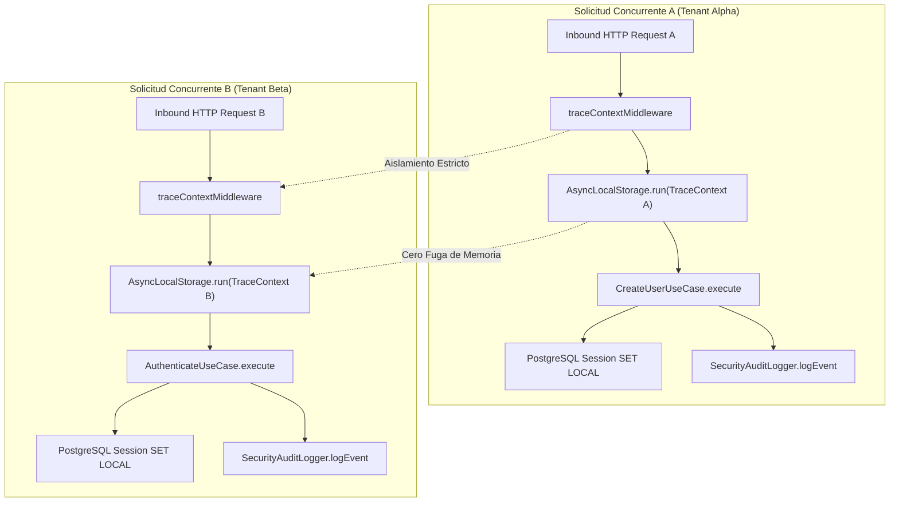

# GUIDELINE-21: Trazabilidad Distribuida, Correlación RFC 7230/7231 y Propagación W3C Traceparent

## 1. Introducción y Contexto Regulatorio y Estándares

### 1.1 El Desafío de la Observabilidad Distribuida en Microservicios FinTech
En plataformas de identidad, autenticación federada y servicios bancarios multi-inquilino (multi-tenant), las peticiones de los usuarios atraviesan múltiples capas arquitectónicas y saltos de red: desde aplicaciones cliente (móviles, SPAs y APIs M2M), pasando por controladores de borde (Ingress Controllers / API Gateways), hasta microservicios de aplicación, proxies de caché en memoria y bases de datos relacionales con aislamiento a nivel de fila (Row-Level Security).

Históricamente, la correlación de solicitudes dependía exclusivamente de encabezados HTTP propietarios o ad-hoc (como `X-Request-ID`), lo que generaba fragmentación, pérdida de contexto en llamadas downstream y falta de interoperabilidad con agentes de monitoreo de rendimiento de aplicaciones (APM) y colectores OpenTelemetry. 

La adopción de una arquitectura de observabilidad estandarizada permite:
1. **Reconstrucción Inequívoca de Transacciones:** Vincular cualquier anomalía, fallo de autenticación o degradación de latencia con la secuencia exacta de llamadas que la originó.
2. **Auditoría Forense en Tiempo Real:** Demostrar ante auditores de cumplimiento que cada acción registrada en la bitácora inmutable corresponde a una interacción de red verificable.
3. **Cero Fuga de Contexto:** Garantizar que los identificadores de traza viajen de forma transparente a través de los límites del proceso asíncrono de Node.js sin contaminar operaciones concurrentes.

---

### 1.2 Estándares Técnicos Aplicados

#### W3C Trace Context (Recommendation 2021)
El estándar **W3C Trace Context** define encabezados HTTP universalmente reconocidos para la propagación de contexto de rastreo distribuido sin acoplamiento a proveedores propietarios:
- `traceparent`: Encabezado primario obligatorio estructurado que transmite el identificador global de traza, el identificador del span emisor y las banderas de muestreo.
- Formato Canónico: `version-trace_id-parent_id-trace_flags` (ejemplo: `00-4bf92f3577b34da6a3ce929d0e0e4736-00f067aa0ba902b7-01`).

#### RFC 7230 / RFC 7231 (Hypertext Transfer Protocol - Message Syntax & Semantics)
Define la sintaxis y semántica de las cabeceras HTTP. Para garantizar retrocompatibilidad total con sistemas legados y balanceadores de carga tradicionales, se implementa una estrategia de doble encabezado:
- `X-Request-ID`: Identificador unívoco asignado al salto HTTP actual (UUID v4 o valor suministrado por el cliente/gateway).
- `X-Correlation-ID`: Identificador de sesión o flujo de negocio que persiste a lo largo de múltiples transacciones encadenadas.

---

### 1.3 Marco de Cumplimiento Regulatorio y de Seguridad

| Estándar / Regulación | Requerimiento Específico | Implementación en `identity-service` |
| :--- | :--- | :--- |
| **PCI-DSS v4.0** | **Req 10.2.1 & 10.2.5:** Registrar todos los eventos de acceso a datos del titular, autenticación y verificación de credenciales con identificadores de sesión y traza verificables. | Cada evento emitido por `SecurityAuditEventBuilder` incluye obligatoriamente `trace: { requestId, correlationId, traceId, spanId, traceparent }`. |
| **PCI-DSS v4.0** | **Req 10.5.1:** Proteger las bitácoras de auditoría contra modificaciones no autorizadas garantizando inmutabilidad y sellado criptográfico. | Los eventos se serializan como objetos congelados (`Object.freeze`) y se emiten a `stdout` en formato NDJSON estructurado de 12 factores. |
| **SOC 2 Type II** | **Criterio CC7.2:** Monitoreo y detección de anomalías operacionales y eventos de seguridad en toda la infraestructura tecnológica. | Visibilidad en tiempo real de transacciones bloqueadas o lentas en PostgreSQL correlacionadas directamente con el trace ID HTTP. |

---

### 1.4 Topología de Propagación de Traza de Extremo a Extremo

```mermaid
sequenceDiagram
    autonumber
    actor Cliente as Cliente HTTP / SPA
    participant Ingress as NGINX Ingress Controller
    participant Middleware as TraceContextMiddleware
    participant Storage as AsyncLocalStorage
    participant App as UseCase / Aggregate
    participant DB as PostgreSQL (Session Context)
    participant Audit as NDJSON Audit Logger

    Cliente->>Ingress: HTTP Request (traceparent opcional, X-Request-ID)
    Note over Ingress: Preserva o reenvía<br/>traceparent & X-Request-ID
    Ingress->>Middleware: Inbound Request
    Note over Middleware: Valida W3C traceparent.<br/>Si es válido, deriva child spanId.<br/>Si es ausente, crea nueva raíz.
    Middleware->>Storage: CorrelationContextStorage.run(traceContext)
    activate Storage
    Middleware->>App: Invoca Casos de Uso (dominio desacoplado)
    App->>DB: TenantAwareTransactionRunner.runInTenantContext()
    Note over DB: BEGIN;<br/>SET LOCAL app.current_tenant_id = $1;<br/>SET LOCAL app.traceparent = $2;<br/>SET LOCAL app.request_id = $3;
    DB-->>App: Transacción completada (COMMIT)
    App->>Audit: SecurityAuditLogger.logEvent()
    Note over Audit: Recupera traceId/spanId<br/>desde Storage.current()<br/>y emite NDJSON a stdout
    App-->>Middleware: Resultado de negocio
    deactivate Storage
    Middleware-->>Cliente: HTTP Response con headers:<br/>traceparent, X-Request-ID, X-Correlation-ID
```

---

## 2. Anatomía Técnica del Encabezado W3C Traceparent

### 2.1 Estructura Cuatripartita del Estándar W3C
La recomendación W3C Trace Context (versión de nivel 1) formaliza una cadena de texto ASCII delimitada por guiones (`-`) compuesta exactamente por cuatro subcampos posicionales en formato hexadecimal en minúsculas:

$$\texttt{traceparent} = \texttt{version} - \texttt{trace\_id} - \texttt{parent\_id} - \texttt{trace\_flags}$$

| Campo | Longitud | Representación | Invariantes de Especificación | Semántica en `identity-service` |
| :--- | :--- | :--- | :--- | :--- |
| **`version`** | 2 caracteres hex | 1 byte (`00` a `fe`) | Actualmente la especificación fija `00`. El valor `ff` está explícitamente prohibido por la W3C. Si la versión es `00`, debe contener exactamente 4 partes y 55 caracteres en total. | Fijado rígidamente en `00`. Versiones distintas se consideran incompatibles y provocan regeneración defensiva de contexto raíz. |
| **`trace_id`** | 32 caracteres hex | 16 bytes (128 bits) | **Prohibido All-Zeroes:** No puede ser `00000000000000000000000000000000`. Debe ser generado aleatoriamente o con entropía criptográfica suficiente para garantizar unicidad global. | Identificador global e inmutable de la transacción de negocio distribuida. Permanece idéntico en todos los saltos de microservicios y consultas a base de datos. |
| **`parent_id` / `span_id`** | 16 caracteres hex | 8 bytes (64 bits) | **Prohibido All-Zeroes:** No puede ser `0000000000000000`. Identifica el segmento o llamada inmediata precedente que originó la solicitud. | En la cabecera recibida representa el span del emisor (`parentSpanId`). Para el procesamiento interno de `identity-service`, se deriva un nuevo `spanId` local único. |
| **`trace_flags`** | 2 caracteres hex | 1 byte (8 bits) | Mapa de bits de control. El bit menos significativo (`01`) representa la bandera `recorded` / `sampled`. Los 7 bits restantes están reservados para futuros estándares y deben ser preservados. | Por defecto `01` (muestreado/grabado). Indica a los colectores APM y agentes de monitoreo si la traza debe persistirse en los sistemas de telemetría. |

---

### 2.2 Invariantes de Validación y Reglas de Rechazo Defensivo

Para blindar la plataforma frente a entradas maliciosas, encabezados corruptos o vectores de inyección en encabezados HTTP (CRLF / Header Injection), el analizador sintáctico implementa las siguientes salvaguardas rigurosas:

1. **Expresión Regular Canónica Estricta:**
   La cadena debe satisfacer sin excepciones la siguiente expresión regular canónica:
   ```typescript
   const W3C_TRACEPARENT_REGEX = /^([0-9a-f]{2})-([0-9a-f]{32})-([0-9a-f]{16})-([0-9a-f]{2})$/;
   ```
2. **Rechazo de Identificadores Nulos (All-Zeroes):**
   Conforme a la sección 3.2.2 y 3.2.3 de la especificación W3C:
   - Un `trace_id` con 32 ceros hexadecimales (`00000000000000000000000000000000`) es considerado formalmente inválido.
   - Un `parent_id` con 16 ceros hexadecimales (`0000000000000000`) es considerado formalmente inválido.
3. **Resiliencia Operacional (Fail-Safe Root Regeneration):**
   Si una solicitud entrante carece de cabecera `traceparent`, o si el valor recibido es malformado, vacío o viola las restricciones W3C, **el servicio nunca rechaza la solicitud HTTP con errores 400 Bad Request o 500 Internal Server Error**. En su lugar, inicializa de forma silenciosa y transparente un nuevo contexto raíz (`TraceContext.createNew()`) manteniendo la continuidad operacional del negocio y asegurando trazabilidad local completa.

---

### 2.3 Semántica de Derivación de Child Spans (Service Hop)

Uno de los errores más comunes en implementaciones de observabilidad es la **reutilización del `span_id` entrante** dentro del microservicio receptor. 

Bajo la arquitectura de OpenTelemetry y W3C Distributed Tracing:
- El `span_id` recibido en el encabezado `traceparent` pertenece exclusivamente al salto anterior (por ejemplo, el API Gateway o Ingress).
- Cuando `identity-service` acepta la petición, debe registrar el `span_id` recibido como su `parentSpanId`.
- Inmediatamente, debe generar un nuevo identificador criptográfico de 8 bytes (16 caracteres hexadecimales) para su propio `spanId` local.

```text
Transacción Distribuida (Trace ID: 4bf92f3577b34da6a3ce929d0e0e4736)
 │
 ├── [Span A: API Gateway] (span_id: 00f067aa0ba902b7, parent: null)
 │    │
 │    └── HTTP Request con traceparent: 00-4bf92f3577b34da6a3ce929d0e0e4736-00f067aa0ba902b7-01
 │         │
 │         ▼
 └── [Span B: Identity Service] (span_id: 5c8a412e109dfb33, parent_span_id: 00f067aa0ba902b7)
      │
      ├── PostgreSQL Transaction (Session Context: app.traceparent = 00-4bf92f3577b34da6a3ce929d0e0e4736-5c8a412e109dfb33-01)
      └── Audit Log Event (trace: { traceId, spanId: 5c8a412e109dfb33, parentSpanId: 00f067aa0ba902b7 })
```

Esta separación garantiza que las herramientas de APM (Grafana Tempo, Jaeger, Datadog) puedan graficar con exactitud el árbol de llamadas, desglosando la latencia propia de `identity-service` frente a la latencia de red del Ingress.

---

### 2.4 Diseño e Implementación del Value Object `TraceContext`

El dominio compartido aloja el Value Object inmutable `TraceContext` en `src/contexts/shared/domain/tracing/trace_context.ts`. El diseño aplica el patrón *Value Object* de Domain-Driven Design (DDD): inmutabilidad por congelamiento (`Object.freeze`), igualdad por valor y encapsulamiento completo de invariantes.

```typescript
import { randomBytes, randomUUID } from 'crypto';
import { DomainValidationError } from '../exceptions/domain_error';

export interface TraceContextProps {
  traceId: string;
  spanId: string;
  traceFlags?: string;
  requestId?: string;
  correlationId?: string;
  parentSpanId?: string;
}

export class TraceContext {
  public readonly version: string;
  public readonly traceId: string;
  public readonly spanId: string;
  public readonly traceFlags: string;
  public readonly requestId: string;
  public readonly correlationId: string;
  public readonly parentSpanId?: string;

  private constructor(props: {
    version: string;
    traceId: string;
    spanId: string;
    traceFlags: string;
    requestId: string;
    correlationId: string;
    parentSpanId?: string;
  }) {
    this.version = props.version;
    this.traceId = props.traceId;
    this.spanId = props.spanId;
    this.traceFlags = props.traceFlags;
    this.requestId = props.requestId;
    this.correlationId = props.correlationId;
    this.parentSpanId = props.parentSpanId;

    Object.freeze(this);
  }

  /**
   * Crea una instancia validando invariantes W3C y asignando defaults seguros.
   */
  public static create(props: TraceContextProps): TraceContext {
    const traceId = props.traceId ? props.traceId.toLowerCase().trim() : '';
    const spanId = props.spanId ? props.spanId.toLowerCase().trim() : '';
    const traceFlags = (props.traceFlags || '01').toLowerCase().trim();
    const requestId = props.requestId ? props.requestId.trim() : randomUUID();
    const correlationId = props.correlationId ? props.correlationId.trim() : requestId;
    const parentSpanId = props.parentSpanId ? props.parentSpanId.toLowerCase().trim() : undefined;

    TraceContext.validateTraceId(traceId);
    TraceContext.validateSpanId(spanId);
    TraceContext.validateTraceFlags(traceFlags);

    if (parentSpanId !== undefined) {
      TraceContext.validateSpanId(parentSpanId, 'parentSpanId');
    }

    return new TraceContext({
      version: '00',
      traceId,
      spanId,
      traceFlags,
      requestId,
      correlationId,
      parentSpanId,
    });
  }

  /**
   * Genera un nuevo contexto raíz con entropía criptográfica segura.
   */
  public static createNew(requestId?: string, correlationId?: string): TraceContext {
    const traceId = randomBytes(16).toString('hex');
    const spanId = randomBytes(8).toString('hex');
    const activeRequestId = requestId ? requestId.trim() : randomUUID();
    const activeCorrelationId = correlationId ? correlationId.trim() : activeRequestId;

    return new TraceContext({
      version: '00',
      traceId,
      spanId,
      traceFlags: '01',
      requestId: activeRequestId,
      correlationId: activeCorrelationId,
    });
  }

  /**
   * Parsea un encabezado W3C traceparent y deriva automáticamente un child span para este microservicio.
   */
  public static fromW3C(traceparent: string, requestId?: string, correlationId?: string): TraceContext {
    if (!traceparent || typeof traceparent !== 'string') {
      throw new InvalidTraceContextError('Traceparent header must be a non-empty string');
    }

    const trimmed = traceparent.trim().toLowerCase();
    const match = trimmed.match(/^([0-9a-f]{2})-([0-9a-f]{32})-([0-9a-f]{16})-([0-9a-f]{2})$/);

    if (!match) {
      throw new InvalidTraceContextError(`Malformed traceparent header format: "${traceparent}"`);
    }

    const [, version, incomingTraceId, incomingParentSpanId, traceFlags] = match;

    if (!version || !incomingTraceId || !incomingParentSpanId || !traceFlags) {
      throw new InvalidTraceContextError(`Malformed traceparent header format: "${traceparent}"`);
    }

    if (version !== '00') {
      throw new InvalidTraceContextError(`Unsupported W3C traceparent version: "${version}". Expected "00".`);
    }

    if (incomingTraceId === '00000000000000000000000000000000') {
      throw new InvalidTraceContextError('All-zeroes trace-id is forbidden by W3C specification.');
    }

    if (incomingParentSpanId === '0000000000000000') {
      throw new InvalidTraceContextError('All-zeroes span-id is forbidden by W3C specification.');
    }

    // Microservicio hop: derivar un nuevo spanId local y preservar el entrante como parentSpanId
    const localSpanId = randomBytes(8).toString('hex');
    const activeRequestId = requestId ? requestId.trim() : randomUUID();
    const activeCorrelationId = correlationId ? correlationId.trim() : activeRequestId;

    return new TraceContext({
      version: '00',
      traceId: incomingTraceId,
      spanId: localSpanId,
      traceFlags,
      requestId: activeRequestId,
      correlationId: activeCorrelationId,
      parentSpanId: incomingParentSpanId,
    });
  }

  /**
   * Serializa al formato canónico W3C: version-trace_id-span_id-trace_flags
   */
  public toTraceparent(): string {
    return `${this.version}-${this.traceId}-${this.spanId}-${this.traceFlags}`;
  }

  /**
   * Deriva un nuevo span hijo manteniendo traceId, requestId y correlationId.
   */
  public createChildSpan(): TraceContext {
    const childSpanId = randomBytes(8).toString('hex');
    return new TraceContext({
      version: this.version,
      traceId: this.traceId,
      spanId: childSpanId,
      traceFlags: this.traceFlags,
      requestId: this.requestId,
      correlationId: this.correlationId,
      parentSpanId: this.spanId,
    });
  }
}
```

---

## 3. Propagación Asíncrona con Node.js `AsyncLocalStorage` y Middleware HTTP

### 3.1 El Desafío Arquitectónico en Clean Architecture y Domain-Driven Design
En sistemas basados en Clean Architecture y DDD, una de las mayores tensiones de diseño radica en cómo propagar metadatos operacionales y de infraestructura (como `traceId`, `spanId`, `requestId` y `tenantId`) hacia las capas más profundas: casos de uso en la capa de aplicación, agregados en el dominio y adaptadores de persistencia en infraestructura.

Existen dos estrategias tradicionales, ambas con desventajas severas:
1. **Contaminación del Dominio (Antipatrón de *Parameter Drilling*):**
   Pasar un objeto de contexto (`context`, `traceContext` o peor aún, el objeto `req` de Express) como parámetro en cada método de caso de uso, método de agregado, entidad y puerto de repositorio (`userRepository.save(user, traceContext)`). Esto rompe la regla de dependencia de Clean Architecture, acopla el dominio a conceptos de red y genera interfaces infladas y frágiles.
2. **Variables Globales Estáticas:**
   En entornos multihilo tradicionales (Java, C#), se utiliza `ThreadLocal`. Sin embargo, en el modelo monohilo asíncrono y no bloqueante de Node.js, una variable global provocaría una catastrófica contaminación de contexto entre solicitudes concurrentes (un usuario A vería la traza y datos de un usuario B).

---

### 3.2 Mecanismo y Ciclo de Vida de `AsyncLocalStorage`
Para resolver este dilema de manera elegante y formal, Node.js introdujo el módulo nativo `async_hooks` y la clase de alto nivel `AsyncLocalStorage`.

`AsyncLocalStorage` asocia un almacén de datos arbitrario al flujo de ejecución asíncrono actual. Dicho almacén se propaga automáticamente a través de:
- Cadenas de promesas y sentencias `await`.
- Microtareas y macrotareas del Event Loop.
- Callbacks asíncronos (`fs.readFile`, temporizadores, eventos de red).
- Consultas paralelas con `Promise.all` o `Promise.allSettled`.



**Beneficios de Ingeniería:**
- **Aislamiento Total:** Cada solicitud concurrente posee su propio contexto de almacenamiento aislado.
- **Recolección Automática de Basura (Zero Memory Leaks):** Al finalizar la ejecución de la función envuelta en `run()`, la referencia al almacén es liberada automáticamente por el recolector de basura de V8 sin requerir limpieza manual.
- **Transparencia para el Dominio:** Los casos de uso y agregados de dominio ejecutan lógica pura sin conocer la existencia de `traceContext`, mientras que los componentes de infraestructura (repositorios y auditores) acceden a la traza de forma implícita.

---

### 3.3 Adaptador de Infraestructura `CorrelationContextStorage`

En `src/contexts/shared/infrastructure/tracing/correlation_context_storage.ts`, se encapsula la instancia de `AsyncLocalStorage` protegiendo el acceso y proporcionando métodos de conveniencia estáticos con salvaguardas defensivas:

```typescript
import { AsyncLocalStorage } from 'async_hooks';
import { TraceContext } from '../../domain/tracing/trace_context';

/**
 * Adaptador de infraestructura que encapsula AsyncLocalStorage de Node.js.
 * Provee acceso de acoplamiento cero al TraceContext activo a lo largo de cadenas
 * de ejecución asíncronas (controladores, casos de uso, servicios y adaptadores).
 */
export class CorrelationContextStorage {
  private static readonly storage = new AsyncLocalStorage<TraceContext>();

  /**
   * Ejecuta lógica sincrónica o asincrónica dentro del alcance del TraceContext dado.
   */
  public static run<T>(context: TraceContext, fn: () => T): T {
    return this.storage.run(context, fn);
  }

  /**
   * Recupera el TraceContext activo, o undefined si se ejecuta fuera de un ciclo HTTP.
   */
  public static current(): TraceContext | undefined {
    return this.storage.getStore();
  }

  /**
   * Retorna el encabezado canónico W3C traceparent del contexto activo,
   * o genera un fallback seguro si se invoca fuera de contexto (ej. jobs cron o workers).
   */
  public static getTraceparent(): string {
    const currentContext = this.current();
    if (currentContext) {
      return currentContext.toTraceparent();
    }
    return TraceContext.createNew().toTraceparent();
  }

  /**
   * Recupera el Request ID activo, o undefined si está fuera de contexto.
   */
  public static getRequestId(): string | undefined {
    return this.current()?.requestId;
  }

  /**
   * Recupera el Correlation ID activo, o undefined si está fuera de contexto.
   */
  public static getCorrelationId(): string | undefined {
    return this.current()?.correlationId ?? this.current()?.requestId;
  }

  /**
   * Recupera el Trace ID activo (W3C), o undefined si está fuera de contexto.
   */
  public static getTraceId(): string | undefined {
    return this.current()?.traceId;
  }

  /**
   * Recupera el Span ID activo (W3C), o undefined si está fuera de contexto.
   */
  public static getSpanId(): string | undefined {
    return this.current()?.spanId;
  }
}
```

---

### 3.4 Middleware HTTP de Trazabilidad y Correlación (`traceContextMiddleware`)

El middleware HTTP (`interfaces/http/middlewares/trace_context_middleware.ts`) actúa como el punto de entrada de la solicitud en la capa de interfaces. Sus responsabilidades están estrictamente orquestadas:

1. **Extracción y Normalización de Encabezados:**
   Inspecciona de forma insensible a mayúsculas los encabezados entrantes `traceparent`, `x-traceparent`, `x-request-id` y `x-correlation-id`.
2. **Validación W3C y Fallback Resiliente:**
   Utiliza `TraceContext.isValidW3C()` para verificar la cabecera. Si es válida, deriva un nuevo `spanId` local preservando el `parentSpanId` con `TraceContext.fromW3C()`. Si no es válida o está ausente, genera una nueva raíz con `TraceContext.createNew()`.
3. **Simetría de Encabezados en la Respuesta:**
   Inyecta en la respuesta HTTP saliente los encabezados `traceparent`, `X-Request-ID` y `X-Correlation-ID`, permitiendo a los clientes correlacionar sus solicitudes.
4. **Envoltura Asíncrona con `run()`:**
   Ejecuta el resto del pipeline de Express (`next()`) dentro de `CorrelationContextStorage.run(traceContext, ...)`.

```typescript
import { Request, Response, NextFunction } from 'express';
import { randomUUID } from 'crypto';
import { TraceContext } from '../../../src/contexts/shared/domain/tracing/trace_context';
import { CorrelationContextStorage } from '../../../src/contexts/shared/infrastructure/tracing/correlation_context_storage';

declare global {
  namespace Express {
    interface Request {
      traceContext?: TraceContext;
    }
  }
}

export function traceContextMiddleware(req: Request, res: Response, next: NextFunction): void {
  const incomingTraceparent =
    (req.headers['traceparent'] as string) ||
    (req.headers['x-traceparent'] as string) ||
    undefined;

  const incomingRequestId =
    typeof req.headers['x-request-id'] === 'string' && req.headers['x-request-id'].trim().length > 0
      ? req.headers['x-request-id'].trim()
      : undefined;

  const incomingCorrelationId =
    typeof req.headers['x-correlation-id'] === 'string' && req.headers['x-correlation-id'].trim().length > 0
      ? req.headers['x-correlation-id'].trim()
      : undefined;

  const requestId = incomingRequestId || randomUUID();
  const correlationId = incomingCorrelationId || requestId;

  let traceContext: TraceContext;

  if (incomingTraceparent && TraceContext.isValidW3C(incomingTraceparent)) {
    try {
      traceContext = TraceContext.fromW3C(incomingTraceparent, requestId, correlationId);
    } catch {
      // Fallback defensivo ante fallos inesperados
      traceContext = TraceContext.createNew(requestId, correlationId);
    }
  } else {
    // Generación de nuevo contexto raíz W3C
    traceContext = TraceContext.createNew(requestId, correlationId);
  }

  // Decoración de la Petición
  req.traceContext = traceContext;
  req.headers['x-request-id'] = requestId;
  req.headers['x-correlation-id'] = correlationId;

  // Decoración Simétrica de Encabezados de Respuesta
  res.setHeader('X-Request-ID', requestId);
  res.setHeader('X-Correlation-ID', correlationId);
  res.setHeader('traceparent', traceContext.toTraceparent());

  // Ejecución downstream aislada en AsyncLocalStorage
  CorrelationContextStorage.run(traceContext, () => {
    next();
  });
}
```


---

## 4. Observabilidad en Capa de Persistencia Relacional (PostgreSQL)

### 4.1 La Brecha de Observabilidad en el Acceso a Datos
En arquitecturas de microservicios basadas en bases de datos relacionales, existe una brecha crítica de observabilidad entre la capa de aplicación y el motor de almacenamiento. Las conexiones hacia PostgreSQL se administran a través de *connection pools* compartidos (como `pg.Pool` o PgBouncer en capas de infraestructura).

Bajo este modelo:
- Múltiples solicitudes HTTP concurrentes reutilizan de manera intercalada un conjunto finito de conexiones físicas TCP.
- Tradicionalmente, cuando un DBA o ingeniero SRE inspecciona la vista del sistema `pg_stat_activity` para analizar contención de bloqueos (*deadlocks*, *exclusive row locks*) o consultas lentas (*slow queries*), la información observable se limita al identificador de proceso (`pid`), tiempo transcurrido, dirección IP del pod y la sentencia SQL en ejecución.
- Resulta imposible correlacionar de forma inmediata una transacción problemática en base de datos con el usuario, la petición HTTP o el identificador de traza que la originó en el borde de la red.

---

### 4.2 Inyección de Variables de Sesión Locales Transaccionales (`set_config`)

PostgreSQL proporciona la función del sistema `set_config(setting_name, new_value, is_local)` para establecer variables de configuración en tiempo de ejecución. 

El diseño de `identity-service` aprovecha de forma estricta el tercer parámetro booleano: `is_local = true` (equivalente a la sentencia SQL `SET LOCAL`):

$$\texttt{SELECT set\_config('app.traceparent', \$1, true);}$$
$$\texttt{SELECT set\_config('app.request\_id', \$1, true);}$$

#### Invariantes Técnicas de `is_local = true`:
1. **Alcance Exclusivamente Transaccional:** La variable reside únicamente en el espacio de memoria de la transacción activa (entre el `BEGIN` y el `COMMIT` o `ROLLBACK`).
2. **Caducidad y Destrucción Automática:** Tan pronto como la transacción finaliza (sea exitosa o fallida), PostgreSQL revierte y purga de forma nativa la variable configurada.
3. **Cero Contaminación de Pool (Anti-Connection Poisoning):** Cuando la conexión física es liberada y devuelta al pool (`client.release()`), no conserva ningún estado residual ni metadatos de solicitudes previas, garantizando higiene absoluta y aislamiento criptográfico entre peticiones.

---

### 4.3 Implementación en `TenantAwareTransactionRunner`

En `src/contexts/identity/infrastructure/persistence/database/tenant_aware_transaction_runner.ts`, el adaptador secundario de transacciones coordina la inyección del contexto de inquilino (`app.current_tenant_id`) con el contexto de trazabilidad distribuida recuperado de forma implícita desde `CorrelationContextStorage`:

```typescript
// Flujo raíz: adquisición de conexión desde el pool y apertura de transacción BEGIN
const client = await this.pool.connect();
let hasError = false;

try {
  await client.query('BEGIN');

  // Inyección de aislamiento de inquilino (Row-Level Security)
  await client.query("SELECT set_config('app.current_tenant_id', $1, true)", [
    targetSession.getTenantIdValue(),
    true,
  ]);

  TenantAwareTransactionRunner.activeSessions.set(client, targetSession);

  // Inyección de Trazabilidad Distribuida (W3C Traceparent y Request-ID)
  const activeTrace = CorrelationContextStorage.current();
  if (activeTrace) {
    await client.query("SELECT set_config('app.traceparent', $1, true)", [
      activeTrace.toTraceparent(),
      true,
    ]);
    await client.query("SELECT set_config('app.request_id', $1, true)", [
      activeTrace.requestId,
      true,
    ]);
  }
} catch (err) {
  hasError = true;
  await this.handleRollback(client, err, 'set_config');
  throw err;
}
```

**Resiliencia Operacional:**
Si una transacción de base de datos se ejecuta fuera del ciclo de una solicitud HTTP (por ejemplo, durante la ejecución de migraciones de esquema o scripts de inicialización de semillas), `CorrelationContextStorage.current()` retorna `undefined`. En este caso, el runner omite limpiamente las llamadas a `set_config` para trazabilidad, permitiendo la ejecución de tareas de mantenimiento sin degradación funcional.

---

### 4.4 Monitoreo Operativo y Consultas Forenses en PostgreSQL

Gracias a la inyección de estas variables de sesión, los equipos de Operaciones, SRE y Seguridad pueden ejecutar diagnósticos en tiempo real directamente sobre el motor relacional.

#### Consulta Forense: Diagnóstico de Consultas Lentas y Transacciones Bloqueadas
```sql
SELECT 
    pid,
    usename,
    client_addr,
    now() - xact_start AS transaction_age,
    now() - query_start AS query_age,
    state,
    current_setting('app.traceparent', true) AS traceparent,
    current_setting('app.request_id', true) AS request_id,
    current_setting('app.current_tenant_id', true) AS tenant_id,
    query
FROM pg_stat_activity
WHERE state != 'idle'
  AND (now() - query_start) > interval '500 milliseconds'
ORDER BY query_age DESC;
```

#### Análisis de Contención de Bloqueos (Deadlocks y Locks)
Cuando dos transacciones compiten por el mismo registro en la tabla `users` o `tenants`, el DBA puede correlacionar el proceso bloqueador y el bloqueado con sus respectivas trazas distribuidas:

```sql
SELECT
    blocked_locks.pid AS blocked_pid,
    blocked_activity.usename AS blocked_user,
    blocking_locks.pid AS blocking_pid,
    blocking_activity.usename AS blocking_user,
    blocked_activity.query AS blocked_statement,
    blocking_activity.query AS blocking_statement
FROM pg_catalog.pg_locks blocked_locks
JOIN pg_catalog.pg_stat_activity blocked_activity ON blocked_activity.pid = blocked_locks.pid
JOIN pg_catalog.pg_locks blocking_locks 
    ON blocking_locks.locktype = blocked_locks.locktype
    AND blocking_locks.database IS NOT DISTINCT FROM blocked_locks.database
    AND blocking_locks.relation IS NOT DISTINCT FROM blocked_locks.relation
    AND blocking_locks.page IS NOT DISTINCT FROM blocked_locks.page
    AND blocking_locks.tuple IS NOT DISTINCT FROM blocked_locks.tuple
    AND blocking_locks.virtualxid IS NOT DISTINCT FROM blocked_locks.virtualxid
    AND blocking_locks.transactionid IS NOT DISTINCT FROM blocked_locks.transactionid
    AND blocking_locks.classid IS NOT DISTINCT FROM blocked_locks.classid
    AND blocking_locks.objid IS NOT DISTINCT FROM blocked_locks.objid
    AND blocking_locks.objsubid IS NOT DISTINCT FROM blocked_locks.objsubid
    AND blocking_locks.pid != blocked_locks.pid
JOIN pg_catalog.pg_stat_activity blocking_activity ON blocking_activity.pid = blocking_locks.pid
WHERE NOT blocked_locks.granted;
```

---

### 4.5 Certificación de Pruebas de Integración

La integración entre `TenantAwareTransactionRunner`, `CorrelationContextStorage` y el cliente de base de datos se encuentra exhaustivamente verificada en la suite `tests/integration/identity/tracing/test_database_trace_propagation.ts`.

Los escenarios certificados incluyen:
1. **Propagación Exitosa:** Verificación de que `set_config('app.traceparent', ...)` y `set_config('app.request_id', ...)` se invocan con los valores exactos del `TraceContext` activo y con el flag `true` (local a la transacción).
2. **Comportamiento Fuera de Contexto:** Garantía de que ejecuciones sin `TraceContext` en el almacenamiento asíncrono ejecutan la transacción sin lanzar errores.
3. **Manejo de Errores y Rollback Seguro:** Si la inyección de `set_config` falla, la transacción ejecuta inmediatamente `ROLLBACK` y libera la conexión evitando intoxicación del pool.

---

## 5. Lineamientos de Seguridad, Resiliencia y Fallbacks Defensivos

### 5.1 Diferenciación Semántica entre `X-Request-ID` y `X-Correlation-ID`

En sistemas distribuidos complejos y plataformas transaccionales bancarias, es frecuente que exista confusión entre los términos *Request ID* y *Correlation ID*. En `identity-service`, ambos encabezados coexisten con responsabilidades operativas perfectamente diferenciadas:

| Característica | `X-Request-ID` (RFC 7230/7231) | `X-Correlation-ID` (Flujo Distribuido) |
| :--- | :--- | :--- |
| **Alcance Operativo** | **Salto Local (Microservice Hop):** Identifica de forma unívoca la interacción HTTP física recibida por esta instancia de `identity-service`. | **End-to-End (Sesión / Transacción de Negocio):** Correlaciona una secuencia de múltiples llamadas encadenadas o asíncronas originadas por una misma intención del usuario. |
| **Generación** | Si el cliente o Ingress lo suministra (formato UUID v4 o alfanumérico no vacío), se preserva; si no, el middleware genera un nuevo `randomUUID()`. | Si el cliente suministra un `X-Correlation-ID`, se preserva inmutablemente. Si está ausente, toma por defecto el valor de `requestId`. |
| **Propagación Downstream** | Cambia o se deriva en cada salto de microservicio (representa el request entrante actual). | Se propaga sin alteraciones a todos los microservicios downstream, eventos de cola (Kafka/RabbitMQ) y jobs en segundo plano. |
| **Caso de Uso Principal** | Depuración de errores en balanceadores de carga, logs de acceso del Ingress y timeouts puntuales de red. | Trazabilidad de sagas distribuidas, auditoría forense de operaciones de negocio y correlación de eventos en el SIEM. |

> [!WARNING] Antipatrón de Sobrescritura de Correlation-ID
> Sobrescribir `req.headers['x-correlation-id']` con el `requestId` generado localmente destruye la correlación global end-to-end suministrada por el cliente (por ejemplo, el ID de sesión del frontend o el ID de orden de pago). `TraceContext` preserva ambos valores de forma independiente: `requestId` para el salto actual y `correlationId` para la continuidad de la transacción.

---

### 5.2 Resiliencia Operacional y Principio Fail-Safe (Zero Business Disruption)

En ingeniería de alta concurrencia, una regla arquitectónica inquebrantable es: **las anomalías en la instrumentación de observabilidad nunca deben interrumpir el procesamiento de transacciones de negocio válidas**.

Si un cliente envía:
- Un encabezado `traceparent` malformado (ej. `invalid-trace-header` o con menos de 4 segmentos).
- Una versión no soportada (ej. `01` o `ff`).
- Cadenas prohibidas por W3C (ej. all-zeroes `00-00000000000000000000000000000000-0000000000000000-01`).
- Caracteres truncados o valores no hexadecimales.

**Comportamiento del Middleware:**
El analizador sintáctico en `traceContextMiddleware` atrapa cualquier error o violación de invariantes y activa de inmediato el fallback resiliente:
```typescript
if (incomingTraceparent && TraceContext.isValidW3C(incomingTraceparent)) {
  try {
    traceContext = TraceContext.fromW3C(incomingTraceparent, requestId, correlationId);
  } catch {
    traceContext = TraceContext.createNew(requestId, correlationId);
  }
} else {
  traceContext = TraceContext.createNew(requestId, correlationId);
}
```
Bajo ninguna circunstancia se responde con código HTTP `400 Bad Request` ni `500 Internal Server Error` debido a cabeceras de trazabilidad. El sistema regenera transparentemente una nueva raíz W3C criptográfica, garantizando disponibilidad máxima del 100% y manteniendo observabilidad local completa.

---

### 5.3 Enriquecimiento de Auditoría de Seguridad (PCI-DSS & SOC 2)

Los estándares **PCI-DSS v4.0 (Req 10.2 & 10.5)** y **SOC 2 Type II (CC7.2)** exigen que cada evento de seguridad (autenticación exitosa o fallida, bloqueo de cuenta, emisión o revocación de tokens) esté indeleblemente vinculado al contexto de red y traza de la solicitud.

En la capa de aplicación, `SecurityAuditEventBuilder` enriquece automáticamente cada evento con los datos recuperados desde `CorrelationContextStorage`:

```typescript
export interface SecurityAuditTrace {
  requestId?: string;
  correlationId?: string;
  traceId?: string;
  spanId?: string;
  traceparent?: string;
}

// Dentro del builder de eventos de auditoría:
const activeTrace = CorrelationContextStorage.current();
const trace: SecurityAuditTrace = {
  requestId: activeTrace?.requestId,
  correlationId: activeTrace?.correlationId,
  traceId: activeTrace?.traceId,
  spanId: activeTrace?.spanId,
  traceparent: activeTrace?.toTraceparent(),
};
```

#### Medidas de Protección de Datos (PII & Secret Redaction):
1. **Inmutabilidad por Diseño:** Cada evento emitido se congela mediante `Object.freeze` impidiendo cualquier mutación posterior en el ciclo de vida del proceso.
2. **Cero Secretos en Trazas:** Los campos `traceId`, `spanId`, `requestId` y `traceparent` contienen exclusivamente identificadores numéricos hexadecimales y UUIDs sin contenido semántico. Bajo ninguna circunstancia se codifican tokens JWT, contraseñas, hashes, claves API ni números de tarjeta de crédito (PAN) dentro de los identificadores de traza.
3. **Serialización NDJSON de 12 Factores:** Los eventos se envían a `stdout` en formato JSON de una sola línea delimitado por saltos de línea (NDJSON), permitiendo que los agentes de Kubernetes (FluentBit, Datadog Agent, Vector) los recolecten de forma asíncrona sin bloquear el bucle de eventos.

---

### 5.4 Configuración de Borde en Kubernetes (Helm & NGINX Ingress Controller)

Para asegurar que los encabezados de trazabilidad atraviesen el controlador de borde sin ser filtrados o alterados, el Helm chart de la aplicación (`deployments/helm/identity-service/values.yaml`) configura explícitamente las directivas de proxy de NGINX Ingress:

```yaml
ingress:
  enabled: true
  className: "nginx"
  annotations:
    kubernetes.io/ingress.class: "nginx"
    nginx.ingress.kubernetes.io/ssl-redirect: "true"
    nginx.ingress.kubernetes.io/configuration-snippet: |
      proxy_set_header X-Forwarded-Proto https;
      proxy_set_header X-Forwarded-Host $host;
      proxy_set_header X-Real-IP $remote_addr;
      proxy_set_header X-Request-ID $http_x_request_id;
      proxy_set_header X-Correlation-ID $http_x_correlation_id;
      proxy_set_header traceparent $http_traceparent;
```

**Efecto Operativo:**
- `$http_traceparent`, `$http_x_request_id` y `$http_x_correlation_id` extraen los valores originales enviados por el cliente o gateway perimetral.
- NGINX los reenvía de forma transparente al pod de `identity-service` manteniendo la continuidad de la traza distribuida desde el exterior del clúster.

---

### 5.5 Matriz de Buenas Prácticas vs. Antipatrones

| Dimensión | Buena Práctica Canónica | Antipatrón a Evitar |
| :--- | :--- | :--- |
| **Arquitectura de Dominio** | Usar `CorrelationContextStorage` (AsyncLocalStorage) para acceder a la traza en infraestructura sin contaminar casos de uso ni entidades. | Pasar `req` o `traceId` como parámetro explícito en todas las interfaces de dominio (*parameter drilling*). |
| **Derivación de Spans** | Generar un nuevo `spanId` de 8 bytes para el procesamiento local del microservicio y preservar el entrante como `parentSpanId`. | Reutilizar el mismo `span_id` recibido en el encabezado `traceparent` (colisión de spans en APM). |
| **Resiliencia HTTP** | Degradar graciosamente generando un nuevo contexto raíz ante cabeceras malformadas o corruptas. | Lanzar excepciones no controladas o responder con HTTP 400/500 debido a cabeceras de telemetría inválidas. |
| **Persistencia SQL** | Inyectar `app.traceparent` y `app.request_id` con `set_config(..., true)` para caducidad automática al terminar la transacción. | Usar `SET SESSION` permanente, contaminando la conexión física en pools de conexiones compartidas. |
| **Seguridad de Auditoría** | Emitir eventos inmutables en NDJSON a `stdout` enriquecidos con `trace` sin incluir datos sensibles o PII. | Registrar credenciales, contraseñas o tokens dentro de campos de traza o logs no estructurados. |
