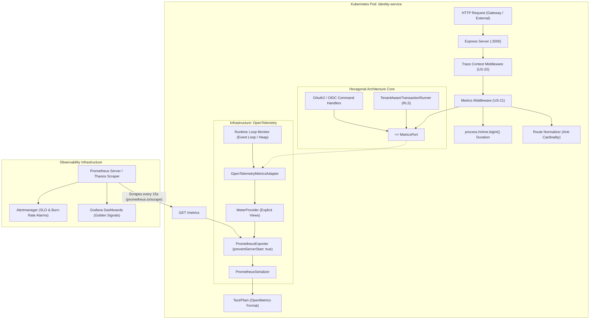

# GUIDELINE-22: OpenTelemetry SDK Integration, Structured Metrics y Google SRE Golden Signals

## 1. Introducción, Contexto Regulatorio y Estándares de Telemetría

### 1.1 El Desafío de la Observabilidad Cuantitativa en Plataformas FinTech Multi-Tenant
En arquitecturas de microservicios distribuidos dedicadas a la gestión de identidad, emisión de credenciales y autorización federada (OAuth 2.0 / OIDC), la observabilidad no puede limitarse a la inspección retrospectiva de logs o a trazas de span aisladas. La disponibilidad y el rendimiento operativo requieren una **telemetría cuantitativa en tiempo real** que permita:
1. **Detección Inmediata de Degradación (SLO/SLA):** Identificar cuellos de botella y aumentos en los tiempos de respuesta antes de que impacten a los usuarios finales.
2. **Aislamiento de Impacto por Tenant:** Medir la carga y el comportamiento de clientes específicos sin provocar fugas de datos entre inquilinos ni sobrecargar la base de datos de métricas.
3. **Defensa Activa ante la Explosión de Cardinalidad:** Prevenir el colapso del clúster de Prometheus limitando estrictamente las dimensiones de las etiquetas mediante normalización determinista de rutas y ofuscación de identificadores de recursos dinámicos.
4. **Supervisión de Salud del Runtime:** Vigilar el bloqueo del Event Loop de Node.js y la saturación de memoria del heap para prevenir reinicios abruptos de pods por fallos OOM (Out Of Memory).

---

### 1.2 Estándares Técnicos Aplicados

#### OpenTelemetry Metrics Specification (v3.x) & OpenMetrics
El estándar **OpenTelemetry Metrics API & SDK** desacopla la instrumentación de las aplicaciones de los agentes recolectores concretos:
- **`MeterProvider`:** Instancia raíz del pipeline de métricas responsable de configurar vistas (`View`), lectores de métricas (`MetricReader`) y exportadores.
- **Instrumentos Monótonos y No Monótonos:**
  - *Counter:* Contador acumulativo estrictamente creciente (`http_requests_total`, `http_requests_errors_total`, `auth_attempts_total`, `auth_tokens_issued_total`).
  - *Histogram:* Agrupación de observaciones numéricas en cubos explícitos predefinidos (`http_request_duration_seconds`, `db_query_duration_seconds`).
  - *Observable Gauge:* Muestra periódica de valores instantáneos del sistema operativo o runtime (`process_memory_heap_bytes`, `nodejs_eventloop_lag_seconds`).

#### Google SRE 4 Golden Signals
Nuestra plataforma implementa la directriz de Google Site Reliability Engineering (SRE) estructurada en cuatro señales cardinales:

| Golden Signal | Métrica Canónica | Tipo de Instrumento | Unidades | Etiquetas Esenciales |
| :--- | :--- | :--- | :--- | :--- |
| **Tráfico (Traffic)** | `http_requests_total` | Counter | Recuento | `method`, `route`, `status_code` |
| **Latencia (Latency)** | `http_request_duration_seconds` | Histogram | Segundos | `method`, `route`, `status_code` |
| **Latencia DB** | `db_query_duration_seconds` | Histogram | Segundos | `operation`, `table` |
| **Errores (Errors)** | `http_requests_errors_total` | Counter | Recuento | `method`, `route`, `error_type` |
| **Saturación (Saturation)** | `process_memory_heap_bytes` | Gauge | Bytes | `type` (`used`, `total`, `rss`) |
| **Saturación (Saturation)** | `nodejs_eventloop_lag_seconds` | Gauge | Segundos | *(sin etiquetas dinámicas)* |

#### Límites de Cubos Explícitos (Default Latency Buckets)
Para garantizar una distribución percentil precisa (especialmente en los rangos de sub-milisegundos y decimas de segundo típicos de APIs de identidad):
```typescript
export const DEFAULT_LATENCY_BUCKETS = [
  0.005, // 5ms
  0.01,  // 10ms
  0.025, // 25ms
  0.05,  // 50ms
  0.1,   // 100ms
  0.25,  // 250ms
  0.5,   // 500ms
  1.0,   // 1s
  2.5,   // 2.5s
  5.0,   // 5s
  10.0,  // 10s
];
```

---

### 1.3 Marco de Cumplimiento Regulatorio y de Seguridad

| Regulación / Estándar | Requerimiento Clave | Implementación en `identity-service` |
| :--- | :--- | :--- |
| **PCI-DSS v4.0** | **Req 10.2:** Registrar y auditar intentos de autenticación de usuarios y procesos M2M, incluyendo fallos de autorización y cambios en el estado de sesiones. | Emisión de `auth_attempts_total` y `auth_tokens_issued_total` etiquetados con `client_id`, `flow_type` y `outcome`. |
| **SOC 2 Type II** | **Criterio CC7.2:** Monitoreo y detección continua de anomalías de rendimiento, degradación operativa y disponibilidad del servicio. | Exposición estandarizada de latencia p95/p99 y saturación en `/metrics` recolectada por Prometheus con intervalos de 15 segundos. |
| **Zero-Trust & Data Privacy** | **GDPR / CCPA / Bank Secrecy:** Prohibición estricta de incluir PII (Personally Identifiable Information) o secretos en etiquetas de métricas. | `RouteNormalizer` sanitiza parámetros de URL; tokens, correos y contraseñas quedan estrictamente excluidos de los labels de métricas. |

---

### 1.4 Topología de Recolección de Métricas de Extremo a Extremo



---

## 2. Arquitectura Hexagonal y Contratos de Dominio

### 2.1 Principio de Inversión de Dependencias y Desacoplamiento de Vendors
Siguiendo los principios de la Arquitectura Hexagonal (Ports & Adapters), la lógica de negocio y los controladores HTTP dependen exclusivamente del contrato abstracto `MetricsPort`. Ningún módulo de dominio o aplicación importa directamente paquetes de `@opentelemetry/*` o `prom-client`.

```typescript
// src/contexts/shared/domain/telemetry/metrics_port.ts
export interface MetricsPort {
  incrementCounter(name: MetricName, value?: number, labels?: MetricLabels): void;
  recordHistogram(name: MetricName, value: number, labels?: MetricLabels): void;
  setGauge(name: MetricName, value: number, labels?: MetricLabels): void;
  recordHttpRequest(method: string, route: string, statusCode: number, durationSeconds: number): void;
  recordHttpError(method: string, route: string, errorType: string): void;
  recordDbQuery(operation: string, table: string, durationSeconds: number): void;
  recordAuthAttempt(clientId: string, flowType: string, outcome: 'success' | 'failure'): void;
  recordTokenIssued(grantType: string, tenantId?: string): void;
  getMetricsContentType(): string;
  getMetrics(): Promise<string>;
  shutdown(): Promise<void>;
}
```

---

### 2.2 Modelado de Dominio de Métricas (`metric_types.ts`)
El dominio define tipados estrictos para evitar valores arbitrarios o nombres inconsistentes:

```typescript
export type MetricName =
  | 'http_requests_total'
  | 'http_request_duration_seconds'
  | 'http_requests_errors_total'
  | 'db_query_duration_seconds'
  | 'auth_attempts_total'
  | 'auth_tokens_issued_total'
  | 'process_memory_heap_bytes'
  | 'nodejs_eventloop_lag_seconds';

export interface HttpRequestLabels {
  method: string;
  route: string;
  statusCode: number;
}

export interface HttpErrorLabels {
  method: string;
  route: string;
  errorType: string;
}

export interface DbQueryLabels {
  operation: string;
  table: string;
}

export interface AuthAttemptLabels {
  clientId: string;
  flowType: string;
  outcome: 'success' | 'failure';
}

export interface TokenIssuedLabels {
  grantType: string;
  tenantId?: string;
}
```

---

### 2.3 Estrategia Anti-Cardinalidad y Normalización de Rutas
La inclusión de identificadores únicos en las etiquetas de métricas (por ejemplo, `/api/v1/users/550e8400-e29b-41d4-a716-446655440000`) genera una explosión exponencial de series temporales en Prometheus, degradando severamente la memoria del recolector.

`RouteNormalizer` implementa dos capas de protección:
1. **Detección de Rutas Express:** Si la solicitud fue manejada por un enrutador registrado, Express asigna `req.baseUrl + req.route.path` (ejemplo: `/api/v1/users/:userId`), la cual se usa preferentemente.
2. **Normalización Regex Heurística:** Para URLs sin coincidencia directa o invocaciones dinámicas, se sanitizan patrones conocidos:
   - UUIDs v4 / v1: `[0-9a-f]{8}-[0-9a-f]{4}-[0-9a-f]{4}-[0-9a-f]{4}-[0-9a-f]{12}` -> `:id`
   - IDs Numéricos enteros: `/\d+/` -> `/:id`
   - Slugs alfanuméricos largos (>24 caracteres hexadecimales/base64): -> `:id`
   - Eliminación de Query Parameters: `req.originalUrl.split('?')[0]`

```typescript
export class RouteNormalizer {
  private static readonly UUID_REGEX = /[0-9a-f]{8}-[0-9a-f]{4}-[0-9a-f]{4}-[0-9a-f]{4}-[0-9a-f]{12}/gi;
  private static readonly NUMERIC_ID_REGEX = /\/\d+(\/|$)/g;
  private static readonly HEX_ID_REGEX = /\/[0-9a-f]{24,}(\/|$)/gi;

  public static normalize(path: string): string {
    if (!path || path === '/') return '/';
    let normalized = path.split('?')[0];
    normalized = normalized.replace(this.UUID_REGEX, ':id');
    normalized = normalized.replace(this.NUMERIC_ID_REGEX, '/:id$1');
    normalized = normalized.replace(this.HEX_ID_REGEX, '/:id$1');
    return normalized.endsWith('/') && normalized.length > 1
      ? normalized.slice(0, -1)
      : normalized;
  }
}
```

---

### 2.4 Adaptador In-Memory para Pruebas Herméticas (`InMemoryMetricsAdapter`)
Para testing unitario y de aceptación sin arrancar el SDK de OpenTelemetry ni invocar sockets de red, se implementó `InMemoryMetricsAdapter`, el cual acumula valores en colecciones en memoria e implementa métodos de introspección:
- `getCounterValue(name, labels)`
- `getHistogramObservations(name, labels)`
- `getGaugeValue(name, labels)`
- `clear()`

---

## 3. Implementación de Infraestructura y Middleware

### 3.1 Adaptador OpenTelemetry SDK (`OpenTelemetryMetricsAdapter`)

#### Configuración de Vistas de Histograma Explícitas
En OpenTelemetry SDK v3.x, los límites de histogramas deben configurarse mediante vistas registradas en el `MeterProvider`:

```typescript
import { MeterProvider, ViewOptions, AggregationType } from '@opentelemetry/sdk-metrics';
import { PrometheusExporter, PrometheusSerializer } from '@opentelemetry/exporter-prometheus';

export class OpenTelemetryMetricsAdapter implements MetricsPort {
  private readonly provider: MeterProvider;
  private readonly exporter: PrometheusExporter;
  private readonly serializer: PrometheusSerializer;

  constructor() {
    this.exporter = new PrometheusExporter({ preventServerStart: true });
    this.serializer = new PrometheusSerializer();

    const latencyView: ViewOptions = {
      instrumentName: '*duration_seconds',
      aggregation: {
        type: AggregationType.EXPLICIT_BUCKET_HISTOGRAM,
        options: { boundaries: DEFAULT_LATENCY_BUCKETS }
      }
    };

    this.provider = new MeterProvider({ views: [latencyView] });
    this.provider.addMetricReader(this.exporter);
  }
}
```

#### Prevención de Servidores Redundantes (`preventServerStart: true`)
Por defecto, `PrometheusExporter` intenta levantar un servidor HTTP independiente en el puerto 9464. Para alinearse con las prácticas de microservicios contenerizados y simplificar el diseño de red, establecemos `preventServerStart: true`. La serialización de las métricas se delega a `PrometheusSerializer` y se expone directamente a través de una ruta Express en el puerto primario de la aplicación (`:3000/metrics`).

---

### 3.2 Monitoreo de Saturación de Runtime en Node.js
Para capturar la saturación del proceso sin dependencias de scraping externo:
1. **Lag del Event Loop:** Se utiliza `perf_hooks.monitorEventLoopDelay({ resolution: 20 })`. En cada intervalo de recolección (por defecto cada 10 segundos), se calcula la media acumulada en segundos y se actualiza en el gauge `nodejs_eventloop_lag_seconds`.
2. **Consumo de Memoria Heap:** Se ejecuta `process.memoryUsage()`, registrando `process_memory_heap_bytes` con etiquetas `type: "used"` y `type: "total"`.

```typescript
private startRuntimeMetricsCollection(): void {
  this.eventLoopMonitor = monitorEventLoopDelay({ resolution: 20 });
  this.eventLoopMonitor.enable();

  this.runtimeMetricsInterval = setInterval(() => {
    const lagSeconds = this.eventLoopMonitor.mean / 1e9;
    this.setGauge('nodejs_eventloop_lag_seconds', lagSeconds);

    const mem = process.memoryUsage();
    this.setGauge('process_memory_heap_bytes', mem.heapUsed, { type: 'used' });
    this.setGauge('process_memory_heap_bytes', mem.heapTotal, { type: 'total' });
  }, 10000);
}
```

---

### 3.3 Middleware HTTP de Golden Signals (`metrics_middleware.ts`)
El middleware intercepta cada solicitud entrante calculando la duración exacta con precisión de nanosegundos mediante `process.hrtime.bigint()`:

```typescript
export function createMetricsMiddleware(metrics: MetricsPort): RequestHandler {
  return (req: Request, res: Response, next: NextFunction): void => {
    if (req.path === '/metrics' || req.path === '/health' || req.path === '/ready') {
      return next();
    }

    const startHrTime = process.hrtime.bigint();

    res.on('finish', () => {
      const durationSeconds = Number(process.hrtime.bigint() - startHrTime) / 1e9;
      const route = req.route ? `${req.baseUrl || ''}${req.route.path}` : RouteNormalizer.normalize(req.originalUrl || req.url);
      const statusCode = res.statusCode;

      metrics.recordHttpRequest(req.method, route, statusCode, durationSeconds);

      if (statusCode >= 400) {
        const errorType = statusCode >= 500 ? 'server_error' : 'client_error';
        metrics.recordHttpError(req.method, route, errorType);
      }
    });

    next();
  };
}
```

---

### 3.4 Instrumentación en la Capa de Persistencia (`TenantAwareTransactionRunner`)
Cada transacción y savepoint ejecutado con aislamiento de inquilino (RLS) se cronometra y registra en `db_query_duration_seconds`:

```typescript
const startHrTime = process.hrtime.bigint();
try {
  return await this.executeUnderTenant(client, tenantId, callback);
} finally {
  const duration = Number(process.hrtime.bigint() - startHrTime) / 1e9;
  this.metrics?.recordDbQuery('transaction', 'multi_tenant_tx', duration);
}
```

---

### 3.5 Instrumentación de Casos de Uso y Comandos de Autenticación
Los comandos de seguridad registran intentos y emisiones de credenciales para cumplir con PCI-DSS Req 10.2:
- `AuthenticateClientM2MCommandHandler`: Emite `auth_attempts_total` con `flowType: 'client_credentials'` y `outcome: 'success' | 'failure'`. Emite `auth_tokens_issued_total` con `grantType: 'client_credentials'`.
- `ExchangeAuthorizationCodeCommandHandler`: Emite `auth_attempts_total` con `flowType: 'authorization_code'` y `auth_tokens_issued_total` con `grantType: 'authorization_code'`.
- `RotateRefreshTokenCommandHandler`: Emite `auth_attempts_total` con `flowType: 'refresh_token'` y `auth_tokens_issued_total` con `grantType: 'refresh_token'`.

---

## 4. Configuración Operacional en Kubernetes / Helm y Consultas PromQL

### 4.1 Configuración de Métricas en Helm Chart
El archivo `deployments/helm/identity-service/values.yaml` gobierna la activación de métricas y la inyección de anotaciones de scrape:

```yaml
metrics:
  enabled: true
  port: 3000
  path: /metrics
  serviceMonitor:
    enabled: false
  prometheusRule:
    enabled: false
```

### 4.2 Anotaciones de Scrape en `Service` y `Deployment`
Los templates de Helm inyectan las directivas canónicas de Prometheus:

```yaml
# templates/service.yaml
metadata:
  annotations:
    prometheus.io/scrape: "true"
    prometheus.io/path: "/metrics"
    prometheus.io/port: "3000"
```

---

### 4.3 Consultas Canónicas PromQL para Dashboards y Alertas

#### 1. Tráfico (Throughput / Requests Per Second)
```promql
sum(rate(http_requests_total[5m])) by (method, route)
```

#### 2. Latencia (Percentiles p95 y p99)
```promql
# Percentil 95 de latencia HTTP
histogram_quantile(0.95, sum(rate(http_request_duration_seconds_bucket[5m])) by (le, route))

# Percentil 99 de latencia en Base de Datos PostgreSQL
histogram_quantile(0.99, sum(rate(db_query_duration_seconds_bucket[5m])) by (le, operation))
```

#### 3. Tasa de Error (HTTP Error Rate %)
```promql
(sum(rate(http_requests_errors_total[5m])) / sum(rate(http_requests_total[5m]))) * 100
```

#### 4. Saturación del Event Loop y Memoria Heap
```promql
# Lag del Event Loop en segundos
nodejs_eventloop_lag_seconds

# Porcentaje de uso del Heap de Node.js
(process_memory_heap_bytes{type="used"} / process_memory_heap_bytes{type="total"}) * 100
```

---

## 5. Estrategia de Pruebas Automatizadas y Certificación

### 5.1 Pirámide de Pruebas Inside-Out
La estrategia de validación cubre todas las capas arquitectónicas:

| Nivel de Prueba | Archivo de Prueba | Cobertura / Verificación |
| :--- | :--- | :--- |
| **Unit - Dominio** | `test_metric_types.ts` | Buckets estándar, tipos de etiquetas y normalización anti-cardinalidad. |
| **Unit - Dominio** | `test_in_memory_metrics_adapter.ts` | Acumulación precisa de contadores, histogramas y gauges. |
| **Unit - Infraestructura** | `test_opentelemetry_metrics_adapter.ts` | Inicialización del SDK, serialización OpenMetrics y lifecycle shutdown. |
| **Unit - Middleware** | `test_metrics_middleware.ts` | Medición de duración, códigos de estado, exclusión de `/health` y `/metrics`. |
| **Unit - Persistencia** | `test_tenant_aware_transaction_runner.ts` | Emisión de `db_query_duration_seconds` en commits y rollbacks. |
| **Unit - Handlers** | `test_authenticate_client_m2m_handler.ts` etc. | Emisión de `auth_attempts_total` y `auth_tokens_issued_total`. |
| **Integración HTTP** | `test_metrics_endpoint.ts` | Verificación de `GET /metrics` devolviendo texto OpenMetrics con formato canónico. |
| **Aceptación BDD** | `opentelemetry_metrics.feature` | 5 escenarios de living documentation ejecutados con Cucumber. |

---

### 5.2 Living Documentation con Cucumber (`opentelemetry_metrics.feature`)

```gherkin
Feature: OpenTelemetry Structured Metrics and Golden Signals
  As a Site Reliability Engineer (SRE) and Security Auditor
  I want the identity service to emit structured OpenTelemetry metrics
  So that I can monitor traffic, latency, errors, saturation, and authentication attempts in real time

  Scenario: Expose Golden Signals via Prometheus metrics endpoint
    Given the identity service is running with OpenTelemetry metrics enabled
    When a client sends a GET request to "/metrics"
    Then the response status code should be 200
    And the response content type should contain "text/plain"
    And the response body should contain metric "http_requests_total"
    And the response body should contain metric "http_request_duration_seconds"
    And the response body should contain metric "process_memory_heap_bytes"
    And the response body should contain metric "nodejs_eventloop_lag_seconds"

  Scenario: Record HTTP traffic and latency with normalized routes
    Given the identity service is running with OpenTelemetry metrics enabled
    When an API request is made to "/api/v1/auth/token"
    Then the counter "http_requests_total" should be incremented for route "/api/v1/auth/token"
    And the histogram "http_request_duration_seconds" should record an observation

  Scenario: Record database query latency in tenant-aware transactions
    Given the identity service is connected to PostgreSQL with RLS
    When a database transaction is executed under a tenant context
    Then the histogram "db_query_duration_seconds" should record query latency with operation "transaction"

  Scenario: Track authentication attempts and token issuance for audit compliance
    Given a client initiates an OAuth2 M2M authentication request
    When the client credentials are validated successfully
    Then the counter "auth_attempts_total" should be incremented with outcome "success"
    And the counter "auth_tokens_issued_total" should be incremented with grant type "client_credentials"

  Scenario: Protect against cardinality explosion in dynamic routes
    Given an incoming request to "/users/550e8400-e29b-41d4-a716-446655440000/profile"
    When the request metrics are recorded
    Then the route label should be normalized to "/users/:id/profile"
```

---

### 5.3 Comandos de Certificación Continua

Para ejecutar la verificación completa de telemetría y calidad de código:

```bash
# 1. Compilación de tipos TypeScript
npm run build

# 2. Ejecución de suites unitarias de telemetría
npx mocha --require ts-node/register tests/unit/shared/domain/telemetry/*.ts
npx mocha --require ts-node/register tests/unit/shared/infrastructure/telemetry/*.ts

# 3. Pruebas de integración del endpoint /metrics
npx mocha --require ts-node/register tests/integration/interfaces/http/test_metrics_endpoint.ts

# 4. Pruebas de aceptación BDD
npx cucumber-js tests/acceptance/features/opentelemetry_metrics.feature --require-module ts-node/register --require tests/acceptance/step_defs/test_opentelemetry_metrics_steps.ts

# 5. Lint del Helm Chart
helm lint deployments/helm/identity-service
```
