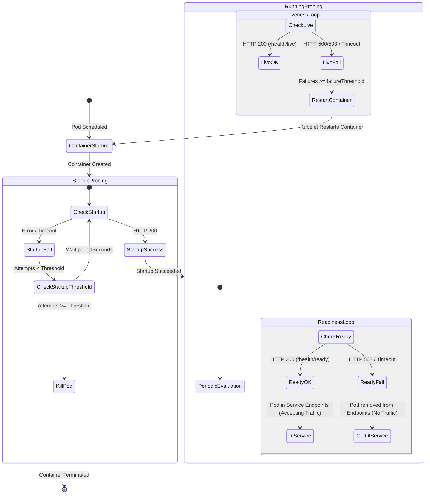
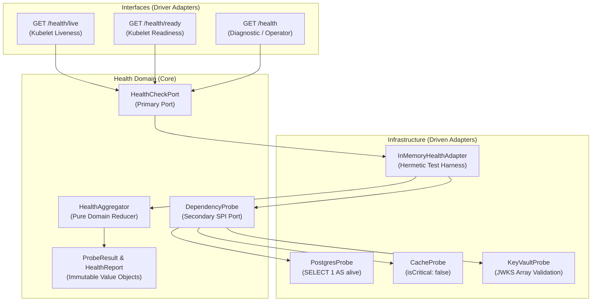

# GUIDELINE-23: Sondas de Infraestructura Kubernetes, Health, Readiness y Prevención de Cascadas de Muerte

## 1. Contexto Operativo y Objetivos de Fiabilidad SRE

### 1.1 El Desafío de la Disponibilidad en Servicios de Identidad Críticos (Tier-0)
En una plataforma FinTech multi-tenant y distribuida, el microservicio de identidad (`identity-service`) actúa como el núcleo neurálgico de autenticación, emisión de tokens criptográficos JWT/JWKS y control de acceso federado (OAuth 2.0 / OIDC). Es un componente clasificado como **Tier-0 (Misión Crítica)**: si el servicio de identidad experimenta una caída total o una degradación no controlada, la totalidad de los servicios perimetrales, aplicaciones cliente, APIs transaccionales y pasarelas de pago quedan inmediatamente inoperables.

Sin embargo, en entornos orquestados por Kubernetes, uno de los errores arquitectónicos más frecuentes y destructivos consiste en confundir la **vitalidad del proceso local** (*Liveness*) con la **disponibilidad de las dependencias externas** (*Readiness*). Esta confusión introduce vulnerabilidades sistémicas catastróficas:
- **Cascadas de Reinicios (Death Cascades):** Si una base de datos PostgreSQL entra en mantenimiento o experimenta saturación momentánea de conexiones, y la sonda de *Liveness* consulta la base de datos, Kubernetes interpretará erróneamente que todos los pods de la aplicación están "muertos" y procederá a reiniciar el clúster entero de manera concurrente. Al arrancar, decenas o cientos de réplicas golpearán la base de datos simultáneamente para inicializarse, impidiendo que esta se recupere y prolongando indefinidamente la caída del sistema.
- **Tráfico Enrutado a Instancias no Preparadas:** Si un pod aún no ha terminado de montar sus secretos de KeyVault (claves RSA de firma) o no ha establecido su pool de conexiones a la base de datos, pero el balanceador de carga le envía peticiones entrantes, los usuarios finales recibirán errores HTTP 500 intermitentes durante despliegues progresivos (*rolling updates*).
- **Sobrecarga de Sondaje por DoS Auto-infligido:** Sondas que ejecutan operaciones costosas o sin límites de tiempo defensivos (*timeouts*) pueden agotar los hilos del *Event Loop* de Node.js o saturar la base de datos con consultas de monitoreo superfluas.

```
+-------------------------------------------------------------------------------------------------------+
|                                  TAXONOMÍA DE SONDAS EN KUBERNETES                                    |
+------------------------------------+-----------------------------------+------------------------------+
|             STARTUP                |             LIVENESS              |          READINESS           |
+------------------------------------+-----------------------------------+------------------------------+
| "¿El contenedor ha arrancado?"     | "¿El proceso sigue vivo?"         | "¿Puede recibir tráfico?"    |
| Protege cold-starts y migraciones  | Solo verifica el Event Loop local | Evalúa dependencias activas  |
| Desactiva Liveness temporalmente   | NUNCA consulta DB ni red externa  | PostgreSQL, Redis, KeyVault  |
| Acción de fallo: RESTART           | Acción de fallo: RESTART POD      | Acción de fallo: UNROUTE POD |
+------------------------------------+-----------------------------------+------------------------------+
```

---

### 1.2 Taxonomía de Fallos en Sistemas Distribuidos
Para diseñar sondas confiables, debemos categorizar formalmente los modos de fallo de un pod en producción:

1. **Fallo de Runtime Local (Process Deadlock / Event Loop Starvation):**
   - El proceso Node.js ha entrado en un bucle infinito síncrono, se ha quedado sin memoria (OOM) o su event loop está completamente bloqueado.
   - **Acción requerida:** Reinicio del contenedor (*Restart Pod*) gestionado por la sonda de **Liveness**.
2. **Fallo de Dependencia Crítica (Database Downtime / Key Depletion):**
   - PostgreSQL está fuera de servicio o el almacén de claves KeyVault no contiene pares de claves RSA válidos para firmar JWTs.
   - El proceso Node.js está sano, pero la aplicación no puede procesar solicitudes de autenticación válidas.
   - **Acción requerida:** Retirar el pod del balanceo de carga (*Unroute Pod* de los Endpoints del Service) mediante la sonda de **Readiness**, sin reiniciar el pod.
3. **Fallo de Dependencia No Crítica (Cache Server Unreachable):**
   - Redis o la caché en memoria no responde. La aplicación puede continuar sirviendo solicitudes consultando directamente la base de datos de manera degradada (*Graceful Degradation*).
   - **Acción requerida:** Mantener el pod en servicio con estado `DEGRADED` (HTTP 200 en `/health/ready`), evitando la des-habilitación innecesaria del clúster.
4. **Fallo de Inicialización Prolongada (Cold-Start & Secret Mounts):**
   - El pod requiere montar volúmenes CSI de Azure KeyVault o inicializar pools de conexión pesados al iniciar.
   - **Acción requerida:** Contener el sondeo de inicio mediante la sonda de **Startup** para no gatillar falsos positivos de liveness antes de que la aplicación esté lista.

---

### 1.3 Objetivos de Confiabilidad SRE (SLIs, SLOs y Resiliencia)
Nuestros estándares de ingeniería para el subsistema de health y readiness imponen los siguientes compromisos cuantitativos:

| Métrica / Dimensión | Objetivo / Límite Operativo | Justificación de Ingeniería |
| :--- | :--- | :--- |
| **SLO de Disponibilidad (Liveness)** | 99.99% en bucle local | El proceso debe responder de inmediato sin depender de recursos externos. |
| **Tiempo de Respuesta (Liveness)** | $\le 5\text{ ms}$ (p99) | Respuesta síncrona en memoria para evitar degradar el scheduler de Kubelet. |
| **Tiempo de Corte Defensivo (Timeout)** | $\le 1500\text{ ms}$ | Toda sonda a dependencias externas debe abortar tajantemente en $\le 1.5\text{ s}$. |
| **Frecuencia de Muestreo (Readiness)** | Cada $5\text{ s}$ (`periodSeconds`) | Detección rápida de fallas de base de datos en menos de dos periodos ($10\text{ s}$). |
| **Umbral de Tolerancia de Fallo** | $2\text{ fallos consecutivos}$ (`failureThreshold`) | Evita aleteo (*flapping*) ante micro-cortes de red transitorios. |
| **Aislamiento de Carga** | Consultas ultra-ligeras (`SELECT 1`) | Las sondas no deben ejecutar escaneos de tablas ni competir por bloqueos en BD. |

---

### 1.4 Ciclo de Vida del Pod en Kubernetes
El agente `kubelet` de cada nodo del clúster evalúa de forma periódica las sondas configuradas en el manifiesto del contenedor:



En las siguientes secciones se detalla el diseño hexagonal, la implementación de sondas y la configuración estricta de Helm para hacer cumplir este modelo en producción.


---

## 2. Desacoplamiento Arquitectural: Liveness vs Readiness vs Startup

### 2.1 Anatomía de una Cascada de Reinicios (Death Cascade)
Uno de los fallos operativos más costosos en arquitecturas de microservicios sobre Kubernetes es la **Cascada de Reinicios**. Para comprender su mecánica, consideremos un clúster de $N$ réplicas del servicio de identidad donde la sonda de *Liveness* comete el error de verificar la conexión a la base de datos PostgreSQL:

```
[Situación Normal]
  N Réplicas Activas ---> PostgreSQL (Conexiones concurrentes estables C_normal)

[Incidente: Degradación Transitoria en PostgreSQL]
  - PostgreSQL ralentiza sus respuestas por una ráfaga o bloqueo temporal.
  - La sonda de Liveness (/health/live) excede el timeout en K réplicas.
  - Kubelet declara los K contenedores como UNHEALTHY y emite SIGKILL / SIGTERM.

[Comportamiento en Cascada]
  1. Las N-K réplicas restantes reciben TODO el tráfico entrante de los usuarios.
  2. Esas réplicas se saturan rápidamente, aumentando sus tiempos de respuesta.
  3. Sus sondas de Liveness también fallan por starvation.
  4. Kubelet reinicia las N réplicas simultáneamente.

[Colapso en Rearranque (Thundering Herd)]
  - Las N réplicas arrancan a la vez.
  - Cada una intenta abrir un pool de M conexiones a PostgreSQL.
  - PostgreSQL recibe N x M solicitudes de conexión TCP/TLS simultáneas.
  - La base de datos colapsa por sobrecarga de CPU y sockets (OOM/Max Connections).
  - Ningún pod logra superar su Liveness Probe; el clúster entra en ciclo infinito de CrashLoop.
```

Matemáticamente, la carga de reconexión $L_{boot}$ impuesta sobre la dependencia en un reinicio masivo viene dada por:
$$L_{boot} = \sum_{i=1}^{N} \left( P_{init} \cdot S_{tls} \right)$$
Donde $P_{init}$ es el tamaño mínimo del pool de conexiones configurado por pod y $S_{tls}$ es el costo de handshake criptográfico TLS. Si $L_{boot}$ supera la capacidad del servidor de base de datos $C_{max}$, el sistema colapsa indefinidamente.

**Conclusión Arquitectural:** La sonda de **Liveness debe estar 100% desacoplada de cualquier recurso externo a la memoria y el proceso del pod**.

---

### 2.2 Comparativa Dimensional de Sondas

| Dimensión de Diseño | Sonda de Startup (`startupProbe`) | Sonda de Liveness (`livenessProbe`) | Sonda de Readiness (`readinessProbe`) |
| :--- | :--- | :--- | :--- |
| **Pregunta Fundamental** | *¿El proceso completó su inicialización?* | *¿El proceso sigue ejecutando su bucle?* | *¿El pod puede procesar tráfico de negocio?* |
| **Alcance de Evaluación** | Proceso local y carga de artefactos | Bucle de eventos (*Event Loop*) local | Dependencias activas (PostgreSQL, Cache, JWKS) |
| **Acción ante Fallo** | Kubelet reinicia el contenedor (`kill -9`) | Kubelet reinicia el contenedor (`kill -9`) | Kubelet retira la IP del pod de los Endpoints |
| **Impacto en Tráfico** | El pod aún no recibe tráfico | El pod deja de servir al ser reiniciado | El tráfico se enruta solo a las réplicas sanas |
| **Uso de Red Externa** | Permitido solo para bootstrap inicial | **ESTRICTAMENTE PROHIBIDO** | **OBLIGATORIO** (verificación defensiva) |
| **Periodo Típico (`period`)** | $5\text{ s}$ - $10\text{ s}$ | $10\text{ s}$ | $5\text{ s}$ |
| **Umbral de Fallo (`failure`)** | Alto ($12$ - $30$ reintentos) | Moderado ($3$ reintentos) | Bajo ($2$ reintentos para respuesta rápida) |
| **Endpoint HTTP Canónico** | `/health/live` (o `/health/startup`) | `/health/live` (`/health/liveness`) | `/health/ready` (`/health/readiness`) |

---

### 2.3 Reglas Inmutables de Ingeniería

> [!IMPORTANT]
> **Regla 1: Aislamiento Total de Liveness**
> La sonda de *Liveness* nunca debe realizar llamadas de I/O de red, consultas SQL a bases de datos, accesos a sockets Redis o llamadas a servicios remotos. Debe limitarse a responder HTTP 200 si el servidor Express es capaz de despachar la petición a través de su bucle de eventos.

> [!IMPORTANT]
> **Regla 2: Semántica Estricta de Readiness**
> La sonda de *Readiness* debe fallar (HTTP 503) inmediatamente si una dependencia crítica (PostgreSQL, par de claves activas en KeyVault) está inaccesible o si el chequeo agota el tiempo de guarda ($\le 1500\text{ ms}$). Si una dependencia no crítica falla (Caché), debe reportar estado `DEGRADED` manteniendo HTTP 200.

> [!IMPORTANT]
> **Regla 3: Protección de Cold-Starts con Startup Probes**
> En entornos donde el contenedor tarda varios segundos en iniciar (descarga de claves CSI, configuración de pools o migraciones de base de datos), debe emplearse una `startupProbe` con un `failureThreshold` holgado (e.g., $12 \times 5\text{s} = 60\text{s}$) para evitar que `livenessProbe` mate el contenedor prematuramente.

---

### 2.4 Catálogo de Anti-Patrones Comunes y Soluciones

#### Anti-Patrón 1: El "Ping Universal" (Shared Health Endpoint)
* **Error:** Apuntar tanto `livenessProbe` como `readinessProbe` al mismo endpoint monolítico (e.g., `GET /health`), el cual ejecuta consultas a la base de datos y a Redis.
* **Consecuencia:** Cuando la base de datos se ralentiza, Kubelet interpreta que los pods están muertos y los reinicia, desatando la cascada de reinicios.
* **Solución:** Separar tajantemente `/health/live` (solo runtime) de `/health/ready` (evaluación de dependencias).

#### Anti-Patrón 2: La Sonda de "Carga Pesada" (Heavy Probe Query)
* **Error:** En la sonda de readiness, ejecutar consultas costosas como `SELECT count(*) FROM users` o transacciones complejas para verificar la base de datos.
* **Consecuencia:** La sonda añade una sobrecarga considerable a la base de datos (e.g., 20 réplicas consultando cada 5 segundos = 4 queries/segundo solo de monitoreo), compitiendo por CPU y locks de tabla con las transacciones de negocio.
* **Solución:** Utilizar la instrucción más liviana posible en PostgreSQL: `SELECT 1 AS alive`, ejecutada directamente en el pool.

#### Anti-Patrón 3: Timeouts Indefinidos o Mayores al Periodo de Muestreo
* **Error:** Configurar un `periodSeconds: 5` con un driver de base de datos cuyo timeout por defecto es de 30 segundos.
* **Consecuencia:** Si la red se congela, las solicitudes de la sonda se acumulan en el pool de conexiones de Node.js, agotando los sockets del agente HTTP y bloqueando el pod.
* **Solución:** Encapsular toda verificación en un `Promise.race` con un límite estricto de timeout defensivo ($\le 1500\text{ ms}$) y configurar `timeoutSeconds: 3` en el manifiesto de Helm.


---

## 3. Diseño Hexagonal: Puertos, Entidades y Agregador de Salud

### 3.1 Arquitectura Hexagonal del Subsistema de Salud
Para evitar el acoplamiento directo entre las interfaces HTTP (Express) y los drivers específicos de infraestructura (PostgreSQL `pg`, Redis `ioredis`, Azure KeyVault CSI), el subsistema de salud se estructura bajo el patrón de **Puertos y Adaptadores (Arquitectura Hexagonal)**:



---

### 3.2 Contratos Primarios y Secundarios

#### Puerto Primario: `HealthCheckPort`
Ubicado en `src/contexts/shared/domain/health/health_check_port.ts`, este puerto expone los casos de uso de verificación de salud al exterior de la aplicación:

```typescript
export interface HealthCheckPort {
  /**
   * Evalúa la vitalidad del bucle de eventos local.
   * No debe acceder a dependencias externas bajo ninguna circunstancia.
   */
  checkLiveness(): Promise<HealthReport>;

  /**
   * Evalúa en paralelo las dependencias activas del pod.
   * Retorna estado consolidado para decisiones de enrutamiento de red.
   */
  checkReadiness(): Promise<HealthReport>;

  /**
   * Retorna el informe de diagnóstico completo consolidando liveness y readiness.
   */
  checkHealth(): Promise<HealthReport>;
}
```

#### Contrato Secundario: `DependencyProbe`
Ubicado en `src/contexts/shared/domain/health/dependency_probe.ts`, este contrato define la interfaz unificada que debe implementar todo adaptador de infraestructura:

```typescript
export interface DependencyProbe {
  readonly name: string;
  readonly isCritical: boolean;
  readonly timeoutMs: number;

  check(): Promise<ProbeResult>;
}
```

---

### 3.3 Value Objects y Modelos Inmutables de Dominio
En `src/contexts/shared/domain/health/health_types.ts`, se modelan los resultados y estados de salud mediante estructuras inmutables (`Object.freeze`):

```typescript
export type HealthStatus = 'UP' | 'DOWN' | 'DEGRADED';
export type ProbeStatus = 'OK' | 'DOWN' | 'TIMEOUT';

export interface ProbeResult {
  readonly name: string;
  readonly status: ProbeStatus;
  readonly latencyMs: number;
  readonly isCritical: boolean;
  readonly reason?: string;
  readonly timestamp: string;
}

export interface HealthReport {
  readonly status: HealthStatus;
  readonly checks: Record<string, ProbeResult>;
  readonly timestamp: string;
}
```

---

### 3.4 Agregador de Dominio Puro: `HealthAggregator`
La lógica de reducción de resultados de múltiples sondas a un único estado de salud se encapsula en una función pura sin estado, garantizando determinismo absoluto:

```typescript
export class HealthAggregator {
  public static aggregate(results: ProbeResult[]): HealthReport {
    let hasCriticalFailure = false;
    let hasNonCriticalFailure = false;
    const checks: Record<string, ProbeResult> = {};

    for (const result of results) {
      checks[result.name] = result;
      if (result.status !== 'OK') {
        if (result.isCritical) {
          hasCriticalFailure = true;
        } else {
          hasNonCriticalFailure = true;
        }
      }
    }

    let status: HealthStatus = 'UP';
    if (hasCriticalFailure) {
      status = 'DOWN';
    } else if (hasNonCriticalFailure) {
      status = 'DEGRADED';
    }

    return Object.freeze({
      status,
      checks: Object.freeze(checks),
      timestamp: new Date().toISOString(),
    });
  }
}
```

#### Reglas de Consolidación de Estado:
1. **`DOWN` (Crítico):** Si al menos una sonda con `isCritical: true` falla o agota el timeout (`status !== 'OK'`). Esto obliga al endpoint `/health/ready` a responder HTTP 503, retirando el pod del balanceo.
2. **`DEGRADED` (Degradado No Crítico):** Si todas las sondas críticas están `OK`, pero una o más sondas no críticas (`isCritical: false`, como la caché) fallan. El endpoint `/health/ready` responde HTTP 200 para mantener el pod en servicio.
3. **`UP` (Completamente Saludable):** Todas las sondas registradas responden con `status: 'OK'`.

---

### 3.5 Adaptador en Memoria y Protección contra Timeouts
El adaptador `InMemoryHealthAdapter` (`src/contexts/shared/domain/health/in_memory_health_adapter.ts`) implementa `HealthCheckPort` orquestando la ejecución en paralelo de las sondas mediante `Promise.allSettled` y aplicando una carrera defensiva (`Promise.race`) contra un temporizador estricto por cada sonda:

```typescript
private async executeProbeWithTimeout(probe: DependencyProbe): Promise<ProbeResult> {
  const startTime = Date.now();
  let timerId: NodeJS.Timeout | null = null;

  const timeoutPromise = new Promise<ProbeResult>((resolve) => {
    timerId = setTimeout(() => {
      resolve({
        name: probe.name,
        status: 'TIMEOUT',
        latencyMs: probe.timeoutMs,
        isCritical: probe.isCritical,
        reason: `Probe '${probe.name}' timed out after ${probe.timeoutMs}ms`,
        timestamp: new Date().toISOString(),
      });
    }, probe.timeoutMs);
    if (timerId.unref) {
      timerId.unref(); // Previene mantener vivo el bucle de eventos en tests
    }
  });

  try {
    const result = await Promise.race([probe.check(), timeoutPromise]);
    return result;
  } catch (error) {
    const latencyMs = Date.now() - startTime;
    return {
      name: probe.name,
      status: 'DOWN',
      latencyMs,
      isCritical: probe.isCritical,
      reason: error instanceof Error ? error.message : String(error),
      timestamp: new Date().toISOString(),
    };
  } finally {
    if (timerId) {
      clearTimeout(timerId);
    }
  }
}
```
Este diseño garantiza que ninguna dependencia lenta pueda secuestrar la ejecución de la sonda de salud más allá del límite predefinido.


---

## 4. Implementación de Probes Defensivas (`PostgresProbe`, `CacheProbe`, `KeyVaultProbe`)

### 4.1 Sonda de Base de Datos: `PostgresProbe`
La persistencia de usuarios, credenciales, sesiones y clientes OAuth 2.0 descansa en PostgreSQL. Si la base de datos se vuelve inaccesible, el servicio no puede autenticar usuarios ni verificar contraseñas. Por tanto, `PostgresProbe` es una dependencia **estrictamente crítica (`isCritical: true`)**.

#### Desacoplamiento de Cliente SQL (`SqlQueryClient`)
En lugar de depender del paquete concreto `pg`, la sonda define una interfaz mínima:

```typescript
export interface SqlQueryClient {
  query(sql: string): Promise<{ rows: unknown[] }>;
}
```
Esto permite inyectar tanto el `DynamicPostgresPoolManager` en producción como adaptadores simulados o transaccionales en pruebas unitarias e integración.

#### Implementación en `src/contexts/shared/infrastructure/health/probes/postgres_probe.ts`:
```typescript
export class PostgresProbe implements DependencyProbe {
  public readonly name = 'database';
  public readonly isCritical = true;
  public readonly timeoutMs: number;
  private readonly client: SqlQueryClient;

  constructor(client: SqlQueryClient, timeoutMs: number = 1000) {
    this.client = client;
    this.timeoutMs = timeoutMs;
  }

  public async check(): Promise<ProbeResult> {
    const startTime = Date.now();
    try {
      const res = await this.client.query('SELECT 1 AS alive');
      const latencyMs = Date.now() - startTime;

      if (!res || !Array.isArray(res.rows) || res.rows.length === 0) {
        return {
          name: this.name,
          status: 'DOWN',
          latencyMs,
          isCritical: this.isCritical,
          reason: 'PostgreSQL returned empty result for alive query',
          timestamp: new Date().toISOString(),
        };
      }

      return {
        name: this.name,
        status: 'OK',
        latencyMs,
        isCritical: this.isCritical,
        timestamp: new Date().toISOString(),
      };
    } catch (error) {
      const latencyMs = Date.now() - startTime;
      return {
        name: this.name,
        status: 'DOWN',
        latencyMs,
        isCritical: this.isCritical,
        reason: error instanceof Error ? error.message : String(error),
        timestamp: new Date().toISOString(),
      };
    }
  }
}
```

*Aspectos Clave de Resiliencia:*
1. **Instrucción Ultra-Ligera:** `SELECT 1 AS alive` no consulta ninguna tabla física ni compite por bloqueos de fila o página.
2. **Medición de Latencia Real:** Se cronometra el viaje de ida y vuelta (*round-trip latency*) para auditoría de rendimiento en el endpoint consolidado `/health`.

---

### 4.2 Sonda de Caché y Degradación Elegante: `CacheProbe`
El subsistema de caché en memoria o distribuido (Redis) se utiliza para optimizar la lectura de perfiles de usuario y validación de orígenes de clientes SPA. Sin embargo, si la capa de caché falla, la aplicación sigue siendo capaz de consultar directamente a PostgreSQL.

Por ende, `CacheProbe` se declara formalmente como **no crítica (`isCritical: false`)**.

#### Implementación en `src/contexts/shared/infrastructure/health/probes/cache_probe.ts`:
```typescript
export interface CacheCheckProvider {
  get(key: string): Promise<unknown>;
}

export class CacheProbe implements DependencyProbe {
  public readonly name = 'cache';
  public readonly isCritical = false; // Degradación elegante: el pod sigue operando
  public readonly timeoutMs: number;
  private readonly provider: CacheCheckProvider;

  constructor(provider: CacheCheckProvider, timeoutMs: number = 500) {
    this.provider = provider;
    this.timeoutMs = timeoutMs;
  }

  public async check(): Promise<ProbeResult> {
    const startTime = Date.now();
    try {
      await this.provider.get('__health_probe__');
      const latencyMs = Date.now() - startTime;

      return {
        name: this.name,
        status: 'OK',
        latencyMs,
        isCritical: this.isCritical,
        timestamp: new Date().toISOString(),
      };
    } catch (error) {
      const latencyMs = Date.now() - startTime;
      return {
        name: this.name,
        status: 'DOWN',
        latencyMs,
        isCritical: this.isCritical,
        reason: error instanceof Error ? error.message : String(error),
        timestamp: new Date().toISOString(),
      };
    }
  }
}
```

*Comportamiento SRE en Producción:*
- Si Redis cae, `CacheProbe` retorna `status: 'DOWN'`.
- Como `isCritical: false`, `HealthAggregator` consolida el reporte global como `status: 'DEGRADED'`.
- El endpoint `/health/ready` responde **HTTP 200 con `status: 'DEGRADED'`**.
- **Resultado:** Kubernetes **NO** retira el pod de los endpoints ni interrumpe el servicio a los usuarios; el tráfico continúa fluyendo contra la base de datos mientras los operadores investigan la capa de caché.

---

### 4.3 Sonda Criptográfica de KeyVault / JWKS: `KeyVaultProbe`
El microservicio de identidad firma tokens de acceso JWT y emite metadatos OIDC mediante pares de claves asimétricas RSA-256 (`RS256`). Si durante una rotación de secretos el almacén de claves (Azure KeyVault CSI) queda vacío o corrupto, el servicio emitiría tokens inválidos o fallaría en el intercambio de códigos de autorización PKCE.

Por tanto, `KeyVaultProbe` es una dependencia **crítica (`isCritical: true`)**.

#### Implementación en `src/contexts/shared/infrastructure/health/probes/keyvault_probe.ts`:
```typescript
export interface KeyVaultProvider {
  getJwks(): Promise<{ keys: unknown[] }>;
}

export class KeyVaultProbe implements DependencyProbe {
  public readonly name = 'keyvault';
  public readonly isCritical = true;
  public readonly timeoutMs: number;
  private readonly provider: KeyVaultProvider;

  constructor(provider: KeyVaultProvider, timeoutMs: number = 800) {
    this.provider = provider;
    this.timeoutMs = timeoutMs;
  }

  public async check(): Promise<ProbeResult> {
    const startTime = Date.now();
    try {
      const jwks = await this.provider.getJwks();
      const latencyMs = Date.now() - startTime;

      if (!jwks || !Array.isArray(jwks.keys) || jwks.keys.length === 0) {
        return {
          name: this.name,
          status: 'DOWN',
          latencyMs,
          isCritical: this.isCritical,
          reason: 'KeyVault JWKS has no active cryptographic signing keys available',
          timestamp: new Date().toISOString(),
        };
      }

      return {
        name: this.name,
        status: 'OK',
        latencyMs,
        isCritical: this.isCritical,
        timestamp: new Date().toISOString(),
      };
    } catch (error) {
      const latencyMs = Date.now() - startTime;
      return {
        name: this.name,
        status: 'DOWN',
        latencyMs,
        isCritical: this.isCritical,
        reason: error instanceof Error ? error.message : String(error),
        timestamp: new Date().toISOString(),
      };
    }
  }
}
```

---

### 4.4 Matriz Comparativa de Sondas de Dependencias

| Sonda | Dependencia Externa | Timeout Defensivo | Criticidad (`isCritical`) | Impacto si Falla | Código HTTP `/health/ready` |
| :--- | :--- | :--- | :--- | :--- | :--- |
| **`PostgresProbe`** | Base de Datos PostgreSQL | $1000\text{ ms}$ | **Sí (`true`)** | Pod retirado de Service Endpoints | **HTTP 503 (`DOWN`)** |
| **`KeyVaultProbe`** | Almacén de Claves RSA/JWKS | $800\text{ ms}$ | **Sí (`true`)** | Pod retirado de Service Endpoints | **HTTP 503 (`DOWN`)** |
| **`CacheProbe`** | Redis / Caché Distribuida | $500\text{ ms}$ | **No (`false`)** | Degradación elegante (acceso directo a BD) | **HTTP 200 (`DEGRADED`)** |


---

## 5. Capa de Interfaces HTTP y Semántica de Códigos de Respuesta (200 vs 503)

### 5.1 Arquitectura del Servidor Express y Mapeo de Rutas Canónicas
En la capa de interfaces (`interfaces/http/server.ts`), el microservicio expone los endpoints de monitoreo cumpliendo las convenciones canónicas de Kubernetes y las herramientas del ecosistema Cloud Native:

```typescript
// Sonda de Liveness (Kubernetes): /health/live y alias canónico /health/liveness
const handleLiveness = async (req: Request, res: Response): Promise<void> => {
  if (deps?.healthCheckPort) {
    const report = await deps.healthCheckPort.checkLiveness();
    res.status(200).json({
      status: report.status,
      checks: report.checks,
      protocol: req.protocol,
      timestamp: report.timestamp,
    });
    return;
  }

  res.status(200).json({
    status: 'UP',
    checks: { liveness: 'OK' },
    protocol: req.protocol,
    timestamp: new Date().toISOString(),
  });
};
app.get('/health/live', handleLiveness);
app.get('/health/liveness', handleLiveness);

// Sonda de Readiness (Kubernetes): /health/ready y alias canónico /health/readiness
const handleReadiness = async (_req: Request, res: Response): Promise<void> => {
  if (deps?.healthCheckPort) {
    const report = await deps.healthCheckPort.checkReadiness();
    const statusCode = report.status === 'DOWN' ? 503 : 200;
    res.status(statusCode).json(report);
    return;
  }

  const { isHealthy, dbStatus, cacheStatus, keyvaultStatus } = await evaluateReadiness();
  const statusCode = isHealthy ? 200 : 503;

  res.status(statusCode).json({
    status: isHealthy ? 'UP' : 'DOWN',
    checks: {
      database: dbStatus,
      cache: cacheStatus,
      ...(keyvaultStatus !== undefined ? { keyvault: keyvaultStatus } : {}),
    },
    timestamp: new Date().toISOString(),
  });
};
app.get('/health/ready', handleReadiness);
app.get('/health/readiness', handleReadiness);

// Sonda Combinada / Diagnóstico Integral
app.get('/health', async (_req: Request, res: Response): Promise<void> => {
  if (deps?.healthCheckPort) {
    const report = await deps.healthCheckPort.checkHealth();
    const statusCode = report.status === 'DOWN' ? 503 : 200;
    res.status(statusCode).json(report);
    return;
  }

  const { isHealthy, dbStatus, cacheStatus, keyvaultStatus } = await evaluateReadiness();
  const statusCode = isHealthy ? 200 : 503;

  res.status(statusCode).json({
    status: isHealthy ? 'UP' : 'DOWN',
    checks: {
      liveness: 'OK',
      database: dbStatus,
      cache: cacheStatus,
      ...(keyvaultStatus !== undefined ? { keyvault: keyvaultStatus } : {}),
    },
    timestamp: new Date().toISOString(),
  });
});
```

*Decisión de Diseño:* Se registran las rutas de manera individual (`app.get('/health/live', ...)`, `app.get('/health/liveness', ...)`) en lugar de pasar un arreglo de strings `app.get(['/health/live', ...])`. Esto garantiza que `req.route.path` en Express sea una cadena limpia, facilitando la extracción determinista de la ruta en middlewares posteriores sin conversiones de tipo ambiguas.

---

### 5.2 Semántica de Códigos de Respuesta HTTP: 200 vs 503

El orquestador Kubernetes Kubelet y los Ingress Controllers (Nginx Ingress) interpretan los códigos de estado HTTP de forma binaria:
- **Rango $200 \le \text{status} < 400$:** Éxito (*Probe Successful*).
- **Rango $\text{status} \ge 400$ o Timeout:** Fallo (*Probe Failure*).

Por tanto, la correlación entre el estado de dominio y el código HTTP se rige por la siguiente tabla de decisión:

```
+-------------------------------------------------------------------------------------------------------+
|                                    MATRIZ DE CÓDIGOS DE ESTADO HTTP                                   |
+-------------------+---------------------+------------------+------------------+-----------------------+
| Endpoint          | Estado de Dominio   | Código HTTP      | Acción Kubelet   | Tráfico de Usuario    |
+-------------------+---------------------+------------------+------------------+-----------------------+
| /health/live      | UP                  | 200 OK           | Ninguna          | Pod vivo              |
| /health/live      | (Bucle Bloqueado)   | (Timeout / Error)| Reinicio Pod     | Pod terminado         |
| /health/ready     | UP                  | 200 OK           | Mantiene Pod     | Enrutado con normalidad|
| /health/ready     | DEGRADED            | 200 OK           | Mantiene Pod     | Enrutado (Graceful Deg)|
| /health/ready     | DOWN                | 503 Unavailable  | Retira Pod       | Aisla Pod (Sin tráfico)|
| /health           | UP / DEGRADED       | 200 OK           | Diagnóstico      | N/A (Solo inspección) |
| /health           | DOWN                | 503 Unavailable  | Diagnóstico      | Alerta SRE            |
+-------------------+---------------------+------------------+------------------+-----------------------+
```

---

### 5.3 Estructura de Payloads JSON y Ejemplos Concretos

#### 1. Respuesta de Liveness (`GET /health/live` - HTTP 200)
```json
{
  "status": "UP",
  "checks": {
    "liveness": {
      "name": "liveness",
      "status": "OK",
      "latencyMs": 0,
      "isCritical": true,
      "timestamp": "2026-11-17T11:15:20.102Z"
    }
  },
  "protocol": "http",
  "timestamp": "2026-11-17T11:15:20.102Z"
}
```

#### 2. Respuesta de Readiness Saludable (`GET /health/ready` - HTTP 200)
```json
{
  "status": "UP",
  "checks": {
    "database": {
      "name": "database",
      "status": "OK",
      "latencyMs": 1.4,
      "isCritical": true,
      "timestamp": "2026-11-17T11:15:20.105Z"
    },
    "cache": {
      "name": "cache",
      "status": "OK",
      "latencyMs": 0.6,
      "isCritical": false,
      "timestamp": "2026-11-17T11:15:20.105Z"
    },
    "keyvault": {
      "name": "keyvault",
      "status": "OK",
      "latencyMs": 2.1,
      "isCritical": true,
      "timestamp": "2026-11-17T11:15:20.105Z"
    }
  },
  "timestamp": "2026-11-17T11:15:20.105Z"
}
```

#### 3. Respuesta de Readiness Degradada (`GET /health/ready` - HTTP 200 `DEGRADED`)
Cuando la caché falla, el estado global pasa a `DEGRADED`, pero el código HTTP permanece en 200 para que el pod siga procesando solicitudes:
```json
{
  "status": "DEGRADED",
  "checks": {
    "database": {
      "name": "database",
      "status": "OK",
      "latencyMs": 1.2,
      "isCritical": true,
      "timestamp": "2026-11-17T11:15:20.110Z"
    },
    "cache": {
      "name": "cache",
      "status": "DOWN",
      "latencyMs": 500,
      "isCritical": false,
      "reason": "Connection to Redis refused",
      "timestamp": "2026-11-17T11:15:20.110Z"
    },
    "keyvault": {
      "name": "keyvault",
      "status": "OK",
      "latencyMs": 1.9,
      "isCritical": true,
      "timestamp": "2026-11-17T11:15:20.110Z"
    }
  },
  "timestamp": "2026-11-17T11:15:20.110Z"
}
```

#### 4. Respuesta de Readiness Caída (`GET /health/ready` - HTTP 503 `DOWN`)
Cuando una dependencia crítica falla o agota el timeout, se emite HTTP 503 para que Kubelet retire el pod de los Service Endpoints de inmediato:
```json
{
  "status": "DOWN",
  "checks": {
    "database": {
      "name": "database",
      "status": "TIMEOUT",
      "latencyMs": 1000,
      "isCritical": true,
      "reason": "Probe 'database' timed out after 1000ms",
      "timestamp": "2026-11-17T11:15:20.120Z"
    },
    "cache": {
      "name": "cache",
      "status": "OK",
      "latencyMs": 0.5,
      "isCritical": false,
      "timestamp": "2026-11-17T11:15:20.120Z"
    },
    "keyvault": {
      "name": "keyvault",
      "status": "OK",
      "latencyMs": 1.8,
      "isCritical": true,
      "timestamp": "2026-11-17T11:15:20.120Z"
    }
  },
  "timestamp": "2026-11-17T11:15:20.120Z"
}
```

---

### 5.4 Interacción con OpenTelemetry y Normalización de Rutas
En plataformas con observabilidad estructurada (US-21), cada petición HTTP procesada por el servidor pasa por `metrics_middleware.ts`. Cuando una ruta se define mediante alias o arreglos, Express almacena `req.route.path` como un `string[]`.

Si el middleware de métricas no maneja esta condición, la normalización de rutas (`RouteNormalizer.normalize`) puede fallar devolviendo la ruta raíz `'/'`, corrompiendo la métrica de Golden Signals `http_requests_total`. Para evitarlo, implementamos la extracción defensiva:

```typescript
// En src/contexts/shared/infrastructure/telemetry/metrics_middleware.ts
const routePathRaw = req.route?.path;
const routePath = Array.isArray(routePathRaw)
  ? routePathRaw.find((p) => typeof p === 'string' && p === req.path) || routePathRaw[0] || req.path
  : routePathRaw;

const rawRoute = req.baseUrl
  ? `${req.baseUrl}${routePath || req.path || ''}`
  : routePath || req.path || '/';
const normalizedRoute = RouteNormalizer.normalize(rawRoute);
```
Esto garantiza que tanto `/health/live` como `/health/ready` registren métricas exactas y separadas en Prometheus, sin distorsionar la observabilidad del tráfico.

---

### 5.5 Soporte Dual y Retrocompatibilidad Hermética
Para asegurar que las pruebas de integración existentes (US-13, US-14, US-20, US-21) no sufran regresiones, `createApp()` admite tanto la inyección moderna del puerto `healthCheckPort` como los callbacks funcionales previos (`dbHealthCheck`, `cacheHealthCheck`, `keyVaultHealthCheck`). Si no se inyecta `healthCheckPort`, el servidor conmuta de forma transparente al evaluador funcional legacy `evaluateReadiness()`.


---

## 6. Configuración en Helm y Kubernetes: Umbrales, Periodos y Timeouts

### 6.1 Manifiestos Helm del Microservicio `identity-service`
La configuración de infraestructura como código (IaC) para las sondas de Kubernetes se encuentra versionada en el chart de Helm del servicio (`deployments/helm/identity-service/`).

#### Plantilla `templates/deployment.yaml`:
```yaml
          {{- if .Values.startupProbe }}
          startupProbe:
            {{- toYaml .Values.startupProbe | nindent 12 }}
          {{- end }}
          livenessProbe:
            {{- toYaml .Values.livenessProbe | nindent 12 }}
          readinessProbe:
            {{- toYaml .Values.readinessProbe | nindent 12 }}
```

#### Valores de Producción en `values.yaml`:
```yaml
# Startup Probe: verifies application bootstrap before liveness/readiness take over
# Prevents liveness restart cascades during heavy cold-starts or migrations
startupProbe: {}
  # httpGet:
  #   path: /health/live
  #   port: 4000
  # initialDelaySeconds: 5
  # periodSeconds: 5
  # timeoutSeconds: 3
  # failureThreshold: 12

# Liveness Probe: verifies Node.js process and event loop vitality (isolated, never checks external dependencies)
livenessProbe:
  httpGet:
    path: /health/live
    port: 4000
  initialDelaySeconds: 10
  periodSeconds: 10
  timeoutSeconds: 3
  failureThreshold: 3

# Readiness Probe: actively verifies dependencies (PostgreSQL, Redis/Cache, KeyVault) for safe traffic routing
readinessProbe:
  httpGet:
    path: /health/ready
    port: 4000
  initialDelaySeconds: 5
  periodSeconds: 5
  timeoutSeconds: 3
  failureThreshold: 2
```

---

### 6.2 Calibración Matemática de Umbrales y Tiempos

El comportamiento temporal de cada sonda se define mediante cuatro parámetros críticos que deben guardar una relación matemática estricta para evitar aleteo (*flapping*) o detección tardía de fallos:

```
+-------------------------------------------------------------------------------------------------------+
|                               PARÁMETROS TEMPORALES DE SONDAS KUBERNETES                              |
+----------------------+--------------------+--------------------+--------------------------------------+
| Parámetro            | Liveness           | Readiness          | Justificación SRE                    |
+----------------------+--------------------+--------------------+--------------------------------------+
| initialDelaySeconds  | 10 s               | 5 s                | Espera a que el servidor Express ate |
|                      |                    |                    | el puerto TCP 4000 antes de sondear. |
+----------------------+--------------------+--------------------+--------------------------------------+
| periodSeconds        | 10 s               | 5 s                | Readiness debe responder con mayor   |
|                      |                    |                    | rapidez para aislar pods dañados.    |
+----------------------+--------------------+--------------------+--------------------------------------+
| timeoutSeconds       | 3 s                | 3 s                | Margen superior al timeout interno   |
|                      |                    |                    | de las sondas (<= 1500 ms).          |
+----------------------+--------------------+--------------------+--------------------------------------+
| failureThreshold     | 3 reintentos       | 2 reintentos       | Liveness tolera picos transitorios;  |
|                      |                    |                    | Readiness aísla en max 10 s.         |
+----------------------+--------------------+--------------------+--------------------------------------+
```

#### Fórmulas de Tiempo de Detección de Incidentes:
1. **Tiempo Máximo de Aislamiento de Tráfico ($T_{unroute}$):**
   $$T_{unroute} = \text{failureThreshold}_{ready} \times \text{periodSeconds}_{ready} = 2 \times 5\text{ s} = 10\text{ s}$$
   Si PostgreSQL cae, un pod defectuoso dejará de recibir peticiones de usuarios en un máximo de **10 segundos**.
2. **Tiempo Máximo de Reinicio de Proceso Bloqueado ($T_{restart}$):**
   $$T_{restart} = \text{failureThreshold}_{live} \times \text{periodSeconds}_{live} = 3 \times 10\text{ s} = 30\text{ s}$$
   Un proceso con el bucle de eventos bloqueado será terminado y reiniciado en un máximo de **30 segundos**.
3. **Regla de No Acumulación de Sondas:**
   $$\text{timeoutSeconds} < \text{periodSeconds}$$
   Para prevenir la acumulación de sockets o descriptores de archivo en el agente Kubelet, el timeout configurado en Helm ($3\text{ s}$) es estrictamente menor que el periodo de sondeo ($5\text{ s}$ y $10\text{ s}$). A su vez, el corte defensivo de software en TypeScript ($\le 1.5\text{ s}$) garantiza que la respuesta HTTP se emita mucho antes de que Kubelet agote su tiempo de espera.

---

### 6.3 Sinergia con RollingUpdate y PodDisruptionBudget (PDB)

#### Despliegues Progresivos sin Downtime (Zero-Downtime Rolling Updates)
En `deployments/helm/identity-service/values.yaml`, la estrategia de actualización se configura de la siguiente manera:

```yaml
strategy:
  type: RollingUpdate
  rollingUpdate:
    maxSurge: 25%
    maxUnavailable: 0
```
- **`maxUnavailable: 0`:** Kubernetes no da de baja ningún pod existente hasta que el nuevo pod haya superado con éxito su sonda de **Readiness** (`readinessProbe`).
- **Rol de la Sonda de Readiness:** El nuevo pod arranca, monta los secretos CSI de KeyVault, establece el pool a PostgreSQL, y cuando `GET /health/ready` responde HTTP 200, Kubernetes lo incorpora a los Service Endpoints. Solo entonces se inicia la terminación controlada del pod antiguo mediante `SIGTERM`.

#### Protección de Alta Disponibilidad con PodDisruptionBudget (PDB)
```yaml
podDisruptionBudget:
  enabled: true
  minAvailable: 1
```
Durante operaciones de mantenimiento de nodos en Azure Kubernetes Service (AKS), actualizaciones de versión de Kubernetes o drenado de nodos (*kubectl drain*), el PDB garantiza que siempre exista al menos 1 réplica en estado `Ready` procesando solicitudes de autenticación, impidiendo que el clúster quede sin capacidad de servicio.

---

### 6.4 Verificación Automatizada de Manifiestos Helm
Toda modificación a los manifiestos de Helm debe ser certificada mediante herramientas automatizadas en el pipeline de CI/CD:

```bash
# 1. Validación de sintaxis y buenas prácticas del Chart
helm lint deployments/helm/identity-service

# 2. Comprobación del renderizado de plantillas y presencia de sondas
helm template identity-service deployments/helm/identity-service \
  --show-only templates/deployment.yaml | grep -A 20 "livenessProbe"
```
Criterio de aprobación: **1 chart(s) linted, 0 chart(s) failed**.


---

## 7. Runbook de Operaciones y Resolución de Incidentes en Producción

### 7.1 Matriz Diagnóstica de Incidentes SRE

Cuando se activan alertas de monitoreo relacionadas con el estado de los pods en Kubernetes, los ingenieros de guardia y SRE deben consultar la siguiente matriz de diagnóstico rápido:

```
+-------------------------------------------------------------------------------------------------------+
|                                    ÁRBOL DE DECISIÓN Y RUNBOOK SRE                                    |
+---------------------+-------------------------------+-------------------------------------------------+
| Síntoma en K8s      | Causa Raíz Probable           | Acción de Mitigación Inmediata                  |
+---------------------+-------------------------------+-------------------------------------------------+
| Pods en estado      | Bloqueo del Event Loop        | 1. Inspeccionar heap dump y eventos K8s.        |
| CrashLoopBackOff    | de Node.js por CPU al 100%    | 2. Verificar métrica nodejs_eventloop_lag.      |
| (Liveness Failure)  | o fuga de memoria (OOM).      | 3. Aumentar CPU requests/limits si es legítimo. |
+---------------------+-------------------------------+-------------------------------------------------+
| Pods en Running     | PostgreSQL caído o pool       | 1. Verificar conectividad a PostgreSQL.         |
| con estado 0/1 READY| saturado; o KeyVault no       | 2. Revisar logs: kubectl describe pod | grep Unready|
| (Readiness Failure) | expone claves RSA activas.    | 3. Comprobar secrets-store CSI driver.          |
+---------------------+-------------------------------+-------------------------------------------------+
| Endpoint /health    | Redis o caché distribuida no  | 1. El tráfico NO se interrumpe (Graceful Deg).  |
| reporta DEGRADED    | responde; PostgreSQL y        | 2. Monitorear carga en PostgreSQL.              |
| (HTTP 200)          | KeyVault están saludables.    | 3. Reiniciar réplicas de caché si procede.      |
+---------------------+-------------------------------+-------------------------------------------------+
| Aleteo de Pods      | periodSeconds muy agresivo o  | 1. Aumentar periodSeconds de 5 a 10 s.          |
| (Pod Flapping)      | micro-cortes transitorios     | 2. Subir failureThreshold de 2 a 3.             |
| Ready <-> Not Ready | de latencia en la red.        | 3. Verificar saturación de red o TLS handshakes.|
+---------------------+-------------------------------+-------------------------------------------------+
```

---

### 7.2 Comandos Operativos Estándar con `kubectl`

#### 1. Inspección de Eventos y Motivo de Fallo de Sonda
```bash
# Inspeccionar eventos del pod buscando eventos Unhealthy de Kubelet
kubectl describe pod -l app.kubernetes.io/name=identity-service -n identity-prod | grep -A 10 -B 2 "Events:"

# Filtrar específicamente por advertencias de Liveness y Readiness
kubectl get events -n identity-prod --field-selector reason=Unhealthy --sort-by='.metadata.creationTimestamp'
```

#### 2. Consulta Manual de Sondas dentro del Clúster (Port-Forward)
Para aislar un pod específico y verificar sus sondas sin pasar por el Ingress Controller:
```bash
# Establecer túnel al puerto 4000 del pod afectado
kubectl port-forward pod/identity-service-7d4bf884cb-xyz12 4000:4000 -n identity-prod

# Probar sonda de liveness
curl -i http://localhost:4000/health/live

# Probar sonda de readiness (examinando checks individuales)
curl -i http://localhost:4000/health/ready

# Consultar reporte completo con latencias en milisegundos
curl -s http://localhost:4000/health | jq .
```

#### 3. Inspección de Logs en Streaming durante Incidentes de Readiness
```bash
kubectl logs -f -l app.kubernetes.io/name=identity-service -n identity-prod --tail=100 | grep -E "health|readiness|database|keyvault|probe"
```

---

### 7.3 Procedimientos de Mitigación y Recuperación ante Desastres (DR)

#### Procedimiento A: Saturación o Caída de Base de Datos PostgreSQL
1. **Comportamiento Esperado:** Todos los pods responderán HTTP 503 en `/health/ready`.
2. **Acción del Orquestador:** Kubernetes retirará los pods del Service; los usuarios recibirán HTTP 502/503 en el Ingress pero **ningún pod será reiniciado** (prevención de death cascade).
3. **Acción del Operador:**
   - Realizar failover al réplica de lectura o restaurar el cluster de Azure Database for PostgreSQL Flexible Server.
   - En cuanto PostgreSQL restablezca conectividad, en el siguiente ciclo de sondeo ($\le 10\text{ s}$), las sondas de readiness responderán automáticamente HTTP 200 `UP`.
   - Kubernetes re-incorporará los pods a los Endpoints sin necesidad de redeploy manual ni reinicio de pods.

#### Procedimiento B: Regeneración de Claves Criptográficas (KeyVault Desync)
1. **Comportamiento Esperado:** Los pods reportan `keyvault: DOWN` con motivo `KeyVault JWKS has no active cryptographic signing keys available`.
2. **Acción del Operador:**
   - Comprobar el estado del volumen CSI de Azure KeyVault:
     ```bash
     kubectl describe secretproviderclass -n identity-prod
     ```
   - Si las claves fueron rotadas y el archivo montado quedó vacío, restaurar las claves válidas en Azure KeyVault.
   - El servicio `SecretWatcherService` detectará el cambio en el filesystem o el reinicio del pod volverá a cargar las claves válidas, restableciendo la sonda `keyvault: OK`.

---

### 7.4 Checklist de Certificación Pre-Despliegue a Producción

Antes de autorizar cualquier despliegue o cambio de versión en producción, el equipo de ingeniería debe verificar la siguiente lista de control:

- [x] **Aislamiento de Liveness:** El endpoint `/health/live` responde HTTP 200 sin consultar base de datos, caché ni servicios externos.
- [x] **Defensa de Readiness:** El endpoint `/health/ready` consulta PostgreSQL, Caché y KeyVault en paralelo con timeout defensivo ($\le 1500\text{ ms}$).
- [x] **Degradación Elegante:** La caída de la caché reporta estado `DEGRADED` manteniendo HTTP 200 en readiness.
- [x] **IaC Helm:** Manifiestos `deployment.yaml` y `values.yaml` configurados con `initialDelaySeconds: 10/5`, `periodSeconds: 10/5`, `timeoutSeconds: 3` y `failureThreshold: 3/2`.
- [x] **RollingUpdate Protegido:** `maxUnavailable: 0` para impedir bajas de pods antes de que los nuevos pods superen la sonda de readiness.
- [x] **Observabilidad Integrada:** Métricas de latencia y tráfico registradas en OpenTelemetry con normalización de rutas (`RouteNormalizer`).
- [x] **Validación Automatizada:** 100% de la suite de pruebas unitarias, integración y aceptación pasando (713+ pruebas).
