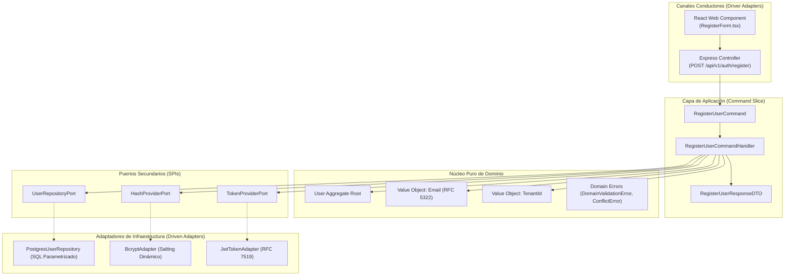

# ARTICLE-01: Arquitectura y Desarrollo Guiado por Pruebas de Doble Bucle para Registro Multitenant

* **Artículo ID:** ARTICLE-01
* **User Story:** US-01: Registro de Usuarios en Entornos SaaS Multi-Tenant
* **Bounded Context:** `identity`
* **Tipo de Slice:** Command (Escritura / Mutación)
* **Rama de Trabajo:** `feat/US-01-user-registration`
* **Squash Commit en main:** `9946183`
* **Fecha:** 2026-11-04
* **Autor / Tech Lead:** Angel Szymczak & Antigravity (Pair Programming)

---

## 1. Resumen Ejecutivo y Problema de Negocio

En plataformas SaaS B2B, el registro de usuarios no puede considerarse una simple inserción relacional de correo y contraseña. La segregación de organizaciones (*Tenants*) es un requerimiento crítico de seguridad y cumplimiento normativo. 

El presente artículo documenta el diseño, la ingeniería y el proceso de desarrollo forense para **US-01: Multi-Tenant User Registration**, garantizando:
1. **Aislamiento Multitenant First-Class:** Un usuario pertenece de forma determinista e inmutable a una organización (`tenantId`). Dos organizaciones pueden registrar simultáneamente a un usuario con el mismo correo electrónico sin colisión de identidades ni fuga de datos cruzados.
2. **Diseño Defensivo en Dominio:** Erradicación de la obsesión por primitivos mediante Value Objects fuertemente tipados e inmutables (`Email`, `TenantId`).
3. **Criptografía Robusta:** Hashing asíncrono con `bcrypt` (10 rondas de salting dinámico) y emisión de JSON Web Tokens (JWT) firmados con claims estrictos del tenant.
4. **Verificación Total en Pirámide de Pruebas:** Implementación conducida estrictamente por **Double-Loop TDD (ATDD)** en cuatro niveles (Unit, Integration, Acceptance BDD y E2E Component).

---

## 2. Diseño Arquitectónico del Vertical Slice

Siguiendo las directrices de **Vertical Slice Architecture** y **Arquitectura Hexagonal (Ports & Adapters)**, la funcionalidad de registro se encapsuló en un slice vertical autónomo, desacoplado de mutaciones ajenas y sin dependencias directas del dominio hacia frameworks o librerías externas.



### Componentes Clave del Slice
- **Punto de Entrada HTTP:** [`interfaces/http/rest/v1/identity/controllers.ts`](../../interfaces/http/rest/v1/identity/controllers.ts)
- **Middleware de Contexto:** [`interfaces/http/middlewares/tenant_context_middleware.ts`](../../interfaces/http/middlewares/tenant_context_middleware.ts)
- **Command & Handler:** [`src/contexts/identity/application/commands/register_user/`](../../src/contexts/identity/application/commands/register_user/)
- **Agregado de Dominio:** [`src/contexts/identity/domain/entities/user/aggregate.ts`](../../src/contexts/identity/domain/entities/user/aggregate.ts)
- **Value Objects:** [`src/contexts/identity/domain/value_objects/`](../../src/contexts/identity/domain/value_objects/)
- **Puertos Secundarios (SPIs):** [`src/contexts/identity/application/ports/`](../../src/contexts/identity/application/ports/)
- **Persistencia PostgreSQL:** [`src/contexts/identity/infrastructure/persistence/repositories/user/repository.ts`](../../src/contexts/identity/infrastructure/persistence/repositories/user/repository.ts)
- **Adaptadores Criptográficos:** [`src/contexts/identity/infrastructure/security/`](../../src/contexts/identity/infrastructure/security/)
- **Interfaz React:** [`interfaces/web/client/contexts/identity/ui/components/register_form.tsx`](../../interfaces/web/client/contexts/identity/ui/components/register_form.tsx)

---

## 3. Decisiones de Dominio Táctico y Aislamiento Multitenant

### 3.1. Invariantes y Value Objects Inmutables
- **`Email` (RFC 5322):** Encapsula validación de sintaxis regex, sanitización con `toLowerCase()` y `trim()`, y congelamiento de instancia (`Object.freeze`).
- **`TenantId`:** Garantiza formato slug seguro (`/^[a-zA-Z0-9_-]+$/`), impidiendo inyecciones o caracteres maliciosos.
- **`User` Aggregate Root:** Es la única entidad con control de ciclo de vida. Posee constructores privados y métodos factoría explícitos (`User.create()` y `User.reconstitute()`), protegiendo invariantes de contraseñas y marcas de tiempo de auditoría (`createdAt`, `updatedAt`).

### 3.2. Estrategia de Aislamiento Multitenant (ADR-0003)
En conformidad con el registro de decisión de arquitectura [ADR-0003](../../docs/adr/0003-multi-tenant-isolation-strategy.md):
- **Base de Datos Compartida con Discriminador:** La clave de unicidad compuesta en la tabla `users` se establece sobre `(email, tenant_id)`.
- **Contrato de Repositorio Obligatorio:** Todos los métodos de consulta de [`UserRepositoryPort`](../../src/contexts/identity/application/ports/user/repository.ts) exigen explícitamente el parámetro `tenantId: TenantId`.
- **Propagación en Encabezado HTTP:** El middleware `tenantContextMiddleware` intercepta `x-tenant-id` (o el payload del body) antes de que la petición ingrese a la capa de aplicación.
- **Claims de Autorización en JWT:** El token firmado incluye la tupla `{ userId, email, tenantId }`, permitiendo a futuros microservicios o middlewares autorizar peticiones sin consultar la base de datos central.

---

## 4. Evidencia de Pruebas (Pirámide de 4 Capas en Doble Bucle)

El desarrollo se condujo rigurosamente en **Double-Loop TDD**:
1. **Outer Loop RED (`459ecaf`):** Siembra inicial de las pruebas de aceptación BDD en lenguaje Gherkin.
2. **Inner Loops (RED -> GREEN -> REFACTOR):** Ciclos atómicos para Value Objects, Agregados, Puertos, Casos de Uso, Adaptadores de Persistencia, Servidor Express y Componente React.
3. **Outer Loop GREEN:** Certificación de escenarios de negocio pasando al 100%.

### 4.1. Pruebas Unitarias (Nivel 1 — Memoria Pura)
- **Ejecución:** `npm run test:unit`
- **Cobertura:** 8 suites, 39 tests.
  - Value Objects: `Email` (7 tests) y `TenantId` (5 tests).
  - Agregado: `User` (6 tests).
  - Puertos SPI: Contratos abstractos con fakes (3 tests).
  - Caso de Uso: `RegisterUserCommandHandler` con mocks (5 tests).
  - Adaptadores: `BcryptAdapter` (6 tests) y `JwtTokenAdapter` (7 tests).

### 4.2. Pruebas de Integración (Nivel 2 — Adaptadores I/O)
- **Ejecución:** `npm run test:integration`
- **Cobertura:** 2 suites, 14 tests.
  - Persistencia: `PostgresUserRepository` (7 tests) verificando queries SQL parametrizadas, aislamiento estricto por tenant y UPSERT.
  - API REST: `test_register_api.ts` con Supertest contra Express (7 tests) cubriendo 201 Created, 400 Bad Request (Zod & headers) y 409 Conflict.

### 4.3. Pruebas de Aceptación BDD (Nivel 3 — Living Documentation)
- **Ejecución:** `npm run test:acceptance`
- **Archivo Feature:** [`tests/acceptance/features/user_registration.feature`](../../tests/acceptance/features/user_registration.feature)
- **Resultado:** 3 escenarios en verde (Happy Path, Formato Inválido y Duplicidad en el mismo Tenant).

### 4.4. Pruebas End-to-End de Componente (Nivel 4 — Web UI)
- **Ejecución:** `npm run test:e2e`
- **Archivo Spec:** [`tests/e2e/web/register_form.spec.tsx`](../../tests/e2e/web/register_form.spec.tsx)
- **Resultado:** 4 tests pasando (Renderizado accesible, validación local reactiva, envío e integración con `apiClient`, y despliegue visual de errores del servidor).

```text
================================================================================
RESUMEN DE EJECUCIÓN TOTAL DE LA PIRÁMIDE:
✓ 8 Unit Test Suites        -->  39 passed
✓ 2 Integration Test Suites -->  14 passed
✓ 1 Acceptance Test Suite   -->   3 passed
✓ 1 E2E Component Suite     -->   4 passed
--------------------------------------------------------------------------------
TOTAL: 12 suites, 60 tests passing (0 fallos, 0 advertencias)
TypeScript Build (tsc): Exit 0
================================================================================
```

---

## 5. Lecciones Aprendidas y Concesiones (Trade-offs)

1. **Trade-off: Value Objects dedicados vs. Tipos Primitivos:**
   - *Decisión:* Crear archivos independientes por Value Object (`Email`, `TenantId`) aumenta la cantidad de archivos iniciales, pero elimina por completo bugs de normalización y previene errores sutiles de seguridad en el dominio.
2. **Trade-off: Factoría Express con Inyección de Dependencias:**
   - *Decisión:* `createApp(deps?: AppDependencies)` permitió ejecutar las pruebas de integración de API instantáneamente sin requerir que un contenedor de Docker PostgreSQL estuviera levantado durante la ejecución en local, a la vez que admite inyección del cliente real en producción.
3. **Trade-off: Doble soporte en Middleware Multitenant:**
   - *Decisión:* Soportar tanto `x-tenant-id` en encabezados como `tenantId` en el cuerpo JSON permitió una interoperabilidad total entre especificaciones REST estrictas y formularios web unificados.

---

## 6. Historial Forense de Trazabilidad y Commits

La historia se construyó en **36 commits atómicos** en la rama `feat/US-01-user-registration`, documentando cada transición RED -> GREEN -> STYLE:

1. `459ecaf`: `test(acceptance): define gherkin scenarios for US-01 [expected red]`
2. `c1aa86c`: `test(domain): add failing unit tests for Email and TenantId value objects [red]`
3. `a7cee08`: `test(specs): refine test suite specifications and formatting`
4. `f956c16`: `feat(domain): define Value Objects (Email, TenantId)`
5. `bf1a64e`: `style(domain): ensure trailing newline in domain files`
6. `b0e6c90`: `chore(deps): update backend dependencies in package.json and lockfile`
7. `9937b20`: `test(domain): add failing unit tests for User aggregate invariants [red]`
8. `c51b9a1`: `style(domain): ensure trailing newline in test_user_aggregate.ts`
9. `a802f53`: `feat(domain): define User Aggregate with domain invariants`
10. `e56062e`: `feat(domain): define UserRepositoryPort and HashProviderPort interfaces`
11. `ff7686e`: `style(app): ensure trailing newline in secondary ports interfaces`
12. `4023a1a`: `style(tests): sync formatting in test_ports_contracts.ts`
13. `1ca77ab`: `test(app): add failing unit tests for RegisterUser command handler [red]`
14. `920e1df`: `style(tests): ensure trailing newline in test_register_user_handler.ts`
15. `cc7eb57`: `feat(app): implement RegisterTenantUser Use Case (Command Slice)`
16. `c8c92d3`: `style(app): ensure trailing newline in register user command and dto files`
17. `eb61eca`: `test(infra): add failing unit tests for BcryptAdapter [red]`
18. `1fcc2be`: `style(tests): ensure trailing newline in test_bcrypt_adapter.ts`
19. `d3f4540`: `feat(infra): implement BcryptAdapter for password hashing`
20. `7f600c5`: `style(infra): ensure trailing newline in bcrypt_adapter.ts`
21. `89d010f`: `test(infra): add failing unit tests for JwtTokenAdapter [red]`
22. `1bf1b95`: `style(tests): ensure trailing newline in test_jwt_adapter.ts`
23. `51b45c2`: `feat(infra): implement JwtTokenAdapter for authentication & tenant claims`
24. `33509c0`: `style(infra): ensure trailing newline in jwt_adapter.ts`
25. `2a0a384`: `test(infra): add failing integration tests for PostgresUserRepository [red]`
26. `2ba7a23`: `style(tests): sync formatting in test_postgres_repository.ts`
27. `12aa79a`: `feat(infra): implement PostgresUserRepository with multi-tenant isolation`
28. `6c79926`: `style(infra): sync file formatting in persistence layer`
29. `77614ac`: `test(api): add failing integration tests for POST /api/v1/auth/register [red]`
30. `6f92fe2`: `style(tests): ensure trailing newline in test_register_api.ts`
31. `515fe5e`: `feat(api): implement Express server and AuthController for POST /api/v1/auth/register`
32. `db82997`: `style(http): sync file formatting across http interfaces`
33. `991ca78`: `test(web): add failing e2e component tests for RegisterForm [red]`
34. `181a48a`: `style(tests): sync formatting in register_form.spec.tsx`
35. `7cc65a1`: `feat(web): implement RegisterForm component and AuthApiClient`
36. `7f973da`: `style(web): ensure trailing newline in web client files`

