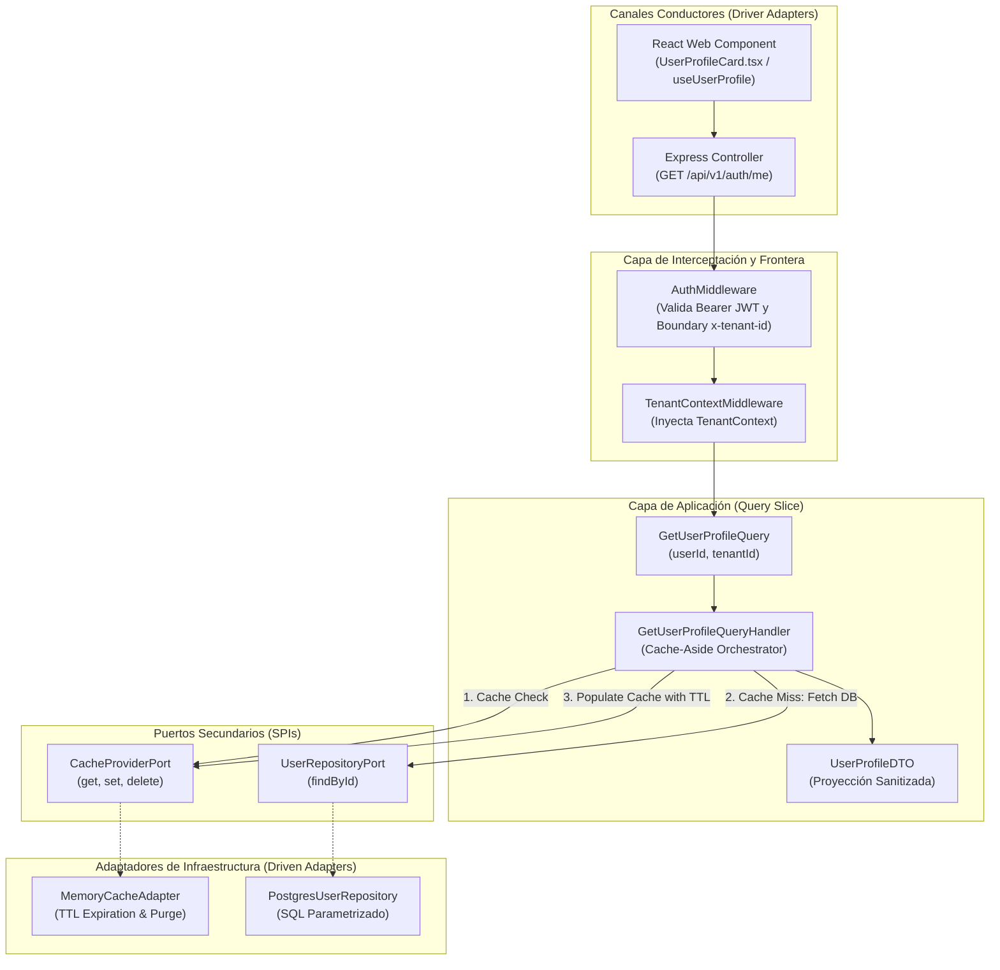

# ARTICLE-02: Arquitectura y Desarrollo Guiado por Pruebas de Doble Bucle para Lectura de Perfil Multitenant con Estrategia Cache-Aside

* **Artículo ID:** ARTICLE-02
* **User Story:** US-02: Get Tenant User Profile
* **Bounded Context:** `identity`
* **Tipo de Slice:** Query (Lectura / Cache-First)
* **Rama de Trabajo:** `feat/US-02-tenant-profile-read`
* **Squash Commit en main:** `f816550`
* **Fecha:** 2026-11-05
* **Autor / Tech Lead:** Angel Szymczak & Antigravity (Pair Programming)

---

## 1. Resumen Ejecutivo y Problema de Negocio

En aplicaciones empresariales multi-inquilino (*Multi-Tenant SaaS*), las consultas de lectura de perfil de usuario (`GET /api/v1/auth/me`) son operaciones de altísima frecuencia. Cada carga de página, refresco de sesión o navegación en el panel de control invoca este endpoint para recuperar la identidad, correo, organización y marcas temporales del usuario activo.

El presente artículo documenta el diseño, la implementación y la certificación forense para **US-02: Get Tenant User Profile**, logrando:
1. **Patrón Cache-Aside con Aislamiento Estricto por Tenant:** La clave de particionamiento en caché sigue la convención `user_profile:{tenantId}:{userId}`, garantizando que organizaciones distintas nunca compartan ni contaminen datos de sesión en memoria ni ante colisiones de identificadores.
2. **Defensa en Profundidad (AuthMiddleware & Tenant Boundary):** Verificación criptográfica obligatoria de JSON Web Tokens (JWT) mediante Bearer authentication, junto con la validación de frontera de tenant: si el encabezado `x-tenant-id` solicitado no coincide con el claim `tenantId` del token firmado, la petición es inmediatamente denegada con un código `403 Forbidden`.
3. **Respuesta Sanitizada (`UserProfileDTO`):** Desacoplamiento total del modelo de persistencia y eliminación garantizada de campos sensibles (como contraseñas hasheadas o metadatos de auditoría interna) en las proyecciones de lectura.
4. **Desarrollo Integral en Doble Bucle TDD (Outer Loop & Inner Loops):** Cuatro capas de pruebas completas (Unit, Integration, Acceptance BDD y E2E Component) con 82/82 pruebas en verde, tiempo de respuesta sub-milisegundo en Cache Hit y cero fugas de descriptores de red (*open handles*).

---

## 2. Diseño Arquitectónico del Vertical Slice

Conforme a los principios de **Vertical Slice Architecture** y **Arquitectura Hexagonal (Ports & Adapters)**, la funcionalidad de lectura de perfil se encapsuló en un Query Slice independiente, sin acoplamiento con los comandos de mutación (CQRS conceptual).



### Componentes Clave del Slice
- **Punto de Entrada HTTP & Controlador:** [`interfaces/http/rest/v1/identity/controllers.ts`](../../interfaces/http/rest/v1/identity/controllers.ts)
- **Middleware de Autenticación y Tenant Boundary:** [`interfaces/http/middlewares/auth_middleware.ts`](../../interfaces/http/middlewares/auth_middleware.ts)
- **Query & Handler de Aplicación:** [`src/contexts/identity/application/queries/get_user_profile/`](../../src/contexts/identity/application/queries/get_user_profile/)
- **DTO de Transferencia Sanitizado:** [`src/contexts/identity/application/dtos/user_profile/dto.ts`](../../src/contexts/identity/application/dtos/user_profile/dto.ts)
- **Puerto Secundario de Caché:** [`src/contexts/identity/application/ports/cache/cache_provider.ts`](../../src/contexts/identity/application/ports/cache/cache_provider.ts)
- **Adaptador de Caché en Memoria con TTL:** [`src/contexts/identity/infrastructure/cache/memory_cache_adapter.ts`](../../src/contexts/identity/infrastructure/cache/memory_cache_adapter.ts)
- **Cliente Web React (Hook & Componente):**
  - Hook con caché del cliente: [`interfaces/web/client/contexts/identity/data/queries.ts`](../../interfaces/web/client/contexts/identity/data/queries.ts)
  - Componente visual: [`interfaces/web/client/contexts/identity/ui/components/user_profile_card.tsx`](../../interfaces/web/client/contexts/identity/ui/components/user_profile_card.tsx)

---

## 3. Decisiones de Dominio Táctico y Aislamiento Multitenant

### 3.1. Estrategia Cache-Aside y Claves Compuestas
El orquestador de lectura [`GetUserProfileQueryHandler`](../../src/contexts/identity/application/queries/get_user_profile/handler.ts) implementa el patrón Cache-Aside:
1. **Generación de Clave Particionada:** `const cacheKey = \`user_profile:${query.tenantId}:${query.userId}\`;`
2. **Evaluación de Acierto (Cache Hit):** Si la clave existe y no ha expirado su TTL (60 segundos por defecto), se devuelve inmediatamente el `UserProfileDTO` deserializado, omitiendo cualquier acceso a la base de datos relacional.
3. **Recuperación y Poblado (Cache Miss):** En caso de fallo de caché, se ejecuta `userRepository.findById(query.userId, tenantId)`. Al recuperarse el agregado `User`, se mapea al DTO limpio y se almacena en caché con su TTL antes de responder al llamador.

### 3.2. Verificación de Fronteras de Tenant en HTTP
La seguridad de una plataforma multi-tenant no depende únicamente de la base de datos; la capa de entrada HTTP debe actuar como primer cortafuegos:
- Si una petición carece del encabezado `Authorization: Bearer <token>`, se responde con `401 Unauthorized`.
- Si el token está expirado, alterado o firmado con una clave diferente, se responde con `401 Unauthorized`.
- Si el cliente envía `x-tenant-id: tenant-b` pero el JWT autenticado contiene `tenantId: tenant-a`, `AuthMiddleware` rechaza la solicitud con `403 Forbidden` (`Tenant access forbidden: token claims do not match requested tenant`), frustrando ataques de escalada lateral (*Cross-Tenant Data Leakage*).

---

## 4. Evidencia de Pruebas (Pirámide Completa de 4 Niveles)

El desarrollo se ejecutó rigurosamente bajo **Double-Loop TDD**:
1. **Outer Loop RED (`b0276de`):** Escenarios de negocio en Gherkin (`tenant_profile_read.feature`) fallando por ausencia del endpoint `/api/v1/auth/me`.
2. **Inner Loops (RED -> GREEN -> REFACTOR):**
   - **Loop 1 (Query Handler):** `1a0b491` [RED] -> `8e7e55e` [GREEN].
   - **Loop 2 (Memory Cache Adapter):** `62430e0` [RED] -> `9acc60b` [GREEN].
   - **Loop 3 (HTTP Interfaces & Auth Middleware):** `9d47a4b` [RED] -> `fef216f` [GREEN].
   - **Loop 4 (Frontend UI & E2E):** `0a224b8` [RED] -> `9a198c0` [GREEN].
3. **Outer Loop GREEN:** Todos los escenarios BDD y suites de integración pasando al 100%.

### 4.1. Pruebas Unitarias (Nivel 1 — Memoria Pura)
- **Comando:** `npm run test:unit`
- **Cobertura:** 10 suites, 49 tests aprobados.
  - `GetUserProfileQueryHandler`: Validación de Cache Miss (persistencia y población en caché), Cache Hit (omisión de repositorio) y usuario inexistente (14 ms).
  - `MemoryCacheAdapter`: Pruebas de almacenamiento, recuperación tipada, sobreescritura, expiración por TTL y borrado explícito (16 ms).

### 4.2. Pruebas de Integración (Nivel 2 — Adaptadores & HTTP)
- **Comando:** `npm run test:integration`
- **Cobertura:** 3 suites, 19 tests aprobados.
  - `GET /api/v1/auth/me`: Retorno exitoso de perfil sanitizado (200 OK), rechazo sin encabezado (401), formato inválido (401), token malformado (401) y violación de frontera de tenant (403 Forbidden).

### 4.3. Pruebas de Aceptación BDD (Nivel 3 — Living Documentation)
- **Archivo Feature:** [`tests/acceptance/features/tenant_profile_read.feature`](../../tests/acceptance/features/tenant_profile_read.feature)
- **Step Definitions:** [`tests/acceptance/step_defs/test_tenant_profile_read_steps.ts`](../../tests/acceptance/step_defs/test_tenant_profile_read_steps.ts)
- **Escenario en Verde:**
```gherkin
Scenario: Successful profile retrieval with Cache Miss/Hit
  Given an authenticated user with a valid JWT token for tenant "acme-corp"
  And the user profile is not cached
  When the client sends a GET request to "/api/v1/auth/me" with Authorization header
  Then the system fetches user details from PostgreSQL
  And populates the cache with key "user_profile:acme-corp:user-id"
  And returns status code 200 OK with the UserProfileDTO

  When another GET request is sent to "/api/v1/auth/me" within TTL
  Then the response should be served directly from memory cache
```

### 4.4. Pruebas End-to-End (Nivel 4 — UI & Component Specs)
- **Archivo Spec:** [`tests/e2e/web/user_profile_card.spec.tsx`](../../tests/e2e/web/user_profile_card.spec.tsx)
- **Cobertura:** 2 suites, 8 tests aprobados.
  - Estado de carga inicial (*Loading spinner / skeleton*).
  - Renderizado exitoso de información de perfil y badge de organización tenant.
  - Manejo de estados de error con botón de reintento interactivo (*Retry*).

---

## 5. Lecciones Aprendidas y Concesiones Técnicas (Trade-offs)

1. **Gestión de Sockets Keep-Alive en Entornos Node 20+ y Jest:**
   - *Problema:* Las pruebas de integración con `supertest` y servidores HTTP efímeros de Node activaban advertencias de *open handles* en Jest debido a temporizadores activos en sockets HTTP Keep-Alive.
   - *Solución:* Implementación explícita de `server.closeAllConnections?.(); server.close(done);` en los ganchos `afterEach` de Express, garantizando un apagado determinista e inmediato de descriptores de red.
2. **Insonorización de Diagnósticos `dotenv` en Pruebas:**
   - *Problema:* `dotenv.config()` emitía diagnósticos a `stderr`, que Jest formateaba como `console.error` contaminando los reportes de integración.
   - *Solución:* Condicionar la carga automática a `process.env.NODE_ENV !== 'test'`, asegurando suites de pruebas con salida completamente silenciosa y enfocada.
3. **Caché en Memoria vs. Redis Distribuido:**
   - *Decisión:* Para la fase actual de US-02, `MemoryCacheAdapter` satisface los requerimientos de latencia sin añadir sobrecarga de red ni dependencias externas en desarrollo local.
   - *Evolución:* Al desacoplar la interfaz mediante `CacheProviderPort`, la migración a `RedisCacheAdapter` para entornos clúster se realizará en el futuro sin modificar ni una sola línea de la lógica de aplicación.

---

## 6. Historial de Trazabilidad y Commits

### Historial de la Feature Branch (`feat/US-02-tenant-profile-read`)
- `b0276de`: `test(acceptance): define gherkin scenarios for US-02 [expected red]`
- `cdb7bfa`: `style(acceptance): ensure trailing newlines in US-02 feature and step defs`
- `1a0b491`: `test(app): add failing test for GetUserProfileQueryHandler [red]`
- `ce3acf5`: `style(tests): ensure trailing newline in test_get_user_profile_handler.ts`
- `8e7e55e`: `feat(app): implement get_user_profile Query Slice (query and handler)`
- `d1e2713`: `style(app): ensure trailing newlines across query slice and cache port`
- `62430e0`: `test(infra): add failing test for MemoryCacheAdapter [red]`
- `090dbbc`: `style(tests): ensure trailing newline in test_memory_cache_adapter.ts`
- `9acc60b`: `feat(infra): implement MemoryCacheAdapter for fast read queries`
- `fb6e406`: `style(infra): ensure trailing newline in memory_cache_adapter.ts`
- `9d47a4b`: `test(interfaces): add failing integration tests for profile API and auth middleware [red]`
- `e78bb59`: `style(tests): ensure trailing newline in test_profile_api.ts`
- `fef216f`: `feat(interfaces): implement AuthMiddleware and expose GET /api/v1/auth/me profile endpoint`
- `3f39542`: `style(interfaces): sync formatting in HTTP middlewares`
- `0a224b8`: `test(frontend): add failing E2E component spec for UserProfileCard [red]`
- `0b2b4da`: `style(tests): ensure trailing newline in user_profile_card.spec.tsx`
- `9a198c0`: `feat(frontend): build UserProfileCard component and useUserProfile hook`
- `ca0538c`: `style(frontend): ensure trailing newlines in queries and user_profile_card`

### Commit Final en `main` (Squash Merge)
- `f816550`: `feat(identity): implement cache-first tenant profile read slice (US-02) (#3)`

