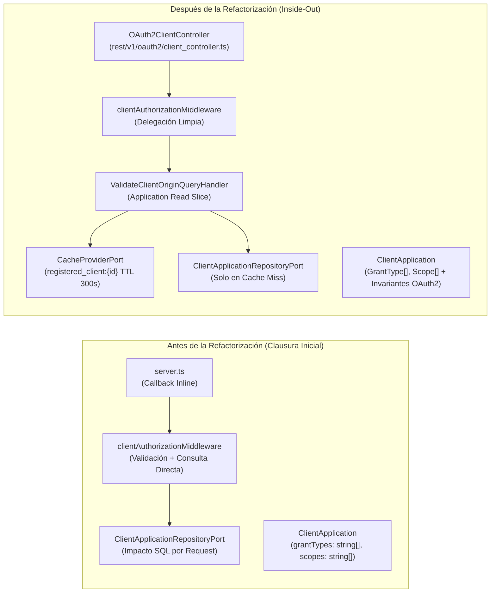

# ARTICLE-03-B: Bucle de Refactorización Inside-Out sobre el Registro de Clientes OAuth2 y Validación de Orígenes

* **Artículo ID:** ARTICLE-03-B
* **User Story:** [US-03: Dynamic Client Registry and Origin Validation](../epics/EPIC-02-client-registry/stories/US-03-client-registry-origin-validation.md)
* **Artículo Predecesor:** [ARTICLE-03: Arquitectura y Desarrollo Guiado por Tests en 4 Capas](./ARTICLE-03-client-registry.md)
* **ADR Relacionado:** [ADR-0004: Client Registry and Service Authorization](../../docs/adr/0004-client-registry-authorization.md)
* **Rama de Trabajo:** `feat/US-03-client-registry`
* **Fecha:** 2026-11-06
* **Autor / Tech Lead:** Angel Szymczak & Antigravity (Pair Programming)

---

## 1. Motivación: El Bucle de Refactorización Post-Green

En el ciclo clásico de **Test-Driven Development (Red $\rightarrow$ Green $\rightarrow$ Refactor)** aplicado a escala de arquitectura hexagonal, alcanzar el estado `100% GREEN` en las cuatro capas de pruebas (Unidad, Integración, Aceptación BDD y E2E) cierra la **Fase 2 (Clausura Bottom-Up)**, pero abre la oportunidad crítica del **Bucle de Refactorización**.

Antes de realizar el *squash-merge* de `feat/US-03-client-registry` hacia `main`, realizamos una auditoría técnica mediante `/grill-me` identificando cuatro áreas de mejora estructural que podían perfeccionarse bajo la red de seguridad de las pruebas existentes:

1. **Obsesión por Primitivos en el Dominio (`Primitive Obsession`):** En la primera iteración, `ClientApplication` representaba `allowedGrantTypes` y `scopes` como arreglos primitivos `string[]`, dejando sin validar concesiones incompatibles (como asignar `client_credentials` a un cliente `public` SPA).
2. **Acoplamiento Directo entre Middleware e Infraestructura:** El middleware `clientAuthorizationMiddleware` consultaba directamente `ClientApplicationRepositoryPort` en cada petición HTTP sin pasar por un caso de uso de la capa de Aplicación ni aprovechar una estrategia de caché.
3. **Lógica de Controlador Inline en `server.ts`:** El endpoint `POST /api/v1/oauth2/clients/validate` residía como un callback anónimo dentro de `interfaces/http/server.ts`, rompiendo la simetría con `AuthController`.
4. **Ausencia de Catálogo Visual para el Guard Frontend:** Aunque `ClientAuthorizationGuard` contaba con pruebas E2E en Jest/Testing Library, carecía de historias interactivas en Storybook (`*.stories.tsx`) para inspeccionar visualmente sus estados de carga, éxito, bloqueo CORS y reintento de red.

---

## 2. Arquitectura Comparativa: Before vs. After

---

## 3. Desglose de las 4 Refactorizaciones Inside-Out

### 3.1. Paso 1: Enriquecimiento del Dominio Puro (`GrantType` y `Scope`)
* **Archivos:**
  * [`src/contexts/identity/domain/value_objects/grant_type/value.ts`](../../src/contexts/identity/domain/value_objects/grant_type/value.ts)
  * [`src/contexts/identity/domain/value_objects/scope/value.ts`](../../src/contexts/identity/domain/value_objects/scope/value.ts)
  * [`src/contexts/identity/domain/entities/client_application/aggregate.ts`](../../src/contexts/identity/domain/entities/client_application/aggregate.ts)
* **Mejora Técnica:**
  * `GrantType` restringe el dominio al conjunto cerrado `'authorization_code' | 'refresh_token' | 'client_credentials'` y expone el predicado semántico `requiresConfidentialClient()`.
  * `Scope` valida scopes estándar OIDC (`openid`, `profile`, `email`) y scopes con namespace (`identity:read`, `orders:write`), rechazando espacios o caracteres malformados.
  * `ClientApplication` ahora impide en tiempo de instanciación que un cliente `public` reciba el flujo `client_credentials` (exclusivo para autenticación Machine-to-Machine con secreto confidencial) y expone `hasGrantType()` y `hasScope()`.

### 3.2. Paso 2: Query Slice con Patrón Cache-Aside y Sanitización de Secretos
* **Archivos:**
  * [`src/contexts/identity/application/dtos/client_validation/dto.ts`](../../src/contexts/identity/application/dtos/client_validation/dto.ts)
  * [`src/contexts/identity/application/queries/validate_client_origin/query.ts`](../../src/contexts/identity/application/queries/validate_client_origin/query.ts)
  * [`src/contexts/identity/application/queries/validate_client_origin/handler.ts`](../../src/contexts/identity/application/queries/validate_client_origin/handler.ts)
* **Mejora Técnica:**
  * Cada validación de origen (que ocurre con alta frecuencia en preflights e inicializaciones de SPAs) consulta primero la clave `registered_client:{clientId}` en `CacheProviderPort`.
  * En caso de *Cache Miss*, el handler recupera el agregado desde PostgreSQL y almacena un `CachedRegisteredClientDTO` con un TTL de `300` segundos.
  * **Garantía de Seguridad (Zero-Secret Caching):** El snapshot `CachedRegisteredClientDTO` excluye por diseño el campo `clientSecretHash`, asegurando que ningún hash criptográfico sea serializado en memoria de caché o Redis.

### 3.3. Paso 3: Controlador Dedicado (`OAuth2ClientController`) y Desacoplamiento HTTP
* **Archivos:**
  * [`interfaces/http/rest/v1/oauth2/client_controller.ts`](../../interfaces/http/rest/v1/oauth2/client_controller.ts)
  * [`interfaces/http/middlewares/client_authorization_middleware.ts`](../../interfaces/http/middlewares/client_authorization_middleware.ts)
  * [`interfaces/http/server.ts`](../../interfaces/http/server.ts)
* **Mejora Técnica:**
  * Se extrajo `OAuth2ClientController` bajo `interfaces/http/rest/v1/oauth2/`, centralizando el mapeo determinista entre códigos de error de aplicación (`missing_client_id`, `invalid_client_id`, `client_not_found`, `client_deactivated`, `unauthorized_client_origin`) y códigos de estado HTTP (`400`, `404`, `401`, `403`).
  * `clientAuthorizationMiddleware` eliminó toda lógica de validación duplicada, delegando en `ValidateClientOriginQueryHandler` y propagando el resultado tipado en `req.clientValidation`.

### 3.4. Paso 4: Component-Driven Development en Storybook
* **Archivo:**
  * [`interfaces/web/client/contexts/identity/ui/components/client_authorization_guard.stories.tsx`](../../interfaces/web/client/contexts/identity/ui/components/client_authorization_guard.stories.tsx)
* **Mejora Técnica:**
  * Se incorporaron 5 historias visuales interactivas bajo `Identity/ClientAuthorizationGuard`:
    1. `AuthorizedPublicClient`: Renderizado del árbol hijo tras validación exitosa.
    2. `UnauthorizedOriginError`: Pantalla de bloqueo HTTP `403` ante un origen no registrado.
    3. `DeactivatedClientError`: Pantalla de bloqueo HTTP `401` para aplicaciones dadas de baja.
    4. `VerifyingLoadingState`: Estado de espera accesible (`role="status"`, `aria-live="polite"`).
    5. `NetworkErrorWithRetry`: Simulación de caída de red (`503`) para verificar la experiencia de reintento (`Retry Verification`).

---

## 4. Evolución de la Pirámide de Pruebas

Tras completar el bucle de refactorización, la suite total creció de **116 a 129 pruebas automatizadas** distribuidas en **26 suites**, manteniendo un **100% de ejecución en verde**:

| Capa | Suites Antes | Tests Antes | Suites Después | Tests Después | Delta | Estado |
| :--- | :---: | :---: | :---: | :---: | :---: | :---: |
| **Capa 1: Unit Tests** | 13 | 69 | **15** | **82** | `+2 suites / +13 tests` | 🟢 PASS |
| **Capa 2: Integration Tests** | 5 | 27 | **5** | **27** | `0 regresiones` | 🟢 PASS |
| **Capa 3: Acceptance BDD** | 3 | 9 | **3** | **9** | `0 regresiones` | 🟢 PASS |
| **Capa 4: End-to-End (E2E)** | 3 | 11 | **3** | **11** | `+5 Storybook Stories` | 🟢 PASS |
| **TOTAL** | **24** | **116** | **26** | **129** | **`+13 Tests` + `5 Stories`** | 🟢 **100% VERDE** |

---

## 5. Registro Forense de Commits del Bucle de Refactorización

1. `3acc136` — `refactor(domain): introduce GrantType and Scope value objects in ClientApplication`
2. `89ca254` — `test(unit): add unit tests for GrantType and Scope value objects`
3. `9abee7e` — `refactor(application): implement ValidateClientOriginQueryHandler with Cache-Aside pattern`
4. `ebea58c` — `test(unit): add unit tests for ValidateClientOriginQueryHandler and cache-aside scenarios`
5. `abf5b23` — `refactor(interfaces): extract OAuth2ClientController and delegate middleware validation to query handler`
6. `b8f1bf5` — `feat(storybook): add visual stories for ClientAuthorizationGuard states`

