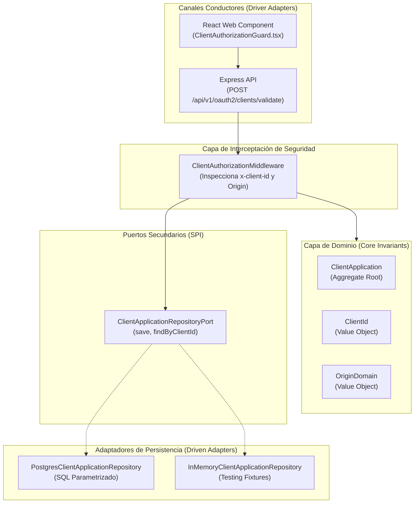

# ARTICLE-03: Arquitectura y Desarrollo Guiado por Tests en 4 Capas para Registro de Clientes y Validación de Origen

* **Artículo ID:** ARTICLE-03
* **User Story:** US-03: Dynamic Client Registry and Origin Validation
* **Bounded Context:** `identity` / `client-registry`
* **Tipo de Slice:** Security & Protocol (Client Registry Slice)
* **Rama de Trabajo:** `feat/US-03-client-registry`
* **ADR Relacionado:** [ADR-0004: Client Registry and Service Authorization](../../docs/adr/0004-client-registry-authorization.md)
* **Fecha:** 2026-11-06
* **Autor / Tech Lead:** Angel Szymczak & Antigravity (Pair Programming)

---

## 1. Resumen Ejecutivo y Problema de Negocio

La transición de `identity-service` desde un autenticador básico hacia un **Identity Provider (IdP) & Broker Enterprise** para el ecosistema (E-commerce, Portales de IA, Aplicaciones Móviles y Microservicios satélites) exige abandonar supuestos frágiles de seguridad. En la web tradicional, es habitual confiar únicamente en el mecanismo de cabeceras CORS del navegador. Sin embargo, en un entorno federado de grado corporativo:
1. Las llamadas entre servicios backend (Machine-to-Machine) y herramientas CLI no aplican preflight CORS y pueden vulnerar la API si el IdP no valida activamente la identidad del cliente.
2. Clientes frontend con distintas clasificaciones de seguridad (`public` SPAs vs `confidential` backends) requieren reglas diferenciadas: mientras que una SPA en el navegador no puede resguardar un secreto de cliente de forma segura, un microservicio backend debe autenticarse mediante secretos criptográficos robustos.
3. El secuestro de orígenes y redirecciones maliciosas (*Open Redirectors*) requiere validación determinista de orígenes y redirect URIs en la base de datos del servidor de identidad.

El presente artículo documenta el diseño, la implementación y la certificación forense para **US-03: Dynamic Client Registry and Origin Validation**, implementando de forma pionera la metodología **Outside-In Test-Driven Development en 4 Capas**.

---

## 2. Diseño Arquitectónico del Vertical Slice

Conforme a [ADR-0004](../../docs/adr/0004-client-registry-authorization.md), se modeló el subsistema bajo Arquitectura Hexagonal y DDD:



### Componentes Clave:
1. **Value Objects (`ClientId`, `OriginDomain`):**
   * `ClientId`: Normaliza identificadores en formato slug/kebab-case, forzando longitud mínima de 3 caracteres y prohibiendo caracteres especiales vulnerables a inyección.
   * `OriginDomain`: Valida estrictamente protocolos `http:` / `https:`, rechaza rutas subordinadas no-root (e.g. `/app/path`) y normaliza la URL eliminando trailing slashes para comparaciones seguras de origen.
2. **Agregado Raíz `ClientApplication`:**
   * Garantiza la invariante de que clientes `public` jamás almacenen `client_secret` (mitigando fugas de credenciales en bundles de frontend).
   * Obliga a que clientes `confidential` dispongan de `client_secret_hash`.
   * Expone el método de negocio `isOriginAllowed(origin)` para verificación en tiempo constante de listas blancas de dominios.
3. **Persistencia Relacional (`006-create-registered-clients.sql`):**
   * Almacenamiento en PostgreSQL con columnas tipadas tipo array (`allowed_origins TEXT[]`, `redirect_uris TEXT[]`, `scopes TEXT[]`) e índices únicos sobre `client_id`.
4. **Middleware Express (`clientAuthorizationMiddleware`):**
   * Intercepta la cabecera `x-client-id`, consulta el repositorio, verifica el estado `is_active` (HTTP 401 si está inactivo) y rechaza con `403 Forbidden` (`unauthorized_client_origin`) cualquier petición cuyo origen no pertenezca a la lista autorizada.
5. **Guard Frontend (`ClientAuthorizationGuard`):**
   * Componente React que intercepta el ciclo de renderizado, consulta el endpoint `/api/v1/oauth2/clients/validate` y presenta pantallas defensivas ante orígenes no homologados o clientes desactivados.

---

## 3. Metodología: Ciclo de Desarrollo Guiado por Tests en 4 Capas

Se adoptó de manera sistemática el flujo **Outside-In (Apertura Top-Down en ROJO)** y **Inside-Out (Clausura Bottom-Up en VERDE)** definido en las reglas de ingeniería [DEVELOPMENT_WORKFLOW.md](../rules/DEVELOPMENT_WORKFLOW.md):

```text
FASE 1: APERTURA (Top-Down / Red Phase)
├── Paso 1: Capa 4 (E2E)          -> tests/e2e/web/client_registry_origin.spec.tsx [ROJO]
├── Paso 2: Capa 3 (Aceptación)   -> tests/acceptance/features/client_registry_validation.feature [ROJO]
├── Paso 3: Capa 2 (Integración)  -> tests/integration/identity/repositories & interfaces [ROJO]
└── Paso 4: Capa 1 (Unidad)       -> tests/unit/identity/domain/client_registry/* [ROJO]

FASE 2: CLAUSURA (Bottom-Up / Green Phase)
├── Paso 5: Capa 1 (Dominio Puro) -> ClientId, OriginDomain, ClientApplication [VERDE]
├── Paso 6: Capa 2 (Infra)        -> DDL 006, PostgresClientRepository, Middleware [VERDE]
├── Paso 7: Capa 3 (Aceptación)   -> Enlace en server.ts & InMemoryClientRepository [VERDE]
└── Paso 8: Capa 4 (E2E)          -> ClientAuthorizationGuard [VERDE]
```

Esta disciplina garantiza:
* **Cero código especulativo:** Cada componente productivo responde estrictamente a un contrato de prueba que previamente falló.
* **Separación de responsabilidades en Git:** Los commits de especificación (`[red]`) se encuentran totalmente desacoplados de los commits de implementación (`[green]`).

---

## 4. Cobertura de Pruebas y Certificación de la Pirámide

La ejecución integral de la suite de pruebas certifica **116 pruebas automatizadas pasando al 100%** sin advertencias ni regresiones:

```bash
npm run test:unit && npm run test:integration && npm run test:acceptance && npm run test:e2e
```

| Capa | Archivos / Suites | Tests | Tiempo | Estado |
| :--- | :--- | :---: | :---: | :---: |
| **Capa 1: Unit Tests** | 13 suites (`test_client_id`, `test_origin_domain`, `test_client_application`, etc.) | 69 | ~7s | 🟢 PASS |
| **Capa 2: Integration Tests** | 5 suites (`test_postgres_client_repository`, `test_client_authorization_middleware`, etc.) | 27 | ~5s | 🟢 PASS |
| **Capa 3: Acceptance BDD** | 3 suites (`client_registry_validation.feature`, etc.) | 9 | ~4s | 🟢 PASS |
| **Capa 4: End-to-End (E2E)** | 3 suites (`client_registry_origin.spec.tsx`, etc.) | 11 | ~4s | 🟢 PASS |
| **TOTAL** | **24 Test Suites** | **116 Tests** | **~20s** | 🟢 **100% VERDE** |

---

## 5. Trazabilidad Forense de Commits en `feat/US-03-client-registry`

1. `d21b384` — `test(e2e): specify client origin validation and authorization guard [red]`
2. `ef89fb9` — `test(acceptance): define gherkin scenarios and step definitions for client registry [red]`
3. `9eee102` — `test(integration): specify client repository and authorization middleware [red]`
4. `f60aca1` — `test(unit): specify client_id, origin_domain and client_application aggregate [red]`
5. `c4f5bb3` — `feat(domain): implement client_id, origin_domain and client_application aggregate [green]`
6. `4ec59d0` — `test(integration): refine client repository test assertions with strict optional chaining`
7. `0f86b19` — `feat(infra): implement registered clients ddl, repository port and postgres adapter [green]`
8. `bd7baa7` — `feat(interfaces): implement client authorization and origin validation middleware [green]`
9. `468d0de` — `feat(acceptance): connect client registry validation route and in-memory repository to pass bdd scenarios [green]`
10. `91ec3df` — `feat(frontend): implement ClientAuthorizationGuard to close E2E tests [green]`

---

## 6. Conclusiones y Próximos Pasos

Con la finalización de **US-03**, `identity-service` cuenta con un motor determinista para verificar la procedencia de las aplicaciones satélites consumidoras.

El siguiente paso en la hoja de ruta de **EPIC-02 (Client Registry & Service Authorization)** corresponde a:
* **[`US-04: Client Credentials & Scoped Access Token Grant`](../epics/EPIC-02-client-registry/stories/US-04-client-credentials-scoped-grant.md):** Permitir autenticación Machine-to-Machine (M2M) con emisión de JWTs acotados por scopes para clientes confidenciales.

