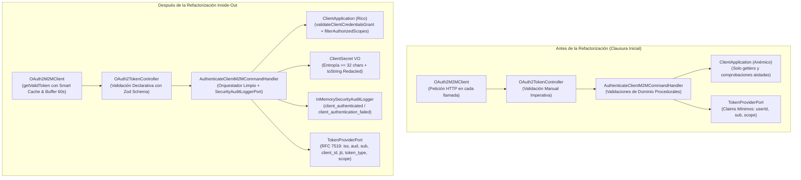

# ARTICLE-04-B: Bucle de Refactorización Inside-Out sobre OAuth2 Client Credentials y Scoped Grant

* **Artículo ID:** ARTICLE-04-B
* **User Story:** [US-04: Client Credentials & Scoped Access Token Grant](../epics/EPIC-02-client-registry/stories/US-04-client-credentials-scoped-grant.md)
* **Plan de Refactorización:** [US-04: Plan de Refactorización Integral](../epics/EPIC-02-client-registry/stories/US-04-client-credentials-refactoring-plan.md)
* **Artículo Predecesor:** [ARTICLE-04: Client Credentials Grant y Flujo Consumidor M2M en 4 Capas](./ARTICLE-04-client-credentials-grant.md)
* **ADR Relacionado:** [ADR-0004: Client Registry and Service Authorization](../../docs/adr/0004-client-registry-authorization.md)
* **Estándares:** RFC 6749 (OAuth 2.0, Secciones 2.3.1, 4.4, 5) y RFC 7519 (JSON Web Tokens)
* **Rama de Trabajo:** `feat/US-04-client-credentials`
* **Fecha:** 2026-11-07
* **Autor / Tech Lead:** Angel Szymczak & Antigravity (Pair Programming)

---

## 1. Motivación: El Bucle de Refactorización Post-Green

Tras culminar con éxito la **Fase 2 (Clausura Bottom-Up)** de la historia de usuario **US-04**, alcanzando un estado de `100% GREEN` en las cuatro capas de la pirámide de pruebas (Dominio, Aplicación, Integración HTTP, Aceptación BDD y Consumidor E2E), realizamos una auditoría arquitectónica mediante la sesión interactiva `/grill-me`.

El objetivo de esta auditoría consistió en identificar áreas de fricción técnica, deuda incipiente y oportunidades de hardening antes de consolidar la rama de características en `main`. Se consensuaron cuatro ejes de evolución estructurados mediante el principio **Inside-Out (desde el núcleo de dominio hacia el borde de infraestructura y consumo)**:

1. **Obsesión por Primitivos en Secretos (`Primitive Obsession`):** La credencial confidencial `client_secret` ingresaba y fluía a través de la aplicación como un string plano (`string`), sin salvaguardas de entropía criptográfica mínima ni protección contra exposición en trazas o logs.
2. **Lógica de Concesión Anémica en el Agregado:** Las reglas de validación de estado activo, clasificación confidencial, comprobación del grant type `client_credentials` y filtrado de scopes residían de manera procedural dentro de `AuthenticateClientM2MCommandHandler`, en lugar de pertenecer al agregado `ClientApplication`.
3. **Ausencia de Claims Estándar RFC 7519 y Trazabilidad de Seguridad:** Los tokens JWT emitidos omitían claims RFC 7519 obligatorios en arquitecturas empresariales federadas (`iss`, `aud`, `token_type`, `jti`), y no existía un mecanismo para auditar intentos fallidos de autenticación (fuerza bruta, secretos inválidos o clientes deshabilitados).
4. **Validación Imperativa en Interfaces HTTP:** El controlador `OAuth2TokenController` realizaba validaciones manuales de parámetros, careciendo del esquema declarativo Zod homologado con el resto de la plataforma.
5. **Ineficiencia en Consumidores M2M:** El SDK cliente `OAuth2M2MClient` exigía una petición HTTP por cada obtención de token, sin soporte de caché en memoria ni renovación preventiva antes de la expiración.

---

## 2. Arquitectura Comparativa: Before vs. After

---

## 3. Desglose de las Refactorizaciones Inside-Out

### 3.1. Paso 1: Dominio Puro (`ClientSecret` y Enriquecimiento de `ClientApplication`)
* **Archivos Modificados:**
  * [`src/contexts/identity/domain/value_objects/client_secret/value.ts`](../../src/contexts/identity/domain/value_objects/client_secret/value.ts)
  * [`src/contexts/identity/domain/entities/client_application/aggregate.ts`](../../src/contexts/identity/domain/entities/client_application/aggregate.ts)
  * [`tests/unit/identity/domain/client_registry/test_client_secret.ts`](../../tests/unit/identity/domain/client_registry/test_client_secret.ts)
  * [`tests/unit/identity/domain/client_registry/test_client_application.ts`](../../tests/unit/identity/domain/client_registry/test_client_application.ts)
* **Mejora Técnica:**
  * **Value Object `ClientSecret`:** Exige una longitud mínima estricta de **32 caracteres** (alineado con ADR-0004 y las mejores prácticas de seguridad de RFC 6749 BCP), inmutabilidad mediante congelación profunda (`Object.freeze`) y enmascaramiento seguro en su representación textual (`toString()` retorna `'[REDACTED]'`).
  * **Encapsulación en `ClientApplication`:**
    * `validateClientCredentialsGrant(secret, secretVerifier)`: valida de forma atómica el estado activo, tipo confidencial, asignación del grant `client_credentials`, existencia de hash y comparación criptográfica.
    * `filterAuthorizedScopes(requestedScopes)`: verifica que cada scope solicitado esté explícitamente concedido al cliente o retorna la totalidad de scopes homologados si la petición no especifica restricciones.
  * **Actualización de Fixtures de Pruebas:** Se migraron todas las suites de pruebas (unitarias, integración, aceptación BDD y E2E) para utilizar secretos con entropía completa ($\ge 32$ caracteres).

### 3.2. Paso 2: Capa de Aplicación (Claims RFC 7519 y Auditoría de Seguridad)
* **Archivos Modificados:**
  * [`src/contexts/identity/application/ports/security/audit_logger.ts`](../../src/contexts/identity/application/ports/security/audit_logger.ts)
  * [`src/contexts/identity/infrastructure/logging/memory_security_audit_logger.ts`](../../src/contexts/identity/infrastructure/logging/memory_security_audit_logger.ts)
  * [`src/contexts/identity/application/commands/authenticate_client_m2m/handler.ts`](../../src/contexts/identity/application/commands/authenticate_client_m2m/handler.ts)
  * [`tests/unit/identity/application/oauth2/test_authenticate_client_m2m_handler.ts`](../../tests/unit/identity/application/oauth2/test_authenticate_client_m2m_handler.ts)
* **Mejora Técnica:**
  * **Secondary Port `SecurityAuditLoggerPort`:** Contrato de auditoría desacoplado que registra eventos tipados `client_authenticated` y `client_authentication_failed` con marca temporal ISO, cliente, IP remota y motivo de rechazo.
  * **Secondary Adapter `InMemorySecurityAuditLogger`:** Implementación en memoria para desarrollo y testing que facilita la inspección de trazas y la correlación forense.
  * **Anatomía de Claims RFC 7519:** La emisión del JWT ahora incluye:
    * `iss`: Identificador de la autoridad emisora (`https://auth.angelpixel.io` o configurable).
    * `aud`: Audiencia destinataria de la API (`https://api.angelpixel.io` o configurable).
    * `sub`: Sujeto (identificador unívoco del cliente máquina).
    * `client_id`: Identificador del cliente.
    * `token_type`: `'Bearer'`.
    * `jti`: Identificador único de token generado con UUID v4 (`crypto.randomUUID()`), permitiendo detección de reuso y revocación.
    * `scope`: Cadena delimitada por espacios con los permisos autorizados.

### 3.3. Paso 3: Interfaces HTTP (Validación Declarativa con Zod)
* **Archivos Modificados:**
  * [`interfaces/http/rest/v1/oauth2/schemas.ts`](../../interfaces/http/rest/v1/oauth2/schemas.ts)
  * [`interfaces/http/rest/v1/oauth2/token_controller.ts`](../../interfaces/http/rest/v1/oauth2/token_controller.ts)
  * [`tests/unit/identity/interfaces/test_oauth2_schemas.ts`](../../tests/unit/identity/interfaces/test_oauth2_schemas.ts)
  * [`tests/integration/identity/interfaces/test_oauth2_token_m2m.ts`](../../tests/integration/identity/interfaces/test_oauth2_token_m2m.ts)
* **Mejora Técnica:**
  * **Esquema Zod `OAuth2TokenRequestSchema`:** Declara y valida la presencia obligatoria de `grantType` y `clientId`, sanitizando espacios en blanco con `trim()`.
  * **Traductor de Protocolo `validateOAuth2TokenRequest`:** Mapea de forma determinista cualquier violación de validación de entrada a errores estándar RFC 6749 Sección 5.2 (`400 invalid_request` o `400 unsupported_grant_type`), aislando la capa de aplicación de peticiones malformadas.
  * **Trazabilidad de IP:** El controlador extrae `req.ip` o la cabecera `x-forwarded-for` y la transmite al caso de uso para auditoría de seguridad.

### 3.4. Paso 4: Consumidor M2M (`OAuth2M2MClient` con Smart Caching y Auto-Renovación)
* **Archivos Modificados:**
  * [`interfaces/http/client/oauth2_m2m_client.ts`](../../interfaces/http/client/oauth2_m2m_client.ts)
  * [`tests/e2e/m2m/client_credentials_flow.spec.ts`](../../tests/e2e/m2m/client_credentials_flow.spec.ts)
* **Mejora Técnica:**
  * **Método `getValidToken(params)`:** Consulta la caché interna en memoria indexada por `${clientId}:${scope}`. Si el token está presente y su tiempo restante de validez supera el buffer de seguridad (**60 segundos** por defecto), se devuelve inmediatamente (**Cache Hit**, 0 ms de latencia de red).
  * **Preemptive Auto-Renewal:** Si el token está próximo a expirar (dentro de los 60 segundos previos a `expires_in`), el SDK solicita transparentemente un nuevo token antes de que expire, evitando rechazos `401` en llamadas downstream.
  * **Refresco Forzado con `requestToken(params)`:** Se conserva la invocación directa para escenarios donde un servicio consumidor requiera forzar una nueva emisión tras detectar cambios de permisos.
  * **Gestión de Ciclo de Vida:** Métodos `invalidateToken(params)` y `clearTokenCache()` para control programático.

---

## 4. Análisis de Impacto y Métricas de Calidad

| Métrica | Antes del Refactoring | Después del Refactoring | Variación |
| :--- | :--- | :--- | :--- |
| **Test Suites Totales** | 30 suites | **33 suites** | $+3$ suites ($+10.0\%$) |
| **Pruebas Totales** | 157 pruebas | **188 pruebas** | $+31$ pruebas ($+19.7\%$) |
| **Unit Tests** | 100 pruebas | **117 pruebas** | $+17$ pruebas |
| **Integration Tests** | 38 pruebas | **39 pruebas** | $+1$ prueba |
| **Acceptance BDD** | 13 pruebas | **13 pruebas** | Estable ($100\%$ GREEN) |
| **E2E Consumer Tests** | 15 pruebas | **19 pruebas** | $+4$ pruebas |
| **Tasa de Éxito de Tests** | $100\%$ | **$100\%$ GREEN** | Sin regresiones |
| **Compilación TypeScript (`tsc`)** | Exitosa | **Exitosa (0 errores)** | Totalmente tipado |

---

## 5. Trazabilidad de Commits Atómicos

Conforme a la política de calidad y separación estricta entre código de producción y pruebas:

1. `0a7fdc4`: `refactor(domain): introduce ClientSecret value object and M2M grant methods in ClientApplication`
2. `2fbb007`: `test(domain): add unit tests for ClientSecret and update fixtures to 32 chars`
3. `a88ce84`: `feat(application): add SecurityAuditLoggerPort and RFC 7519 standard claims to M2M grant`
4. `3680915`: `test(application): add unit tests for SecurityAuditLogger and RFC 7519 claims`
5. `ea70e38`: `refactor(http): add OAuth2TokenRequestSchema and integrate Zod validation in OAuth2TokenController`
6. `df79d80`: `test(http): add unit tests for OAuth2TokenRequestSchema and integration test for missing client_id`
7. `2e84d5f`: `feat(client): implement in-memory token cache and preemptive auto-renewal in OAuth2M2MClient`
8. `6008293`: `test(e2e): add test coverage for OAuth2M2MClient token cache hit and auto-renewal`

---

## 6. Conclusión y Próximos Pasos

El bucle de refactorización transformó el slice vertical de **US-04** desde una implementación funcionalmente correcta hacia una solución con grado de robustez de nivel empresarial:
- **Protección criptográfica y semántica** en el núcleo de dominio (`ClientSecret` $\ge 32$ chars, inmutable y redactado).
- **Riqueza de dominio en el agregado** (`ClientApplication`), eliminando código procedural.
- **Trazabilidad y observabilidad forense** mediante claims RFC 7519 y eventos estructurados de auditoría.
- **Contratos declarativos** en la frontera HTTP con esquemas Zod.
- **Rendimiento y ergonomía óptima** en el SDK consumidor con caché en memoria y renovación preventiva.

Con el **Paso 5** concluido y 188 pruebas verdes, la historia de usuario **US-04** está lista para su consolidación definitiva mediante *squash-merge* hacia `main`.

