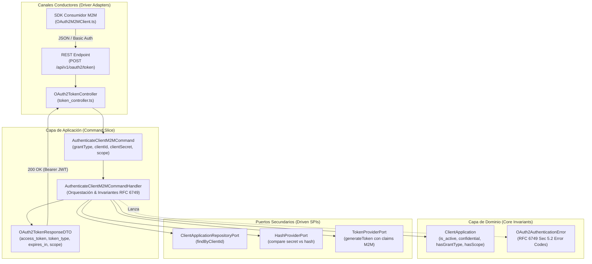

# ARTICLE-04: Autenticación Machine-to-Machine (M2M) con OAuth2 Client Credentials Grant y Emisión de Scoped Access Tokens

* **Artículo ID:** ARTICLE-04
* **User Story:** [US-04: Client Credentials & Scoped Access Token Grant](../epics/EPIC-02-client-registry/stories/US-04-client-credentials-scoped-grant.md)
* **Épica Asociada:** [EPIC-02: Client Registry & Service Authorization](../epics/EPIC-02-client-registry/README.md)
* **Bounded Context:** `identity` / `oauth2-token`
* **Tipo de Slice:** Command (OAuth2 M2M Token Slice)
* **Rama de Trabajo:** `feat/US-04-client-credentials`
* **ADR Relacionado:** [ADR-0004: Client Registry and Service Authorization](../../docs/adr/0004-client-registry-authorization.md)
* **Estándar Normativo:** RFC 6749 (The OAuth 2.0 Authorization Framework, Sección 4.4 y 5)
* **Fecha:** 2026-11-07
* **Autor / Tech Lead:** Angel Szymczak & Antigravity (Pair Programming)

---

## 1. Resumen Ejecutivo y Problema de Negocio

En la arquitectura de microservicios distribuida de un ecosistema digital moderno, la comunicación no siempre se origina a partir de la interacción directa de un usuario humano en un navegador web. Procesos batch en segundo plano, workers de analítica, microservicios satélites (como servicios de facturación, catálogos u órdenes) y tareas programadas necesitan comunicarse entre sí de forma autónoma: **Machine-to-Machine (M2M)**.

Para evitar la proliferación de API Keys estáticas hardcodeadas —que carecen de ciclo de vida temporal, no soportan rotación dinámica y no pueden restringirse a privilegios mínimos—, el estándar de la industria es el flujo **Client Credentials Grant de OAuth 2.0 (RFC 6749 Sección 4.4)**.

Con **US-04**, `identity-service` asume formalmente el rol de Servidor de Autorización OAuth2, permitiendo a clientes confidenciales intercambiar sus credenciales criptográficas (`client_id` y `client_secret`) por un **Access Token JWT firmado** con tiempo de expiración finito y permisos rigurosamente acotados mediante **Scopes**.

---

## 2. Diseño Arquitectónico del Vertical Slice

Siguiendo los principios de Clean Architecture y DDD, se implementó el slice completo desacoplando los adaptadores conductores (HTTP/SDK) del caso de uso de aplicación y las invariantes del dominio:



### Componentes y Responsabilidades:
1. **`OAuth2TokenController`:**
   - Extrae parámetros de la solicitud soportando tanto `application/json`, formularios `application/x-www-form-urlencoded` como autenticación `Authorization: Basic base64(client_id:client_secret)`.
   - Inyecta cabeceras normativas obligatorias: `Cache-Control: no-store` y `Pragma: no-cache`.
   - Aplica cabecera `WWW-Authenticate: Basic realm="OAuth2"` ante fallos de autenticación cuando el cliente utilizó el esquema Basic.
2. **`AuthenticateClientM2MCommandHandler`:**
   - Valida el parámetro `grant_type === 'client_credentials'` (rechaza otros con `unsupported_grant_type`).
   - Verifica que la aplicación cliente exista, esté activa y sea clasificada como `confidential` (prohíbe el flujo a clientes públicos con `unauthorized_client`).
   - Comprueba criptográficamente el secreto provisto contra el hash persistido mediante `HashProviderPort`.
   - Evalúa que los scopes solicitados sean un subconjunto estricto de los autorizados para el cliente (rechaza con `invalid_scope`). Si no se solicita scope, otorga por defecto todos los scopes registrados.
   - Genera el token JWT firmado mediante `TokenProviderPort` con claims M2M (`sub: clientId`, `client_id`, `scope`, `token_type: 'Bearer'`).
3. **`OAuth2M2MClient`:**
   - SDK cliente ligero que encapsula la interacción HTTP contra el Identity Provider para simplificar el consumo por parte de microservicios satélites.

---

## 3. Seguridad y Cumplimiento Normativo RFC 6749

Durante la revisión y construcción de este vertical slice, se aplicaron rigurosas salvaguardas de seguridad según las especificaciones de la RFC 6749:

### 3.1. Prohibición de Múltiples Métodos de Autenticación (Anti-Confusion)
Conforme a **RFC 6749 Sección 2.3.1**: *"The authorization server MUST NOT accept more than one form of client authentication on a given request"*.  
Si una petición incluye credenciales en la cabecera `Authorization: Basic` y simultáneamente envía `client_id` o `client_secret` en el cuerpo del request, se rechaza de inmediato con HTTP `400 Bad Request` y `error: "invalid_request"`.

### 3.2. Prohibición de Fallback Silenciosa en Basic Auth
En lugar de ignorar errores en bloques `catch` al parsear la cabecera Basic, cualquier cabecera malformada (sin base64 válido, credenciales vacías o sin delimitador `:`) se rechaza explícitamente con HTTP `401 Unauthorized`, `error: "invalid_client"` e inyección de `WWW-Authenticate`.

### 3.3. Principio de Menor Privilegio en Scopes
Si un microservicio registrado únicamente con `identity:read` intenta solicitar `identity:admin` o cualquier otro scope no otorgado previamente en base de datos, el servidor rechaza la transacción con HTTP `400` y `error: "invalid_scope"`, impidiendo la escalada horizontal de privilegios entre servicios satélites.

---

## 4. Metodología: Ciclo Guiado por Tests en 4 Capas (Outside-In / Inside-Out)

Siguiendo el estándar de ingeniería de [DEVELOPMENT_WORKFLOW.md](../rules/DEVELOPMENT_WORKFLOW.md), el desarrollo se ejecutó en dos fases estrictas:

```text
FASE 1: APERTURA (Top-Down / Red Phase)
├── Paso 1: Capa 4 (E2E Consumidor M2M) -> tests/e2e/m2m/client_credentials_flow.spec.ts [ROJO]
├── Paso 2: Capa 3 (Aceptación BDD)     -> tests/acceptance/features/client_credentials_grant.feature [ROJO]
├── Paso 3: Capa 2 (Integración API)    -> tests/integration/identity/interfaces/test_oauth2_token_m2m.ts [ROJO]
└── Paso 4: Capa 1 (Unidad Handler)     -> tests/unit/identity/application/oauth2/test_authenticate_client_m2m_handler.ts [ROJO]

FASE 2: CLAUSURA (Bottom-Up / Green Phase)
├── Paso 5: Capa 1 (Dominio & Handler)  -> AuthenticateClientM2MCommand/Handler + OAuth2AuthenticationError [VERDE]
├── Paso 6: Capa 2 (Integración & HTTP) -> OAuth2TokenController + montaje en server.ts [VERDE]
├── Paso 7: Capa 3 (Aceptación BDD)     -> Living Documentation BDD validada en verde [VERDE]
└── Paso 8: Capa 4 (E2E Consumidor M2M) -> Implementación de OAuth2M2MClient [VERDE]
```

---

## 5. Cobertura de Pruebas y Certificación de la Pirámide

La ejecución integral de la suite completa confirma la ausencia total de regresiones y el crecimiento de la pirámide a **157 pruebas automatizadas pasando al 100%** en **30 test suites**:

| Capa Arquitectónica | Suites | Tests | Tiempo | Estado |
| :--- | :---: | :---: | :---: | :---: |
| **Capa 1: Unit Tests** | 16 suites | 91 tests | ~9s | 🟢 PASS |
| **Capa 2: Integration Tests** | 6 suites | 38 tests | ~7s | 🟢 PASS |
| **Capa 3: Acceptance BDD** | 4 suites | 13 tests | ~5s | 🟢 PASS |
| **Capa 4: End-to-End (E2E)** | 4 suites | 15 tests | ~4s | 🟢 PASS |
| **TOTAL** | **30 Suites** | **157 Tests** | **~25s** | 🟢 **100% VERDE** |

---

## 6. Registro Forense de Commits en `feat/US-04-client-credentials`

1. `0f3cf5c` — `test(e2e): specify client credentials and scoped grant flow for m2m consumers [red]`
2. `2ce18af` — `test(acceptance): define gherkin scenarios and step definitions for client credentials scoped grant [red]`
3. `0652760` — `test(integration): specify oauth2 token endpoint for client credentials grant [red]`
4. `86667aa` — `test(unit): specify authenticate client m2m command handler and token issuance invariants [red]`
5. `0e12a19` — `feat(application): implement AuthenticateClientM2MCommandHandler and token issuance logic [green]`
6. `13eadd8` — `feat(interfaces): implement OAuth2TokenController and mount token endpoint [green]`
7. `c6ff687` — `feat(client): implement OAuth2M2MClient to close E2E consumer tests [green]`

---

## 7. Conclusiones y Cierre de EPIC-02

Con la finalización de **US-04**, la épica **[EPIC-02: Client Registry & Service Authorization](../epics/EPIC-02-client-registry/README.md)** queda completada al 100%:
* **US-03:** Registro dinámico de aplicaciones y validación estricta de orígenes con Cache-Aside.
* **US-04:** Autenticación M2M server-to-server con emisión de JWTs acotados por scopes conforme a RFC 6749.

El sistema de identidad cuenta ahora con las bases completas para federación e interoperabilidad. La siguiente épica en la hoja de ruta corresponde a:
* **[`EPIC-03: Row-Level Security (RLS) & Multi-Tenant Data Isolation`](../epics/EPIC-03-rls-isolation/README.md):**
  * `US-05`: Migración de base de datos a RLS y runner transaccional con `SET LOCAL identity.current_tenant_id`.
  * `US-06`: Arnés de pruebas automatizadas de penetración y prevención de fugas cross-tenant.

