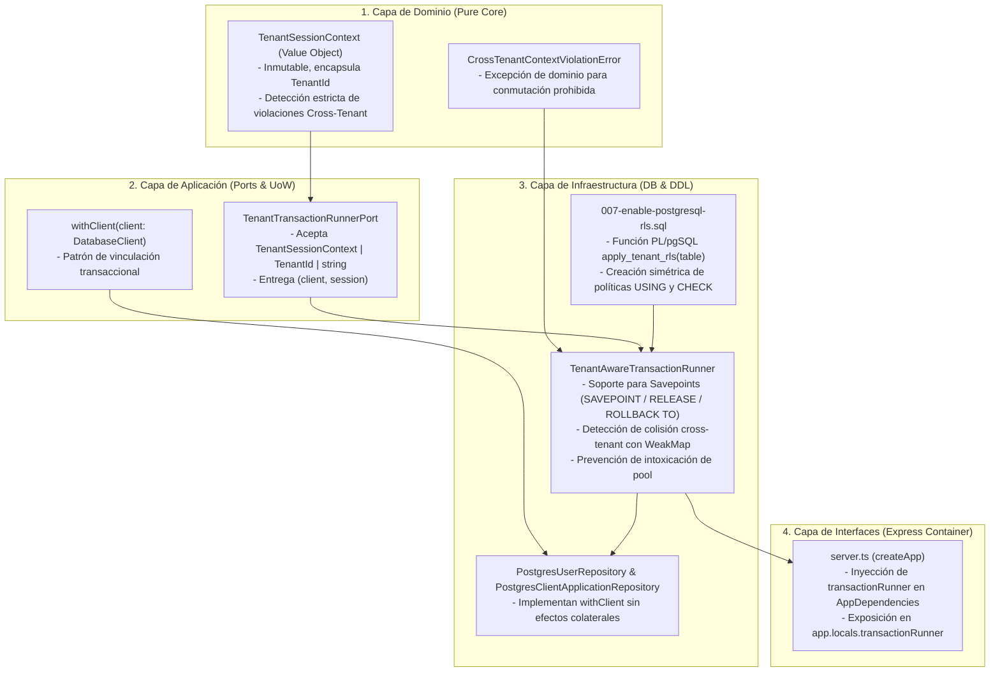

# ARTICLE-05-B: Bucle de Refactorización Inside-Out — Contexto de Sesión Inmutable, Savepoints Anidados y Repositorios Vinculados a RLS

* **Artículo ID:** ARTICLE-05-B
* **User Story:** [US-05: Database Tenant Session Context & RLS Policies Migration](../epics/EPIC-03-rls-isolation/stories/US-05-tenant-session-rls-migration.md)
* **Plan de Refactorización:** [US-05 Tenant Session RLS Refactoring Plan](../epics/EPIC-03-rls-isolation/stories/US-05-tenant-session-rls-refactoring-plan.md)
* **Épica Asociada:** [EPIC-03: PostgreSQL Row-Level Security Isolation Engine](../epics/EPIC-03-rls-isolation/README.md)
* **Bounded Context:** `identity` / `tenancy`
* **Tipo de Slice:** Architectural Refactor / Inside-Out Engineering
* **Rama de Trabajo:** `feat/US-05-rls-runner`
* **ADR Relacionado:** [ADR-0005: PostgreSQL Row-Level Security Strategy](../../docs/adr/0005-postgresql-rls-strategy.md)
* **Fecha:** 2026-11-07
* **Autor / Tech Lead:** Angel Szymczak & Antigravity (Pair Programming)

---

## 1. Motivación y Resumen Ejecutivo

Tras culminar con éxito el ciclo Outside-In TDD de [US-05](ARTICLE-05-tenant-session-rls-migration.md) —conduciendo las 4 capas de pruebas (Unidad, Integración, Aceptación BDD y E2E de Concurrencia de Pool) a un estado 100% GREEN—, se detectaron cuatro oportunidades de mejora arquitectónica para endurecer la modularidad, extensibilidad y resiliencia del sistema de aislamiento:

1. **Ausencia de un Contexto de Sesión Tipado en Dominio:** El identificador del tenant se pasaba primordialmente como un valor primitivo `string` o como `TenantId` sin encapsular la semántica de sesión transaccional ni sus invariantes de invariabilidad durante la vida útil del contexto.
2. **Desacoplamiento Rápido de Repositorios Transaccionales:** Los repositorios de persistencia (`PostgresUserRepository`, `PostgresClientApplicationRepository`) estaban instanciados con un connection pool global, careciendo de un mecanismo inmutable (`withClient`) para reutilizar sus métodos sobre la conexión transaccional con RLS activo sin duplicar estado.
3. **Falta de Soporte para Transacciones Anidadas (Savepoints):** Si un caso de uso orquestaba múltiples llamadas a `runInTenantContext` en la misma conexión, ejecutar un segundo `BEGIN` en PostgreSQL provocaría un error fatal o un comportamiento indeterminado. Además, era crucial impedir formalmente que una operación anidada intentara conmutar el contexto a otro tenant (*cross-tenant context violation*).
4. **Mantenibilidad DDL:** El script de migración SQL `007-enable-postgresql-rls.sql` declaraba políticas de forma manual; resultaba indispensable empaquetar una función PL/pgSQL reutilizable (`apply_tenant_rls(table)`) para aplicar RLS simétrico en tablas presentes y futuras de manera estandarizada.
5. **Inyección en Interfaces:** El contenedor Express `createApp` requería soporte de inyección explícita para `TenantTransactionRunnerPort` y su exposición vía `app.locals` para coordinar flujos HTTP seguros.

Para resolver estas deficiencias sin romper regresiones, se ejecutó un **Bucle de Refactorización Inside-Out** transitando ordenadamente desde el Núcleo Puro de Dominio hasta la Capa de Interfaces.

---

## 2. Diagrama Arquitectónico Inside-Out

---

## 3. Desglose de Implementación por Capas

### 3.1. Capa 1: Dominio Puro (`TenantSessionContext` & `CrossTenantContextViolationError`)
* **Ubicación:** `src/contexts/identity/domain/value_objects/tenant_session_context/value.ts` y `src/contexts/identity/domain/exceptions/security/error.ts`.
* **Propiedades:**
  - `TenantSessionContext` es inmutable y congelado (`Object.freeze`).
  - Provee el método `assertMatchingTenant(incomingTenantId)` que compara estrictamente el tenant entrante con el tenant de la sesión activa.
  - Si los tenants difieren, lanza `CrossTenantContextViolationError`, blindando el núcleo contra mezclas transaccionales involuntarias.
* **Commits Atómicos:**
  - Producción: `d14b29b` (`feat(domain): implement TenantSessionContext value object and CrossTenantContextViolationError`)
  - Pruebas: `0940471` (`test(domain): add unit test coverage for TenantSessionContext and CrossTenantContextViolationError`)

### 3.2. Capa 2: Aplicación y Repositorios (`withClient` Pattern)
* **Ubicación:** `src/contexts/identity/application/ports/database/tenant_transaction_runner.ts`, `PostgresUserRepository`, `PostgresClientApplicationRepository`.
* **Propiedades:**
  - `TenantTransactionRunnerPort` acepta polimórficamente `TenantSessionContext | TenantId | string`.
  - El callback recibe tanto la conexión `DatabaseClient` como el `TenantSessionContext` tipado.
  - Los repositorios incorporan `withClient(client: DatabaseClient)`, retornando una nueva instancia configurada para ejecutar queries sobre la conexión transaccional con RLS, sin recrear configuraciones globales.
* **Commits Atómicos:**
  - Producción: `88709f4` (`feat(application): enrich TenantTransactionRunnerPort and repositories with withClient pattern`)
  - Pruebas: `6be4b5a` (`test(application): add tests for withClient repository binding and runner session parameter`)

### 3.3. Capa 3: Infraestructura (Savepoints Anidados y Función DDL PL/pgSQL)
* **Ubicación:** `src/contexts/identity/infrastructure/persistence/database/tenant_aware_transaction_runner.ts`, `infrastructure/local/initdb.d/007-enable-postgresql-rls.sql`.
* **Propiedades:**
  - El runner detecta si una conexión ya tiene una transacción activa mediante `activeSessions` (`WeakMap<DatabaseClient, TenantSessionContext>`).
  - **Transacciones Anidadas:** Si la sesión coincide, genera un identificador único de savepoint y ejecuta `SAVEPOINT sp_<id>`. Ante éxito ejecuta `RELEASE SAVEPOINT sp_<id>`, y ante error ejecuta `ROLLBACK TO SAVEPOINT sp_<id>`, sin cerrar prematuramente la transacción raíz ni devolver la conexión al pool antes de tiempo.
  - **Detección Anti-Cross-Tenant:** Si una operación anidada intenta ejecutarse bajo un `tenantId` diferente al registrado en la conexión activa, el runner invoca `assertMatchingTenant` y aborta inmediatamente arrojando `CrossTenantContextViolationError`.
  - **Función DDL Reutilizable:** En `007-enable-postgresql-rls.sql` se definió la función `apply_tenant_rls(target_table text)` que automatiza `ALTER TABLE ... ENABLE ROW LEVEL SECURITY`, `FORCE ROW LEVEL SECURITY`, y la política simétrica `USING (tenant_id = current_setting('app.current_tenant_id', true))` y `WITH CHECK (tenant_id = current_setting('app.current_tenant_id', true))`.
* **Commits Atómicos:**
  - Producción: `e84691b` (`feat(database): implement nested savepoints and PLpgSQL apply_tenant_rls helper function`)
  - Pruebas: `508135e` (`test(database): add unit test coverage for nested savepoints and cross-tenant collision prevention`)

### 3.4. Capa 4: Interfaces (Wiring del Runner en el Contenedor HTTP)
* **Ubicación:** `interfaces/http/server.ts`, `tests/integration/identity/interfaces/test_server_dependency_injection.ts`.
* **Propiedades:**
  - `AppDependencies` incorpora `transactionRunner?: TenantTransactionRunnerPort`.
  - `createApp` resuelve perezosamente el `Pool` y crea automáticamente una instancia de `TenantAwareTransactionRunner` si existe `DATABASE_URL` y no se encuentra en modo test.
  - Expone el runner y los repositorios a través de `app.locals` (`app.locals.transactionRunner`).
* **Commits Atómicos:**
  - Producción: `eb03963` (`refactor(interfaces): wire TenantTransactionRunner into HTTP server container`)
  - Pruebas: `cae41af` (`test(interfaces): verify dependency injection of transaction runner and repositories in createApp`)

---

## 4. Métricas de Certificación de la Pirámide de Pruebas

Tras completar los 4 pasos del bucle Inside-Out, se ejecutó la certificación total de la pirámide de pruebas:

| Nivel de la Pirámide | Suites Ejecutadas | Pruebas Totales | Estado | Cobertura / Alcance |
| :--- | :--- | :--- | :--- | :--- |
| **Capa 1: Unidad** | 22 suites | 160 tests | **100% PASS** | VOs, Agregados, Handlers, Runner Savepoints, Value Context |
| **Capa 2: Integración** | 9 suites | 52 tests | **100% PASS** | Repositorios `withClient`, Container DI, Middleware, RLS Policies |
| **Capa 3: Aceptación BDD** | 5 features | 16 scenarios | **100% PASS** | Living Documentation (Cucumber / BDD Gherkin) |
| **Capa 4: E2E & Concurrencia** | 5 specs | 24 tests | **100% PASS** | Concurrencia de Pool (50 TXs), M2M Client, Web UI Form |
| **Total Global** | **41 suites** | **252 tests** | **100% GREEN** | Cero regresiones y compilación TypeScript limpia |

---

## 5. Conclusión y Próximos Pasos

El bucle de refactorización Inside-Out elevó la implementación de [US-05](ARTICLE-05-tenant-session-rls-migration.md) a estándares de arquitectura limpia de nivel enterprise:
- **Dominio Puro:** Sesiones transaccionales inmutables con barrera anti-cross-tenant.
- **Aplicación:** Repositorios desacoplados con capacidad de operar dentro de transacciones RLS.
- **Infraestructura:** Savepoints seguros sin riesgo de intoxicación de pool ni pérdida de transacciones padre.
- **Interfaces:** Contenedor desacoplado e inyectable.

Con este hito culminado, el proyecto avanza formalmente hacia la preparación de **US-06: Arnés de Pruebas de Penetración Cross-Tenant** y el soporte de llaves asimétricas RS256 para OIDC en **EPIC-04**.
