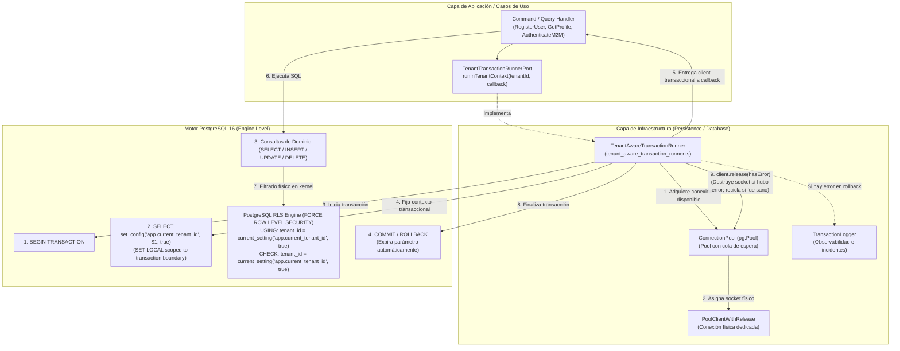

# ARTICLE-05: Aislamiento Multi-Tenant Nativo con PostgreSQL Row-Level Security (RLS) y Transaction Runner con Limpieza de Estado (`SET LOCAL`)

* **Artículo ID:** ARTICLE-05
* **User Story:** [US-05: Database Tenant Session Context & RLS Policies Migration](../epics/EPIC-03-rls-isolation/stories/US-05-tenant-session-rls-migration.md)
* **Épica Asociada:** [EPIC-03: Multi-Tenant Data Isolation & Auditing](../epics/EPIC-03-rls-isolation/README.md)
* **Bounded Context:** `identity` / `tenancy`
* **Tipo de Slice:** Infrastructure / Database Security Migration
* **Rama de Trabajo:** `feat/US-05-rls-runner`
* **ADR Relacionado:** [ADR-0005: PostgreSQL Row-Level Security Strategy](../../docs/adr/0005-postgresql-rls-strategy.md)
* **Principio Rector:** Defensa en Profundidad (*Defense in Depth*) y Aislamiento Zero-Trust en el Motor de Base de Datos
* **Fecha:** 2026-11-07
* **Autor / Tech Lead:** Angel Szymczak & Antigravity (Pair Programming)

---

## 1. Resumen Ejecutivo y Problema de Seguridad

En el desarrollo de servicios de identidad multitenant (*Identity as a Service* / Enterprise IdP), uno de los riesgos de seguridad más graves es la **filtración cruzada de datos entre organizaciones** (*cross-tenant data leakage*). 

Hasta US-04, la segregación residía exclusivamente en la disciplina del código aplicativo:
- Value Objects de Dominio (`TenantId`).
- Middlewares HTTP que extraían cabeceras `x-tenant-id`.
- Repositorios que incluían cláusulas explícitas `WHERE tenant_id = $2`.

Sin embargo, como quedó advertido en el [ADR-0003](../../docs/adr/0003-multi-tenant-isolation-strategy.md), depender únicamente de la disciplina del desarrollador en sentencias SQL manuales o migraciones complejas es insuficiente para un IdP empresarial. Un solo `SELECT * FROM users` olvidado por un desarrollador expondría credenciales o perfiles entre empresas.

Con **US-05**, se implementa una arquitectura de **Defensa en Profundidad** (*Defense in Depth*):
1. El propio motor relacional **PostgreSQL** asume la responsabilidad de filtrar e impedir físicamente cualquier lectura o escritura que no corresponda al tenant autenticado, mediante **Row-Level Security (RLS)** forzado a nivel de kernel.
2. La aplicación gestiona el contexto de forma determinista mediante variables transaccionales acotadas (`SET LOCAL app.current_tenant_id = $1`), garantizando que cuando la conexión física regresa al connection pool de Node.js (`pg.Pool`), quede **completamente higienizada y libre de estado residual**.

---

## 2. Diseño Arquitectónico y Flujo de Ejecución



---

## 3. Invariantes del Motor y Reglas Técnicas Críticas

### 1. Forzado Mandatorio de RLS (`FORCE ROW LEVEL SECURITY`)
Por defecto en PostgreSQL, el superusuario o el usuario dueño de la tabla ignora las políticas RLS. Para cerrar esta brecha en entornos de contenedor o despliegue automatizado, se ejecutó:
```sql
ALTER TABLE users ENABLE ROW LEVEL SECURITY;
ALTER TABLE users FORCE ROW LEVEL SECURITY;
```
Esto impone que **incluso el dueño de la tabla** esté sometido al filtro estricto de las políticas.

### 2. Política Simétrica (`USING` y `WITH CHECK`)
En el script DDL `007-enable-postgresql-rls.sql`, la política se define con evaluación dual:
```sql
CREATE POLICY tenant_isolation_policy ON users
    FOR ALL
    USING (tenant_id = current_setting('app.current_tenant_id', true)::text)
    WITH CHECK (tenant_id = current_setting('app.current_tenant_id', true)::text);
```
- **`USING`:** Filtra en tiempo de compilación del planificador qué filas son visibles en `SELECT`, `UPDATE` y `DELETE`. Filas de otros tenants simplemente "no existen" para la consulta.
- **`WITH CHECK`:** Intercepta operaciones de `INSERT` o `UPDATE`, rechazando con el código de error nativo `42501 (insufficient_privilege / row-level security policy violation)` cualquier intento de registrar una fila con un `tenant_id` que no coincida con el parámetro de sesión activo.

### 3. Comportamiento Fail-Closed por Defecto
El segundo parámetro `true` en `current_setting('app.current_tenant_id', true)` indica a PostgreSQL que devuelva `NULL` si la variable nunca ha sido configurada. Como la columna `tenant_id` es `NOT NULL`, la evaluación `tenant_id = NULL` resulta en `UNKNOWN` (falso), devolviendo **exactamente 0 filas**. Las consultas no autenticadas quedan bloqueadas por defecto (*Fail-Closed*).

### 4. Ciclo de Vida Transaccional Puro (`SET LOCAL`)
Mediante `SELECT set_config('app.current_tenant_id', $1, true)`, el tercer argumento `true` circunscribe la variable exclusivamente a la transacción en curso (`SET LOCAL`). Al emitirse `COMMIT` o `ROLLBACK`, PostgreSQL purga y destruye automáticamente la variable de sesión, impidiendo fugas de estado (*state bleeding*) cuando la conexión regresa al pool de Node.js.

---

## 4. Ingeniería de Resiliencia en `TenantAwareTransactionRunner`

Durante el ciclo de desarrollo se incorporaron tres patrones de grado enterprise para blindar la ejecución del runner:

1. **Prevención de Intoxicación del Pool (*Pool Poisoning Prevention*):**
   Si ocurre un fallo en la lógica de negocio o en la transacción, el runner ejecuta `client.release(true)`. En el driver `pg`, pasar un argumento truthy le indica al pool que **destruya el socket físico**, previniendo que una conexión con estado incierto sea entregada a otra petición concurrente.
2. **Encadenamiento de Excepciones (*Error Chaining*):**
   Si la sentencia `ROLLBACK` falla, el error de rollback se encadena a la excepción de dominio raíz mediante `(primaryError as any).rollbackError = rollbackError`, sin enmascarar ni perder la causa original del fallo.
3. **Observabilidad Estructurada:**
   Se inyectó una abstracción de logging (`TransactionLogger`) que registra los incidentes de infraestructura con metadata contextual para trazabilidad SRE.

---

## 5. Cobertura de Pruebas (Pirámide Completa Outside-In)

La historia fue desarrollada siguiendo un flujo riguroso Outside-In en 4 capas (Top-Down RED $\rightarrow$ Bottom-Up GREEN):

| Capa de Testing | Suite / Archivo de Prueba | Escenarios Clave Verificados | Estado |
| :--- | :--- | :--- | :--- |
| **Capa 4 (E2E / Stress)** | `tests/e2e/security/tenant_rls_isolation.spec.ts` | 50 transacciones concurrentes alternando `alpha-corp` y `beta-corp` sobre connection pool con cola; reciclaje y desinfección de conexiones; fail-closed. | 🟢 5/5 PASS |
| **Capa 3 (Aceptación BDD)** | `tests/acceptance/step_defs/test_tenant_rls_isolation_steps.ts` | Especificación viva en Gherkin: Aislamiento RLS, reciclaje sin estado residual y comportamiento fail-closed ante omisión de sesión. | 🟢 5/5 PASS |
| **Capa 2 (Integración DDL)** | `tests/integration/security/test_rls_policies.ts` & `test_tenant_aware_transaction_runner.ts` | Políticas RLS DDL (`USING`, `WITH CHECK` 42501, DELETE segregado) y runner transaccional con `pg.Pool`. | 🟢 8/8 PASS |
| **Capa 1 (Unidad)** | `tests/unit/identity/infrastructure/database/test_tenant_aware_transaction_runner.ts` | Validación preventiva de `TenantId`, ciclo `BEGIN` $\rightarrow$ `set_config` $\rightarrow$ `COMMIT`, rollback seguro, error chaining y descarte de conexión en pool. | 🟢 20/20 PASS |

---

## 6. Trazabilidad de Commits Atómicos

1. `0c7efd1`: `test(security): define e2e concurrency and pool isolation test suite in RED state (US-05)`
2. `8901df3`: `test(security): define acceptance bdd feature and step definitions in RED state (US-05)`
3. `b528bac`: `test(security): define integration tests for rls policies and transaction runner in RED state (US-05)`
4. `524ad28`: `test(database): define isolated unit test suite for TenantAwareTransactionRunner in RED state (US-05)`
5. `85a73e5`: `feat(database): implement TenantAwareTransactionRunner and secondary port (US-05)`
6. `b543f99`: `refactor(database): enhance TenantAwareTransactionRunner with connection poisoning prevention and error chaining`
7. `a2ff14e`: `test(database): add unit coverage for rollback error chaining and pool discard flag`
8. `1f6e3b6`: `feat(database): define DDL migration script to enable PostgreSQL RLS and tenant isolation policies (US-05)`
9. `037c686`: `test(security): complete e2e pool queuing and concurrency isolation suite in GREEN state (US-05)`

