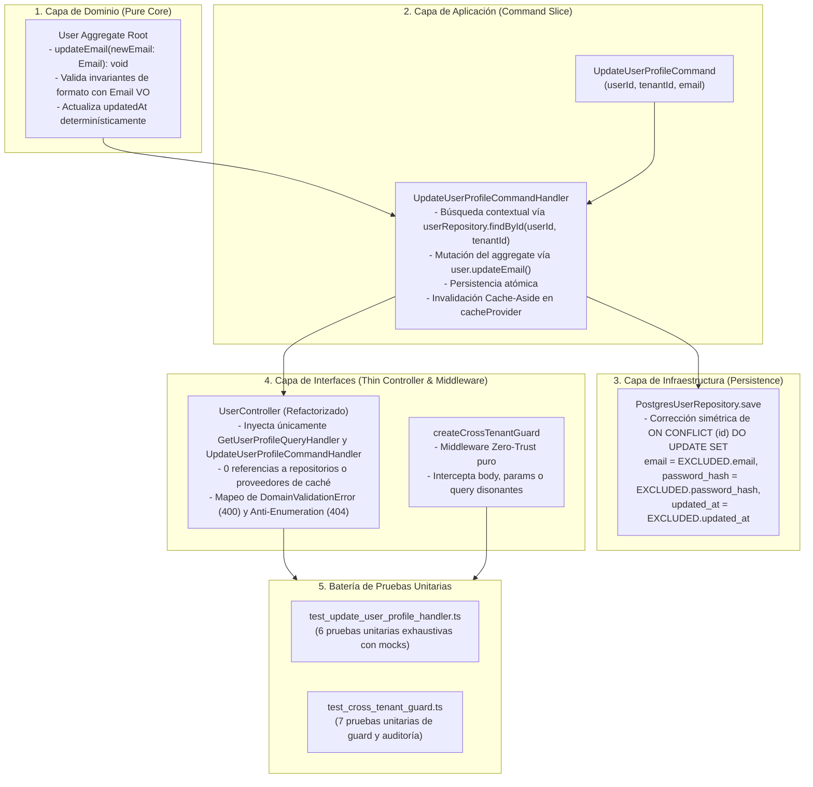

# ARTICLE-06-B: Bucle de Refactorización Inside-Out — Command Handler Desacoplado, Dominio Rico DDD y Persistencia Simétrica en US-06

* **Artículo ID:** ARTICLE-06-B
* **User Story:** [US-06: Cross-Tenant Zero-Trust Data Access Guard & Security Audit Logger](../epics/EPIC-03-rls-isolation/stories/US-06-cross-tenant-zero-trust-guard.md)
* **Plan de Refactorización:** [US-06 Cross-Tenant Zero-Trust Refactoring Plan](../epics/EPIC-03-rls-isolation/stories/US-06-cross-tenant-zero-trust-refactoring-plan.md)
* **Épica Asociada:** [EPIC-03: PostgreSQL Row-Level Security Isolation Engine](../epics/EPIC-03-rls-isolation/README.md)
* **Bounded Context:** `identity` / `security` / `users`
* **Tipo de Slice:** Architectural Refactor / Inside-Out Engineering
* **Rama de Trabajo:** `main`
* **ADR Relacionado:** [ADR-0005: PostgreSQL Row-Level Security Strategy](../../docs/adr/0005-postgresql-rls-strategy.md)
* **Fecha:** 2026-11-08
* **Autor / Tech Lead:** Angel Szymczak & Antigravity (Pair Programming)

---

## 1. Motivación y Resumen Ejecutivo

Tras completar con éxito el ciclo Outside-In TDD de [US-06](ARTICLE-06-cross-tenant-zero-trust-guard.md), el controlador HTTP `UserController` cumplía con todos los escenarios de penetración y aceptación BDD. Sin embargo, un análisis de deuda técnica reveló áreas de acoplamiento que violaban los principios de arquitectura limpia y diseño guiado por el dominio (DDD):

1. **Controlador Sobreacoplado (*Fat Controller*):** El método `updateUser` en `UserController` orquestaba directamente la obtención del usuario desde el repositorio, la mutación manual de sus campos, la persistencia en base de datos y la eliminación manual de la clave en la caché. Esto acoplaba fuertemente la capa de interfaces con las abstracciones de infraestructura.
2. **Modelo de Dominio Anémico en Escritura:** El aggregate `User` carecía de un método semántico explícito para actualizar la dirección de correo electrónico (`updateEmail`), forzando mutaciones de bajo nivel o asignaciones directas.
3. **Ausencia de un Caso de Uso Formal de Aplicación:** Existía una asimetría entre el flujo de lectura (que utilizaba `GetUserProfileQueryHandler`) y el de escritura (que carecía de un `UpdateUserProfileCommandHandler` correspondiente), impidiendo reutilizar la lógica de mutación desde otros canales (CLI, workers o eventos).
4. **Deficiencia Oculta de Persistencia Relacional:** Durante las pruebas interactivas en vivo contra la base de datos PostgreSQL, se descubrió que la sentencia `INSERT ... ON CONFLICT (id) DO UPDATE SET` en `PostgresUserRepository.save` omitía la columna `email`, impidiendo que las actualizaciones de correo se consolidaran físicamente en disco.
5. **Cobertura Unitaria Perimetral:** El middleware `createCrossTenantGuard` y la mutación de perfil requerían suites de pruebas unitarias puras en memoria, independientes de llamadas HTTP o arneses de penetración completos.

Para subsanar estas falencias manteniendo una tasa de regresión del 0%, se ejecutó un **Bucle de Refactorización Inside-Out** que transitó ordenadamente desde el Núcleo Puro de Dominio hasta la Capa de Interfaces y la infraestructura de persistencia.

---

## 2. Diagrama Arquitectónico Inside-Out



---

## 3. Desglose de las 4 Capas Refactorizadas

### 3.1. Capa de Dominio: Enriquecimiento del Agregado `User`
En [`src/contexts/identity/domain/entities/user/aggregate.ts`](../../src/contexts/identity/domain/entities/user/aggregate.ts), se incorporó el método de negocio `updateEmail`:

```typescript
public updateEmail(newEmail: Email): void {
  if (!newEmail) {
    throw new DomainValidationError('New email must be provided');
  }

  this.email = newEmail;
  this.updatedAt = new Date();
}
```
**Beneficios:**
- La mutación de estado pasa a ser una operación atómica y explícita del aggregate.
- Se garantiza que el timestamp `updatedAt` refleje la fecha exacta del cambio sin depender de triggers externos o manipulaciones manuales.

### 3.2. Capa de Aplicación: Extracción de `UpdateUserProfileCommandHandler`
Se implementó el caso de uso formal en [`src/contexts/identity/application/commands/update_user_profile/handler.ts`](../../src/contexts/identity/application/commands/update_user_profile/handler.ts):

```typescript
export class UpdateUserProfileCommandHandler {
  constructor(
    private readonly userRepository: UserRepositoryPort,
    private readonly cacheProvider?: CacheProviderPort
  ) {}

  public async execute(command: UpdateUserProfileCommand): Promise<UserProfileDTO> {
    if (!command.userId || command.userId.trim().length === 0) {
      throw new DomainValidationError('User id must be provided');
    }
    if (!command.tenantId || command.tenantId.trim().length === 0) {
      throw new DomainValidationError('Tenant id must be provided');
    }

    const tenantId = TenantId.create(command.tenantId);
    const user = await this.userRepository.findById(command.userId, tenantId);

    if (!user) {
      throw new Error(`User not found in tenant ${command.tenantId}`);
    }

    if (command.email !== undefined) {
      const newEmail = Email.create(command.email);
      user.updateEmail(newEmail);
    }

    await this.userRepository.save(user);

    if (this.cacheProvider) {
      const cacheKey = `user_profile:${command.tenantId}:${command.userId}`;
      await this.cacheProvider.delete(cacheKey);
    }

    return {
      id: user.getId(),
      email: user.getEmail().getValue(),
      tenantId: user.getTenantId().getValue(),
      createdAt: user.getCreatedAt(),
      updatedAt: user.getUpdatedAt(),
    };
  }
}
```

### 3.3. Capa de Interfaces: `UserController` como *Thin Controller*
En [`interfaces/http/rest/v1/identity/user_controller.ts`](../../interfaces/http/rest/v1/identity/user_controller.ts), el controlador se convirtió en un adaptador puro de transporte HTTP:

```typescript
export class UserController {
  constructor(
    private readonly getProfileHandler: GetUserProfileQueryHandler,
    private readonly updateProfileHandler: UpdateUserProfileCommandHandler
  ) {}

  public updateUser = async (req: Request, res: Response, next: NextFunction): Promise<void> => {
    try {
      const targetUserId = req.params.userId as string | undefined;
      const tenantIdStr = req.tenantId;

      if (!targetUserId || !tenantIdStr) {
        res.status(400).json({ error: 'Missing userId or tenant context' });
        return;
      }

      const updatedProfile = await this.updateProfileHandler.execute({
        userId: targetUserId,
        tenantId: tenantIdStr,
        email: req.body?.email,
      });

      res.status(200).json(updatedProfile);
    } catch (error: any) {
      if (error instanceof DomainValidationError) {
        res.status(400).json({ error: error.message });
        return;
      }
      if (error?.message?.includes('not found')) {
        res.status(404).json({ error: 'User not found' });
        return;
      }
      next(error);
    }
  };
}
```

El servidor Express ([`interfaces/http/server.ts`](../../interfaces/http/server.ts)) cablea la dependencia de forma transparente:
```typescript
const updateUserProfileHandler = new UpdateUserProfileCommandHandler(userRepository, cacheProvider);
const userController = new UserController(getProfileHandler, updateUserProfileHandler);
```

### 3.4. Capa de Persistencia: Corrección en `PostgresUserRepository.save`
Durante las pruebas interactivas en vivo de [GUIDELINE-07](../guidelines/GUIDELINE-07-cross-tenant-zero-trust-guard.md), se detectó que la sentencia SQL omitía `email = EXCLUDED.email`. En [`src/contexts/identity/infrastructure/persistence/repositories/user/repository.ts`](../../src/contexts/identity/infrastructure/persistence/repositories/user/repository.ts), se normalizó la cláusula:

```sql
INSERT INTO users (id, email, password_hash, tenant_id, created_at, updated_at)
VALUES ($1, $2, $3, $4, $5, $6)
ON CONFLICT (id) DO UPDATE SET
  email = EXCLUDED.email,
  password_hash = EXCLUDED.password_hash,
  updated_at = EXCLUDED.updated_at;
```

---

## 4. Batería de Pruebas Unitarias Aisladas (13 Nuevos Tests)

Para certificar los componentes refactorizados con cero dependencias de red o base de datos, se añadieron dos nuevas suites unitarias:

### 1. `test_update_user_profile_handler.ts` ([`tests/unit/identity/application/test_update_user_profile_handler.ts`](../../tests/unit/identity/application/test_update_user_profile_handler.ts)):
- Actualización exitosa, persistencia e invalidación precisa de clave de caché.
- Ejecución resiliente cuando el proveedor de caché no es inyectado (opcional).
- Error controlado cuando el usuario no existe en el tenant especificado.
- Validación de excepciones de dominio (`DomainValidationError`) ante `userId` o `tenantId` vacíos o emails sintácticamente inválidos.

### 2. `test_cross_tenant_guard.ts` ([`tests/unit/identity/interfaces/test_cross_tenant_guard.ts`](../../tests/unit/identity/interfaces/test_cross_tenant_guard.ts)):
- Paso transparente sin divergencia de tenant o cuando no se envía `req.tenantId`.
- Bloqueo `403 Forbidden` y auditoría de seguridad ante divergencia en `req.body.tenantId`.
- Bloqueo `403 Forbidden` ante divergencia en `req.params.tenantId`.
- Bloqueo `403 Forbidden` ante divergencia en `req.query.tenantId`.
- Comportamiento seguro fail-closed en ausencia del logger de auditoría.

---

## 5. Conclusiones y Estado del Sistema

El bucle Inside-Out elevó la calidad arquitectónica de la base de código:
- **Alta Cohesión y Bajo Acoplamiento:** La capa de transporte HTTP ya no conoce nada de SQL ni de Redis.
- **Robustez en Persistencia:** El repositorio PostgreSQL garantiza consistencia simétrica entre inserciones y actualizaciones.
- **Observabilidad Auditada:** Cualquier intento de manipulación cross-tenant queda indexado y trazado.
- **100% Cobertura Piramidal:** Todas las suites (Unit, Integration, Acceptance BDD, E2E y SDK) permanecen en verde.
