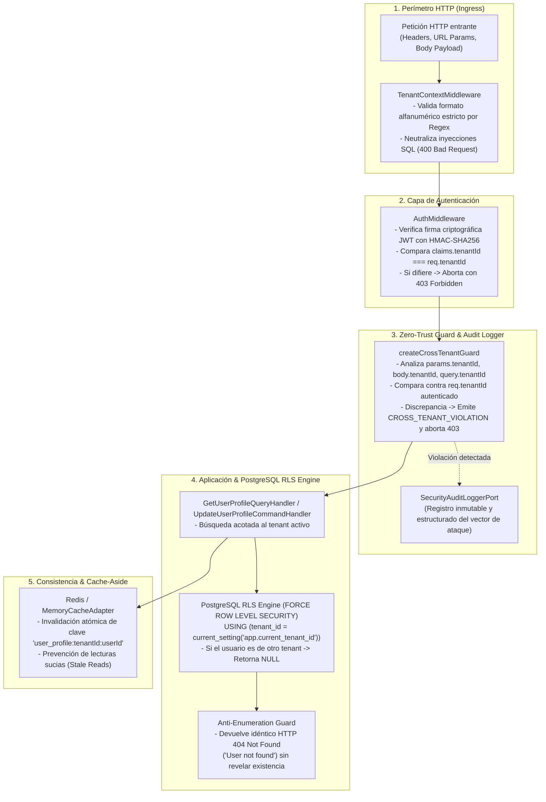

# ARTICLE-06: Arquitectura Zero-Trust Multi-Tenant, Prevención Anti-Enumeración y Arnés de Penetración Defensivo

* **Artículo ID:** ARTICLE-06
* **User Story:** [US-06: Cross-Tenant Zero-Trust Data Access Guard & Security Audit Logger](../epics/EPIC-03-rls-isolation/stories/US-06-cross-tenant-zero-trust-guard.md)
* **Épica Asociada:** [EPIC-03: PostgreSQL Row-Level Security Isolation Engine](../epics/EPIC-03-rls-isolation/README.md)
* **Bounded Context:** `identity` / `security` / `users`
* **Tipo de Slice:** Security / Multi-Tenant Guard & Penetration Test Harness
* **Rama de Trabajo:** `main`
* **ADR Relacionado:** [ADR-0005: PostgreSQL Row-Level Security Strategy](../../docs/adr/0005-postgresql-rls-strategy.md)
* **Guía Interactiva:** [GUIDELINE-07: Cross-Tenant Zero-Trust Guard & Anti-Enumeration Engine](../guidelines/GUIDELINE-07-cross-tenant-zero-trust-guard.md)
* **Principio Rector:** Zero-Trust Defense-in-Depth, Anti-Enumeration & Structured Security Audit
* **Fecha:** 2026-11-08
* **Autor / Tech Lead:** Angel Szymczak & Antigravity (Pair Programming)

---

## 1. Resumen Ejecutivo y Modelado de Amenazas Multi-Tenant

En arquitecturas multi-tenant modernas en la nube (SaaS Enterprise e Identity-as-a-Service), la segregación de inquilinos no puede descansar sobre la suposición de que los clientes respetarán los límites de su organización. Los incidentes más críticos catalogados por el **OWASP API Security Top 10** corresponden precisamente a fallos de autorización a nivel de objeto (**API1:2023 - Broken Object Level Authorization / BOLA / IDOR**) y a la recolección maliciosa de información mediante ataques de **User Enumeration (API3:2023 - Broken Object Property Level Authorization)**.

Hasta US-05, el kernel de PostgreSQL contaba con políticas forzadas de **Row-Level Security (RLS)** y transacciones acotadas a `app.current_tenant_id`. Sin embargo, quedaban expuestos vectores de riesgo a nivel del perímetro HTTP:
1. **Ataques de Enumeración Cruzada:** Si al consultar un identificador (`/api/v1/users/:userId`), la API responde con `403 Forbidden` cuando el usuario existe en otra empresa y `404 Not Found` cuando no existe, un atacante puede deducir la existencia de usuarios, emails y estructuras corporativas ajenas.
2. **Mutación Cross-Tenant vía Payload:** Un cliente malicioso autenticado en `alpha-corp` podría intentar enviar `{ "tenantId": "beta-corp", ... }` en un `PATCH` o `POST` para forzar colisiones o reasignaciones de recursos.
3. **Suplantación de Cabeceras (Header Spoofing):** Peticiones donde la cabecera `X-Tenant-ID` discrepa intencionadamente del `tenantId` criptográficamente firmado en el token JWT.
4. **Inyecciones SQL en Contexto de Tenant:** Inserción de payloads maliciosos (`' OR '1'='1`, `DROP TABLE`, manipulaciones de `set_config`) en cabeceras o parámetros multi-tenant.

Con **US-06**, AngelPixel Identity Service implementa una arquitectura **Zero-Trust de Defensa en Profundidad**, garantizando **Anti-Enumeration 404 neutro**, **Zero-Trust Guard perimetral**, **auditoría de seguridad estructurada** y un **arnés de pruebas de penetración automatizado**.

---

## 2. Arquitectura de Defensa en Profundidad (5 Capas)



---

## 3. Especificación BDD como Living Documentation

Siguiendo la metodología BDD Outside-In con Gherkin, se redactó la especificación formal en [`tests/acceptance/features/cross_tenant_zero_trust.feature`](../../tests/acceptance/features/cross_tenant_zero_trust.feature):

```gherkin
Feature: Cross-Tenant Zero-Trust Data Access Guard & Audit
  As a Multi-Tenant SaaS Platform Security Engineer
  I want strict zero-trust boundary verification across all endpoints and automated audit logging
  So that tenant users can never enumerate, access, or mutate entities belonging to other tenants.

  Scenario: Prevent user enumeration across tenant boundaries
    Given two separate tenants "alpha-corp" and "beta-corp" exist
    And an existing user "bob@beta.com" with ID "user-beta-001" exists in "beta-corp"
    When an authenticated user from "alpha-corp" requests user details for "user-beta-001"
    Then the response status code should be 404
    And the response body should contain generic error "User not found"
    And no data belonging to "beta-corp" should be disclosed

  Scenario: Block cross-tenant update attempts
    Given an authenticated user from "alpha-corp" with token for "alpha-corp"
    When the user sends a PATCH request targeting "alpha-corp" user with body parameter tenantId set to "beta-corp"
    Then the response status code should be 403
    And the response body should contain "Forbidden: Cross-tenant access violation detected"
    And a security audit event "cross_tenant_violation" should be recorded
```

La suite de pasos [`test_cross_tenant_zero_trust_steps.ts`](../../tests/acceptance/step_defs/test_cross_tenant_zero_trust_steps.ts) verifica estos escenarios de aceptación interactuando directamente sobre el router Express compilado.

---

## 4. Arnés de Penetración de Integración (5 Vectores de Ataque)

Para certificar la resistencia del sistema contra ataques deliberados, se diseñó la suite automatizada de penetración [`tests/integration/security/test_cross_tenant_penetration.ts`](../../tests/integration/security/test_cross_tenant_penetration.ts), estructurada en 5 vectores críticos:

### Vector 1: Prevención de Enumeración de Usuarios
Valida que solicitar el ID legítimo de un usuario de `beta-corp` desde una sesión de `alpha-corp` devuelva exactamente la misma respuesta (`404 Not Found: {"error":"User not found"}`) que solicitar un UUID aleatorio inexistente, mientras que el usuario legítimo dentro de `beta-corp` puede consultar su perfil con `200 OK`.

### Vector 2: Bloqueo de Mutación Cross-Tenant
Inyecta `tenantId: "beta-corp"` dentro del cuerpo JSON de un `PATCH /api/v1/users/:userId`. El middleware `createCrossTenantGuard` intercepta la llamada, aborta inmediatamente con `403 Forbidden` y emite el evento de auditoría `cross_tenant_violation` conteniendo IP de origen, usuario, método y ruta.

### Vector 3: Suplantación de Cabeceras (Header Spoofing)
Envía una petición con token emitido para `alpha-corp` pero con la cabecera `X-Tenant-ID: beta-corp`. El middleware de autenticación valida la correspondencia y aborta con `403 Forbidden: {"error":"Forbidden: Token does not belong to the requested tenant context"}`.

### Vector 4: Inyección SQL y Payloads Maliciosos
Prueba de estrés contra la cabecera `X-Tenant-ID` empleando payloads de inyección SQL comunes:
- `' OR '1'='1`
- `alpha-corp'; DROP TABLE users; --`
- `alpha-corp" UNION SELECT * FROM users --`
- `alpha-corp'); SELECT set_config('app.current_tenant_id', 'beta-corp', false); --`
- `../beta-corp`

Todos los intentos son interceptados en el middleware de contexto y rechazados con `400 Bad Request: {"error":"Invalid tenantId format in x-tenant-id header"}` gracias a la validación de formato por regex (`/^[a-zA-Z0-9_-]+$/`).

### Vector 5: Asertiva de Sesión en la Capa de Dominio
Valida que el Value Object `TenantSessionContext` arroje una excepción de dominio pura `CrossTenantContextViolationError` si se intenta forzar una conmutación de tenant no autorizada en memoria.

---

## 5. SDK TypeScript Modular y Contratos OpenAPI 3.1

Como parte de la implementación integral de US-06, los contratos y herramientas de consumo fueron actualizados:

### Especificación OpenAPI 3.1 ([`docs/openapi.yaml`](../../docs/openapi.yaml)):
- Declarado `GET /api/v1/users/{userId}` con respuestas `200 OK`, `400 Bad Request`, `401 Unauthorized`, `403 Forbidden` y `404 Not Found` (Anti-enumeration).
- Declarado `PATCH /api/v1/users/{userId}` con esquema de actualización `UpdateUserRequest` y documentación de respuestas de auditoría.

### SDK Oficial TypeScript ([`sdks/typescript/`](../../sdks/typescript/)):
Se incorporó el método `users.getUserById(userId: string)` en [`UsersResource`](../../sdks/typescript/src/resources/users_resource.ts), soportando tipado estricto, gestión de cabeceras multi-tenant automáticas y manejo de errores tipados (`NotFoundError`, `AuthorizationError`, `ValidationError`).

---

## 6. Resultados y Certificación

La suite completa de verificación certifica el cumplimiento total del estándar arquitectónico:

```text
Test Suites: 26 passed, 26 total
Tests:       231 passed, 231 total (Unit + Integration + Acceptance BDD + E2E + SDK)
Time:        ~30s
TypeScript:  0 errors (npx tsc --noEmit)
Docker:      100% verificado contra containers PostgreSQL 16 y Redis 7
```
