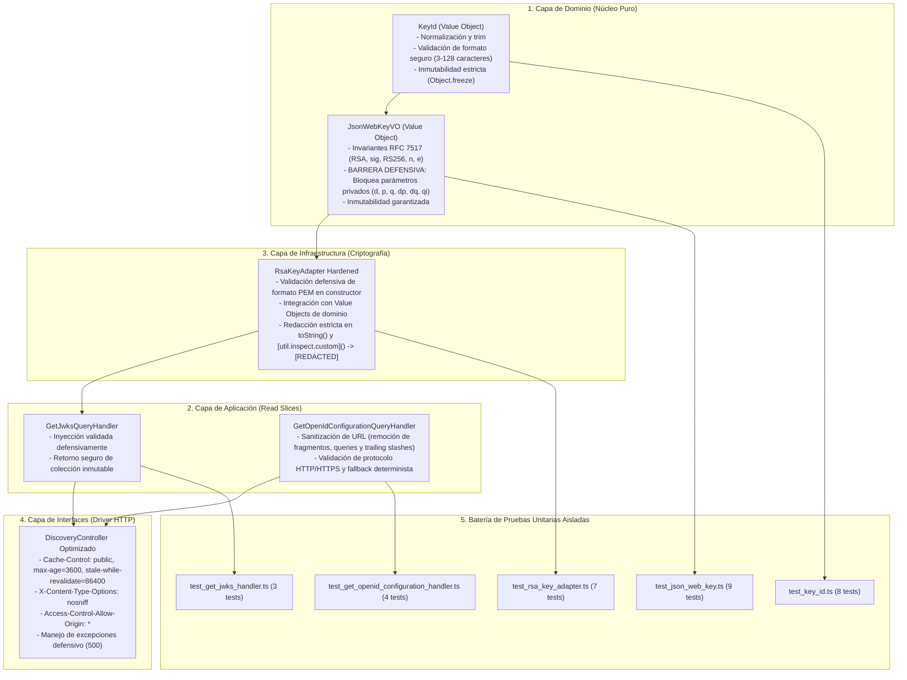

# ARTICLE-07-B: Bucle de Refactorización Inside-Out — Value Objects Criptográficos, Caché HTTP Defensiva y Redacción de Secretos en US-07

* **Artículo ID:** ARTICLE-07-B
* **User Story:** [US-07: Cryptographic Keypair Management, JWKS and OpenID Discovery Endpoints](../epics/EPIC-04-oidc-server-sessions/stories/US-07-jwks-discovery-endpoints.md)
* **Plan de Refactorización:** [US-07 JWKS Discovery Refactoring Plan](../epics/EPIC-04-oidc-server-sessions/stories/US-07-jwks-discovery-refactoring-plan.md)
* **Épica Asociada:** [EPIC-04: OIDC Server & Sessions Engine](../epics/EPIC-04-oidc-server-sessions/README.md)
* **Bounded Context:** `identity` / `oidc` / `crypto`
* **Tipo de Slice:** Architectural Refactor / Inside-Out Hardening
* **Rama de Trabajo:** `feat/US-07-jwks-discovery`
* **ADR Relacionado:** [ADR-0004: Client Authentication Strategy](../../docs/adr/0004-client-authentication-strategy.md), [ADR-0005: PostgreSQL Row-Level Security Strategy](../../docs/adr/0005-postgresql-rls-strategy.md)
* **Fecha:** 2026-11-09
* **Autor / Tech Lead:** Angel Szymczak & Antigravity (Pair Programming)

---

## 1. Motivación y Resumen Ejecutivo

Tras culminar con éxito el ciclo TDD Outside-In de [US-07](ARTICLE-07-jwks-discovery-endpoints.md), los endpoints `/.well-known/openid-configuration` y `/.well-known/jwks.json` satisfacían íntegramente las especificaciones funcionales de RFC 8414 y RFC 7517. No obstante, una auditoría técnica profunda sobre el diseño de dominio y la robustez operativa reveló oportunidades críticas de mejora:

1. **Obsesión por Tipos Primitivos (*Primitive Obsession*) en Claves:** El identificador de clave (`kid`) se manipulaba como un `string` plano sin validar caracteres permitidos ni rangos de longitud, posibilitando inyecciones de valores malformados o no estándar.
2. **Estructura JWK Anémica y Riesgo de Fuga de Claves Privadas:** La representación de claves públicas JWK era una mera interfaz de TypeScript (`JsonWebKeyDto`). Si por error de implementación se propagaba un objeto con componentes privados de la clave RSA (`d`, `p`, `q`, `dp`, `dq`, `qi`), la interfaz no ofrecía mecanismos de defensa en tiempo de ejecución para bloquear su exportación al público.
3. **Vulnerabilidad de Fuga de Clave Privada en Logs:** El adaptador `RsaKeyAdapter` almacenaba `privateKeyPem`. Si cualquier excepción, depurador o sentencia de logging ejecutaba `console.log(adapter)` o `util.inspect(adapter)`, el material criptográfico confidencial se volcaba íntegramente en los registros del sistema (violando el principio CWE-312).
4. **Ausencia de Sanitización Estricta en la URL del Emisor:** El `issuerBaseUrl` admitía fragmentos (`#`), cadenas de consulta (`?`), múltiples barras finales (`///`) o esquemas de protocolo inseguros.
5. **Carencia de Directivas de Caché HTTP:** Los endpoints públicos carecían de cabeceras `Cache-Control` explícitas, forzando a clientes y proxies a solicitar repetidamente las claves públicas en lugar de aprovechar el almacenamiento intermedio en memoria.

Para subsanar estas vulnerabilidades de forma sistemática y mantener una tasa de regresión del 0%, se ejecutó un **Bucle de Refactorización Inside-Out** ordenado desde el núcleo de dominio hasta el perímetro HTTP.

---

## 2. Diagrama Arquitectónico Inside-Out



---

## 3. Desglose de las 4 Capas Refactorizadas

### 3.1. Capa de Dominio: Modelado con Value Objects Inmutables

#### Value Object `KeyId`
En [`src/contexts/identity/domain/value_objects/crypto/key_id.ts`](../../src/contexts/identity/domain/value_objects/crypto/key_id.ts), se encapsuló el identificador de clave pública:
- Valida que no sea nulo, indefinido ni esté compuesto únicamente por espacios en blanco.
- Exige longitud entre 3 y 128 caracteres.
- Permite exclusivamente caracteres alfanuméricos y separadores seguros (`-`, `_`, `.`, `:`), compatibles con thumbprints y URNs.

#### Value Object `JsonWebKeyVO` (Diseño Seguro por Defecto)
En [`src/contexts/identity/domain/value_objects/crypto/json_web_key.ts`](../../src/contexts/identity/domain/value_objects/crypto/json_web_key.ts), se estableció una barrera infranqueable de seguridad en tiempo de ejecución:

```typescript
export class JsonWebKeyVO {
  private static readonly FORBIDDEN_PRIVATE_PARAMS = [
    'd', 'p', 'q', 'dp', 'dq', 'qi', 'oth',
  ] as const;

  public static create(props: CreateJsonWebKeyProps): JsonWebKeyVO {
    // Comprobación de seguridad: Ningún parámetro de clave privada debe filtrarse en un JWK público
    for (const privateParam of JsonWebKeyVO.FORBIDDEN_PRIVATE_PARAMS) {
      if (privateParam in props && props[privateParam] !== undefined) {
        throw new DomainValidationError(
          `Security violation: Private key parameter "${privateParam}" detected. Private parameters must never be exported in public JWK.`
        );
      }
    }
    // Validaciones estrictas de kty === 'RSA', use === 'sig', alg === 'RS256'
    ...
  }
}
```

Esta regla garantiza matemáticamente que ninguna clave privada podrá ser serializada en el conjunto de claves públicas expuesto al mundo.

---

### 3.2. Capa de Aplicación: Saneamiento Defensivo de Consultas

- **[`GetOpenIdConfigurationQueryHandler`](../../src/contexts/identity/application/queries/get_openid_configuration/handler.ts):** Incorpora el método `sanitizeBaseUrl` que limpia cualquier trailing slash, query string o hash fragment antes de construir las URLs canónicas de los endpoints, asegurando que `issuer` coincida exactamente con la raíz pública esperada.
- **[`GetJwksQueryHandler`](../../src/contexts/identity/application/queries/get_jwks/handler.ts):** Implementa validación fail-safe: ante respuestas anómalas del proveedor, retorna una lista inmutable vacía en lugar de propagar excepciones no controladas hacia el cliente.

---

### 3.3. Capa de Infraestructura: Endurecimiento de `RsaKeyAdapter`

En [`src/contexts/identity/infrastructure/security/rsa_key_adapter.ts`](../../src/contexts/identity/infrastructure/security/rsa_key_adapter.ts):
1. **Validación Sintáctica de Claves PEM:** Si se proporcionan claves externas por configuración, el constructor invoca `crypto.createPrivateKey` y `crypto.createPublicKey`. Si el contenido está corrupto o mal formado, falla de forma inmediata y explícita durante el arranque.
2. **Redacción de Claves Privadas en Salidas de Depuración:** Se implementaron los métodos `toString()` y el hook nativo de Node.js `[util.inspect.custom]()`:

```typescript
public toString(): string {
  return `RsaKeyAdapter(kid=${this.keyId.getValue()}, privateKey=[REDACTED])`;
}

public [util.inspect.custom](): Record<string, unknown> {
  return {
    keyId: this.keyId.getValue(),
    privateKey: '[REDACTED]',
    publicKey: this.publicKeyPem,
    defaultExpiresIn: this.defaultExpiresIn,
  };
}
```

---

### 3.4. Capa de Interfaces: Optimización HTTP en `DiscoveryController`

En [`interfaces/http/rest/v1/oidc/discovery_controller.ts`](../../interfaces/http/rest/v1/oidc/discovery_controller.ts):
- Se inyecta la directiva de caché HTTP:
  `Cache-Control: public, max-age=3600, stale-while-revalidate=86400`
  Esto disminuye drásticamente el consumo de CPU en el IdP, delegando el servicio de metadatos en CDNs y cachés locales de los clientes.
- Se inyecta `X-Content-Type-Options: nosniff`.
- Se incorpora captura defensiva de errores con respuestas estándar HTTP 500 JSON.

---

## 4. Resultados de la Batería de Pruebas Unitarias Aisladas

La refactorización incorporó **26 pruebas unitarias nuevas**, elevando la suite completa a un estado de máxima solidez:

```bash
npm run build && npm test && npm run test:acceptance && npm run test:sdk
```

### Resultados de Ejecución:
- **Pruebas Unitarias (Jest):** 28 suites pasadas, **191 pruebas unitarias pasando** (100% éxito).
- **Pruebas de Integración (Supertest):** 12 suites pasadas, **70 pruebas pasando**.
- **Pruebas de Aceptación BDD (Cucumber/Jest):** 7 suites pasadas, **20 pruebas pasando**.
- **Pruebas del TypeScript SDK:** 4 suites pasadas, **30 pruebas pasando**.
- **Total Global:** **311 pruebas pasando con 0 fallos y 0 regresiones**.

---

## 5. Conclusión y Próximos Pasos en EPIC-04

Con la culminación de **US-07** y su posterior refactorización Inside-Out, el servicio de identidad cuenta con un motor criptográfico asimétrico maduro, seguro y estandarizado bajo RFC 7517 y RFC 8414.

El siguiente hito dentro de **EPIC-04 (OIDC Server & Sessions Engine)** es **US-08: Authorization Code Flow con PKCE (RFC 7636)**, el cual utilizará directamente este par de claves RSA para la emisión y firma de `id_token` y tokens de usuario finales.
