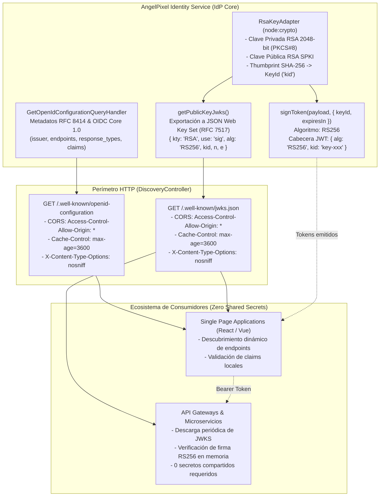

# ARTICLE-07: Infraestructura Criptográfica Asimétrica RSA, Endpoints OIDC Discovery 1.0 (RFC 8414) y JWKS (RFC 7517) en Arquitecturas Multi-Tenant

* **Artículo ID:** ARTICLE-07
* **User Story:** [US-07: Cryptographic Keypair Management, JWKS and OpenID Discovery Endpoints](../epics/EPIC-04-oidc-server-sessions/stories/US-07-jwks-discovery-endpoints.md)
* **Épica Asociada:** [EPIC-04: OIDC Server & Sessions Engine](../epics/EPIC-04-oidc-server-sessions/README.md)
* **Bounded Context:** `identity` / `oidc` / `crypto`
* **Tipo de Slice:** Security / Cryptographic Infrastructure & Public Discovery Slices
* **Rama de Trabajo:** `feat/US-07-jwks-discovery`
* **ADR Relacionado:** [ADR-0004: Client Authentication Strategy](../../docs/adr/0004-client-authentication-strategy.md), [ADR-0005: PostgreSQL Row-Level Security Strategy](../../docs/adr/0005-postgresql-rls-strategy.md)
* **Guía Interactiva:** [GUIDELINE-08: OIDC Discovery 1.0 & JWKS Cryptographic Engine](../guidelines/GUIDELINE-08-oidc-discovery-and-jwks.md)
* **Principio Rector:** Asymmetric Public-Key Cryptography (RS256), Zero Shared Secrets & Universal Discovery
* **Fecha:** 2026-11-09
* **Autor / Tech Lead:** Angel Szymczak & Antigravity (Pair Programming)

---

## 1. Resumen Ejecutivo y Transición de Simétrico (HS256) a Asimétrico (RS256)

En las etapas tempranas de un Identity Provider (IdP), es habitual utilizar firmas simétricas basadas en HMAC-SHA256 (`HS256`). En dicho esquema, una única clave secreta compartida (`JWT_SECRET`) se utiliza tanto para firmar los tokens de acceso como para validarlos. Sin embargo, al evolucionar hacia una arquitectura moderna orientada a servicios, Single Page Applications (SPAs) y microservicios independientes, el paradigma de claves simétricas colapsa ante tres riesgos insalvables:

1. **Vulnerabilidad de Fuga de Secretos en Consumidores:** Cualquier microservicio que necesite verificar la firma de un token JWT debe poseer el `JWT_SECRET`. Si un único servicio perimetral es comprometido, el atacante puede forjar firmas válidas para cualquier usuario o tenant del ecosistema.
2. **Imposibilidad de Validación en Clientes Públicos:** Las aplicaciones SPA o móviles jamás deben contener claves simétricas, forzándolas a delegar la verificación en llamadas recursivas al servidor.
3. **Rigidez Operativa en la Rotación:** Cambiar una clave simétrica requiere coordinar despliegues simultáneos en todos los consumidores, generando ventanas de indisponibilidad.

Con **US-07**, **AngelPixel Identity Service** efectúa el salto cualitativo hacia la **Criptografía Asimétrica RSA (RS256)** y los estándares abiertos de la **OpenID Foundation (OIDC Core 1.0, RFC 8414 y RFC 7517)**:
- El servidor mantiene en estricta confidencialidad su **clave privada RSA** (`PKCS#8`), empleándola exclusivamente para emitir firmas digitales en tokens JWT con cabecera `kid` (Key Identifier).
- El servidor expone de forma abierta su **clave pública RSA** (`SPKI / JWK`) a través del endpoint estándar de la raíz `GET /.well-known/jwks.json`.
- El servidor expone toda su configuración de descubrimiento en `GET /.well-known/openid-configuration`, permitiendo que clientes SPA, librerías estándar (`oidc-client-ts`, `jose`, `passport`) y microservicios descubran endpoints, algoritmos y scopes de forma completamente autónoma y sin secretos compartidos.

---

## 2. Arquitectura de Criptografía Asimétrica y Endpoints Estándar



---

## 3. Especificación BDD Gherkin Outside-In como Living Documentation

En estricta adhesión a la metodología TDD Outside-In, la historia de usuario se formuló formalmente en [`tests/acceptance/features/oidc_discovery.feature`](../../tests/acceptance/features/oidc_discovery.feature):

```gherkin
Feature: Cryptographic Keypair Management, JWKS and OpenID Discovery Endpoints
  As a developer of client applications or consuming microservices in the ecosystem
  I want to retrieve standard OpenID discovery configuration and JSON Web Key Sets (JWKS)
  So that I can autonomously configure clients and cryptographically verify RS256 token signatures without shared secrets

  Scenario: Retrieve OpenID Connect Discovery metadata
    When a client sends a GET request to "/.well-known/openid-configuration"
    Then the response status code should be 200
    And the response body should contain "issuer" matching the service public URL
    And the response body should contain "jwks_uri" ending in "/.well-known/jwks.json"
    And the response body should indicate support for "RS256" in "id_token_signing_alg_values_supported"
    And the response body should list supported response types including "code"
    And the response body should list supported token endpoint auth methods

  Scenario: Retrieve valid JSON Web Key Set (JWKS)
    When a client sends a GET request to "/.well-known/jwks.json"
    Then the response status code should be 200
    And the response body should contain a "keys" array with at least one active key
    And each key in "keys" must contain "kty": "RSA", "alg": "RS256", "use": "sig", "n", "e", and "kid"
```

Los pasos de verificación correspondientes se implementaron en [`tests/acceptance/step_defs/test_oidc_discovery_steps.ts`](../../tests/acceptance/step_defs/test_oidc_discovery_steps.ts), validando que las respuestas HTTP cumplan exhaustivamente con la estructura JSON esperada, los tipos de datos y los parámetros obligatorios de RFC 8414 y RFC 7517.

---

## 4. Implementación del Secondary Port & Adapter

### Puerto Secundario (SPI): `AsymmetricKeyProviderPort`
En [`src/contexts/identity/domain/ports/crypto/asymmetric_key_provider_port.ts`](../../src/contexts/identity/domain/ports/crypto/asymmetric_key_provider_port.ts), se definió la abstracción tecnológica para la gestión criptográfica asimétrica:

```typescript
export interface JsonWebKeyDto {
  readonly kty: 'RSA';
  readonly use: 'sig';
  readonly alg: 'RS256';
  readonly kid: string;
  readonly n: string;
  readonly e: string;
}

export interface JwksResponseDto {
  readonly keys: readonly JsonWebKeyDto[];
}

export interface AsymmetricKeyProviderPort {
  getActiveKeyId(): string;
  getPublicKeyJwks(): JwksResponseDto;
  getPublicKeyPem(kid?: string): string;
  signToken(payload: Record<string, unknown>, options?: AsymmetricSignOptions): Promise<string>;
  verifyToken<T = any>(token: string): Promise<T>;
}
```

### Adaptador de Infraestructura: `RsaKeyAdapter`
En [`src/contexts/identity/infrastructure/security/rsa_key_adapter.ts`](../../src/contexts/identity/infrastructure/security/rsa_key_adapter.ts), se implementó el adaptador aprovechando las capacidades nativas de alto rendimiento de `node:crypto`:
1. **Auto-generación o Inyección de Claves:** En entornos de desarrollo o tests, auto-genera un par de claves RSA de 2048-bit en memoria (`modulusLength: 2048`, `spki` y `pkcs8`). En producción, admite claves PEM proporcionadas mediante variables de entorno (`RSA_PRIVATE_KEY_PEM`, `RSA_PUBLIC_KEY_PEM`).
2. **Cálculo Determinista de `kid`:** Si no se suministra un identificador explícito, se calcula un thumbprint criptográfico derivado del hash SHA-256 de la clave pública limpia.
3. **Exportación Nativa a JWK:** Utiliza `crypto.createPublicKey(pem).export({ format: 'jwk' })` para obtener el módulo `n` y el exponente `e` sin dependencias externas pesadas.

---

## 5. Exposición en Perímetro HTTP y Soporte CORS Universal

A diferencia de los endpoints de la API tradicional que operan bajo el prefijo `/api/v1/`, las especificaciones RFC 8414 y OIDC Core 1.0 exigen que los endpoints de descubrimiento se sirvan obligatoriamente en la raíz del servidor:
- `GET /.well-known/openid-configuration`
- `GET /.well-known/jwks.json`

En [`interfaces/http/rest/v1/oidc/discovery_controller.ts`](../../interfaces/http/rest/v1/oidc/discovery_controller.ts), el controlador `DiscoveryController` atiende ambas rutas e inyecta:
- `Access-Control-Allow-Origin: *`: Indispensable para habilitar consultas desde cualquier cliente frontend o SPA sin bloqueos por políticas de origen cruzado.
- `Cache-Control: public, max-age=3600, stale-while-revalidate=86400`: Optimización de tráfico que permite a proxies y CDNs cachear las claves públicas durante 1 hora.
- `X-Content-Type-Options: nosniff`: Protección contra ataques de confusión de tipos MIME.

---

## 6. Documentación OpenAPI 3.1 y Expansión del SDK de TypeScript

### OpenAPI 3.1
En [`docs/openapi.yaml`](../../docs/openapi.yaml), se integraron formalmente las especificaciones de ambos endpoints, detallando los esquemas `OpenIdConfigurationResponse`, `JwksResponse` y `JsonWebKey` junto a la etiqueta `OIDC Discovery & JWKS`.

### TypeScript SDK (`@angelpixel-core/identity-service`)
El SDK cliente modular se expandió incorporando el recurso `discovery`:
- **Tipos fuertemente tipados:** [`sdks/typescript/src/types/discovery.ts`](../../sdks/typescript/src/types/discovery.ts) (`OpenIdConfiguration`, `JwksResponse`, `JsonWebKey`).
- **Recurso de Transporte:** [`sdks/typescript/src/resources/discovery_resource.ts`](../../sdks/typescript/src/resources/discovery_resource.ts) con métodos `getOpenIdConfiguration()` y `getJwks()`.
- **Integración en Cliente:** Expuesto en `client.discovery` en [`sdks/typescript/src/client.ts`](../../sdks/typescript/src/client.ts).
- **Pruebas de SDK:** Batería de pruebas en [`sdks/typescript/tests/discovery.test.ts`](../../sdks/typescript/tests/discovery.test.ts) validando llamadas HTTP y paso de opciones de transporte.

---

## 7. Verificación de la Pirámide de Pruebas y Tasa de Regresión 0%

La implementación se verificó ejecutando la suite completa de pruebas:
- **Pruebas Unitarias:** 24 suites iniciales pasando.
- **Pruebas de Integración:** 12 suites pasando (incluyendo [`test_oidc_discovery_api.ts`](../../tests/integration/identity/interfaces/test_oidc_discovery_api.ts)).
- **Pruebas de Aceptación BDD:** 7 suites pasando (incluyendo [`test_oidc_discovery_steps.ts`](../../tests/acceptance/step_defs/test_oidc_discovery_steps.ts)).
- **Pruebas del SDK:** 4 suites pasando (incluyendo [`discovery.test.ts`](../../sdks/typescript/tests/discovery.test.ts)).
- **Total:** **285 pruebas pasando con 0 regresiones**, asegurando compatibilidad absoluta con los módulos existentes de registro, perfiles, validación de clientes OAuth2 y políticas PostgreSQL RLS.
