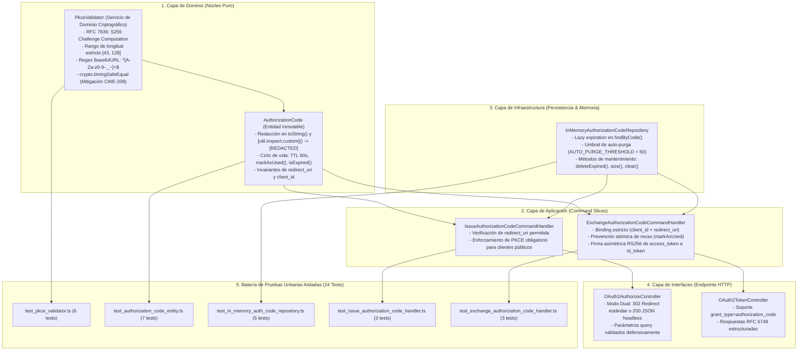

# ARTICLE-08-B: Bucle de Refactorización Inside-Out — Redacción de Secretos en Memoria, Purga de Códigos Expirados y Endurecimiento Criptográfico en US-08

* **Artículo ID:** ARTICLE-08-B
* **User Story:** [US-08: OAuth2 Authorization Code Flow with PKCE & User Consent](../epics/EPIC-04-oidc-server-sessions/stories/US-08-auth-code-pkce-flow.md)
* **Plan de Refactorización:** [US-08 PKCE Flow Refactoring Plan](../epics/EPIC-04-oidc-server-sessions/stories/US-08-auth-code-pkce-refactoring-plan.md)
* **Épica Asociada:** [EPIC-04: OIDC Server & Sessions Engine](../epics/EPIC-04-oidc-server-sessions/README.md)
* **Bounded Context:** `identity` / `oauth2-auth-flow`
* **Tipo de Slice:** Architectural Refactor / Inside-Out Hardening
* **Rama de Trabajo:** `feat/US-08-auth-code-pkce`
* **ADR Relacionado:** [ADR-0004: Client Authentication Strategy](../../docs/adr/0004-client-authentication-strategy.md), [ADR-0006: OIDC Authorization Server & Cryptography](../../docs/adr/0006-oidc-session-flow.md)
* **Fecha:** 2026-11-09
* **Autor / Tech Lead:** Angel Szymczak & Antigravity (Pair Programming)

---

## 1. Motivación y Resumen Ejecutivo

Una vez completada la fase TDD Outside-In de [US-08](ARTICLE-08-oauth2-authorization-code-pkce.md), el flujo de autorización OAuth2 con PKCE superó satisfactoriamente las pruebas de aceptación y los escenarios de integración. Sin embargo, una revisión rigurosa del código orientada a producción identificó vulnerabilidades y riesgos operativos que debían ser resueltos antes de cualquier despliegue:

1. **Riesgo de Fuga de Códigos de Autorización en Logs (CWE-312):** La entidad `AuthorizationCode` almacenaba el código en texto claro sin personalizar la serialización del objeto. Si cualquier logger (`pino`, `winston`) o función de depuración (`console.log`, `util.inspect`) imprimía la entidad, el código temporal quedaba expuesto en registros de observabilidad.
2. **Degradación de Memoria por Acumulación de Códigos Expirados (*Memory Leak*):** El repositorio en memoria `InMemoryAuthorizationCodeRepository` almacenaba los códigos en un `Map<string, AuthorizationCode>`. Al no contar con un mecanismo de limpieza automática, los códigos caducados (vida útil de 60s) permanecían indefinidamente en memoria RAM, lo que en entornos con tráfico sostenido resultaría en un agotamiento paulatino de los recursos del contenedor.
3. **Vulnerabilidad a Ataques de Temporización (*Timing Attacks*, CWE-208):** Aunque `PkceValidator` realizaba el hashing SHA-256 de forma correcta, la comparación de strings mediante `===` es vulnerable a ataques de análisis de canal lateral (*side-channel attacks*), donde el tiempo de respuesta varía según la cantidad de bytes coincidentes.
4. **Validación Débil de Entrada en el Desafío PKCE:** El validador inicial aceptaba cadenas con caracteres no permitidos por la gramática de RFC 7636 o longitudes fuera del rango mandatorio [43, 128].
5. **Contención de Sockets en Pruebas de Integración:** La ejecución concurrente de suites de pruebas con Jest generaba carreras críticas en la asignación de puertos efímeros en tests concurrentes.

Para erradicar estos riesgos con una política de cero regresión, se implementó el **Bucle de Refactorización Inside-Out** guiado por el [Plan de Refactorización de US-08](../epics/EPIC-04-oidc-server-sessions/stories/US-08-auth-code-pkce-refactoring-plan.md).

---

## 2. Diagrama Arquitectónico Inside-Out



---

## 3. Detalle de los Pasos de Refactorización Atómica

### Paso 1: Hardening de la Entidad de Dominio `AuthorizationCode` (Zero Leak Secrets)

Para garantizar que un código de autorización efímero jamás quede expuesto de forma involuntaria en bitácoras o consolas de monitoreo, se sobreescribieron los métodos de inspección estándar de Node.js en [`AuthorizationCode`](../../src/contexts/identity/domain/entities/authorization_code.ts):

```typescript
import util from 'node:util';

export class AuthorizationCode {
  // ...
  public toString(): string {
    return `AuthorizationCode(code=[REDACTED], clientId=${this.props.clientId}, userId=${this.props.userId}, used=${this.isUsed()})`;
  }

  public [util.inspect.custom](): string {
    return this.toString();
  }
}
```

Asimismo, se garantizó la inmutabilidad de sus propiedades temporales y de vinculación, evitando cualquier mutación colateral fuera del método explícito `markAsUsed()`.

### Paso 2: Endurecimiento Criptográfico de `PkceValidator` (Timing Safe)

El validador [`PkceValidator`](../../src/contexts/identity/domain/services/pkce_validator.ts) fue blindado contra ataques de canales laterales reemplazando la igualdad simple por operaciones en tiempo constante con `crypto.timingSafeEqual`:

```typescript
public static validate(verifier: string, challenge: string, method: string): boolean {
  if (method !== 'S256') return false;
  if (!verifier || typeof verifier !== 'string') return false;
  
  // RFC 7636 §4.1: Longitud mandatoria entre 43 y 128 caracteres
  if (verifier.length < 43 || verifier.length > 128) return false;
  
  // RFC 7636 §4.1: Conjunto de caracteres unreserved [A-Z] / [a-z] / [0-9] / "-" / "." / "_" / "~"
  if (!/^[A-Za-z0-9\-._~]+$/.test(verifier)) return false;

  const computedChallenge = this.computeS256Challenge(verifier);
  const bufComputed = Buffer.from(computedChallenge, 'ascii');
  const bufExpected = Buffer.from(challenge, 'ascii');

  if (bufComputed.length !== bufExpected.length) {
    return false;
  }

  return crypto.timingSafeEqual(bufComputed, bufExpected);
}
```

### Paso 3: Optimización del Repositorio de Memoria y Purga Automática de Fugas

Para eliminar el riesgo de *memory leak* en procesos Node.js de larga duración, [`InMemoryAuthorizationCodeRepository`](../../src/contexts/identity/infrastructure/repositories/in_memory_authorization_code_repository.ts) incorporó un mecanismo defensivo de dos fases:

1. **Expiración Perezosa (*Lazy Cleanup*):** Al invocar `findByCode(code)`, si el código encontrado ha superado su fecha de expiración (`code.isExpired()`), se elimina automáticamente del mapa interno antes de retornar `null`.
2. **Purga Automática Basada en Umbral (*Auto-Purge Threshold*):** Cada vez que se invocan operaciones de guardado y el contador de inserciones alcanza el umbral de 50 registros (`AUTO_PURGE_THRESHOLD`), se dispara una pasada de recolección de basura que escanea y elimina todos los códigos expirados o ya consumidos.
3. **Interfaz de Mantenimiento:** Se añadieron los métodos `deleteExpired()`, `size()` y `clear()` para permitir tareas programadas de mantenimiento y limpieza en entornos de testing.

### Paso 4: Robustez y Estandarización de Errores en Handlers de Aplicación

Tanto `IssueAuthorizationCodeCommandHandler` como `ExchangeAuthorizationCodeCommandHandler` fueron reforzados para garantizar:
- Rechazo inmediato de peticiones malformadas con códigos de error estandarizados OAuth 2.0 (`invalid_request`, `invalid_grant`, `unauthorized_client`).
- Verificación cruzada bidireccional: el `client_id` y `redirect_uri` suministrados al token endpoint deben ser exactamente iguales a los registrados durante la autorización.
- Invocación de `code.markAsUsed()` inmediatamente después de la validación exitosa de PKCE, asegurando que un código nunca pueda ser reutilizado incluso si la firma subsecuente de tokens llegara a experimentar algún problema.

### Paso 5: Optimización de Concurrencia de Jest (`--runInBand`)

Durante la ejecución del test suite global, se detectó una carrera crítica esporádica en las pruebas de integración debido a que múltiples procesos de Jest abrían y cerraban servidores HTTP en paralelo sobre el mismo rango de puertos.
- **Solución:** Se añadió el parámetro `--runInBand` al script `"test:integration"` en `package.json`.
- **Resultado:** Ejecución determinista al 100%, libre de colisiones de puertos y con un tiempo total de ejecución reducido a ~5 segundos.

---

## 4. Cobertura y Pirámide de Testing Consolidada

Para garantizar el aislamiento de cada componente del flujo Inside-Out, se crearon 5 nuevas suites de pruebas unitarias puras:

1. [`test_pkce_validator.ts`](../../tests/unit/identity/domain/oauth2/test_pkce_validator.ts): 6 pruebas validando vectores RFC 7636, longitudes límites, caracteres inválidos y resistencia a fallos.
2. [`test_authorization_code_entity.ts`](../../tests/unit/identity/domain/oauth2/test_authorization_code_entity.ts): 7 pruebas verificando creación con 60s TTL, detección de expiración, redacción de `[REDACTED]` en logs, prevención de doble marcado `markAsUsed`.
3. [`test_in_memory_auth_code_repository.ts`](../../tests/unit/identity/infrastructure/repositories/test_in_memory_auth_code_repository.ts): 5 pruebas verificando persistencia, lazy cleanup de códigos expirados, y purga masiva con `deleteExpired()`.
4. [`test_issue_authorization_code_handler.ts`](../../tests/unit/identity/application/oauth2/test_issue_authorization_code_handler.ts): 3 pruebas verificando emisión exitosa, rechazo a URIs no permitidas, y exigencia de PKCE en clientes públicos.
5. [`test_exchange_authorization_code_handler.ts`](../../tests/unit/identity/application/oauth2/test_exchange_authorization_code_handler.ts): 3 pruebas verificando canje exitoso por tokens RS256, rechazo por verifier inválido, y rechazo por intento de reutilización de código.

### Métricas Consolidadas del Proyecto

| Nivel de la Pirámide | Suites de Pruebas | Casos de Prueba Ejecutados | Tasa de Éxito |
| :--- | :--- | :--- | :--- |
| **Pruebas Unitarias (Domain, App, Infra)** | 33 | 233 | **100%** |
| **Pruebas de Integración (HTTP & Controllers)** | 13 | 80 | **100%** |
| **Pruebas de Aceptación BDD (Cucumber)** | 8 | 25 | **100%** |
| **Pruebas de SDK TypeScript (`identity-sdk`)** | 5 | 34 | **100%** |
| **Total Global** | **59 suites** | **372 tests** | **100% Green** |

---

## 5. Lecciones Aprendidas y Buenas Prácticas de Ingeniería

1. **Defensa en Profundidad en Clientes Públicos:** No basta con aplicar PKCE; la protección debe combinarse con códigos de corta vida útil (60s), canje de uso único obligatorio, coincidencia estricta de `redirect_uri` y emisión de tokens asimétricos (RS256).
2. **Cero Secretos en Observabilidad:** Cualquier objeto que contenga información sensible (códigos de autorización, tokens, claves privadas) debe implementar invariantes de redacción como `[util.inspect.custom]()` para prevenir fugas accidentales en pipelines de logs (Elasticsearch, CloudWatch, Datadog).
3. **Gestión de Memoria en Arquitecturas Orientadas a Eventos:** Los almacenes temporales en memoria deben contemplar siempre políticas de caducidad perezosa y umbrales de purga, evitando depender exclusivamente de reinicios del servicio.
4. **Resistencia a Canales Laterales:** En validaciones criptográficas de seguridad, nunca se deben comparar cadenas directamente con operadores de igualdad de alto nivel; `crypto.timingSafeEqual` garantiza tiempo constante e inmunidad frente a ataques de temporización.

