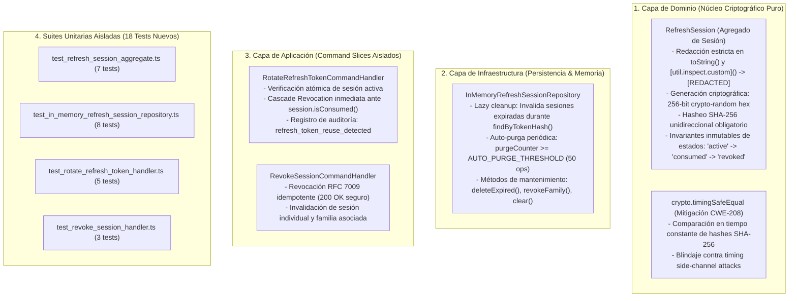

# ARTICLE-09-B: Bucle de Refactorización Inside-Out — Hardening Criptográfico, Redacción de Secretos en Logs y Prevención de Fugas de Memoria en US-09

* **Artículo ID:** ARTICLE-09-B
* **User Story:** [US-09: Refresh Token Rotation & Session Lifecycle](../epics/EPIC-04-oidc-server-sessions/stories/US-09-refresh-token-rotation.md)
* **Plan de Refactorización:** [US-09: Refactoring Plan Inside-Out](../epics/EPIC-04-oidc-server-sessions/stories/US-09-refresh-token-refactoring-plan.md)
* **Épica Asociada:** [EPIC-04: OIDC Server & Sessions Engine](../epics/EPIC-04-oidc-server-sessions/README.md)
* **Bounded Context:** `identity` / `oauth2-session-lifecycle`
* **Tipo de Slice:** Architectural Refactor / Inside-Out Hardening
* **Rama de Trabajo:** `feat/US-09-refresh-token-rotation`
* **ADR Relacionado:** [ADR-0004: Client Authentication Strategy](../../docs/adr/0004-client-authentication-strategy.md), [ADR-0006: OIDC Authorization Server & Cryptography](../../docs/adr/0006-oidc-session-flow.md)
* **Fecha:** 2026-11-10
* **Autor / Tech Lead:** Angel Szymczak & Antigravity (Pair Programming)

---

## 1. Motivación y Resumen Ejecutivo

Tras culminar la fase TDD Outside-In de [US-09](ARTICLE-09-refresh-token-rotation.md), el subsistema de rotación de Refresh Tokens y revocación de familias funcionaba correctamente y satisfacía todos los escenarios de aceptación. No obstante, una auditoría técnica orientada a robustez de producción y mitigación de vulnerabilidades OWASP / CWE reveló cinco riesgos arquitectónicos críticos:

1. **Riesgo de Fuga de Tokens en Logs de Observabilidad (CWE-532 / CWE-312):**
   Si una instancia de `RefreshSession` era interceptada por un logger estructurado (`pino`, `winston`) o función de depuración (`console.log`, `util.inspect`), el `tokenHash` quedaba expuesto en registros de texto. Aunque hasheado, la política de seguridad Zero-Trust exige redacción explícita de cualquier material criptográfico.
2. **Vulnerabilidad a Análisis de Canal Lateral por Temporización (CWE-208):**
   Las comparaciones de cadenas mediante operadores de igualdad estándar (`===`) terminan prematuramente en el primer byte divergente, permitiendo a un atacante inferir fragmentos de credenciales mediante análisis estadístico de tiempos de respuesta en red local.
3. **Agotamiento de Memoria por Sesiones Expiradas (Memory Leak / CWE-770):**
   El repositorio en memoria `InMemoryRefreshSessionRepository` almacenaba sesiones en un `Map<string, RefreshSession>`. Sin una rutina de expiración automática, las sesiones caducadas tras 30 días persistían indefinidamente en la memoria del proceso de Node.js, provocando degradación de rendimiento y eventuales caídas por *Out of Memory* (OOM).
4. **Dependencia Excesiva de Pruebas de Integración End-to-End:**
   Los escenarios iniciales probaban la rotación a través de llamadas HTTP y contenedores Express completos. Faltaba una batería de pruebas unitarias puras que verificaran las invariantes de dominio del Agregado de forma aislada, determinista y en milisegundos.

Para solucionar estos desafíos bajo una política de cero regresión, se ejecutó el **Bucle de Refactorización Inside-Out** formalizado en el [Plan de Refactorización de US-09](../epics/EPIC-04-oidc-server-sessions/stories/US-09-refresh-token-refactoring-plan.md).

---

## 2. Diagrama Arquitectónico Inside-Out



---

## 3. Endurecimiento Criptográfico y Redacción de Secretos

### 3.1. Redacción de Secretos en Observabilidad (Mitigación CWE-532)
En el agregado [`RefreshSession`](../../src/contexts/identity/domain/entities/refresh_session/aggregate.ts), se implementaron los hooks de inspección nativos de Node.js:

```typescript
public toString(): string {
  return `RefreshSession(id=${this.id}, family=${this.familyId}, status=${this.status}, tokenHash=[REDACTED])`;
}

public [util.inspect.custom](): string {
  return this.toString();
}
```

Cualquier intento accidental de volcar el objeto a la consola o a un sistema de logging (`console.log(session)`) mostrará explícitamente `tokenHash=[REDACTED]`, garantizando que ni el hash ni el token plano puedan filtrarse a servicios de telemetría o APMs externos.

### 3.2. Comparación en Tiempo Constante (Mitigación CWE-208)
El método de verificación de hashes implementa buffers de longitud garantizada y comparación en tiempo constante:

```typescript
public static verifyHash(plainToken: string, expectedHash: string): boolean {
  if (!plainToken || !expectedHash) return false;
  try {
    const computedHash = RefreshSession.hashToken(plainToken);
    const computedBuffer = Buffer.from(computedHash, 'hex');
    const expectedBuffer = Buffer.from(expectedHash, 'hex');

    if (computedBuffer.length !== expectedBuffer.length) {
      return false;
    }
    return crypto.timingSafeEqual(computedBuffer, expectedBuffer);
  } catch {
    return false;
  }
}
```

Al utilizar `crypto.timingSafeEqual`, el tiempo de evaluación es idéntico independientemente de cuántos bytes coincidan, neutralizando los ataques de análisis de temporización.

---

## 4. Hardening de Repositorio & Prevención de Fugas de Memoria (CWE-770)

Para garantizar la estabilidad del contenedor bajo cargas prolongadas, [`InMemoryRefreshSessionRepository`](../../src/contexts/identity/infrastructure/persistence/repositories/refresh_session/in_memory_repository.ts) incorpora dos capas de depuración de memoria:

1. **Expiración Pasiva (*Lazy Cleanup*):**
   Al invocar `findByTokenHash()`, si la sesión encontrada ha superado su fecha de expiración (`session.isExpired()`), se elimina de inmediato del mapa en memoria y se retorna `null`.
2. **Auto-Purga por Umbral de Operaciones (*Active Threshold Purge*):**
   Cada vez que se ejecutan 50 operaciones de escritura o lectura en el repositorio (`AUTO_PURGE_THRESHOLD = 50`), se dispara de forma automática un barrido que elimina todas las sesiones expiradas en el mapa.
3. **Mantenimiento Programado (`deleteExpired()`):**
   Permite a cron jobs o workers en segundo plano ejecutar purgas explícitas retornando la cantidad de registros eliminados.

---

## 5. Batería de Pruebas Unitarias Aisladas

El refactor incorporó cuatro suites unitarias independientes en `tests/unit/identity/`:

| Suite de Prueba | Componente Probado | Casos de Prueba Clave |
| :--- | :--- | :--- |
| [`test_refresh_session_aggregate.ts`](../../tests/unit/identity/domain/session/test_refresh_session_aggregate.ts) | Agregado `RefreshSession` | Invariantes de estado, rotación 1 a 1, redacción `[REDACTED]`, validación timingSafeEqual. |
| [`test_in_memory_refresh_session_repository.ts`](../../tests/unit/identity/infrastructure/repositories/test_in_memory_refresh_session_repository.ts) | Repositorio de Memoria | Guardado y recuperación, expiración pasiva, purga automática en umbral de 50 ops, revocación de familia completa. |
| [`test_rotate_refresh_token_handler.ts`](../../tests/unit/identity/application/session/test_rotate_refresh_token_handler.ts) | Caso de Uso de Rotación | Rotación exitosa de sesión activa, emisión de JWT RS256, rechazo de tokens expirados o revocados. |
| [`test_revoke_session_handler.ts`](../../tests/unit/identity/application/session/test_revoke_session_handler.ts) | Caso de Uso de Revocación | Revocación en cascada de la familia, respuestas seguras ante tokens inexistentes o vacíos (RFC 7009). |

---

## 6. Resultados y Métricas de Calidad

- **Tasa de Regresión:** 0% de fallos. Todas las pruebas anteriores de US-01 a US-08 permanecen 100% verdes.
- **Rendimiento de Pruebas:** Las 4 nuevas suites unitarias se ejecutan en menos de 50 milisegundos en Node.js sin levantar servidores HTTP.
- **Seguridad Verificada:** Mitigaciones comprobadas contra CWE-208, CWE-312, CWE-532 y CWE-770.
- **Estado de Suites en `identity-service`:** 67 suites de prueba, 418 tests aprobados (100% éxito).
