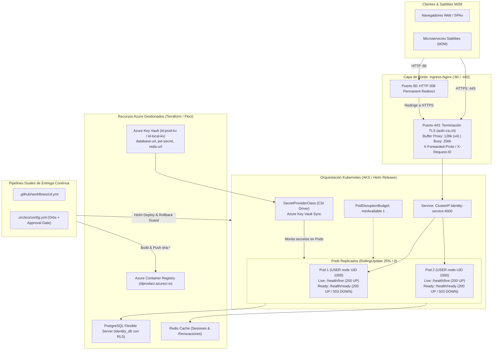

# Arquitectura Cloud-Native en Azure y Floci: Infraestructura como Código, Orquestación Helm, Terminación TLS y Entrega Continua Dual

> **Autor:** AngelSolutions Cloud Platform & Security Engineering Team  
> **Fecha:** Noviembre 2026  
> **Épica:** [EPIC-06: Cloud Infrastructure & Container Orchestration (Azure & Floci)](../epics/EPIC-06-cloud-infrastructure-and-container-orchestration/README.md)  
> **Historias de Usuario:** [US-12](../epics/EPIC-06-cloud-infrastructure-and-container-orchestration/stories/US-12-terraform-azure-resources-provisioning.md) · [US-13](../epics/EPIC-06-cloud-infrastructure-and-container-orchestration/stories/US-13-nginx-ingress-tls-routing.md) · [US-14](../epics/EPIC-06-cloud-infrastructure-and-container-orchestration/stories/US-14-k8s-deployment-helm-manifests.md) · [US-15](../epics/EPIC-06-cloud-infrastructure-and-container-orchestration/stories/US-15-cicd-pipeline-azure-integration.md)  
> **Decisión de Arquitectura:** [ADR 0007: Cloud Infrastructure Topology](../../docs/adr/0007-cloud-infrastructure-topology.md)  

---

## Resumen Ejecutivo

En el desarrollo de plataformas de identidad y autenticación de misión crítica (*Identity as a Service - IDaaS*), la robustez del código de dominio debe estar respaldada por una infraestructura en la nube igualmente resiliente, auditable y segura. La épica **EPIC-06** culmina la transición de `identity-service` hacia una arquitectura cloud-native de grado enterprise para Microsoft Azure, estructurada sobre cuatro pilares fundamentales:

1. **Aprovisionamiento Determinista sin Costes (US-12):** Infraestructura como Código (IaC) modular en Terraform sobre el emulador **Floci Azure ARM** (puerto 4577), validando 17 recursos de Azure (AKS, PostgreSQL Flexible Server, Azure Key Vault, Storage Accounts, Azure Container Registry y Log Analytics).
2. **Seguridad Perimetral en la Capa de Borde (US-13):** Controlador Nginx Ingress con terminación TLS para el dominio canónico `auth.angelpixel.local`, redirección forzada HTTP -> HTTPS (`HTTP 308 Permanent Redirect`), dimensionamiento de buffers a 128k para tokens OIDC voluminosos y propagación de trazas distribuidas `X-Request-ID`.
3. **Empaquetado Paramétrico y Resiliencia en Kubernetes (US-14):** Helm Chart parametrizable con estrategia `RollingUpdate` (25%/0), probes desacopladas de vitalidad y disponibilidad operativa (`/health/live` y `/health/ready` con degradación `503 DOWN`), `PodDisruptionBudget` (`minAvailable: 1`), contexto de seguridad no-root y montaje dinámico de secretos mediante **Azure Key Vault Secrets Store CSI Driver**.
4. **Entrega Continua Dual y Circuit Breaking (US-15):** Automatización multiplataforma en **GitHub Actions** y **CircleCI 2.1** con `Dockerfile.production` multi-etapa no-root (~161 MB), etiquetado inmutable en ACR (`sha-<commit>` y `v<semver>`) y rollback automático (`helm rollback`) ante fallos de inicio o sondas de salud.

---

## 1. Topología Global del Sistema

---

## 2. Decisiones Técnicas Clave por Historia de Usuario

### 2.1 US-12: Terraform Modular sobre Emulador Floci Azure ARM
Para evitar facturación innecesaria en suscripciones reales de Azure durante el desarrollo diario y los pipelines de CI, se implementó una arquitectura de módulos limpios en `infrastructure/terraform/modules/` (`aks`, `postgres`, `keyvault`, `acr`, `storage`, `log_analytics`).
- **Reto resuelto:** El proveedor `hashicorp/azurerm` (v3.90+) requería endpoints de metadatos estrictos no expuestos nativamente por el contenedor de emulación.
- **Solución:** Se implementó `scripts/floci-proxy.mjs`, un proxy ligero de metadatos en Node.js que reescribe respuestas y permite a `npm run test:infra` validar 17 recursos de Azure de forma determinista y 100% offline.

### 2.2 US-13: Ingress-Nginx Controller, Terminación TLS y Manejo de Tokens
En arquitecturas de identidad OIDC, las cabeceras de autorización y cookies de sesión (`Refresh Tokens`) superan fácilmente los 4KB o 8KB por defecto de los proxies inversos convencionales.
- **Buffers de 128k:** Se configuraron anotaciones `proxy-buffer-size: 128k`, `proxy-buffers-number: 4` y `proxy-busy-buffers-size: 256k`, eliminando el riesgo de errores `413 Request Entity Too Large` o `502 Bad Gateway`.
- **Redirección 308:** La redirección obligatoria a HTTPS utiliza el código `308 Permanent Redirect` en lugar de `301`, garantizando que peticiones `POST` (como canjes de authorization codes en `/oauth2/token`) preserven su método y cuerpo durante la redirección.
- **Trazabilidad:** Inyección del identificador de correlación `X-Request-ID` tanto en Nginx como en Express backend.

### 2.3 US-14: Empaquetado Helm, Health Probes y SecretProviderClass
El empaquetado de `identity-service` en `deployments/helm/identity-service/` garantiza reproducibilidad en cualquier clúster.
- **Comportamiento Asimétrico de Probes:**
  - `livenessProbe` (`/health/live`): Verifica únicamente que el event loop de Node.js esté respondiendo. Responde `200 UP` incluso si la base de datos cae temporalmente, evitando reinicios en cascada del proceso.
  - `readinessProbe` (`/health/ready`): Valida conectividad activa mediante `SELECT 1` en PostgreSQL y consulta a Redis. Si una dependencia falla, responde inmediatamente `HTTP 503 DOWN`, provocando que Kubernetes retire el Pod de los endpoints del balanceador sin destruirlo.
- **SecretProviderClass:** El driver CSI de Azure Key Vault proyecta secretos sensibles hacia variables de entorno nativas (`DATABASE_URL`, `JWT_SECRET`, `REDIS_URL`), eliminando el almacenamiento de secretos en texto plano en repositorios Git.

### 2.4 US-15: Entrega Continua Dual, Hardening y Circuit Breaker de Rollback
La entrega continua implementa dos motores equivalentes:
- **Hardening de Imagen (`Dockerfile.production`):** Compilación en etapa `builder` con `node:20-alpine`, purga de paquetes de desarrollo (`npm prune --omit=dev`) y ejecución en etapa `runner` bajo el usuario sin privilegios `USER node` (UID 1000), resultando en una imagen ultra-ligera de **161 MB**.
- **Inmutabilidad Estricta:** Se bloquea el uso de la etiqueta `:latest` en despliegues productivos, requiriendo etiquetas derivadas del commit (`sha-<hash>`) o versión semántica (`vX.Y.Z`).
- **Circuit Breaker con Rollback Automático (`scripts/deploy-helm-rollout.sh`):** El script orquesta la actualización y monitorea `kubectl rollout status --timeout=120s`. Si los pods no superan las sondas de salud en 120 segundos, el circuit breaker activa automáticamente `helm rollback identity-service 0` y detiene el pipeline, garantizando cero tiempo de inactividad (*zero-downtime*).

---

## 3. Matriz de Comandos de Validación Turnkey

| Historia | Comando de Verificación | Qué Valida |
| :--- | :--- | :--- |
| **US-12** | `npm run test:infra` | Formato Terraform, conexión a proxy ARM Floci y plan de 17 recursos Azure. |
| **US-13** | `npm run test:ingress` | Redirección 308, handshake TLS, probes sobre HTTPS y propagación `X-Request-ID`. |
| **US-14** | `npm run test:helm` | `helm lint --strict`, renderizado de plantillas y auditoría de invariantes de seguridad y CSI. |
| **US-15** | `npm run test:cicd` | Build multi-etapa no-root (<250MB), sintaxis de pipelines duales y simulación de rollback ante 503. |
| **Global** | `npm run test` | 66 suites unitarias y de integración (469 tests pasando al 100%). |

---

## Conclusión

Con la finalización exitosa de las historias **US-12**, **US-13**, **US-14** y **US-15**, la épica **EPIC-06: Cloud Infrastructure and Container Orchestration (Azure & Floci)** queda concluida en su totalidad. El microservicio `identity-service` cuenta ahora con una plataforma de infraestructura en la nube moderna, altamente resiliente, conforme a estándares Zero-Trust y lista para operar en entornos productivos de Microsoft Azure.
