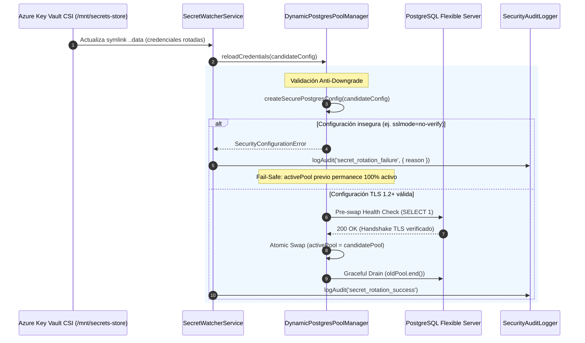

# ARTICLE-14: Cifrado Integral de Base de Datos en Tránsito (TLS 1.3/1.2) y en Reposo (CMK) para Azure PostgreSQL Flexible Server — Arquitectura Criptográfica FinTech y Defensa Anti-Downgrade

* **Artículo ID:** ARTICLE-14
* **User Story Asociada:** [US-17: Database Encryption In-Flight (TLS 1.3/1.2) & At-Rest (CMK) for PostgreSQL Flexible Server](../epics/EPIC-07-fintech-compliance-hardening-and-security-standards/stories/US-17-database-encryption-flexible-server.md)
* **Épica:** [EPIC-07: Fintech Compliance, Hardening & Security Standards](../epics/EPIC-07-fintech-compliance-hardening-and-security-standards/README.md)
* **Bounded Context:** `infrastructure` / `security` / `database`
* **Tipo de Slice:** Cryptographic Hardening & Infrastructure Slice (TLS 1.3/1.2 Anti-Downgrade, Fail-Safe Pool, Terraform CMK & Helm Schema)
* **Rama de Trabajo:** `development`
* **ADR Relacionado:** [ADR 0007: Cloud Infrastructure Topology](../../docs/adr/0007-cloud-infrastructure-topology.md)
* **Guía Interactiva Asociada:** [GUIDELINE-18: Database Encryption Flexible Server](../guidelines/GUIDELINE-18-database-encryption-flexible-server.md)
* **Fecha:** Noviembre 2026
* **Autor / Tech Lead:** AngelSolutions Cloud Platform & Security Engineering Team (Pair Programming)

---

## 1. Motivación y Resumen Ejecutivo

En el desarrollo de plataformas de identidad y autenticación que sustentan ecosistemas bancarios y financieros (*Identity-as-a-Service - IDaaS*), la seguridad de los datos en tránsito y en reposo no puede sustentarse en supuestos perimetrales. En una arquitectura nativa de la nube (*Cloud-Native*), el tráfico entre microservicios y bases de datos relacionales atraviesa redes virtuales compartidas, puentes de contenedores y mallas de servicio expuestas a vectores de intercepción (*Man-in-the-Middle - MitM*), exfiltración de memoria o ataques de degradación de protocolo (*Downgrade Attacks*).

Los principales marcos normativos internacionales imponen controles mandatorios e ineludibles:
- **PCI-DSS v4.0:**
  - *Requisito 4.1:* Criptografía robusta y protocolos de seguridad modernos (TLS 1.2 o superior) para proteger los datos sensibles del tarjetahabiente y credenciales de autenticación durante la transmisión a través de redes abiertas o internas.
  - *Requisito 3.6:* Protección y gestión integral del ciclo de vida de claves criptográficas, incluyendo la custodia en módulos de seguridad en hardware (HSM) y separación de responsabilidades.
- **SOC 2 Type II (Trust Services Criteria):**
  - *CC6.7:* Cifrado de datos en reposo y en tránsito empleando algoritmos y suites criptográficas robustas reconocidas por la industria.
  - *CC6.1:* Controles de acceso lógico basados en el principio de mínimo privilegio y gestión centralizada de secretos en bóvedas criptográficas.

A pesar de estas exigencias, una de las vulnerabilidades más extendidas en microservicios basados en Node.js y el driver `node-pg` es el uso permisivo del flag `rejectUnauthorized: false` (o la presencia inadvertida de parámetros de URL como `sslmode=no-verify`). Esta configuración desactiva la validación de la cadena de confianza de la Autoridad Certificadora (CA), creando una **falsa ilusión de cifrado**: el tráfico viaja envuelto en una capa TLS, pero cualquier intermediario no autorizado con un certificado autofirmado puede interceptar o alterar las credenciales y perfiles de usuario sin levantar ninguna excepción.

Para erradicar de raíz este riesgo y dotar a `identity-service` de un blindaje de grado bancario, la historia **US-17** implementó una solución integral de cinco capas:

```
+---------------------------------------------------------------------------------------------------------+
| ARQUITECTURA CRIPTOGRÁFICA MULTICAPA (US-17: DATABASE ENCRYPTION IN-FLIGHT & AT-REST)                    |
|                                                                                                         |
|  [CAPA 1: FÁBRICA CRIPTOGRÁFICA & ANTI-DOWNGRADE GUARD]                                                 |
|  - createSecurePostgresConfig()                           <-- Bloqueo de rejectUnauthorized=false       |
|  - SecurityConfigurationError                             <-- Prohibición de sslmode=no-verify/disable  |
|  - Pinning estricto de CA institucional y minVersion TLS 1.2 / TLS 1.3                                  |
|         │                                                                                               |
|         ▼                                                                                               |
|  [CAPA 2: POOL DINÁMICO RESILIENTE CON FAIL-SAFE]                                                       |
|  - DynamicPostgresPoolManager                             <-- Soporte nativo de PostgresSslOptions      |
|  - Pre-swap SELECT 1 + atomic pointer swap               <-- Cero interrupción de transacciones         |
|  - Salvaguarda anti-downgrade en reloadCredentials()       <-- Preservación del pool activo previo       |
|         │                                                                                               |
|         ▼                                                                                               |
|  [CAPA 3: CONTENEDOR HTTP & PROBES DESACOPLADAS]                                                        |
|  - interfaces/http/server.ts                              <-- Resolución DATABASE_SSL_* & CA CSI file   |
|  - /health/live: 200 UP (anti-crashloop)                  <-- /health/ready: 503 DOWN ante fallo TLS    |
|  - Suite de integración E2E (4 escenarios de seguridad)                                                 |
|         │                                                                                               |
|         ▼                                                                                               |
|  [CAPA 4: INFRAESTRUCTURA TERRAFORM (AZURE POSTGRESQL FLEXIBLE SERVER)]                                 |
|  - require_secure_transport = "on"                        <-- Forzado en socket a nivel motor de base   |
|  - ssl_min_protocol_version = "TLSv1.2"                   <-- Exclusión de suites TLS 1.0 y 1.1         |
|  - Customer-Managed Key (CMK) dinámico                    <-- Cifrado en reposo con Azure Key Vault     |
|         │                                                                                               |
|         ▼                                                                                               |
|  [CAPA 5: EMPAQUETADO HELM & CONTRATOS DE ESQUEMA JSON DRAFT-07]                                        |
|  - values.yaml / values-local.yaml: database.ssl          <-- Parametrización declarativa en Kubernetes |
|  - values.schema.json: enum ["TLSv1.2", "TLSv1.3"]        <-- Rechazo preventivo de protocolos débiles  |
|  - scripts/test-helm-chart.sh (6 etapas)                  <-- Negative Schema Testing automatizado      |
+---------------------------------------------------------------------------------------------------------+
```

---

## 2. Capa 1: La Fábrica Criptográfica y el Anti-Downgrade Guard

El principio rector de la arquitectura fue aislar la construcción de las configuraciones de conexión en una fábrica pura e inmutable, situada en [`src/contexts/identity/infrastructure/persistence/database/postgres_ssl_config.ts`](../../src/contexts/identity/infrastructure/persistence/database/postgres_ssl_config.ts).

### 2.1. Anatomía del Anti-Downgrade Guard

La función `createSecurePostgresConfig` inspecciona tanto objetos de configuración de `pg.PoolConfig` como URIs de conexión relacionales (`postgresql://...`). Cualquier intento de relajar los controles de transporte seguro es interceptado y abortado lanzando una excepción `SecurityConfigurationError`:

```typescript
export function createSecurePostgresConfig(
  baseConfig: PoolConfig | string,
  options?: PostgresSslOptions
): PoolConfig {
  const isEnabled = options?.enabled ?? true;

  // Si SSL está explícitamente deshabilitado en entornos no productivos
  if (!isEnabled) {
    if (typeof baseConfig === 'string') {
      return { connectionString: baseConfig };
    }
    const { ssl, ...rest } = baseConfig;
    return rest;
  }

  // 1. Análisis y normalización defensiva de connection strings
  if (typeof baseConfig === 'string') {
    const parsedUrl = new URL(baseConfig);
    const sslmode = parsedUrl.searchParams.get('sslmode')?.toLowerCase();

    // Bloqueo estricto de degradación en la cadena de conexión
    if (sslmode === 'disable' || sslmode === 'allow' || sslmode === 'prefer' || sslmode === 'no-verify') {
      throw new SecurityConfigurationError(
        `Insecure sslmode '${sslmode}' is prohibited. Connections must enforce strict certificate verification.`
      );
    }
    // ...
  }

  // 2. Bloqueo estricto de rejectUnauthorized=false en objetos PoolConfig
  if (typeof baseConfig === 'object' && baseConfig.ssl) {
    if (typeof baseConfig.ssl === 'object' && baseConfig.ssl.rejectUnauthorized === false) {
      throw new SecurityConfigurationError(
        'Insecure rejectUnauthorized=false is strictly prohibited. SSL connections must validate the certificate authority chain.'
      );
    }
  }

  // 3. Construcción del objeto criptográfico hardened
  return {
    ...cleanBaseConfig,
    ssl: {
      rejectUnauthorized: true,
      minVersion: options?.minVersion ?? 'TLSv1.2',
      ca: options?.ca,
    },
  };
}
```

### 2.2. Pruebas Unitarias Exhaustivas (Fase 1)
En [`tests/unit/identity/infrastructure/database/test_postgres_ssl_config.ts`](../../tests/unit/identity/infrastructure/database/test_postgres_ssl_config.ts), se diseñaron 12 escenarios de prueba que verifican:
- El rechazo sistemático de `rejectUnauthorized: false` en todas sus variantes.
- La invalidación de parámetros de URL inseguros (`sslmode=disable`, `sslmode=no-verify`).
- El enforzamiento predeterminado de `TLSv1.2` como versión mínima.
- La correcta inyección del certificado de la Autoridad Certificadora (CA).

---

## 3. Capa 2: Resiliencia Fail-Safe y Swap Atómico en `DynamicPostgresPoolManager`

En la historia previa ([US-16](ARTICLE-13-fintech-compliance-hardening.md)), se introdujo `DynamicPostgresPoolManager` para permitir la rotación de credenciales de base de datos sin reinicio de contenedores. En **US-17**, este gestor dinámico fue extendido para asimilar las opciones de SSL y actuar como la primera línea de defensa activa ante intentos de manipulación en tiempo de ejecución.

### 3.1. Swap Atómico y Principio Fail-Safe

Durante la auto-rotación de secretos inyectada por el Azure Key Vault CSI Driver, el observador de archivos invoca `reloadCredentials(newConfig)`. El gestor dinámico ejecuta un protocolo de recarga seguro:

1. **Normalización y Chequeo Anti-Downgrade:** Las credenciales candidatas se procesan con `createSecurePostgresConfig`. Si contienen una configuración insegura, se lanza `SecurityConfigurationError` inmediatamente.
2. **Preservación Incondicional del Pool Activo (*Fail-Safe*):** Al fallar la validación o si el nuevo pool no supera el probe previo (`SELECT 1`), **el pool activo original se mantiene completamente operativo**. El servicio continúa atendiendo transacciones de los usuarios sin degradación alguna.
3. **Swap de Puntero y Drenado Ordenado (*Graceful Drain*):** Si el nuevo pool responde satisfactoriamente, el puntero `activePool` se actualiza de forma atómica y el pool anterior es drenado (`oldPool.end()`) en segundo plano sin abortar conexiones activas.



---

## 4. Capa 3: Contenedor HTTP, Probes Desacopladas y Suite E2E de Hardening TLS

En [`interfaces/http/server.ts`](../../interfaces/http/server.ts), la inicialización del contenedor Express resuelve declarativamente las variables de entorno para el soporte de TLS:

```typescript
const sslEnabled = process.env.DATABASE_SSL_ENABLED === 'true';
const sslMinVersion = (process.env.DATABASE_SSL_MIN_VERSION as 'TLSv1.2' | 'TLSv1.3') || 'TLSv1.2';
let sslCa: string | undefined = process.env.DATABASE_SSL_CA;

if (!sslCa && process.env.DATABASE_SSL_CA_PATH) {
  try {
    sslCa = fs.readFileSync(process.env.DATABASE_SSL_CA_PATH, 'utf8');
  } catch (err) {
    logger.error('Failed to read CA certificate from path', { path: process.env.DATABASE_SSL_CA_PATH, error: err });
  }
}
```

### 4.1. Desacoplamiento de Sondas de Salud de Kubernetes

Para evitar que un fallo transitorio de la base de datos o un rechazo de apretón de manos TLS induzca un bucle destructivo de reinicios (*CrashLoopBackOff*), las sondas de salud se implementaron de forma estrictamente desacoplada:
- **Liveness Probe (`GET /health/live`):** Evalúa exclusivamente la salud del proceso Node.js y el bucle de eventos. Retorna `200 UP` incluso si la base de datos está inalcanzable, permitiendo al contenedor recibir rotaciones de secretos o diagnósticos.
- **Readiness Probe (`GET /health/ready`):** Ejecuta una consulta real a través de `DynamicPostgresPoolManager`. Si el certificado TLS es revocado o no coincide la Autoridad Certificadora, el probe retorna `503 Service Unavailable` (`checks.database: DOWN`). Kubernetes retira de inmediato el Pod del balanceo de carga, protegiendo las solicitudes de los usuarios.

### 4.2. Suite de Integración E2E (`test_database_tls_hardening.ts`)

La suite de integración valida de forma automatizada 4 escenarios críticos de seguridad:
1. **Escenario 1 (Handshake TLS 1.2+ Estricto):** Inicialización de `DynamicPostgresPoolManager` con opciones SSL institucionales y verificación de `200 OK` en readiness.
2. **Escenario 2 (Defensa Reactiva Anti-Downgrade en Rotación CSI):** Inyección en caliente de credenciales con `sslmode=disable` y verificación de que el pool activo previo se preserva intacto y se registra el evento de auditoría `secret_rotation_failure`.
3. **Escenario 3 (Rechazo Inmediato de Certificados MitM):** Conexión simulada contra un servidor con certificado autofirmado no autorizado, confirmando la degradación a `503 Service Unavailable` en readiness y `200 OK` en liveness.
4. **Escenario 4 (Resolución de Certificados CA en Volumen CSI):** Carga dinámica del certificado PEM desde la ruta montada en disco (`DATABASE_SSL_CA_PATH`).

---

## 5. Capa 4: Hardening de Infraestructura en Terraform (Azure PostgreSQL Flexible Server)

En [`infrastructure/terraform/modules/postgres/`](../../infrastructure/terraform/modules/postgres/), se reforzó el aprovisionamiento de PostgreSQL Flexible Server para forzar las restricciones a nivel de motor y habilitar el cifrado en reposo con claves administradas por el cliente (*Customer-Managed Key - CMK*).

### 5.1. Reglas de Transporte Obligatorio en el Motor

Mediante el recurso `azurerm_postgresql_flexible_server_configuration`, se establecieron parámetros inmutables en el servidor relacional:

```hcl
# Forzado obligatorio de conexiones cifradas en el socket TCP
resource "azurerm_postgresql_flexible_server_configuration" "require_secure_transport" {
  name      = "require_secure_transport"
  server_id = azurerm_postgresql_flexible_server.postgres.id
  value     = "on"
}

# Restricción de versión mínima: se bloquean protocolos obsoletos (TLS 1.0 y 1.1)
resource "azurerm_postgresql_flexible_server_configuration" "ssl_min_protocol_version" {
  name      = "ssl_min_protocol_version"
  server_id = azurerm_postgresql_flexible_server.postgres.id
  value     = "TLSv1.2"
}
```

### 5.2. Cifrado en Reposo con Customer-Managed Key (CMK)

Para satisfacer PCI-DSS Req 3.6 y SOC 2 CC6.1, se estructuraron bloques dinámicos (`dynamic "customer_managed_key"` y `dynamic "identity"`) en `azurerm_postgresql_flexible_server`. Esto permite asociar una clave RSA almacenada en Azure Key Vault con una identidad administrada asignada por el usuario (*User-Assigned Managed Identity*), asegurando que los discos de almacenamiento permanezcan cifrados de extremo a extremo, manteniendo plena compatibilidad local con el emulador Floci ARM donde la clave es opcional:

```hcl
dynamic "customer_managed_key" {
  for_each = var.customer_managed_key != null ? [var.customer_managed_key] : []
  content {
    key_vault_key_id                  = customer_managed_key.value.key_vault_key_id
    primary_user_assigned_identity_id = customer_managed_key.value.primary_user_assigned_identity_id
  }
}
```

---

## 6. Capa 5: Empaquetado Helm y Contratos de Esquema JSON Draft-07

El último eslabón de la cadena garantiza que la infraestructura desplegada en Kubernetes esté alineada con las directivas de seguridad.

### 6.1. Parametrización en Helm y Despliegue en Pods

En [`deployments/helm/identity-service/values.yaml`](../../deployments/helm/identity-service/values.yaml) y [`values-local.yaml`](../../deployments/helm/identity-service/values-local.yaml), se parametrizó la sección `database.ssl`:

```yaml
database:
  ssl:
    enabled: true
    minVersion: "TLSv1.2"
    caPath: "/mnt/secrets-store/ca.crt"
```

Estas propiedades se proyectan directamente como variables de entorno en el contenedor del microservicio en [`templates/deployment.yaml`](../../deployments/helm/identity-service/templates/deployment.yaml):

```yaml
- name: DATABASE_SSL_ENABLED
  value: {{ .Values.database.ssl.enabled | quote }}
- name: DATABASE_SSL_MIN_VERSION
  value: {{ .Values.database.ssl.minVersion | quote }}
- name: DATABASE_SSL_CA_PATH
  value: {{ .Values.database.ssl.caPath | quote }}
```

### 6.2. Validación Estricta con JSON Schema Draft-07

En [`deployments/helm/identity-service/values.schema.json`](../../deployments/helm/identity-service/values.schema.json), se definió un contrato formal que restringe `minVersion` exclusivamente al enum `["TLSv1.2", "TLSv1.3"]`. Cualquier intento de inyectar un valor corrupto o una versión obsoleta (como `TLSv1.0`) provoca un fallo inmediato con código `1` en `helm lint` y `helm template`, impidiendo que el manifiesto defectuoso alcance el clúster.

---

## 7. Matriz de Cobertura y Resultados de Verificación

Todas las capas técnicas fueron validadas de forma continua bajo el flujo de TDD inside-out:

| Nivel de Verificación | Herramienta / Suite | Casos Evaluados | Resultado |
| :--- | :--- | :--- | :---: |
| **Capa 1: Fábrica Criptográfica** | `test_postgres_ssl_config.ts` | 12 pruebas unitarias de flags, enums y anti-downgrade | ✅ **100% PASS** |
| **Capa 2: Dynamic Pool Manager** | `test_dynamic_postgres_pool_manager.ts` | 10 pruebas unitarias de atomic swap, drain y fail-safe | ✅ **100% PASS** |
| **Capa 3: Integración E2E TLS** | `test_database_tls_hardening.ts` | 4 escenarios E2E (MitM, CSI rotation, CA files) | ✅ **100% PASS** |
| **Capa 4: Terraform / Floci** | `npm run test:infra` | 5 etapas de sintaxis, plan y reglas de PostgreSQL | ✅ **100% PASS** |
| **Capa 5: Empaquetado Helm** | `npm run test:helm` | 6 etapas (linting, templates, invariantes y negative schema) | ✅ **100% PASS** |
| **Integración Continua (CI)** | GitHub Actions (`build-test-lint`) | 7 Quality Gates completos en ubuntu-latest | ✅ **100% PASS** |

---

## 8. Lecciones de Ingeniería FinTech y Conclusiones

1. **La Validación Criptográfica en Origen es Innegociable:** Los controles perimetrales no sustituyen la validación a nivel de socket. El *Anti-Downgrade Guard* en la fábrica `createSecurePostgresConfig` actúa como una barrera inmutable que previene que configuraciones defectuosas se propaguen a producción.
2. **El Principio Fail-Safe es la Clave del Zero-Downtime:** En sistemas de alta concurrencia, una rotación de secretos que falle no debe tumbar el servicio. Rechazar la credencial candidata corrupta y preservar el pool activo garantiza la disponibilidad del negocio mientras se alerta al equipo de operaciones vía eventos de auditoría estructurados.
3. **El Esquema Declarativo Previene el Error Humano:** Al trasladar las reglas de cumplimiento al `values.schema.json` de Helm y al código HCL de Terraform, la seguridad deja de ser un documento normativo estático y se convierte en una barrera de compilación automatizada en el ciclo de vida del software.

Con la entrega de **US-17**, la plataforma `identity-service` consolida su cumplimiento de **PCI-DSS v4.0** y **SOC 2 Type II**, garantizando que el transporte y almacenamiento de credenciales relacionales cumplan con los estándares más rigurosos de la industria financiera internacional.
