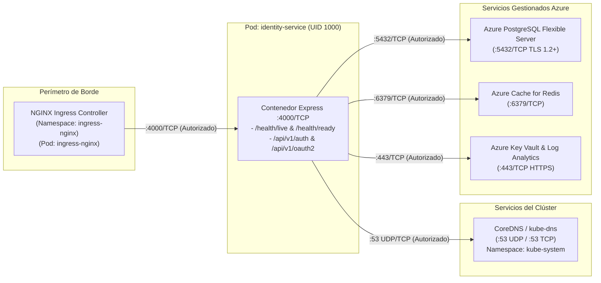

# ARTICLE-15: Micro-Segmentación Zero-Trust con Kubernetes NetworkPolicies en Helm — Defensa en Profundidad L3/L4 y Cumplimiento ISO 27001 & SOC 2

* **Artículo ID:** ARTICLE-15
* **User Story Asociada:** [US-18: Kubernetes Zero-Trust NetworkPolicies & Micro-Segmentation in Helm](../epics/EPIC-07-fintech-compliance-hardening-and-security-standards/stories/US-18-k8s-zero-trust-network-policies.md)
* **Épica:** [EPIC-07: Fintech Compliance, Hardening & Security Standards](../epics/EPIC-07-fintech-compliance-hardening-and-security-standards/README.md)
* **Bounded Context:** `infrastructure` / `security` / `networking`
* **Tipo de Slice:** Security & Orchestration Infrastructure Slice (Zero-Trust L3/L4 NetworkPolicies, Helm Parameterization, Strict JSON Schema & CI/CD Lifecycle)
* **Rama de Trabajo:** `feat/us-18-k8s-zero-trust-network-policies`
* **ADR Relacionado:** [ADR 0007: Cloud Infrastructure Topology](../../docs/adr/0007-cloud-infrastructure-topology.md)
* **Guía Interactiva Asociada:** [GUIDELINE-19: Kubernetes Zero-Trust NetworkPolicies](../guidelines/GUIDELINE-19-k8s-zero-trust-network-policies.md)
* **Fecha:** Noviembre 2026
* **Autor / Tech Lead:** AngelSolutions Cloud Platform & Security Engineering Team (Pair Programming)

---

## 1. Motivación y Resumen Ejecutivo

En el diseño de plataformas de identidad y autenticación que operan en el núcleo de ecosistemas bancarios y financieros (*Identity-as-a-Service - IDaaS*), la seguridad de red no puede confiar en límites perimetrales difusos ni en supuestos de confianza implícita dentro del clúster.

Por defecto, la especificación de red de **Kubernetes** implementa un modelo de red plana (*Flat Network*): todos los Pods en cualquier namespace pueden comunicarse libremente con cualquier otro Pod, servicio o endpoint externo sin restricciones de capa de transporte (L3/L4). Este comportamiento por omisión representa una brecha crítica en entornos financieros de alta criticidad:
- **Movimiento Lateral Incontrolado (*Lateral Movement*):** Si un atacante compromete un contenedor periférico (por ejemplo, mediante una vulnerabilidad en una dependencia de front-end o una aplicación auxiliar), puede escanear libremente la red interna del clúster y atacar directamente servicios sensibles como PostgreSQL, Redis o el motor central de tokens.
- **Exfiltración de Secretos y Tráfico no Autorizado:** Un Pod comprometido tiene la capacidad de establecer conexiones salientes hacia servidores de comando y control (C2) externos, exfiltrando llaves privadas, variables de entorno o volcados de memoria.
- **Falta de Trazabilidad y Aislamiento por Namespace:** Los namespaces de Kubernetes son límites puramente lógicos de gestión, no barreras de aislamiento de paquetes a menos que se apliquen directivas explícitas de filtrado en el motor CNI (*Container Network Interface*).

### Cumplimiento Normativo Internacional

Para erradicar estos riesgos, las principales normas y marcos de ciberseguridad financiera imponen requisitos explícitos de segmentación de tráfico:

- **ISO/IEC 27001:2022 Control A.13.1 (Gestión de la Seguridad en Redes y Segregación):**
  Exige que las redes de información y los grupos de servicios de información se dividan en dominios de seguridad de red separados y que el tráfico entre ellos se controle rigurosamente con base en reglas de negocio y necesidades de acceso explícitas.
- **SOC 2 Type II CC6.6 (Perímetros Lógicos y Protección de Fronteras):**
  Mandata la implementación de controles de seguridad en los límites lógicos para prevenir y detectar accesos o comunicaciones no autorizadas entre los componentes que procesan datos de clientes.

La historia **US-18** resuelve este desafío implementando una arquitectura de micro-segmentación Zero-Trust L3/L4 nativa en el empaquetado Helm de `identity-service`, aplicando el principio de mínimo privilegio (*least privilege*) tanto para el tráfico entrante (*Ingress*) como saliente (*Egress*).

```
+---------------------------------------------------------------------------------------------------------+
| ARQUITECTURA ZERO-TRUST L3/L4 EN HELM (US-18: KUBERNETES NETWORKPOLICIES)                               |
|                                                                                                         |
|  [CAPA 1: AISLAMIENTO BASE DEFAULT-DENY ALL]                                                            |
|  - identity-service-default-deny-all                      <-- podSelector: {}                           |
|  - Ingress: DENY por defecto                              <-- Bloqueo total de entrada no autorizada    |
|  - Egress: DENY por defecto                               <-- Bloqueo total de salida no autorizada     |
|         │                                                                                               |
|         ▼                                                                                               |
|  [CAPA 2: LISTAS BLANCAS DE MÍNIMO PRIVILEGIO (ALLOWLIST)]                                              |
|  - Ingress Allowlist: puerto :4000/TCP                    <-- Únicamente desde namespace ingress-nginx   |
|  - Egress Allowlist: puertos :53, :5432, :6379, :443      <-- CoreDNS, PostgreSQL, Redis, Key Vault     |
|  - Egress Custom: puertos :4577, :4578                    <-- Solo en values-local.yaml (Floci ARM)     |
|         │                                                                                               |
|         ▼                                                                                               |
|  [CAPA 3: GOBERNANZA HELM Y VALIDACIÓN PREVENTIVA DE ESQUEMA]                                           |
|  - values.schema.json (Draft-07)                          <-- Tipos booleanos y puertos IANA 1..65535   |
|  - Guardas condicionales en templates/networkpolicy.yaml  <-- networkPolicy.enabled & defaultDeny       |
|  - scripts/test-helm-chart.sh (6 etapas AST)              <-- Auditoría automatizada en CI/CD           |
+---------------------------------------------------------------------------------------------------------+
```

---

## 2. Arquitectura de Micro-Segmentación Zero-Trust L3/L4

El diseño de seguridad implementado en `US-18` adopta el **patrón dual de directivas de red**, combinando una directiva de bloqueo global con directivas específicas de habilitación selectiva:

### 2.1. Política Base: `identity-service-default-deny-all`

Para garantizar que ningún Pod desplegado en el namespace quede desprotegido por omisión, se genera una directiva de denegación total que aplica a todos los Pods presentes y futuros:

```yaml
apiVersion: networking.k8s.io/v1
kind: NetworkPolicy
metadata:
  name: identity-service-default-deny-all
spec:
  podSelector: {}
  policyTypes:
    - Ingress
    - Egress
```

Al especificar `podSelector: {}` y listar ambos tipos en `policyTypes` sin incluir bloques `ingress:` ni `egress:`, el kernel Linux (vía eBPF o `iptables` administrado por el CNI como Azure CNI, Cilium o Calico) descarta silenciosamente cualquier paquete entrante o saliente que no coincida con una regla permitida explícitamente en otra directiva.

### 2.2. Política de Aplicación: `identity-service` (Allowlist L3/L4)

Sobre el perímetro cerrado por la denegación por defecto, la directiva de aplicación abre exclusivamente los canales verificados de entrada y salida necesarios para el funcionamiento de `identity-service`:



#### Reglas de Ingress:
- **Origen Estricto:** Se exige doble coincidencia de selector:
  - `namespaceSelector.matchLabels: { app.kubernetes.io/name: ingress-nginx }`
  - `podSelector.matchLabels: { app.kubernetes.io/name: ingress-nginx }`
- **Puerto Destino:** Únicamente el puerto `4000/TCP` de la aplicación. Cualquier intento de tráfico directo de otros microservicios hacia el puerto 4000 es bloqueado en la interfaz de red del Pod.

#### Reglas de Egress:
- **Resolución DNS:** Permite salida a los puertos `53/UDP` y `53/TCP` hacia los Pods de `kube-dns` / `coredns` en el namespace `kube-system`.
- **Capa de Persistencia:** Puerto `5432/TCP` hacia Azure PostgreSQL Flexible Server (protegido adicionalmente por TLS 1.2+ y CMK implementados en US-17).
- **Capa de Caché / Sesión:** Puerto `6379/TCP` hacia Azure Cache for Redis.
- **Servicios Cloud Seguros:** Puerto `443/TCP` hacia los endpoints REST de Azure Key Vault (CSI Secrets Store) y Azure Log Analytics.

---

## 3. Parametrización Helm y Aislamiento de Entornos

Una de las premisas arquitectónicas esenciales de `EPIC-07` es la paridad entre entornos de desarrollo local y producción, garantizando al mismo tiempo que **las configuraciones locales de prueba nunca se filtren al entorno productivo**.

### 3.1. Plantilla Modular: `deployments/helm/identity-service/templates/networkpolicy.yaml`

La plantilla utiliza dos interruptores condicionales bien definidos:
1. `networkPolicy.enabled` (Interruptor Maestro): Controla si se renderizan o no los manifiestos de red.
2. `networkPolicy.defaultDeny.enabled` (Interruptor de Aislamiento Base): Permite desactivar la directiva global `default-deny-all` en clústeres donde las políticas globales ya se gestionan centralizadamente.

Adicionalmente, la plantilla cuenta con el bloque `customEgress`:
```yaml
{{- with .Values.networkPolicy.egress.customEgress }}
{{- toYaml . | nindent 4 }}
{{- end }}
```

### 3.2. Diferenciación de Valores: Producción (`values.yaml`) vs Local (`values-local.yaml`)

- **Perfil Productivo (`values.yaml`):**
  Define `customEgress: []`. De este modo, en producción AKS solo se autorizan los puertos estrictos `:53`, `:5432`, `:6379` y `:443`.
- **Perfil Local (`values-local.yaml`):**
  Inyecta los puertos locales del emulador Floci ARM (`:4577/TCP` HTTP y `:4578/TCP` HTTPS proxy TLS) mediante `customEgress`:
  ```yaml
  networkPolicy:
    enabled: true
    defaultDeny:
      enabled: true
    egress:
      customEgress:
        - ports:
            - protocol: TCP
              port: 4577
            - protocol: TCP
              port: 4578
  ```

Esta separación garantiza que la suite de pruebas locales contra Floci pueda validar la infraestructura sin necesidad de abrir puertos inseguros o de desarrollo en los manifiestos de producción.

---

## 4. Validación Preventiva de Esquema JSON y Suite de Pruebas

Para evitar errores humanos de configuración en tiempo de despliegue (*drift* o malformaciones en archivos de valores), `values.schema.json` fue extendido bajo la especificación **JSON Schema Draft-07**:

```json
"networkPolicy": {
  "type": "object",
  "required": ["enabled", "defaultDeny", "ingress", "egress"],
  "properties": {
    "enabled": { "type": "boolean" },
    "defaultDeny": {
      "type": "object",
      "required": ["enabled"],
      "properties": { "enabled": { "type": "boolean" } }
    },
    "ingress": {
      "type": "object",
      "required": ["fromIngressController", "port"],
      "properties": {
        "fromIngressController": { "type": "boolean" },
        "port": { "type": "integer", "minimum": 1, "maximum": 65535 }
      }
    }
  }
}
```

### 4.1. Auditoría Automatizada en `scripts/test-helm-chart.sh`

La suite de verificación del chart fue ampliada para certificar las invariantes Zero-Trust de forma automática en 6 etapas:
- **Etapa 3:** Verifica la presencia física de `kind: NetworkPolicy` en la salida renderizada.
- **Etapa 4 (Auditoría AST Estructural):** Parsea los documentos YAML con Node.js (`yaml.parseAllDocuments`) y comprueba que:
  - Existen exactamente 2 manifiestos `NetworkPolicy`.
  - `identity-service-default-deny-all` tiene `podSelector: {}` y `policyTypes: [Ingress, Egress]`.
  - `identity-service` tiene el selector correcto y las reglas exactas de Ingress/Egress.
- **Etapa 6 (Negative Testing):** Comprueba que valores corruptos como `networkPolicy.enabled="invalid"` o `networkPolicy.ingress.port=70000` son rechazados de inmediato por el motor Helm con mensajes de error descriptivos.

---

## 5. Nueva Estrategia Git Trunk-Based y Ciclo de Promoción

A partir de la ejecución de `US-18`, el equipo adoptó formalmente una evolución en el flujo de desarrollo y entrega continua:

### 5.1. Ramas `feat/*` Preservadas y Squash Merge a `main`

1. **Ramas de Feature Preservadas:** Las ramas `feat/us-XX-<slug>` retienen de manera permanente el historial detallado de commits atómicos desarrollados bajo Inside-Out TDD (`--delete-branch=false`).
2. **Squash Merge hacia `main`:** Cada Pull Request se fusiona mediante Squash Merge, manteniendo el historial de la rama principal limpio y lineal (un commit por historia de usuario).

### 5.2. Ciclo de Despliegue Inmutable con Release Tags SemVer

En lugar de requerir ramas intermedias de entorno, el ciclo de despliegue se apoya en etiquetas Git SemVer inmutables:
- **Tags Pre-Release (`vX.Y.Z-rc.N`):** Despliegan automáticamente al clúster de **Staging** para pruebas integrales de homologación.
- **Tags Release Oficiales (`vX.Y.Z`):** Promueven el mismo artefacto inmutable (`sha-<SHORT_SHA>`) hacia **Production** con mecanismos de circuit breaker y rollback automático (120s).

---

## 6. Lecciones Aprendidas, Cumplimiento de Controles y Conclusiones

### Tabla Comparativa de Seguridad: Antes vs. Después de US-18

| Dimensión de Seguridad | Estado Previo (US-14 / US-17) | Estado Fortalecido (US-18) | Control Normativo Satisfecho |
| :--- | :--- | :--- | :--- |
| **Aislamiento de Entrada (Ingress)** | El Pod aceptaba conexiones en `:4000` de cualquier Pod del clúster. | Solo el controlador `ingress-nginx` puede alcanzar el puerto `:4000/TCP`. | SOC 2 Type II CC6.6 |
| **Aislamiento de Salida (Egress)** | El Pod podía iniciar conexiones hacia cualquier IP o puerto de Internet. | Tráfico de salida bloqueado salvo a DNS (:53), PG (:5432), Redis (:6379) y Key Vault (:443). | ISO/IEC 27001:2022 A.13.1 |
| **Mitigación de Movimiento Lateral** | Nula a nivel de red interna del clúster (modelo de red plana). | Bloqueo en kernel CNI de todo paquete no autorizado (`default-deny-all`). | ISO/IEC 27001:2022 A.13.1 / SOC 2 CC6.6 |
| **Aislamiento de Entornos** | Puertos de emulación podían ser referenciados globalmente. | Puertos Floci (`4577`/`4578`) confinados exclusivamente a `values-local.yaml`. | Mínimo Privilegio (*Least Privilege*) |
| **Gobernanza de Valores Helm** | Parámetros de red sin validación de tipos o límites IANA. | Validación estricta con JSON Schema Draft-07 en compilación y linting. | Calidad de Software & Despliegue Seguro |

### Conclusión

La implementación de **US-18** consolida la madurez de infraestructura y orquestación de `identity-service`, transformando el chart de Helm en una plantilla de grado bancario que implementa micro-segmentación Zero-Trust L3/L4 por diseño. La combinación de directivas de denegación por defecto, listas blancas explícitas, esquemas JSON estrictos y un flujo de ramas con promoción inmutable por tags establece las bases sólidas para la siguiente historia de la épica: **US-19 (Immutable Audit Log Shipping to Azure Log Analytics)**.
