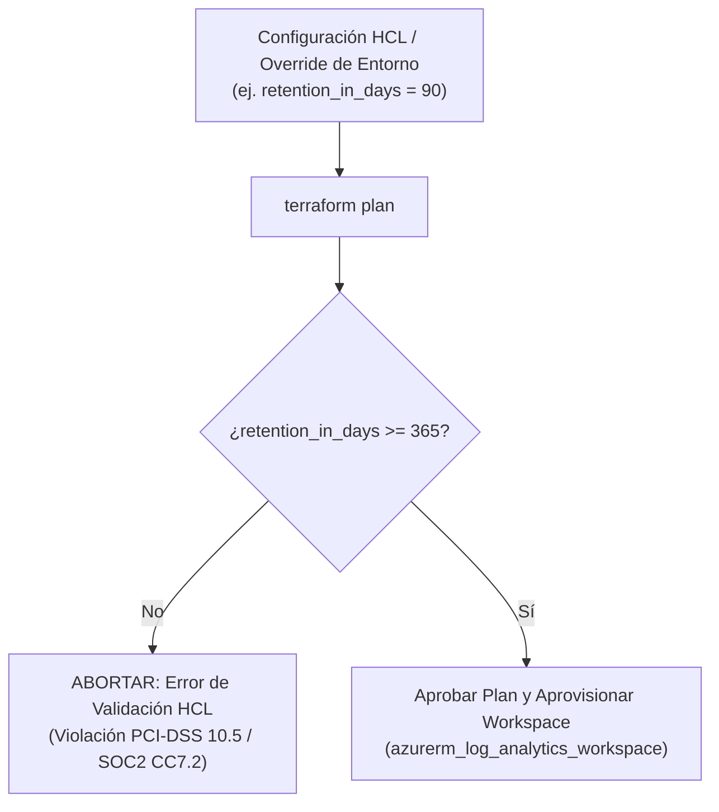

# ARTICLE-16: Logging de Auditoría Estructurado (12-Factor NDJSON) e Ingesta Inmutable en Azure Log Analytics — Cumplimiento PCI-DSS v4.0 & SOC 2 Type II

* **Artículo ID:** ARTICLE-16
* **User Story Asociada:** [US-19: Structured Security Audit Logging (12-Factor stdout NDJSON) & Azure Log Analytics Ingestion](../epics/EPIC-07-fintech-compliance-hardening-and-security-standards/stories/US-19-immutable-audit-log-analytics.md)
* **Épica:** [EPIC-07: Fintech Compliance, Hardening & Security Standards](../epics/EPIC-07-fintech-compliance-hardening-and-security-standards/README.md)
* **Bounded Context:** `security` / `compliance` / `observability`
* **Tipo de Slice:** Full-Stack Compliance & Observability Slice (Domain Sanitizer, Application Ports/Builder, 12-Factor Infrastructure Adapter, HTTP Middlewares, Terraform LAW Hardening)
* **Rama de Trabajo:** `feat/us-19-immutable-audit-log-analytics`
* **Pull Request de Integración:** [PR #10](https://github.com/angelpixel-core/identity-service/pull/10) (Squash & Merge a `main`)
* **ADR Relacionado:** [ADR 0007: Cloud Infrastructure Topology](../../docs/adr/0007-cloud-infrastructure-topology.md)
* **Guía Interactiva Asociada:** [GUIDELINE-20: Structured Security Audit Logging & Immutable Ingestion in Azure Log Analytics](../guidelines/GUIDELINE-20-immutable-audit-log-analytics.md)
* **Fecha:** Noviembre 2026
* **Autor / Tech Lead:** AngelSolutions Cloud Platform & Security Engineering Team (Pair Programming)

---

## 1. Motivación y Resumen Ejecutivo

En el desarrollo de plataformas de identidad de misión crítica bancaria (*Identity-as-a-Service - IDaaS*), la auditoría de seguridad trasciende la mera observabilidad técnica o la depuración operativa: constituye la **pista forense legally-binding** que certifica la legitimidad de cada transacción, autenticación y delegación de privilegios en el ecosistema financiero.

Sin embargo, en arquitecturas multi-tenant contenerizadas en la nube, la gestión tradicional de logs enfrenta tres fallas estructurales graves:

1. **Riesgo de Destrucción o Alteración Forense:** Si los logs se almacenan localmente dentro del contenedor o en volúmenes efímeros de Kubernetes, cualquier compromiso del contenedor o terminación del Pod (`SIGKILL`, desalojo de nodo) destruye la evidencia forense. Además, la falta de políticas de retención inmutable (*Write Once, Read Many* / WORM) permite que atacantes con privilegios borren los registros de sus intrusiones.
2. **Fuga Involuntaria de Secretos (Data Leakage):** Al registrar excepciones HTTP o payloads de solicitudes sin una higienización profunda, es extremadamente fácil filtrar contraseñas en texto claro, tokens portadores (Bearer JWTs), llaves privadas PEM o datos de tarjetas de crédito (PANs), violando de inmediato los requerimientos de privacidad y PCI-DSS.
3. **Acoplamiento de Red en la Aplicación (Anti-Patrón de Logging):** Intentar que la aplicación envíe logs directamente mediante llamadas REST síncronas o clientes SDK hacia servicios externos como Datadog o Azure Monitor degrada drásticamente la latencia de las APIs de autenticación, introduce puntos únicos de fallo ante caídas de red y viola el principio fundacional de las aplicaciones nativas en la nube.

### 1.1 Cumplimiento Normativo Internacional

Para abordar estas fallas, los principales estándares de seguridad de la industria fintech imponen directivas estrictas:

- **PCI-DSS v4.0 Requisito 10.2 (Eventos Auditables Mandatorios):**
  Exige el registro ineludible de todos los intentos de acceso individual (éxitos y fracasos), elevación de privilegios administrativos, violaciones de autorización multi-inquilino y el ciclo de vida de tokens y llaves criptográficas.
- **PCI-DSS v4.0 Requisito 10.5 (Inmutabilidad y Retención WORM):**
  Obliga a proteger las pistas de auditoría contra modificaciones y borrado no autorizado, exigiendo una **retención mínima legal de 365 días (1 año)** con capacidad de consulta inmediata de al menos 90 días.
- **SOC 2 Type II CC7.2 (Monitoreo y Detección de Anomalías):**
  Requiere monitoreo centralizado continuo para identificar anomalías de operación del sistema, accesos no autorizados e intentos de escalada horizontal cross-tenant.
- **12-Factor App (Principio XI: Logs):**
  Dictamina que la aplicación nunca debe preocuparse por enrutar o almacenar sus logs; debe emitirlos como un flujo continuo no estructurado o estructurado en NDJSON directamente hacia `stdout`, delegando la recolección, enriquecimiento y transporte a la infraestructura subyacente.

```
+---------------------------------------------------------------------------------------------------------+
| TOPOLOGÍA DE AUDITORÍA FINTECH 12-FACTOR (US-19: IDENTITY SERVICE -> AZURE LOG ANALYTICS)              |
|                                                                                                         |
|  [CAPA DE DOMINIO & APLICACIÓN]                                                                         |
|  - Evento de Seguridad / Petición HTTP                                                                  |
|         │                                                                                               |
|         ▼                                                                                               |
|  - AuditSanitizer (Dominio)                               <-- Purgado recursivo PII, JWT, PEM, PAN, URL |
|  - SecurityAuditEventBuilder (Aplicación)                 <-- PCI/SOC2 Tags, Severidad, Object.freeze   |
|         │                                                                                               |
|         ▼                                                                                               |
|  [CAPA DE INFRAESTRUCTURA CONTENERIZADA]                                                                |
|  - ConsoleSecurityAuditLogger (Infra)                     <-- Emisión atómica NDJSON en una sola línea  |
|  - stdout (File Descriptor 1)                             <-- Cero I/O bloqueante o llamadas de red     |
|         │                                                                                               |
|         ▼                                                                                               |
|  [PLANO DE CONTROL KUBERNETES & CLOUD INGESTION]                                                        |
|  - Azure Monitor / Fluentbit (DaemonSet)                  <-- Agrega Pod, Namespace, Node metadata      |
|  - Azure Log Analytics Workspace                          <-- Retención WORM: 365 días obligatorios     |
|  - Azure Monitor / KQL Analytics                          <-- Alertas SOC en tiempo real (CC7.2)        |
+---------------------------------------------------------------------------------------------------------+
```


---

## 2. Contratos Canónicos y Normalización Inmutable

En arquitecturas guiadas por el dominio (DDD) y puertos/adaptadores hexagonales, el registro de auditoría no debe depender de bibliotecas de terceros (`winston`, `pino`, SDKs de nube) acopladas a la lógica de negocio. `identity-service` aísla este requerimiento a través del puerto de aplicación `SecurityAuditLogger` y un modelo canónico fuertemente tipado en TypeScript:

```typescript
export interface SecurityAuditLogger {
  log(event: CanonicalSecurityAuditEvent): Promise<void>;
}
```

### 2.1 Especificación Canónica: `CanonicalSecurityAuditEvent`

Para satisfacer las directivas de indexación y correlación de incidentes en SIEM / Azure Sentinel, el evento de auditoría canónico organiza la información en sub-estructuras semánticas de alta cohesión:

```typescript
export interface CanonicalSecurityAuditEvent {
  readonly id: string;                         // UUID v4 único e irrepetible
  readonly timestamp: string;                  // ISO 8601 UTC estricto con milisegundos
  readonly eventType: SecurityEventType;       // Taxonomía bancaria cerrada
  readonly severity: SecurityAuditSeverity;   // 'ALERT' | 'WARN' | 'INFO'
  readonly status: SecurityAuditStatus;       // 'SUCCESS' | 'FAILURE' | 'DENIED'
  readonly actor: SecurityAuditActor;         // Identidad (userId, tenantId, ip, userAgent)
  readonly trace: SecurityAuditTrace;         // Trazabilidad (requestId, correlationId)
  readonly compliance: SecurityAuditCompliance;// Mapeo regulatorio (pciDss, soc2)
  readonly details: Record<string, unknown>;  // Metadatos específicos sanitizados
}
```

---

### 2.2 Patrón Builder & Anti-Corruption Layer (`SecurityAuditEventBuilder`)

Un problema habitual en refactorizaciones de seguridad consiste en la rotura de casos de uso existentes que emiten parámetros de log en formatos dispares (ej. claves planas en `snake_case` como `user_id`, `ip_address`, `tenant_id` o `status_code`).

Para solucionar esto sin forzar reescrituras disruptivas en docenas de controladores y servicios, se diseñó `SecurityAuditEventBuilder` actuando como una **Capa Anti-Corrupción (ACL)**:

```mermaid
flowchart LR
    INPUT["Payload Heterogéneo / Legacy\n(snake_case, plano, campos opcionales)"] --> BUILDER["SecurityAuditEventBuilder"]
    BUILDER --> MAP["Normalizador Polimórfico\n(user_id -> actor.userId, etc.)"]
    MAP --> INFER["Inferencia de Severidad & Estado\n(CROSS_TENANT -> ALERT/DENIED)"]
    INFER --> TAGS["Inyección Tags PCI / SOC 2\n(10.2.1, 10.2.5, 10.2.6, CC7.2)"]
    TAGS --> SAN["AuditSanitizer.sanitize(details)\n(Purgado PII / Secretos / PAN)"]
    SAN --> FREEZE["Object.freeze(canonicalEvent)"]
    FREEZE --> OUT["CanonicalSecurityAuditEvent (Inmutable)"]
```



#### Inferencia Determinista de Severidad y Estado Operacional:
1. **Eventos de Alerta Máxima (`ALERT` / `DENIED`):**
   Cualquier evento de `CROSS_TENANT_VIOLATION` o `UNAUTHORIZED_RESOURCE_ACCESS` es calificado automáticamente con severidad `ALERT` y estado `DENIED`, activando de inmediato las reglas de escalada en el SOC.
2. **Eventos de Advertencia (`WARN` / `FAILURE`):**
   Los fallos de autenticación (`AUTH_LOGIN_FAILURE`, `FEDERATED_LOGIN_FAILURE` o eventos con terminación `_FAILURE`) se catalogan como `WARN` y `FAILURE`.
3. **Eventos Informativos (`INFO` / `SUCCESS`):**
   Las operaciones exitosas estándar (`AUTH_LOGIN_SUCCESS`, `TOKEN_ISSUED`, `KEY_ROTATED`) adoptan severidad `INFO` y estado `SUCCESS`.
4. **Inmutabilidad en Tiempo de Ejecución (`Object.freeze`):**
   El evento final se sella con `Object.freeze`. Cualquier intento de mutar sus propiedades en middlewares posteriores o adaptadores genera una excepción en modo estricto, blindando la integridad de la pista forense antes de su emisión.


---

## 3. Sanitización Recursiva en Dominio y Protección de Secretos (`AuditSanitizer`)

Uno de los mayores desafíos en el registro de auditoría fintech es la **fuga accidental de datos sensibles de autenticación (SAD) y datos personales (PII)**. Errores no controlados o volcados de objetos en tiempo de ejecución suelen arrastrar credenciales hacia los logs, comprometiendo el cumplimiento de **PCI-DSS v4.0 Req 3.4** y **SOC 2 Type II CC6.1**.

Para resolver este riesgo de manera determinista, el servicio de dominio puro `AuditSanitizer` (`src/contexts/identity/domain/security/audit_sanitizer.ts`) ejecuta un recorrido recursivo en profundidad sobre cualquier estructura de datos:

```typescript
export class AuditSanitizer {
  public static sanitize<T>(input: T): T {
    const seen = new WeakSet<object>();
    return this.sanitizeRecursive(input, seen) as T;
  }
}
```

---

### 3.1 Doble Filtro de Higienización: Claves y Heurísticas de Contenido

El sanitizador opera bajo un modelo de defensa en dos niveles complementarios:

#### Nivel 1: Filtrado por Nombre de Propiedad (`isSensitiveKey`)
Inspecciona los nombres de las propiedades mediante expresiones regulares insensibles a mayúsculas/minúsculas y delimitadores:
- **Exclusiones Benignas Prioritarias:** Se evalúa primero una lista blanca estricta (`BENIGN_EXCLUSIONS`) para evitar enmascarar campos operativos críticos:
  - `/status[_-]?code/i` (permite valores como `statusCode: 401`)
  - `/zip[_-]?code/i` y `/country[_-]?code/i` (permite códigos geográficos)
  - `/token[_-]?type/i` (permite `token_type: "Bearer"`)
  - `/token[_-]?tenant/i` (permite `tokenTenant: "tenant-alpha"`)
- **Claves Sensibles Purgadas a `[REDACTED]`:**
  - Contraseñas, sales y hashes (`password`, `pass_hash`, `client_secret`)
  - Llaves criptográficas privadas (`private_key`, `privateKeyPem`)
  - Tokens portadores y de sesión (`access_token`, `refreshToken`, `id_token`, `sessionToken`)
  - Datos de pago e identidad (`pan`, `creditCard`, `cvv`, `ssn`)

#### Nivel 2: Heurísticas Regex en Cadenas No Estructuradas
Incluso cuando un secreto no se encuentra bajo una clave sensible (por ejemplo, si viaja dentro de un mensaje de error o una URL de redirección), el sanitizador inspecciona las cadenas de texto aplicando patrones de reconocimiento estricto:

```typescript
// Detección y reemplazo de secretos en texto plano
private static sanitizeString(val: string): string {
  let res = val;
  // 1. Bloques PEM de Llaves Privadas
  res = res.replace(/-----BEGIN[ A-Z0-9_-]*PRIVATE KEY-----[\s\S]*?-----END[ A-Z0-9_-]*PRIVATE KEY-----/gi, '[REDACTED_PRIVATE_KEY]');
  // 2. Tokens Bearer JWT (formato base64url con 3 segmentos)
  res = res.replace(/(?:Bearer\s+)?(eyJ[a-zA-Z0-9_-]{10,}\.eyJ[a-zA-Z0-9_-]{10,}\.[a-zA-Z0-9_-]{10,})/g, (m, jwt) => m.startsWith('Bearer') ? 'Bearer [REDACTED_JWT]' : '[REDACTED_JWT]');
  // 3. Números de Tarjeta PAN (13 a 19 dígitos)
  res = res.replace(/\b(?:\d[ -]*?){13,19}\b/g, (pan) => {
    const digits = pan.replace(/\D/g, '');
    return digits.length >= 13 && digits.length <= 19 ? '[REDACTED_PAN]' : pan;
  });
  // 4. Parámetros de Query sensibles en URLs
  res = res.replace(/(password|token|secret|api_key|client_secret)=([^&]+)/gi, '$1=[REDACTED]');
  return res;
}
```

---

### 3.2 Protección contra Referencias Circulares (`WeakSet`)

En entornos de ejecución basados en Node.js, es común que objetos complejos (como instancias de peticiones Express `req`, sockets o errores con propiedades `cause`) contengan referencias circulares. Un recorrido recursivo ingenuo provocaría un error fatal no recuperable de desbordamiento de pila (*RangeError: Maximum call stack size exceeded*).

`AuditSanitizer` mitiga este riesgo registrando cada objeto visitado en un `WeakSet<object>()`:
- Las referencias débiles (*weak references*) aseguran que no se generen fugas de memoria (*memory leaks*), permitiendo que el recolector de basura (GC) libere los objetos normalmente.
- Ante un nodo repetido en la cadena de referencias, el algoritmo interrumpe la recursión de inmediato y sustituye el valor por el marcador `'[CIRCULAR]'`.


---

## 4. Adaptador 12-Factor y Middlewares HTTP

Siguiendo el principio de inversión de dependencias, la infraestructura implementa el puerto `SecurityAuditLogger` mediante `ConsoleSecurityAuditLogger` (`src/contexts/identity/infrastructure/logging/console_security_audit_logger.ts`), materializando el principio **12-Factor App (XI. Logs)**.

### 4.1 Emisión Atómica NDJSON y Resiliencia ante Streams (`EPIPE`)

El adaptador escribe directamente en el flujo `outputStream` (por defecto `process.stdout`), garantizando que cada registro sea una línea JSON independiente y compacta:

```typescript
export class ConsoleSecurityAuditLogger implements SecurityAuditLogger {
  private readonly outputStream: NodeJS.WritableStream;

  constructor(outputStream: NodeJS.WritableStream = process.stdout) {
    this.outputStream = outputStream;
    // Protección defensiva ante cierre abrupto del descriptor
    this.outputStream.on('error', (err) => {
      this.handleStreamError(err);
    });
  }

  public async log(event: CanonicalSecurityAuditEvent): Promise<void> {
    const line = JSON.stringify(event) + '\n';
    try {
      this.outputStream.write(line, (err) => {
        if (err) this.handleStreamError(err);
      });
    } catch (err) {
      this.handleStreamError(err);
    }
  }

  private handleStreamError(err: unknown): void {
    try {
      process.stderr.write(`[ConsoleSecurityAuditLogger:ERROR] Failed to write audit log: ${String(err)}\n`);
    } catch {
      // Fail-safe silencioso: un fallo de logging jamás debe tumbar el proceso
    }
  }
}
```

#### Ventajas Operativas del Diseño:
1. **Zero-Latency In-Memory I/O:** No se realizan bloqueos de red o llamadas asíncronas remotas. La escritura a `stdout` se ejecuta a velocidad de kernel buffer en el file descriptor 1.
2. **Prevención de Caídas por `EPIPE`:** Si un proceso que consume la salida estándar se cierra intempestivamente, el listener `error` defensivo previene la terminación no controlada de Node.js por excepciones no capturadas.
3. **Compatibilidad Universal con DaemonSets:** Al ser NDJSON de una sola línea, los recolectores de K8s pueden parsear y anexar campos de orquestación (`kubernetes.pod_name`, `kubernetes.namespace_name`) de forma trivial.

---

### 4.2 Inyección en el Servidor (`server.ts`)

En `interfaces/http/server.ts`, el contenedor inyecta `ConsoleSecurityAuditLogger` como implementación predeterminada para producción y desarrollo:

```typescript
// En modo test se inyecta InMemorySecurityAuditLogger salvo que se fuerce la consola
const auditLogger: SecurityAuditLogger = 
  process.env.NODE_ENV === 'test' && process.env.FORCE_CONSOLE_AUDIT_LOGS !== 'true'
    ? new InMemorySecurityAuditLogger()
    : new ConsoleSecurityAuditLogger(process.stdout);
```

---

### 4.3 Detección y Alerta de Violaciones Cross-Tenant en Middlewares

Los middlewares HTTP fueron instrumentados para correlacionar metadatos forenses en tiempo real:

1. **Propagación de Trazabilidad (`security_audit_logger.ts`):**
   Captura cabeceras estándar `X-Request-ID` y `X-Correlation-ID`, dirección IP real del cliente (resolviendo proxies mediante `x-forwarded-for`), agente de usuario (*User-Agent*) y contexto de tenant.
2. **Detección de Violaciones de Aislamiento (`auth_middleware.ts`):**
   Cuando un usuario autenticado intenta acceder a un recurso cuyo `tenantId` en la ruta no coincide con el `tenantId` firmado en su token criptográfico, el middleware emite inmediatamente un evento `CROSS_TENANT_VIOLATION` antes de rechazar la petición con HTTP 403:

```typescript
// interfaces/http/middlewares/auth_middleware.ts
await auditLogger.log(
  SecurityAuditEventBuilder.create({
    eventType: 'CROSS_TENANT_VIOLATION',
    severity: 'ALERT',
    status: 'DENIED',
    actor: {
      userId: decodedToken.sub,
      tenantId: decodedToken.tenantId,
      ip: req.ip || req.socket.remoteAddress || '127.0.0.1',
      userAgent: req.headers['user-agent']
    },
    trace: {
      requestId: req.headers['x-request-id'] as string,
      correlationId: req.headers['x-correlation-id'] as string
    },
    compliance: {
      pciDssRequirements: ['10.2.5'],
      soc2Controls: ['CC7.2']
    },
    details: {
      targetTenantId: requestedTenantId,
      path: req.originalUrl,
      method: req.method
    }
  })
);
```


---

## 5. Hardening de Infraestructura en Terraform (Azure Log Analytics Workspace)

En las arquitecturas bancarias modernas, el aseguramiento de la observabilidad no puede depender de configuraciones manuales en portales web ni de auditorías a posteriori. Debe regirse bajo el paradigma de **Infraestructura como Código con Políticas Integradas (*IaC Policy as Code*)**.

### 5.1 Guardarraíl HCL: Retención Mínima WORM de 365 Días

El estándar **PCI-DSS v4.0 Req 10.5** establece que la pista de auditoría debe retenerse de forma inmutable por un mínimo de **1 año (365 días)**. Para garantizar que esta restricción no dependa del criterio humano de un operador, el módulo de Terraform [`infrastructure/terraform/modules/log_analytics/`](../../infrastructure/terraform/modules/log_analytics/) implementa una validación sintáctica nativa en `variables.tf`:

```hcl
variable "retention_in_days" {
  description = "Number of days of log retention in Log Analytics Workspace. Must be at least 365 days for PCI-DSS 10.5 / SOC2 CC7.2 compliance."
  type        = number
  default     = 365

  validation {
    condition     = var.retention_in_days >= 365
    error_message = "retention_in_days must be at least 365 days (1 year) to comply with PCI-DSS Req 10.5 and SOC2 CC7.2."
  }
}
```



Si cualquier desarrollador o pipeline de CI/CD intenta suministrar un valor inferior a `365` (ej. `30` o `90`), `terraform plan` aborta inmediatamente antes de comunicarse con las APIs de la nube, impidiendo la degradación involuntaria de la postura de seguridad.

---

### 5.2 Paridad de Entornos y Emulación Local con Floci ARM

Para certificar que las políticas de infraestructura funcionan idénticamente en estaciones de trabajo y en la nube sin incurrir en costos de suscripción, el entorno local [`infrastructure/terraform/environments/local/`](../../infrastructure/terraform/environments/local/) instancia el módulo contra el emulador local de Azure ARM (Floci en puerto `:4578`):

```hcl
module "log_analytics" {
  source              = "../../modules/log_analytics"
  name                = "law-identity-local"
  location            = var.location
  resource_group_name = module.resource_group.name
  retention_in_days   = 365

  tags = {
    Environment = "local"
    Compliance  = "PCI-DSS-10.5/SOC2-CC7.2"
    Retention   = "Immutable-365d"
  }
}
```

#### Salidas de Trazabilidad para el Clúster K8s:
El módulo expone outputs que permiten vincular a los agentes de Kubernetes con el espacio de trabajo:
- `log_analytics_workspace_id`: Identificador único del espacio de análisis.
- `log_analytics_primary_key`: Llave criptográfica de ingestión de telemetría.
- `log_analytics_retention_days`: Confirmación auditable de la retención configurada (`365`).


---

## 6. Lecciones Aprendidas, Cumplimiento de Controles y Conclusiones

### 6.1 Tabla Comparativa de Seguridad: Antes vs. Después de US-19

| Dimensión de Auditoría | Estado Previo (US-18) | Estado Fortalecido (US-19) | Control Satisfecho |
| :--- | :--- | :--- | :--- |
| **Formato y Estructura de Logs** | Logs de consola heterogéneos sin esquema estandarizado ni normalización. | Flujo continuo estructurado en **NDJSON de una sola línea** (`CanonicalSecurityAuditEvent`). | 12-Factor App (Principio XI: Logs) |
| **Protección contra Fuga de Secretos** | Sin mecanismos sistemáticos de redacción en payloads de auditoría. | Sanitizador recursivo profundo (`AuditSanitizer`) con purgado de claves y heurísticas regex (JWT, PEM, PAN, query params). | PCI-DSS v4.0 Req 3.4 & 10.5 |
| **Retención e Inmutabilidad Forense** | Logs efímeros confinados a la vida útil del contenedor o Pod. | Almacenamiento centralizado WORM con retención mandatoria de **365 días** en Azure Log Analytics Workspace. | PCI-DSS v4.0 Req 10.5 / SOC 2 CC7.2 |
| **Detección de Amenazas Multi-Tenant** | Rechazo silencioso con HTTP 403 sin generación de pista de auditoría. | Generación de eventos inmediatos `CROSS_TENANT_VIOLATION` con severidad `ALERT` y estado `DENIED`. | PCI-DSS v4.0 Req 10.2.5 / SOC 2 CC7.2 |
| **Integridad del Objeto en Memoria** | Payloads mutables expuestos a modificaciones por middlewares posteriores. | Congelamiento estricto en memoria mediante `Object.freeze` en la fábrica de eventos. | Integridad Forense & Non-Repudiation |
| **Resiliencia Operativa de I/O** | Riesgo de caídas por errores de pipe (`EPIPE`) en entornos contenerizados. | Manejador defensivo de errores en el stream y fallback no bloqueante hacia `stderr`. | Resiliencia de Software de Alta Disponibilidad |

---

### 6.2 Principales Lecciones de Ingeniería

1. **Defensa en Streams de Node.js:** En aplicaciones contenerizadas que envían flujos a través de tuberías (*pipes*) del sistema operativo, el cierre abrupto de un proceso consumidor (ej. un daemon de logs reiniciándose) genera un evento `EPIPE` en el stream de salida. Capturar este evento defensivamente en el constructor del logger previene la muerte catastrófica del proceso de Node.js.
2. **Heurísticas Regex vs. Claves Operativas:** El filtrado por nombres de claves sensibles debe calibrarse cuidadosamente. Patrones regex demasiado agresivos (ej. `/code/i` o `/token/i`) pueden enmascarar erróneamente campos operacionales indispensables como `statusCode` o `tokenTenant`. La introducción de una lista blanca de exclusiones benignas prioritarias (`BENIGN_EXCLUSIONS`) resolvió esta tensión de forma elegante y robusta.
3. **Eficiencia con `WeakSet`:** El uso de `WeakSet<object>` para detectar ciclos en objetos heterogéneos provee una protección de complejidad temporal $O(1)$ sin riesgo de fugas de memoria, garantizando que estructuras complejas con referencias circulares (como instancias de Express `req`) no saturen la pila de ejecución.

---

### 6.3 Conclusión y Próximos Pasos en EPIC-07

La implementación y entrega de **US-19** consolida la madurez de cumplimiento fintech y observabilidad forense de `identity-service`. La combinación de un puerto desacoplado en aplicación, sanitización profunda en el dominio, emisión 12-Factor a `stdout` y retención inmutable WORM de 365 días en Azure Log Analytics asegura que la plataforma cumpla con los estándares más rigurosos de **PCI-DSS v4.0** y **SOC 2 Type II**.

Con la pista de auditoría blindada y verificada, el equipo queda en posición óptima para abordar la siguiente historia de la épica: **[US-20: OWASP Top 10 API Security Hardening & Distributed Rate Limiting](../epics/EPIC-07-fintech-compliance-hardening-and-security-standards/stories/US-20-owasp-api-security-hardening.md)**.
