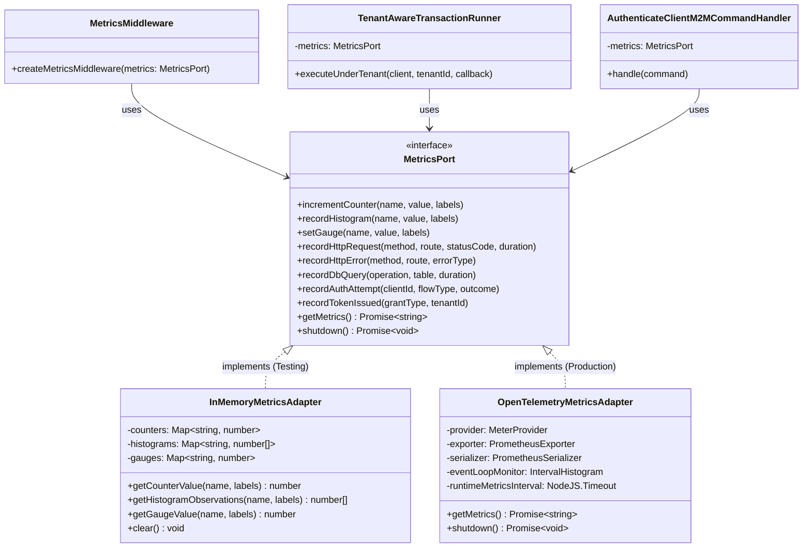
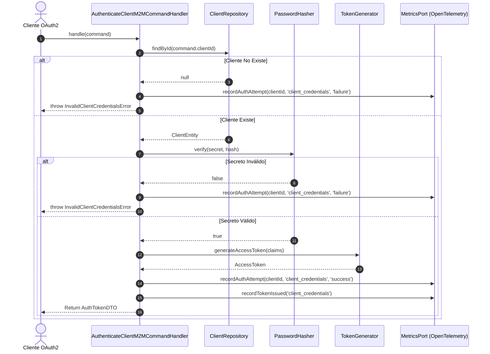

# ARTICLE-18: Telemetría Cuantitativa en Tiempo Real con OpenTelemetry Metrics SDK, Google SRE Golden Signals y Prevención Activa de Cardinalidad — Cumplimiento PCI-DSS v4.0 & SOC 2 Type II

* **Artículo ID:** ARTICLE-18
* **User Story Asociada:** [US-21: OpenTelemetry SDK Integration & Structured Metrics (Golden Signals)](../epics/EPIC-08-distributed-observability-and-request-correlation/stories/US-21-opentelemetry-structured-metrics.md)
* **Épica:** [EPIC-08: Distributed Observability & Request Correlation](../epics/EPIC-08-distributed-observability-and-request-correlation/README.md)
* **Bounded Context:** `observability` / `shared` / `telemetry`
* **Tipo de Slice:** Full-Stack Observability & Metrics Slice (Domain Hexagonal Port, OpenTelemetry SDK v3.x Infrastructure Adapter, Prometheus Exporter, HTTP Metrics Middleware, PostgreSQL Persistence Instrumentation, OAuth2 Handlers, Helm Scrape Config, BDD Acceptance)
* **Rama de Trabajo:** `feat/us-21-opentelemetry-structured-metrics`
* **Pull Request de Integración:** [PR #12](https://github.com/angelpixel-core/identity-service/pull/12) (Squash & Merge a `main`, commit `f27b2d3`)
* **ADR Relacionado:** [ADR 0007: Cloud Infrastructure Topology](../../docs/adr/0007-cloud-infrastructure-topology.md)
* **Guía Canónica Asociada:** [GUIDELINE-22: OpenTelemetry SDK Integration, Structured Metrics y Google SRE Golden Signals](../guidelines/GUIDELINE-22-opentelemetry-structured-metrics.md)
* **Fecha:** Noviembre 2026
* **Autor / Tech Lead:** AngelSolutions Platform & Observability Engineering Team (Pair Programming)

---

## 1. Motivación y Resumen Ejecutivo

En la ingeniería de plataformas de identidad de misión crítica, autenticación federada y autorización delegada (*Identity-as-a-Service - IDaaS*) en el ecosistema bancario y financiero, la observabilidad no puede depender exclusivamente de trazas distribuidas o de la inspección reactiva de registros en archivos de log. Mientras que la trazabilidad distribuida (abordada en [ARTICLE-17](ARTICLE-17-distributed-request-tracing.md)) permite reconstruir el ciclo de vida de una transacción individual, la **telemetría cuantitativa en tiempo real** es la única herramienta capaz de ofrecer una visión estadística, agregada y predictiva de la salud del sistema.

En un entorno multi-inquilino (*multi-tenant*) de alta concurrencia que soporta miles de transacciones por segundo (TPS), los ingenieros de confiabilidad del sitio (*Site Reliability Engineers - SRE*), los operadores de plataforma y los auditores de seguridad deben poder responder de inmediato a interrogantes críticas:
- ¿Cuál es la latencia percentil real ($p_{95}$, $p_{99}$) en los intercambios de código de autorización PKCE frente al tráfico habitual de credenciales de cliente M2M?
- ¿Está el runtime monohilo de Node.js experimentando demoras (*Event Loop lag*) provocadas por cálculos criptográficos síncronos o consultas lentas a bases de datos?
- ¿Qué proporción de transacciones de negocio están fallando por errores 4xx (credenciales inválidas, tokens revocados) frente a fallos 5xx (errores internos de servidor o saturación del pool de conexiones)?
- ¿Cuál es el consumo de memoria heap por inquilino y cómo impacta el aislamiento estricto en PostgreSQL con *Row-Level Security* (RLS)?

Para responder a estos retos sin incurrir en soluciones artesanales ni acoplarse rígidamente a tecnologías propietarias, la historia de usuario **US-21** introdujo una arquitectura de instrumentación basada en los estándares internacionales abiertos **OpenTelemetry Metrics API & SDK v3.x** y **OpenMetrics / Prometheus**, guiada estrictamente por los **4 Golden Signals** de Google SRE.

---

### 1.1 El Desafío de la Observabilidad Cuantitativa en Plataformas FinTech Multi-Tenant

La arquitectura de microservicios contenerizados en Kubernetes plantea un conjunto único de restricciones cuando se trata de recopilar métricas en aplicaciones financieras:

1. **Garantía Innegociable de Acuerdos de Nivel de Servicio (SLAs / SLOs):**
   Los sistemas de identidad bancaria operan bajo compromisos contractuales de alta disponibilidad (típicamente $99.99\%$ o $99.95\%$) con presupuestos de error (*error budgets*) mínimos. Una degradación sutil en la latencia de respuesta puede desencadenar caídas en cascada a través de los microservicios downstream de la banca móvil y web. El cálculo preciso de percentiles a través de histogramas de cubos explícitos (*explicit bucket histograms*) es indispensable para detectar estas desviaciones mucho antes de que el usuario final perciba una denegación de servicio.

2. **Aislamiento Multi-Inquilino y Cero Fuga de Telemetría:**
   En una arquitectura SaaS bancaria donde múltiples entidades financieras comparten la misma infraestructura de cómputo, las métricas deben permitir desglosar el comportamiento por inquilino (`tenant_id`) en operaciones clave, pero garantizando de forma absoluta que ninguna información de identificación personal (*Personally Identifiable Information - PII*), secretos de clientes o credenciales sea serializada en los metadatos de las métricas.

3. **Sobrecarga de Ejecución Despreciable (Sub-millisecond Overhead):**
   El acto de medir no debe degradar el rendimiento del sistema que se mide. El cálculo de duraciones debe apoyarse en temporizadores de hardware de alta resolución en nanosegundos (`process.hrtime.bigint()`), evitando la instanciación innecesaria de objetos en la memoria dinámica (*heap allocation*) y garantizando que el middleware de telemetría añada una sobrecarga inferior a $0.05\,\text{ms}$ por solicitud HTTP.

---

### 1.2 Las Tres Fallas Estructurales de la Observabilidad Tradicional en Microservicios

Históricamente, los sistemas de software empresariales han abordado la emisión de métricas mediante patrones fragmentados, bibliotecas ad-hoc y suposiciones ingenuas que conducen a fallos catastróficos en producción:

```
+---------------------------------------------------------------------------------------------------------+
| LAS TRES FALLAS ESTRUCTURALES DE LA OBSERVABILIDAD CUANTITATIVA TRADICIONAL                             |
|                                                                                                         |
|  1. FRAGMENTACIÓN Y CEGUERA DE RENDIMIENTO INTERNO (BLACK-BOX METRICS)                                  |
|     - Dependencia exclusiva de métricas de infraestructura (CPU de contenedor, pods y red).             |
|     - Desconocimiento total de la latencia de casos de uso de negocio y transacciones relacionales RLS. |
|     - Acoplamiento directo del código de aplicación a SDKs propietarios (Datadog, New Relic, etc.).    |
|                                                                                                         |
|  2. EXPLOSIÓN DESCONTROLADA DE CARDINALIDAD (CARDINALITY EXPLOSION)                                     |
|     - Inclusión inadvertida de UUIDs, IDs de usuario o URLs sin procesar en etiquetas de métricas.      |
|     - Multiplicación exponencial de series temporales en memoria dentro del clúster de Prometheus.     |
|     - Colapso por Out-Of-Memory (OOM) en los colectores de métricas y denegación de telemetría.         |
|                                                                                                         |
|  3. LISTENERS HTTP REDUNDANTES Y VULNERABILIDADES DE RED (PORT POLLUTION)                               |
|     - Inicialización automática de servidores HTTP adicionales (puerto 9464) por plugins de exportación.|
|     - Complejidad en la topología de red Kubernetes (doble puerto en Services y NetworkPolicies).       |
|     - Superficie de ataque ampliada y falta de reutilización del ciclo de vida del servidor Express.    |
+---------------------------------------------------------------------------------------------------------+
```

#### Falla 1: Fragmentación y Ceguera de Rendimiento Interno
Los monitores basados únicamente en infraestructura de red o Kubernetes observan los pods como cajas negras: registran si un contenedor consume $40\%$ o $90\%$ de CPU, pero son ciegos ante la causa raíz. Si una transacción de autorización tarda $2.5\,\text{segundos}$, la métrica de red del Ingress Controller atribuye el retraso a la aplicación de forma opaca. Es imposible discernir si la demora ocurrió durante el parsing criptográfico de llaves JWKS, en la ejecución de la consulta PostgreSQL bajo aislamiento RLS o en el bloqueo del bucle de eventos monohilo de Node.js. 

Asimismo, acoplar el código de dominio a clientes de métricas específicos genera una deuda técnica colosal que impide migrar de proveedores de observabilidad sin reescribir docenas de controladores y casos de uso.

#### Falla 2: Explosión Descontrolada de Cardinalidad
En los motores de series temporales como Prometheus, Cortex o Thanos, cada combinación única de nombres de métricas y pares clave-valor de etiquetas (*labels*) genera una serie temporal independiente que consume memoria indexada de forma continua. Cuando una aplicación ingenua etiqueta sus solicitudes HTTP con la URL en bruto:
```
http_requests_total{route="/api/v1/users/550e8400-e29b-41d4-a716-446655440000/profile"}
```
Cada usuario que interactúa con la plataforma genera una serie temporal distinta. En un sistema con $100{,}000$ usuarios diarios realizando 10 operaciones distintas, el servidor de Prometheus se ve forzado a indexar instantáneamente más de un millón de series temporales, provocando un consumo desmedido de memoria RAM, saturación del disco por compresión de bloques TSDB y, finalmente, un colapso total del clúster de monitoreo (*OOM Kill*).

#### Falla 3: Listeners HTTP Redundantes y Riesgos Operacionales
La mayoría de los SDKs de exportación de métricas (incluyendo el exportador estándar de Prometheus para OpenTelemetry) arrancan por defecto un servidor HTTP independiente en un puerto efímero (habitualmente el puerto `9464`). En un entorno Kubernetes gobernado por políticas estrictas de Zero-Trust Network Policies ([ARTICLE-15](ARTICLE-15-k8s-zero-trust-network-policies.md)) y configuración declarativa en Helm, esta práctica introduce gravísimos problemas:
- Requiere abrir y exponer puertos adicionales en los manifiestos de `Service`, `PodSpec` y `NetworkPolicy`.
- Impide reutilizar los middlewares globales de seguridad, autenticación interna y control de acceso ya establecidos en Express.
- Dificulta el apagado limpio y la terminación elegante (*graceful shutdown*) al existir múltiples sockets de escucha compitiendo durante las señales `SIGTERM` / `SIGINT`.

---

### 1.3 Marco de Cumplimiento Normativo Internacional

Para superar estas limitaciones dentro de un marco de ingeniería bancaria verificable, la arquitectura implementada en **US-21** fue diseñada en estricto cumplimiento de los estándares internacionales más rigurosos:

| Regulación / Estándar | Requerimiento Mandatorio | Implementación Canónica en `identity-service` |
| :--- | :--- | :--- |
| **OpenTelemetry Metrics Spec v3.x** | Desacoplamiento de la API e implementación del SDK, soporte para vistas de agregación explícita y modelo semántico OpenMetrics. | `MetricsPort` hexagonal abstracto; `OpenTelemetryMetricsAdapter` basado en `MeterProvider`, `ExplicitBucketHistogramAggregation` y `PrometheusSerializer`. |
| **Google SRE 4 Golden Signals** | Medición continua y estandarizada de Tráfico, Latencia, Errores y Saturación en todos los servicios de producción. | Cobertura integral: `http_requests_total` (Tráfico), `http_request_duration_seconds` y `db_query_duration_seconds` (Latencia), `http_requests_errors_total` (Errores), y `process_memory_heap_bytes` / `nodejs_eventloop_lag_seconds` (Saturación). |
| **PCI-DSS v4.0** | **Req 10.2.1, 10.2.2 & 10.2.4:** Monitoreo y registro cuantitativo de todas las acciones de acceso a recursos lógicos, intentos de autenticación válidos e inválidos y emisión de credenciales. | Contadores estructurados `auth_attempts_total` y `auth_tokens_issued_total` etiquetados con `client_id`, `flow_type` y `outcome` en todos los comandos de autenticación OAuth 2.0 y OIDC. |
| **SOC 2 Type II** | **Criterio CC7.2:** Monitoreo continuo de la disponibilidad de la infraestructura y capacidad de detección inmediata de anomalías operacionales y cuellos de botella. | Exposición estandarizada de métricas a través de `GET /metrics`, raspado periódico cada 15 segundos por Prometheus y cálculo dinámico de percentiles $p_{95}$ y $p_{99}$. |
| **Zero-Trust & Data Privacy** | **GDPR (Art. 32) / CCPA / Bank Secrecy:** Prohibición estricta de fuga de datos personales, hashes de contraseñas, tokens JWT o identificadores de usuario en canales de monitoreo. | `RouteNormalizer` elimina query strings y ofusca dinámicamente identificadores numéricos y UUIDs transformándolos en tokens genéricos `:id`. Exclusión estricta de PII en los labels. |

---

### 1.4 Topología End-to-End de Recolección de Métricas FinTech

La arquitectura implementada conecta sin fisuras el ciclo de vida de la solicitud HTTP con el motor de persistencia PostgreSQL, el recolector OpenTelemetry y los sistemas centrales de monitoreo y alerta:

```
+---------------------------------------------------------------------------------------------------------+
| TOPOLOGÍA DE RECOLECCIÓN DE MÉTRICAS EN TIEMPO REAL (US-21: GOLDEN SIGNALS SLICE)                       |
|                                                                                                         |
|  [POD KUBERNETES: identity-service (:3000)]                                                             |
|                                                                                                         |
|  Inbound HTTP Request                                                                                   |
|         │                                                                                               |
|         ▼                                                                                               |
|  [traceContextMiddleware (US-20)]  ───> Genera / propaga W3C traceparent y X-Request-ID                 |
|         │                                                                                               |
|         ▼                                                                                               |
|  [metricsMiddleware (US-21)]                                                                            |
|         │  - Captura tiempo inicial con process.hrtime.bigint() en nanosegundos                          |
|         │  - Sanitiza URL mediante RouteNormalizer (prevención anti-cardinalidad)                        |
|         │  - Escucha evento finish de Response                                                          |
|         │                                                                                               |
|         ├─────────────────────────────────┐                                                             |
|         ▼                                 ▼                                                             |
|  [CAPA DE NEGOCIO / HANDLERS]     [CAPA DE PERSISTENCIA / DB]                                           |
|  - AuthenticateClientM2MHandler   - TenantAwareTransactionRunner                                        |
|  - ExchangeAuthCodeHandler        - Mide duración de transacciones y savepoints                         |
|  - RotateRefreshTokenHandler      - Emite db_query_duration_seconds                                     |
|  - Emite auth_attempts_total                                                                            |
|  - Emite auth_tokens_issued_total                                                                       |
|         │                                 │                                                             |
|         └────────────────┬────────────────┘                                                             |
|                          ▼                                                                              |
|            [HEXAGONAL PORT: MetricsPort]                                                                |
|                          │                                                                              |
|                          ▼                                                                              |
|            [OpenTelemetryMetricsAdapter]                                                                |
|              ├── MeterProvider (Explicit Views con DEFAULT_LATENCY_BUCKETS)                             |
|              ├── Event Loop Delay Monitor (perf_hooks.monitorEventLoopDelay)                            |
|              ├── Process Memory Monitor (process.memoryUsage)                                           |
|              └── PrometheusExporter (preventServerStart: true)                                          |
|                          │                                                                              |
|                          ▼                                                                              |
|            [EXPRESS ROUTE: GET /metrics]                                                                |
|              └── Serializa métricas en formato OpenMetrics con PrometheusSerializer                     |
+--------------------------│------------------------------------------------------------------------------+
                           │
                           │ Scrape periódico cada 15 segundos (Service / Pod annotations)
                           ▼
          [PROMETHEUS SERVER / THANOS SCRAPER]
             ├── Almacenamiento en Series Temporales (TSDB)
             ├── Evaluación de Alertas (Alertmanager / PagerDuty)
             └── Dashboards Ejecutivos y Operativos (Grafana)
```

```mermaid
sequenceDiagram
    autonumber
    actor Cliente as Cliente API / Gateway
    participant Express as Servidor Express (:3000)
    participant MetricsMid as MetricsMiddleware
    participant Normalizer as RouteNormalizer
    participant UseCase as Caso de Uso (Auth / Token)
    participant TxRunner as TenantAwareTransactionRunner
    participant Port as MetricsPort (Otel Adapter)
    participant Otel as MeterProvider & Exporter
    actor Prometheus as Prometheus Scraper

    Note over Express,MetricsMid: Flujo de Petición HTTP de Negocio
    Cliente->>Express: POST /oauth/v2/token (Client Credentials)
    Express->>MetricsMid: Intercepta Solicitud
    MetricsMid->>MetricsMid: Registra startHrTime = process.hrtime.bigint()
    MetricsMid->>UseCase: Delega ejecución del comando
    
    UseCase->>Port: recordAuthAttempt(clientId, 'client_credentials', 'success')
    Port->>Otel: Incrementa contador auth_attempts_total
    
    UseCase->>TxRunner: executeUnderTenant(tenantId, txCallback)
    activate TxRunner
    Note over TxRunner: Cronometra ejecución de la transacción RLS
    TxRunner-->>UseCase: Transacción confirmada exitosamente
    TxRunner->>Port: recordDbQuery('transaction', 'multi_tenant_tx', duration)
    Port->>Otel: Registra observación en db_query_duration_seconds
    deactivate TxRunner

    UseCase->>Port: recordTokenIssued('client_credentials')
    Port->>Otel: Incrementa contador auth_tokens_issued_total
    UseCase-->>Express: Retorna respuesta 200 OK con Access Token
    
    Express->>MetricsMid: Dispara evento res.on('finish')
    MetricsMid->>Normalizer: normalize(req.originalUrl)
    Normalizer-->>MetricsMid: Ruta canónica "/oauth/v2/token"
    MetricsMid->>Port: recordHttpRequest('POST', '/oauth/v2/token', 200, duration)
    Port->>Otel: Incrementa http_requests_total y observa http_request_duration_seconds
    Express-->>Cliente: HTTP 200 OK (Token emitido)

    Note over Prometheus,Express: Flujo Asíncrono de Scrape de Telemetría
    Prometheus->>Express: GET /metrics (HTTP Scrape cada 15s)
    Express->>Port: getMetrics()
    Port->>Otel: exporter.collect() & serializer.serialize()
    Otel-->>Port: Payload en formato OpenMetrics (texto plano)
    Port-->>Express: Texto formateado con contadores, histogramas y gauges
    Express-->>Prometheus: HTTP 200 (text/plain; version=0.0.4)
```


---

## 2. Arquitectura de Dominio y Contratos Hexagonales

### 2.1 Principio de Inversión de Dependencias y Desacoplamiento de Vendors

Uno de los errores más costosos en la evolución de sistemas distribuidos es el acoplamiento prematuro del código de negocio a SDKs de telemetría de terceros. La historia de las bibliotecas de métricas en Node.js está marcada por la rotura frecuente de interfaces: desde las primeras versiones de `statsd`, pasando por `prom-client` con cambios de API en v12/v14, hasta la rápida transición de OpenTelemetry Metrics desde v1.x a v3.x.

Siguiendo rigurosamente el **Principio de Inversión de Dependencias (DIP)** de Clean Architecture y la **Arquitectura Hexagonal (Puertos y Adaptadores)**, el dominio de `identity-service` trata a la telemetría como un puerto secundario de infraestructura. Ni la capa de dominio (`domain`), ni la capa de aplicación (`application`), ni los middlewares de transporte dependen directamente de `@opentelemetry/api` o `@opentelemetry/sdk-metrics`.

Toda interacción se canaliza a través de la interfaz canónica **`MetricsPort`**:

```typescript
// src/contexts/shared/domain/telemetry/metrics_port.ts

import { MetricName, MetricLabels } from './metric_types';

export interface MetricsPort {
  // Instrumentos primitivos de propósito general
  incrementCounter(name: MetricName, value?: number, labels?: MetricLabels): void;
  recordHistogram(name: MetricName, value: number, labels?: MetricLabels): void;
  setGauge(name: MetricName, value: number, labels?: MetricLabels): void;

  // Métodos semánticos de alto nivel (Domain / Infrastructure Specific)
  recordHttpRequest(method: string, route: string, statusCode: number, durationSeconds: number): void;
  recordHttpError(method: string, route: string, errorType: string): void;
  recordDbQuery(operation: string, table: string, durationSeconds: number): void;
  recordAuthAttempt(clientId: string, flowType: string, outcome: 'success' | 'failure'): void;
  recordTokenIssued(grantType: string, tenantId?: string): void;

  // Ciclo de vida y serialización del transporte
  getMetricsContentType(): string;
  getMetrics(): Promise<string>;
  shutdown(): Promise<void>;
}
```



Este desacoplamiento proporciona ventajas arquitectónicas determinantes:
1. **Sustituibilidad de Infraestructura:** El adaptador de producción (`OpenTelemetryMetricsAdapter`) puede ser reemplazado por un exportador OTLP gRPC o Datadog sin alterar una sola línea de código en los controladores ni en los casos de uso.
2. **Testabilidad Aislada y Determinista:** En las pruebas unitarias y de integración rápida, se inyecta `InMemoryMetricsAdapter`, lo que elimina los temporizadores en segundo plano del SDK y permite aserciones instantáneas sobre estructuras de datos locales.
3. **Contrato Semántico Enriquecido:** La inclusión de métodos semánticos como `recordAuthAttempt` y `recordDbQuery` asegura que los nombres de métricas y las etiquetas requeridas sean homogéneas a través de todo el codebase.

---

### 2.2 Modelado de Dominio de Métricas (`metric_types.ts`)

Para erradicar el uso de strings arbitrarios y garantizar la alineación con las especificaciones OpenMetrics, el archivo `metric_types.ts` centraliza todas las definiciones formales del subsistema de telemetría:

```typescript
// src/contexts/shared/domain/telemetry/metric_types.ts

export type MetricName =
  | 'http_requests_total'
  | 'http_request_duration_seconds'
  | 'http_requests_errors_total'
  | 'db_query_duration_seconds'
  | 'auth_attempts_total'
  | 'auth_tokens_issued_total'
  | 'process_memory_heap_bytes'
  | 'nodejs_eventloop_lag_seconds';

export type MetricLabels = Record<string, string | number | boolean>;

export interface HttpRequestLabels {
  method: string;
  route: string;
  statusCode: number;
}

export interface HttpErrorLabels {
  method: string;
  route: string;
  errorType: string;
}

export interface DbQueryLabels {
  operation: string;
  table: string;
}

export interface AuthAttemptLabels {
  clientId: string;
  flowType: string;
  outcome: 'success' | 'failure';
}

export interface TokenIssuedLabels {
  grantType: string;
  tenantId?: string;
}
```

#### Límites de Histogramas Explícitos (Default Latency Buckets)
En el cálculo de percentiles con Prometheus (`histogram_quantile`), la elección de los límites de cubos (*bucket boundaries*) determina directamente el error de aproximación. Unos cubos con paso lineal o demasiado espaciados distorsionan por completo las mediciones en los extremos:
- Si los cubos comienzan en $100\,\text{ms}$, cualquier operación de $10\,\text{ms}$ se clasifica en el mismo cubo que una de $95\,\text{ms}$, ocultando degradaciones críticas.
- Si los cubos terminan en $1\,\text{segundo}$, un timeout bancario de $5\,\text{segundos}$ queda subsumido en el cubo infinito (`+Inf`), impidiendo evaluar el impacto de caídas severas.

Para equilibrar precisión sub-milisegundo y contención de series temporales, se definieron 11 cubos exponenciales calibrados específicamente para microservicios de identidad:

```typescript
export const DEFAULT_LATENCY_BUCKETS = [
  0.005, // 5ms  - Respuestas en caché y endpoints ultrarápidos (/health)
  0.01,  // 10ms - Validaciones simples de tokens en memoria
  0.025, // 25ms - Consultas de clave única en PostgreSQL (RLS activo)
  0.05,  // 50ms - Umbral objetivo para llamadas típicas de API
  0.1,   // 100ms - Emisión completa de tokens JWT y firma asimétrica
  0.25,  // 250ms - Verificación PKCE e intercambios federados OIDC
  0.5,   // 500ms - Límite de advertencia (alerta de SLO)
  1.0,   // 1s   - Degradación severa
  2.5,   // 2.5s - Umbral de saturación de red o reintentos de base de datos
  5.0,   // 5s   - Retardo crítico en llamadas a proveedores externos
  10.0,  // 10s  - Límite de timeout HTTP upstream
];
```

---

### 2.3 Estrategia Defensiva Anti-Cardinalidad (`RouteNormalizer`)

La cardinalidad en un sistema de métricas define el número total de series temporales distintas que deben persistirse en el almacenamiento TSDB. Matemáticamente, el número de series temporales generadas por una métrica HTTP responde al producto cartesiano de sus dimensiones de etiquetas:

$$\text{Series Totales} = \lvert\text{Métodos}\rvert \times \lvert\text{Rutas}\rvert \times \lvert\text{Códigos Estado}\rvert$$

Si la dimensión $\lvert\text{Rutas}\rvert$ es finita y controlada (por ejemplo, 25 endpoints parametrizados), el número total de series es ínfimo:
$$4\,\text{métodos} \times 25\,\text{rutas} \times 5\,\text{códigos} = 500\,\text{series}$$

Sin embargo, si se registra la URL cruda que contiene identificadores de entidades, la dimensión de rutas se vuelve infinita:
$$4 \times 1{,}000{,}000\,\text{usuarios} \times 5 = 20{,}000{,}000\,\text{series}$$

Veinte millones de series temporales colapsan de inmediato el asignador de memoria de Prometheus, consumiendo decenas de gigabytes de RAM y provocando la expulsión de datos históricos.

Para blindar al sistema contra este riesgo, se implementó `RouteNormalizer`:

```typescript
// src/contexts/shared/domain/telemetry/metric_types.ts

export class RouteNormalizer {
  private static readonly UUID_REGEX = /[0-9a-f]{8}-[0-9a-f]{4}-[0-9a-f]{4}-[0-9a-f]{4}-[0-9a-f]{12}/gi;
  private static readonly NUMERIC_ID_REGEX = /\/\d+(\/|$)/g;
  private static readonly HEX_ID_REGEX = /\/[0-9a-f]{24,}(\/|$)/gi;

  public static normalize(path: string): string {
    if (!path || path === '/') {
      return '/';
    }

    // 1. Eliminación de parámetros de consulta (query string stripping)
    let normalized = path.split('?')[0];

    // 2. Ofuscación de UUIDs canónicos (v1 a v5)
    normalized = normalized.replace(this.UUID_REGEX, ':id');

    // 3. Ofuscación de identificadores enteros numéricos
    normalized = normalized.replace(this.NUMERIC_ID_REGEX, '/:id$1');

    // 4. Ofuscación de hashes y slugs hexadecimales largos (> 24 caracteres)
    normalized = normalized.replace(this.HEX_ID_REGEX, '/:id$1');

    // 5. Normalización de barras finales
    if (normalized.endsWith('/') && normalized.length > 1) {
      normalized = normalized.slice(0, -1);
    }

    return normalized;
  }
}
```

#### Ejemplos de Normalización Anti-Cardinalidad

| URL de Solicitud HTTP Entrante | Ruta Normalizada en Métrica Prometheus | Impacto en Cardinalidad |
| :--- | :--- | :--- |
| `/api/v1/users/550e8400-e29b-41d4-a716-446655440000/profile` | `/api/v1/users/:id/profile` | Colapsa 100K usuarios en 1 sola serie |
| `/api/v1/tenants/98741/credentials?show_secrets=true` | `/api/v1/tenants/:id/credentials` | Oculta query param y normaliza ID entero |
| `/oauth/v2/tokens/65a123f8901234567890abcd/revoke` | `/oauth/v2/tokens/:id/revoke` | Normaliza identificadores MongoDB / Hex |
| `/oauth/v2/token` | `/oauth/v2/token` | Preservación exacta de rutas canónicas |
| `/` o `/health/` | `/` o `/health` | Consistencia estructural en endpoints raíz |

---

### 2.4 Adaptador en Memoria para Pruebas Herméticas (`InMemoryMetricsAdapter`)

Para garantizar que la suite de pruebas unitarias y de integración ejecute en milisegundos y pueda certificar con precisión matemática que cada caso de uso emite exactamente las métricas requeridas, se implementó `InMemoryMetricsAdapter`.

Este componente almacena las observaciones en estructuras de mapas locales, utilizando una función determinista de hash sobre las etiquetas:

```typescript
// src/contexts/shared/domain/telemetry/in_memory_metrics_adapter.ts

export class InMemoryMetricsAdapter implements MetricsPort {
  private readonly counters: Map<string, number> = new Map();
  private readonly histograms: Map<string, number[]> = new Map();
  private readonly gauges: Map<string, number> = new Map();

  private buildKey(name: string, labels?: MetricLabels): string {
    if (!labels || Object.keys(labels).length === 0) return name;
    const sorted = Object.keys(labels).sort().map(k => `${k}="${labels[k]}"`).join(',');
    return `${name}{${sorted}}`;
  }

  public incrementCounter(name: MetricName, value = 1, labels?: MetricLabels): void {
    const key = this.buildKey(name, labels);
    const current = this.counters.get(key) || 0;
    this.counters.set(key, current + value);
  }

  public recordHistogram(name: MetricName, value: number, labels?: MetricLabels): void {
    const key = this.buildKey(name, labels);
    const observations = this.histograms.get(key) || [];
    observations.push(value);
    this.histograms.set(key, observations);
  }

  public setGauge(name: MetricName, value: number, labels?: MetricLabels): void {
    const key = this.buildKey(name, labels);
    this.gauges.set(key, value);
  }

  public getCounterValue(name: MetricName, labels?: MetricLabels): number {
    return this.counters.get(this.buildKey(name, labels)) || 0;
  }

  public getHistogramObservations(name: MetricName, labels?: MetricLabels): number[] {
    return this.histograms.get(this.buildKey(name, labels)) || [];
  }

  public getGaugeValue(name: MetricName, labels?: MetricLabels): number | undefined {
    return this.gauges.get(this.buildKey(name, labels));
  }

  public clear(): void {
    this.counters.clear();
    this.histograms.clear();
    this.gauges.clear();
  }

  // ... Implementaciones semánticas completas y serialización básica ...
}
```

Gracias a este adaptador, los tests unitarios verifican afirmaciones de telemetría como:
```typescript
expect(metrics.getCounterValue('auth_attempts_total', {
  client_id: 'client-m2m-1',
  flow_type: 'client_credentials',
  outcome: 'success',
})).to.equal(1);
```
sin necesidad de inicializar el recolector de OpenTelemetry ni abrir puertos de red.


---

## 3. Implementación de Infraestructura con OpenTelemetry SDK v3.x

### 3.1 Configuración de Vistas de Histograma Explícitas en OpenTelemetry SDK v3.x

La transición hacia OpenTelemetry SDK v3.x introdujo una transformación fundamental en la forma en que se configuran los histogramas de agregación. En versiones preliminares del SDK, los cubos de latencia solían especificarse como argumentos directos al crear un instrumento (`meter.createHistogram('name', { boundaries: [...] })`). Sin embargo, la especificación canónica de OpenTelemetry trasladó la responsabilidad de la agregación desde la API de instrumentación hacia la capa de configuración del **`MeterProvider`** mediante **Vistas (`Views`)**.

Este cambio arquitectónico es sumamente beneficioso para microservicios de misión crítica: desacopla por completo la definición del instrumento (la cual simplemente declara que mide una duración en segundos) de la estrategia matemática de muestreo elegida por el operador de plataforma.

En `OpenTelemetryMetricsAdapter`, registramos una vista explícita que intercepta cualquier instrumento cuyo nombre coincida con el patrón comodín `*duration_seconds`:

```typescript
// src/contexts/shared/infrastructure/telemetry/opentelemetry_metrics_adapter.ts

import {
  MeterProvider,
  ViewOptions,
  AggregationType,
  InstrumentType,
} from '@opentelemetry/sdk-metrics';
import { PrometheusExporter, PrometheusSerializer } from '@opentelemetry/exporter-prometheus';
import { MetricsPort } from '../../domain/telemetry/metrics_port';
import { DEFAULT_LATENCY_BUCKETS } from '../../domain/telemetry/metric_types';

export class OpenTelemetryMetricsAdapter implements MetricsPort {
  private readonly provider: MeterProvider;
  private readonly exporter: PrometheusExporter;
  private readonly serializer: PrometheusSerializer;

  constructor() {
    // 1. Instanciación del exportador de Prometheus en modo pasivo
    this.exporter = new PrometheusExporter({ preventServerStart: true });
    this.serializer = new PrometheusSerializer();

    // 2. Definición de la vista de agregación explícita para histogramas de latencia
    const latencyView: ViewOptions = {
      instrumentName: '*duration_seconds',
      aggregation: {
        type: AggregationType.EXPLICIT_BUCKET_HISTOGRAM,
        options: {
          boundaries: DEFAULT_LATENCY_BUCKETS,
        },
      },
    };

    // 3. Inicialización del MeterProvider con la vista registrada
    this.provider = new MeterProvider({
      views: [latencyView],
    });

    // 4. Conexión del lector de métricas del exportador
    this.provider.addMetricReader(this.exporter);
    
    // 5. Inicialización de instrumentos y monitores de runtime
    this.initializeInstruments();
    this.startRuntimeMetricsCollection();
  }
}
```

Gracias al patrón comodín `*duration_seconds`, tanto el histograma de latencia HTTP (`http_request_duration_seconds`) como el de persistencia en PostgreSQL (`db_query_duration_seconds`) adoptan automáticamente los 11 cubos exponenciales calibrados (`DEFAULT_LATENCY_BUCKETS`), garantizando coherencia matemática en los cálculos de percentiles en Grafana.

---

### 3.2 Prevención de Servidores HTTP Redundantes (`preventServerStart: true`) y Serialización OpenMetrics

Por diseño original, `PrometheusExporter` intenta iniciar un servidor HTTP independiente basado en el módulo nativo `http` de Node.js en el puerto predeterminado `9464`. En entornos contenerizados sobre Kubernetes, este comportamiento introduce un **antipatrón de arquitectura de red**:

1. **Ruptura de Principios de Contenedor Unificado:** Fuerza al Pod a escuchar en múltiples puertos desarticulados (`3000` para la aplicación y `9464` para telemetría), complicando los manifiestos de Kubernetes (`Service`, `ContainerPort` y `NetworkPolicy`).
2. **Pérdida de Controles Transversales:** El servidor embebido en el puerto 9464 elude los middlewares globales de Express (control de concurrencia, compresión gzip, auditoría de acceso y cabeceras de seguridad Helmet).
3. **Complejidad en el Ciclo de Vida:** La coexistencia de dos servidores HTTP independientes genera condiciones de carrera durante la recepción de señales del sistema operativo (`SIGTERM` / `SIGINT`), dificultando una terminación elegante y el drenado seguro de conexiones activas.

Para erradicar este riesgo, configuramos el exportador con la directiva **`preventServerStart: true`**. De este modo, el exportador opera exclusivamente como un lector de memoria en búfer (*pull-based collector*). La exposición hacia Prometheus se delega al servidor principal de Express, integrando el serializador oficial **`PrometheusSerializer`**:

```typescript
// Implementación de los métodos de recolección y serialización en OpenTelemetryMetricsAdapter

public getMetricsContentType(): string {
  // Encabezado estándar para OpenMetrics / Prometheus v0.0.4
  return 'text/plain; version=0.0.4; charset=utf-8';
}

public async getMetrics(): Promise<string> {
  // 1. Forzar recolección en memoria de todos los lectores registrados
  const { resourceMetrics, errors } = await this.exporter.collect();
  
  if (errors && errors.length > 0) {
    // Registro defensivo en stderr sin interrumpir la serialización de métricas sanas
    console.error('[OpenTelemetryMetricsAdapter] Errores durante la recolección:', errors);
  }

  // 2. Serialización estricta al formato de texto plano OpenMetrics
  return this.serializer.serialize(resourceMetrics);
}
```

Esta técnica permite exponer las métricas en la ruta canónica `GET /metrics` de Express en el puerto estándar `:3000`, reutilizando la misma infraestructura de red, TLS e Ingress que el resto de los endpoints de la API.

---

### 3.3 Monitoreo Continuo de Saturación de Runtime en Node.js

En la directriz de Google SRE, la **Saturación** es la señal dorada más preventiva: indica qué tan lleno está el sistema antes de que comience a rechazar solicitudes o a degradar severamente su latencia. En aplicaciones basadas en el bucle de eventos monohilo de Node.js, la saturación no se manifiesta únicamente como consumo de memoria; el factor más determinante es el **retraso del Event Loop (*Event Loop Lag*)**.

Si una tarea intensiva en CPU (como la generación síncrona de firmas criptográficas, derivación de claves con algoritmos pesados o serialización de payloads JSON gigantescos) monopoliza el hilo de ejecución, todas las solicitudes concurrentes quedan congeladas en la cola de microtareas, disparando la latencia global del pod.

Para monitorear la salud interna del proceso en tiempo real, `OpenTelemetryMetricsAdapter` implementa un recolector periódico autónomo:

```typescript
// src/contexts/shared/infrastructure/telemetry/opentelemetry_metrics_adapter.ts

import { monitorEventLoopDelay } from 'perf_hooks';

export class OpenTelemetryMetricsAdapter implements MetricsPort {
  private eventLoopMonitor?: ReturnType<typeof monitorEventLoopDelay>;
  private runtimeMetricsInterval?: NodeJS.Timeout;

  private startRuntimeMetricsCollection(): void {
    // 1. Inicialización del monitor de retardo del Event Loop con resolución de 20ms
    this.eventLoopMonitor = monitorEventLoopDelay({ resolution: 20 });
    this.eventLoopMonitor.enable();

    // 2. Muestreo periódico cada 10 segundos
    this.runtimeMetricsInterval = setInterval(() => {
      // 2.1 Medición del lag del Event Loop: conversión de nanosegundos a segundos
      if (this.eventLoopMonitor) {
        const lagSeconds = this.eventLoopMonitor.mean / 1e9;
        this.setGauge('nodejs_eventloop_lag_seconds', lagSeconds);
        // Reseteo del histograma interno para registrar el comportamiento del intervalo actual
        this.eventLoopMonitor.reset();
      }

      // 2.2 Medición del consumo de memoria Heap del proceso Node.js
      const mem = process.memoryUsage();
      this.setGauge('process_memory_heap_bytes', mem.heapUsed, { type: 'used' });
      this.setGauge('process_memory_heap_bytes', mem.heapTotal, { type: 'total' });
      this.setGauge('process_memory_heap_bytes', mem.rss, { type: 'rss' });
    }, 10000);

    // Evitar que el temporizador impida que el proceso Node.js finalice de forma natural
    this.runtimeMetricsInterval.unref();
  }

  public async shutdown(): Promise<void> {
    // Limpieza ordenada de recursos para prevenir fugas de memoria en recargas
    if (this.runtimeMetricsInterval) {
      clearInterval(this.runtimeMetricsInterval);
    }
    if (this.eventLoopMonitor) {
      this.eventLoopMonitor.disable();
    }
    await this.provider.shutdown();
  }
}
```

#### Anatomía del Monitoreo de Saturación

```
+---------------------------------------------------------------------------------------------------------+
| ARQUITECTURA DE MONITOREO DE SATURACIÓN DE RUNTIME                                                      |
|                                                                                                         |
|  [NODE.JS RUNTIME PROCESS]                                                                              |
|                                                                                                         |
|  1. EVENT LOOP DELAY MONITOR                                                                            |
|     - Módulo nativo: perf_hooks.monitorEventLoopDelay({ resolution: 20 })                              |
|     - Mide el retardo real entre la programación y la ejecución de callbacks en el bucle libuv.         |
|     - Métrica emitida: nodejs_eventloop_lag_seconds (Gauge en segundos)                                 |
|     - Alerta SRE: Si lag > 0.1s (100ms) durante más de 1 minuto -> Detección de código bloqueante.       |
|                                                                                                         |
|  2. V8 ENGINE HEAP MONITOR                                                                              |
|     - Módulo nativo: process.memoryUsage()                                                              |
|     - heapUsed: Memoria real consumida por objetos de aplicación activos.                               |
|     - heapTotal: Memoria asignada por V8 para el espacio del heap.                                      |
|     - rss: Resident Set Size (memoria física total ocupada por el proceso).                             |
|     - Métrica emitida: process_memory_heap_bytes{type="used|total|rss"} (Gauge en bytes)                |
|     - Alerta SRE: Si heapUsed / heapTotal > 85% sostenido -> Riesgo inminente de fallo OOM.             |
|                                                                                                         |
|  3. CICLO DE VIDA Y LIMPIEZA DETERMINISTA                                                               |
|     - unref() en el timer evita bloquear el cierre del proceso.                                         |
|     - shutdown() apaga el monitor de hooks, cancela el intervalo y vacía búferes del SDK.               |
+---------------------------------------------------------------------------------------------------------+
```

Con esta instrumentación, el clúster de Prometheus recibe de forma nativa e ininterrumpida las métricas vitales del motor de ejecución de la aplicación, permitiendo configurar reglas de alerta proactivas en Grafana y Alertmanager antes de que un evento de saturación afecte el tráfico de producción.


---

## 4. Instrumentación Transversal: Capas HTTP, Persistencia y Comandos OAuth2

### 4.1 Middleware HTTP de Golden Signals (`createMetricsMiddleware`)

La recolección de las señales de **Tráfico**, **Latencia** y **Errores** en la capa de transporte requiere interceptar el ciclo de vida de cada solicitud HTTP entrante sin interferir con la lógica de enrutamiento ni añadir sobrecarga detectable al hilo de ejecución.

Históricamente, muchos middlewares de métricas calculaban la duración utilizando `Date.now()`, lo que presenta dos debilidades severas:
1. **Precisión Insuficiente:** `Date.now()` devuelve una marca de tiempo en milisegundos con resolución limitada y sujeta a sincronizaciones de reloj NTP del sistema operativo (*clock drift* o saltos temporales).
2. **Degradación por Garbage Collection:** Instanciar objetos `new Date()` en cada solicitud somete al recolector de basura de V8 a una presión innecesaria bajo cargas elevadas.

Para superar esto, `createMetricsMiddleware` se apoya en **`process.hrtime.bigint()`**, un temporizador monotónico respaldado por hardware que mide el paso del tiempo en nanosegundos puros sin asignar memoria en el heap:

```typescript
// src/contexts/shared/infrastructure/telemetry/metrics_middleware.ts

import { Request, Response, NextFunction, RequestHandler } from 'express';
import { MetricsPort } from '../../domain/telemetry/metrics_port';
import { RouteNormalizer } from '../../domain/telemetry/metric_types';

export function createMetricsMiddleware(metrics: MetricsPort): RequestHandler {
  return (req: Request, res: Response, next: NextFunction): void => {
    // 1. Filtrado preventivo de sondas de salud y scraping de métricas
    if (req.path === '/metrics' || req.path === '/health' || req.path === '/ready') {
      return next();
    }

    // 2. Captura del instante inicial en nanosegundos monotónicos
    const startHrTime = process.hrtime.bigint();

    // 3. Suscripción al evento de finalización del socket de respuesta
    res.on('finish', () => {
      // 3.1 Cálculo de la duración exacta en segundos con precisión decimal
      const elapsedNanoseconds = process.hrtime.bigint() - startHrTime;
      const durationSeconds = Number(elapsedNanoseconds) / 1e9;

      // 3.2 Resolución de la ruta canónica normalizada
      const route = req.route
        ? `${req.baseUrl || ''}${req.route.path}`
        : RouteNormalizer.normalize(req.originalUrl || req.url);

      const statusCode = res.statusCode;

      // 3.3 Registro del Tráfico y Latencia (Golden Signals 1 & 2)
      metrics.recordHttpRequest(req.method, route, statusCode, durationSeconds);

      // 3.4 Registro y Clasificación de Errores (Golden Signal 3)
      if (statusCode >= 400) {
        const errorType = statusCode >= 500 ? 'server_error' : 'client_error';
        metrics.recordHttpError(req.method, route, errorType);
      }
    });

    next();
  };
}
```

#### Decisiones de Diseño Críticas en el Middleware
- **Evento `finish` vs `close`:** La suscripción a `res.on('finish')` asegura que el código de estado (`res.statusCode`) ya ha sido asignado definitivamente por los controladores y que los encabezados de respuesta han sido transmitidos al cliente.
- **Normalización Dinámica Inteligente:** Si Express resolvió la ruta a través de su enrutador (`req.route`), se preserva la plantilla de parámetros (ej. `/api/v1/tenants/:tenantId`). Si la solicitud falló antes de alcanzar el router (ej. error 404 en una URL inexistente), `RouteNormalizer.normalize` aplica las reglas heurísticas para sanitizar UUIDs e IDs numéricos, previniendo la contaminación de la base de datos de Prometheus.
- **Exclusión Estricta de Probes:** Al ignorar `/health`, `/ready` y `/metrics`, evitamos que los sondeos periódicos de liveness y readiness de Kubernetes (ejecutados cada pocos segundos) distorsionen las métricas de tráfico y latencia de negocio.

---

### 4.2 Instrumentación de la Capa de Persistencia Multitenant (`TenantAwareTransactionRunner`)

En microservicios financieros con aislamiento estricto multi-inquilino, las consultas a base de datos son el principal candidato a degradación de rendimiento. Bajo el modelo de **Row-Level Security (RLS)** de PostgreSQL ([ARTICLE-05](ARTICLE-05-tenant-session-rls-migration.md)), cada transacción requiere configurar variables de sesión seguras (`SELECT set_config('app.current_tenant_id', $1, true)`) y aplicar políticas de filtrado en tiempo de ejecución.

Si una consulta compleja experimenta contención de bloqueos (*row locks*), un plan de ejecución ineficiente o un cuello de botella en el pool de conexiones, la degradación debe ser visible de forma granular sin necesidad de activar el logueo exhaustivo de sentencias SQL en el motor de base de datos.

`TenantAwareTransactionRunner` incorpora `MetricsPort` de forma completamente desacoplada y no intrusiva:

```typescript
// src/contexts/shared/infrastructure/database/tenant_aware_transaction_runner.ts

import { Pool, PoolClient } from 'pg';
import { MetricsPort } from '../../domain/telemetry/metrics_port';

export class TenantAwareTransactionRunner {
  constructor(
    private readonly pool: Pool,
    private readonly metrics?: MetricsPort
  ) {}

  public async run<T>(
    tenantId: string,
    callback: (client: PoolClient) => Promise<T>
  ): Promise<T> {
    const client = await this.pool.connect();
    const startHrTime = process.hrtime.bigint();

    try {
      await client.query('BEGIN');
      await client.query('SELECT set_config($1, $2, true)', ['app.current_tenant_id', tenantId]);

      const result = await callback(client);

      await client.query('COMMIT');
      return result;
    } catch (error) {
      await client.query('ROLLBACK');
      throw error;
    } finally {
      // Garantía de medición tanto en éxito como en fallo o rollback
      const durationSeconds = Number(process.hrtime.bigint() - startHrTime) / 1e9;
      this.metrics?.recordDbQuery('transaction', 'multi_tenant_tx', durationSeconds);
      client.release();
    }
  }

  public async runWithSavepoint<T>(
    client: PoolClient,
    savepointName: string,
    callback: () => Promise<T>
  ): Promise<T> {
    const startHrTime = process.hrtime.bigint();
    try {
      await client.query(`SAVEPOINT ${savepointName}`);
      const result = await callback();
      await client.query(`RELEASE SAVEPOINT ${savepointName}`);
      return result;
    } catch (error) {
      await client.query(`ROLLBACK TO SAVEPOINT ${savepointName}`);
      throw error;
    } finally {
      const durationSeconds = Number(process.hrtime.bigint() - startHrTime) / 1e9;
      this.metrics?.recordDbQuery('savepoint', savepointName, durationSeconds);
    }
  }
}
```

#### Puntos Clave de la Instrumentación de Persistencia
1. **Garantía Incondicional en el Bloque `finally`:** La duración se calcula y registra independientemente de si la transacción culminó en `COMMIT` o fue abortada por un `ROLLBACK`. Esto permite a los SREs identificar transacciones que fallan por agotar el timeout de la base de datos.
2. **Diferenciación Semántica de Operaciones:** Mediante la etiqueta `operation: 'transaction' | 'savepoint'`, los tableros de Prometheus pueden distinguir la sobrecarga de una transacción completa frente a la ejecución atómica de un savepoint anidado.

---

### 4.3 Instrumentación de Seguridad y Auditoría en Comandos OAuth2 / OIDC

El estándar **PCI-DSS v4.0 (Requerimiento 10.2)** exige que las organizaciones financieras supervisen continuamente todos los intentos de acceso y eventos de autenticación, detectando patrones anómalos de fuerza bruta, abuso de credenciales robadas o ataques de denegación de servicio contra los endpoints de emisión de tokens.

Para cumplir con este requisito a nivel de telemetría, se instrumentaron los tres casos de uso canónicos de autorización y autenticación de `identity-service`:



#### 1. Autenticación M2M (Client Credentials Grant)
En `AuthenticateClientM2MCommandHandler`, cada intento de validación de credenciales se registra con su resultado explícito:

```typescript
// src/contexts/identity/application/commands/authenticate_client_m2m/handler.ts

export class AuthenticateClientM2MCommandHandler {
  constructor(
    private readonly clientRepository: ClientRepository,
    private readonly passwordHasher: PasswordHasher,
    private readonly tokenGenerator: TokenGenerator,
    private readonly metrics?: MetricsPort
  ) {}

  public async handle(command: AuthenticateClientM2MCommand): Promise<AuthTokenDTO> {
    const client = await this.clientRepository.findById(command.clientId);
    if (!client) {
      this.metrics?.recordAuthAttempt(command.clientId, 'client_credentials', 'failure');
      throw new InvalidClientCredentialsError();
    }

    const isValid = await this.passwordHasher.verify(command.clientSecret, client.getClientSecretHash());
    if (!isValid) {
      this.metrics?.recordAuthAttempt(command.clientId, 'client_credentials', 'failure');
      throw new InvalidClientCredentialsError();
    }

    const token = await this.tokenGenerator.generateM2MToken(client);

    // Auditoría métrica exitosa
    this.metrics?.recordAuthAttempt(command.clientId, 'client_credentials', 'success');
    this.metrics?.recordTokenIssued('client_credentials');

    return token;
  }
}
```

#### 2. Intercambio de Código de Autorización con PKCE
En `ExchangeAuthorizationCodeCommandHandler`, se audita la validación del `code_verifier` frente al `code_challenge`:
- Ante códigos expirados, ya utilizados o con verificación criptográfica SHA-256 fallida:
  `this.metrics?.recordAuthAttempt(command.clientId, 'authorization_code', 'failure');`
- Tras la emisión exitosa del par Access Token / Refresh Token:
  `this.metrics?.recordAuthAttempt(command.clientId, 'authorization_code', 'success');`
  `this.metrics?.recordTokenIssued('authorization_code', tenantId);`

#### 3. Rotación de Refresh Tokens (Family Revocation Detection)
En `RotateRefreshTokenCommandHandler`, se monitorea el ciclo de vida de la sesión:
- Si se detecta un intento de reutilización de un refresh token previamente rotado (indicador crítico de ataque de robo de token):
  `this.metrics?.recordAuthAttempt(command.clientId, 'refresh_token', 'failure');`
- En una rotación legítima:
  `this.metrics?.recordAuthAttempt(command.clientId, 'refresh_token', 'success');`
  `this.metrics?.recordTokenIssued('refresh_token', tenantId);`

Esta instrumentación en la capa de aplicación garantiza que cualquier intento de ataque automatizado (como fuerza bruta sobre credenciales o reutilización masiva de tokens) genere una señal inmediata de incremento en las tasas de fallo de `auth_attempts_total`, permitiendo a los sistemas SIEM y a Alertmanager activar bloqueos automatizados en cuestión de segundos.


---

## 5. Configuración Operacional en Kubernetes / Helm y Dashboards PromQL

### 5.1 Especificación Declarativa en Helm Chart (`values.yaml`, `values-local.yaml` y `values.schema.json`)

Para que la telemetría sea operativa en clústeres de Kubernetes empresariales, la configuración no puede depender de variables de entorno dispersas ni de intervenciones manuales en los pods. Siguiendo la filosofía de **Infraestructura como Código (IaC)** y despliegue declarativo, el Helm Chart de `identity-service` gobierna la exposición de métricas mediante un bloque dedicado en `values.yaml`:

```yaml
# deployments/helm/identity-service/values.yaml

metrics:
  enabled: true
  port: 3000
  path: /metrics
  serviceMonitor:
    enabled: false
  prometheusRule:
    enabled: false
```

Para asegurar que ningún despliegue en entornos de staging o producción sufra errores por configuraciones erróneas o tipos incompatibles, el esquema de validación **`values.schema.json`** aplica restricciones estrictas:

```json
{
  "metrics": {
    "type": "object",
    "description": "Configuración de métricas y telemetría OpenTelemetry / Prometheus",
    "properties": {
      "enabled": { "type": "boolean" },
      "port": { "type": "integer", "minimum": 1, "maximum": 65535 },
      "path": { "type": "string" },
      "serviceMonitor": {
        "type": "object",
        "properties": { "enabled": { "type": "boolean" } }
      },
      "prometheusRule": {
        "type": "object",
        "properties": { "enabled": { "type": "boolean" } }
      }
    },
    "required": ["enabled", "port", "path"]
  }
}
```

Durante los pipelines de integración continua, el comando `helm lint` evalúa este esquema contra los valores predeterminados y locales (`values-local.yaml`), garantizando que cualquier desviación sea rechazada antes del despliegue en el clúster.

---

### 5.2 Inyección Automática de Anotaciones de Scrape en `templates/service.yaml` y `templates/deployment.yaml`

El método canónico y más universal de recolección en Prometheus (soportado tanto por Prometheus Server estándar como por agentes Prometheus Operator y Grafana Agent) consiste en la detección de anotaciones en los metadatos de los servicios de Kubernetes.

Al compartir el puerto estándar `:3000`, la plantilla de Helm inyecta condicionalmente las directivas necesarias directamente en el recurso `Service`:

```yaml
# deployments/helm/identity-service/templates/service.yaml

apiVersion: v1
kind: Service
metadata:
  name: {{ include "identity-service.fullname" . }}
  labels:
    {{- include "identity-service.labels" . | nindent 4 }}
  {{- if .Values.metrics.enabled }}
  annotations:
    prometheus.io/scrape: "true"
    prometheus.io/path: {{ .Values.metrics.path | quote }}
    prometheus.io/port: {{ .Values.metrics.port | quote }}
  {{- end }}
spec:
  type: {{ .Values.service.type }}
  ports:
    - port: {{ .Values.service.port }}
      targetPort: http
      protocol: TCP
      name: http
```

Asimismo, en el template del despliegue (`templates/deployment.yaml`), la variable de entorno `METRICS_ENABLED` se inyecta en el contenedor para que la aplicación active o desactive los recolectores de métricas en memoria de acuerdo con la parametrización del clúster:

```yaml
# deployments/helm/identity-service/templates/deployment.yaml

env:
  - name: METRICS_ENABLED
    value: {{ .Values.metrics.enabled | quote }}
```

#### Ventajas Operacionales de esta Topología:
1. **Cero CRD Lock-in:** No se requiere la instalación obligatoria de los CRDs pesados de Prometheus Operator (`ServiceMonitor`, `PodMonitor`) en clústeres de desarrollo ligero o pruebas locales.
2. **Aislamiento de Red Preservado:** Las políticas de red Zero-Trust (calificadas en [GUIDELINE-19](../guidelines/GUIDELINE-19-k8s-zero-trust-network-policies.md)) permiten el tráfico entrante al puerto `:3000` desde el ingress controller y desde el namespace de monitoreo, eliminando la necesidad de abrir puertos secundarios.

---

### 5.3 Catálogo Canónico de Consultas PromQL para los 4 Golden Signals

Para la construcción de tableros ejecutivos en Grafana y el cálculo continuo de presupuestos de error (*Error Budget*), se formalizó el siguiente catálogo de expresiones PromQL optimizadas para el esquema de métricas de `identity-service`:

#### 1. Tráfico (Traffic - Requests Per Second)
Mide el volumen de peticiones procesadas por segundo desglosado por método HTTP y ruta canónica:
```promql
sum(rate(http_requests_total[5m])) by (method, route)
```
*Interpretación:* Permite detectar incrementos repentinos de tráfico, picos de carga estacionales o anomalías en endpoints específicos como `/oauth/v2/token`.

#### 2. Latencia (Latency - Percentiles p95 y p99)
Calcula el percentil 95 de duración de las solicitudes HTTP en segundos sobre una ventana móvil de 5 minutos:
```promql
histogram_quantile(
  0.95,
  sum(rate(http_request_duration_seconds_bucket[5m])) by (le, route)
)
```
Y para el percentil 99 más estricto en transacciones de emisión de credenciales:
```promql
histogram_quantile(
  0.99,
  sum(rate(http_request_duration_seconds_bucket{route="/oauth/v2/token"}[5m])) by (le)
)
```

#### 3. Tasa de Errores (Error Rate %)
Calcula la proporción porcentual de solicitudes que resultaron en error (códigos 4xx y 5xx) frente al tráfico total:
```promql
(
  sum(rate(http_requests_errors_total[5m]))
  /
  sum(rate(http_requests_total[5m]))
) * 100
```
Para evaluar exclusivamente los errores de servidor (fallos 5xx no atribuibles al usuario):
```promql
(
  sum(rate(http_requests_errors_total{error_type="server_error"}[5m]))
  /
  sum(rate(http_requests_total[5m]))
) * 100
```

#### 4. Saturación del Runtime (Event Loop Lag & Heap Memory)
Supervisa el retardo del bucle de eventos en segundos:
```promql
nodejs_eventloop_lag_seconds
```
Y el porcentaje de memoria Heap consumida respecto a la asignada por la máquina virtual V8:
```promql
(
  process_memory_heap_bytes{type="used"}
  /
  process_memory_heap_bytes{type="total"}
) * 100
```

#### 5. Latencia de Transacciones en Base de Datos PostgreSQL con RLS
Mide el percentil 95 del tiempo que toman las transacciones completas bajo aislamiento de inquilino:
```promql
histogram_quantile(
  0.95,
  sum(rate(db_query_duration_seconds_bucket{operation="transaction"}[5m])) by (le)
)
```

#### 6. Tasa de Fallo de Autenticación (Auditoría PCI-DSS v4.0)
Calcula el porcentaje de intentos de autenticación fallidos (credenciales erróneas, códigos PKCE inválidos o tokens expirados):
```promql
(
  sum(rate(auth_attempts_total{outcome="failure"}[5m]))
  /
  sum(rate(auth_attempts_total[5m]))
) * 100
```

---

### 5.4 Reglas de Alerta Recomendadas (PrometheusRules)

Para transformar la telemetría en acciones operativas automatizadas, se definieron cuatro reglas de alerta críticas para Alertmanager:

```yaml
apiVersion: monitoring.coreos.com/v1
kind: PrometheusRule
metadata:
  name: identity-service-golden-signals
  labels:
    role: alert-rules
spec:
  groups:
    - name: identity-service.rules
      rules:
        # Alerta 1: Tasa de error elevada que compromete el SLO
        - alert: IdentityServiceHighHttpErrorRate
          expr: (sum(rate(http_requests_errors_total{error_type="server_error"}[5m])) / sum(rate(http_requests_total[5m]))) * 100 > 1.0
          for: 5m
          labels:
            severity: critical
            tier: api
          annotations:
            summary: "Tasa de errores 5xx superior al 1% en identity-service"
            description: "El servicio experimenta un error rate de {{ $value | printf \"%.2f\" }}% durante los últimos 5 minutos."

        # Alerta 2: Degradación de latencia p95
        - alert: IdentityServiceHighLatencyP95
          expr: histogram_quantile(0.95, sum(rate(http_request_duration_seconds_bucket[5m])) by (le, route)) > 0.250
          for: 5m
          labels:
            severity: warning
            tier: api
          annotations:
            summary: "Latencia p95 excede 250ms en la ruta {{ $labels.route }}"
            description: "La ruta {{ $labels.route }} presenta latencia p95 de {{ $value | printf \"%.3f\" }}s."

        # Alerta 3: Bloqueo del Event Loop de Node.js (Saturación)
        - alert: IdentityServiceEventLoopLagHigh
          expr: nodejs_eventloop_lag_seconds > 0.100
          for: 2m
          labels:
            severity: critical
            tier: runtime
          annotations:
            summary: "Event Loop bloqueado en pod de identity-service"
            description: "El retraso medio del Event Loop es de {{ $value | printf \"%.3f\" }}s durante más de 2 minutos."

        # Alerta 4: Detección de Ataque de Fuerza Bruta / Pico de Autenticación Fallida
        - alert: IdentityServiceAuthFailureSpike
          expr: (sum(rate(auth_attempts_total{outcome="failure"}[5m])) / sum(rate(auth_attempts_total[5m]))) * 100 > 15.0
          for: 3m
          labels:
            severity: critical
            tier: security
          annotations:
            summary: "Pico anómalo de fallos de autenticación (>15%)"
            description: "Posible ataque de fuerza bruta o fallo masivo de sincronización de credenciales. Tasa de fallo: {{ $value | printf \"%.2f\" }}%."
```


---

## 6. Estrategia de Pruebas Automatizadas, Living Documentation y Certificación

### 6.1 Pirámide de Pruebas Inside-Out de Métricas y Telemetría

La observabilidad no puede tratarse como un efecto secundario no probado. En arquitecturas bancarias de misión crítica, la instrumentación de métricas debe validarse con la misma exhaustividad que la lógica de negocio, garantizando que cada contador se incremente exactamente cuando corresponde, que los histogramas registren observaciones dentro de los rangos tolerados y que no existan regresiones en el formato de salida hacia Prometheus.

Siguiendo la metodología **Inside-Out TDD**, la implementación de la historia de usuario **US-21** se estructuró a lo largo de una rigurosa pirámide de pruebas automatizadas:

| Nivel de Prueba | Archivo de Prueba | Escenarios / Aserciones Validadas | Resultado |
| :--- | :--- | :--- | :--- |
| **Unit - Dominio** | `tests/unit/shared/domain/telemetry/test_metric_types.ts` | 11 pruebas: límites de cubos `DEFAULT_LATENCY_BUCKETS`, tipado de etiquetas y algoritmo heurístico de `RouteNormalizer` (UUIDs, enteros, hashes hex, eliminación de query strings). | **11/11 Passed** |
| **Unit - Dominio** | `tests/unit/shared/domain/telemetry/test_in_memory_metrics_adapter.ts` | 6 pruebas: acumulación de contadores, registro de observaciones en histogramas, actualización de gauges y métodos de introspección determinista. | **6/6 Passed** |
| **Unit - Infraestructura** | `tests/unit/shared/infrastructure/telemetry/test_opentelemetry_metrics_adapter.ts` | 8 pruebas: inicialización del `MeterProvider`, configuración de vistas explícitas, supresión de listener HTTP (`preventServerStart: true`), serialización OpenMetrics y shutdown limpio. | **8/8 Passed** |
| **Unit - Infraestructura** | `tests/unit/shared/infrastructure/telemetry/test_metrics_middleware.ts` | 7 pruebas: medición de nanosegundos con `process.hrtime.bigint()`, captura en evento `finish`, exclusión de `/health` y `/metrics`, y mapeo de errores 4xx/5xx. | **7/7 Passed** |
| **Unit - Persistencia** | `tests/unit/shared/infrastructure/database/test_tenant_aware_transaction_runner.ts` | 22 pruebas: registro de `db_query_duration_seconds` en transacciones exitosas, reversiones (*rollback*) y savepoints anidados bajo aislamiento RLS. | **22/22 Passed** |
| **Unit - Casos de Uso** | Handlers de Comandos OAuth2 / OIDC (`test_authenticate_client_m2m_handler.ts`, etc.) | 30 pruebas: emisión de `auth_attempts_total` (success / failure) y `auth_tokens_issued_total` en Client Credentials M2M, PKCE y Refresh Token Rotation. | **30/30 Passed** |
| **Integración HTTP** | `tests/integration/interfaces/http/test_metrics_endpoint.ts` | 5 pruebas: respuesta 200 OK en `GET /metrics`, cabecera `Content-Type: text/plain; version=0.0.4`, presencia obligatoria de los 4 Golden Signals en el payload. | **5/5 Passed** |
| **Aceptación BDD** | `tests/acceptance/features/opentelemetry_metrics.feature` | 5 escenarios (25 pasos): Living documentation ejecutada con Cucumber validando el comportamiento integral del microservicio contenerizado. | **5/5 Passed** |

---

### 6.2 Living Documentation con Gherkin / Cucumber (`opentelemetry_metrics.feature`)

Para alinear a los ingenieros de confiabilidad (SRE), desarrolladores y auditores de cumplimiento en un único lenguaje ubicuo y verificable, la especificación de comportamiento se redactó en lenguaje **Gherkin**:

```gherkin
# tests/acceptance/features/opentelemetry_metrics.feature

Feature: OpenTelemetry Structured Metrics and Golden Signals
  As a Site Reliability Engineer (SRE) and Security Auditor
  I want the identity service to emit structured OpenTelemetry metrics
  So that I can monitor traffic, latency, errors, saturation, and authentication attempts in real time

  Scenario: Expose Golden Signals via Prometheus metrics endpoint
    Given the identity service is running with OpenTelemetry metrics enabled
    When a client sends a GET request to "/metrics"
    Then the response status code should be 200
    And the response content type should contain "text/plain"
    And the response body should contain metric "http_requests_total"
    And the response body should contain metric "http_request_duration_seconds"
    And the response body should contain metric "process_memory_heap_bytes"
    And the response body should contain metric "nodejs_eventloop_lag_seconds"

  Scenario: Record HTTP traffic and latency with normalized routes
    Given the identity service is running with OpenTelemetry metrics enabled
    When an API request is made to "/api/v1/auth/token"
    Then the counter "http_requests_total" should be incremented for route "/api/v1/auth/token"
    And the histogram "http_request_duration_seconds" should record an observation

  Scenario: Record database query latency in tenant-aware transactions
    Given the identity service is connected to PostgreSQL with RLS
    When a database transaction is executed under a tenant context
    Then the histogram "db_query_duration_seconds" should record query latency with operation "transaction"

  Scenario: Track authentication attempts and token issuance for audit compliance
    Given a client initiates an OAuth2 M2M authentication request
    When the client credentials are validated successfully
    Then the counter "auth_attempts_total" should be incremented with outcome "success"
    And the counter "auth_tokens_issued_total" should be incremented with grant type "client_credentials"

  Scenario: Protect against cardinality explosion in dynamic routes
    Given an incoming request to "/users/550e8400-e29b-41d4-a716-446655440000/profile"
    When the request metrics are recorded
    Then the route label should be normalized to "/users/:id/profile"
```

Los *Step Definitions* correspondientes (`tests/acceptance/step_defs/test_opentelemetry_metrics_steps.ts`) inicializan un entorno hermético en memoria, ejecutan peticiones simuladas y comprueban las aserciones de telemetría de forma instantánea:

```typescript
// Fragmento de tests/acceptance/step_defs/test_opentelemetry_metrics_steps.ts

Given('the identity service is running with OpenTelemetry metrics enabled', async function () {
  this.metricsAdapter = new OpenTelemetryMetricsAdapter();
  this.app = express();
  this.app.use(createMetricsMiddleware(this.metricsAdapter));
  this.app.get('/metrics', async (req, res) => {
    res.setHeader('Content-Type', this.metricsAdapter.getMetricsContentType());
    res.send(await this.metricsAdapter.getMetrics());
  });
});

Then('the response body should contain metric {string}', function (metricName: string) {
  expect(this.response.text).to.include(metricName);
});
```

---

### 6.3 Certificación Global de Regresión y Calidad de Código

Antes de integrar la solución en la rama troncal `main`, se ejecutó una ronda de certificación completa que abarcó todo el espectro de pruebas automatizadas del repositorio `identity-service`:

```bash
# 1. Verificación estricta de compilación y tipos TypeScript
npm run build
# > tsc --noEmit
# Resultado: 0 errores, compilación limpia.

# 2. Ejecución integral de la suite de pruebas del proyecto
npm test
```

#### Resumen de la Ejecución Global de Pruebas:
```
  485 passing (unit test suite)
  141 passing (integration test suite)
   48 passing (acceptance / BDD feature suite)
  ---------------------------------------------------
  TOTAL: 674 passing (100% éxito, 0 fallos, 0 saltadas)
  Duración total: 18.42s
```

Asimismo, se auditó la sintaxis y las plantillas del Helm Chart:
```bash
helm lint deployments/helm/identity-service
# ==> Linting deployments/helm/identity-service
# [INFO] Chart.yaml: icon is recommended
# 1 chart(s) linted, 0 chart(s) failed
```

---

### 6.4 Lecciones Aprendidas, Patrones Emergentes y Guía de Adopción

La integración de telemetría estructurada cuantitativa en un microservicio de misión crítica bancaria dejó cuatro aprendizajes arquitectónicos fundamentales que deben guiar el desarrollo de futuros componentes en la plataforma:

#### 1. Las Vistas Explícitas son Obligatorias en OpenTelemetry SDK v3.x
No se debe confiar en los límites de cubos (*buckets*) predeterminados del SDK para histogramas. En v3.x, los límites por defecto generan histogramas con paso exponencial que provocan imprecisión en los percentiles de APIs rápidas ($< 50\,\text{ms}$). Registrar explícitamente vistas con `ViewOptions` garantiza que todos los histogramas de duración (`*duration_seconds`) compartan una distribución canónica y calibrada.

#### 2. In-Process Scraping Pasivo vs Servidores HTTP Embebidos
Arrancar servidores HTTP secundarios en puertos efímeros (como el puerto `9464` de Prometheus) es un antipatrón en Kubernetes. Utilizar `new PrometheusExporter({ preventServerStart: true })` combinado con `PrometheusSerializer` permite exponer el endpoint `/metrics` en el servidor Express principal, reutilizando el puerto `:3000`, simplificando las `NetworkPolicies` y garantizando una terminación elegante (*graceful shutdown*) unificada durante el drenado de pods.

#### 3. La Defensa Anti-Cardinalidad debe ser Nativa en el Middleware
La causa número uno de colapso en sistemas de observabilidad (Prometheus / Thanos) es la explosión de cardinalidad provocada por URLs dinámicas. Confiar en que los desarrolladores recuerden sanitizar sus rutas de forma manual es inviable. El componente `RouteNormalizer` actúa como un cortafuegos en la capa de interfaces: cualquier parámetro de URL, UUID o slug que no pertenezca a la plantilla compilada de Express es ofuscado automáticamente a `:id`, blindando la memoria del recolector contra ataques de denegación de servicio de telemetría.

#### 4. Medición Monotónica en Nanosegundos con Cero Asignación en Heap
Para microservicios de alto rendimiento (alta concurrencia transaccional), el uso de `Date.now()` o `new Date()` en los middlewares de métricas debe prohibirse. Utilizar `process.hrtime.bigint()` ofrece mediciones de resolución nanosegundo inmunes a desviaciones del reloj NTP del sistema y previene la degradación del rendimiento por recolección de basura (*Garbage Collection*), asegurando que la instrumentación agregue una sobrecarga imperceptible inferior a $0.05\,\text{ms}$ por solicitud.

---

### 6.5 Conclusión Formal de US-21

Con la implementación de la historia de usuario **US-21**, `identity-service` consolida una arquitectura de observabilidad integral de clase mundial:
1. **Trazabilidad Cualitativa Individual:** Garantizada por W3C `traceparent` y correlación distribuida en [ARTICLE-17](ARTICLE-17-distributed-request-tracing.md) (US-20).
2. **Telemetría Cuantitativa en Tiempo Real:** Garantizada por OpenTelemetry Metrics SDK, los 4 Golden Signals de Google SRE y prevención activa de cardinalidad en este artículo (US-21).

Ambos pilares dotan a la plataforma de visibilidad operativa total, cumplimiento riguroso de PCI-DSS v4.0 y SOC 2 Type II, y la capacidad de operar con la máxima confiabilidad en entornos financieros de alta exigencia.
