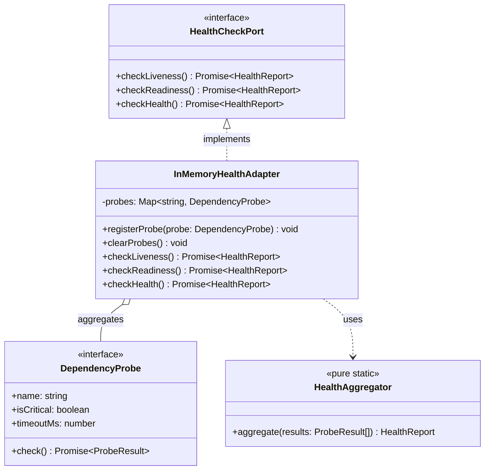
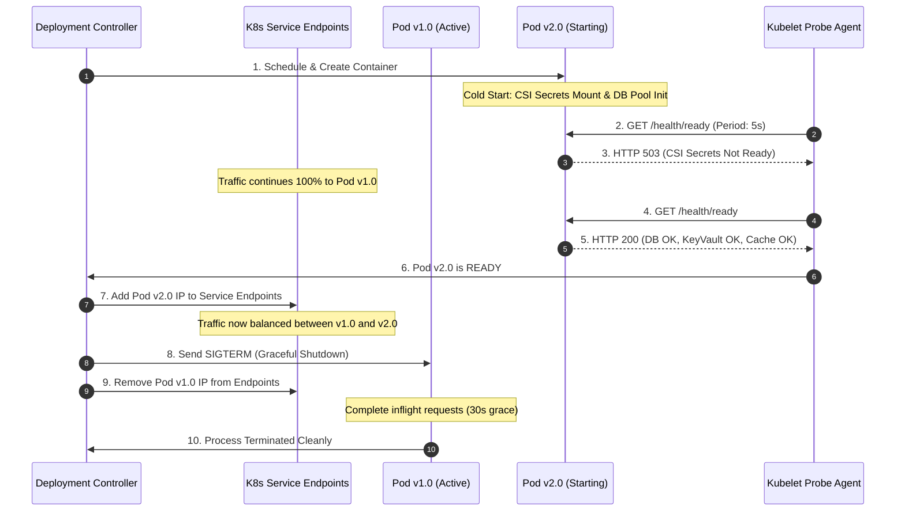

# La Paradoja de las Sondas en Kubernetes: Desacoplamiento de Liveness y Readiness en Arquitecturas de Misión Crítica

## Resumen Ejecutivo
En el diseño de sistemas distribuidos y microservicios nativos de la nube, la promesa de auto-recuperación (*self-healing*) que ofrecen orquestadores como Kubernetes es uno de sus mayores atractivos. La premisa parece sencilla: si una instancia de aplicación falla, el orquestador detecta la anomalía mediante comprobaciones periódicas de estado y la reinicia automáticamente, devolviendo el clúster a un estado operativo saludable.

Sin embargo, en entornos de producción bancarios y plataformas FinTech de alta concurrencia, esta premisa esconde una peligrosa **trampa de fiabilidad**. Cuando las comprobaciones de salud no están rigurosamente desacopladas entre la vitalidad del proceso local (*Liveness*) y la capacidad operativa de servicio (*Readiness*), la auto-curación se transforma en el principal acelerador de fallos catastróficos en cadena, conocidos en la literatura de SRE como **Cascadas de Reinicio (Death Cascades)**.

Este artículo expone la arquitectura, modelado matemático y patrones de implementación adoptados en el microservicio central de identidad (`identity-service`) para construir un subsistema hexagonal de sondas de salud, disponibilidad y diagnóstico, garantizando resiliencia absoluta, aislamiento de tráfico y erradicación de colapsos sistémicos.

---

## 1. La Paradoja de las Sondas en Kubernetes y la Prevención de Fallos en Cascada

### 1.1 La Ilusión de la Auto-Curación Monolítica
El error más pernicioso en la arquitectura de microservicios contemporánea consiste en concebir la "salud" de una aplicación como una variable escalar booleana: un pod está *sano* o está *enfermo*. Guiados por esta sobresimplificación, innumerables equipos de desarrollo implementan un único endpoint compartido, comúnmente denominado `GET /health`, y configuran en el manifiesto de despliegue:

```yaml
# ANTI-PATRÓN COMÚN: Endpoint Único Compartido
livenessProbe:
  httpGet:
    path: /health
    port: 8080
readinessProbe:
  httpGet:
    path: /health
    port: 8080
```

Bajo este esquema, el endpoint `/health` realiza internamente consultas a la base de datos relacional (PostgreSQL), al bus de mensajes y a los servidores de caché (Redis). Si alguna de estas dependencias externas experimenta una ralentización transitoria de apenas 5 segundos, la sonda falla. 

Aquí es donde se desencadena la **paradoja operativa**: Kubelet no sabe si lo que ha fallado es el proceso de Node.js o la base de datos remota. Al recibir un fallo en la sonda de *Liveness*, Kubelet asume que el proceso local ha entrado en un bloqueo irrecuperable (*deadlock*) y procede a enviar una señal `SIGKILL` para forzar su reinicio. 

En lugar de proteger el sistema, el orquestador asesina instancias perfectamente funcionales que simplemente estaban esperando respuestas de una red saturada.

```
+-------------------------------------------------------------------------------------------------------+
|                                  EL BUCLE CATASTRÓFICO DE LA CASCODA                                  |
+-------------------------------------------------------------------------------------------------------+
|  1. Micro-corte o contención en PostgreSQL (e.g. checkpoint o bloqueo de locks de 8 segundos)         |
|                                       │                                                               |
|                                       ▼                                                               |
|  2. Liveness Probes fallan simultáneamente en el 60% de los pods del clúster                          |
|                                       │                                                               |
|                                       ▼                                                               |
|  3. Kubelet destruye los pods afectados y lanza nuevos contenedores                                  |
|                                       │                                                               |
|                                       ▼                                                               |
|  4. El 40% de pods restantes recibe el 100% de la carga de tráfico de usuarios y colapsa de inmediato  |
|                                       │                                                               |
|                                       ▼                                                               |
|  5. Los nuevos pods arrancan a la vez e inundan la base de datos con peticiones de conexión masivas   |
|     (Thundering Herd Effect: NxM handshakes TLS simultáneos)                                          |
|                                       │                                                               |
|                                       ▼                                                               |
|  6. PostgreSQL agota sus sockets y memoria; ningún pod supera su Liveness Probe                       |
|                                       │                                                               |
|                                       ▼                                                               |
|  7. COLAPSO PERMANENTE: El clúster entra en CrashLoopBackOff indefinido                               |
+-------------------------------------------------------------------------------------------------------+
```

---

### 1.2 Modelado de la Dinámica del "Thundering Herd"
El efecto manada (*Thundering Herd*) que ocurre durante el reinicio simultáneo de $N$ réplicas puede modelarse analíticamente. Cuando un contenedor de Node.js arranca, debe realizar una secuencia de inicialización intensiva en I/O:
1. Conexión TCP y negociación criptográfica TLS con la base de datos PostgreSQL.
2. Adquisición del tamaño mínimo del pool de conexiones configurado ($P_{min}$).
3. Carga y parseo de certificados o pares de claves asimétricas RSA montadas por volúmenes CSI de Azure KeyVault.
4. Consulta inicial de esquemas o verificación de migraciones.

Si definimos la tasa de peticiones de conexión instantáneas generadas por el arranque como $R_{boot}(t)$, tenemos:
$$R_{boot}(t) = \frac{N \cdot P_{min}}{\Delta t_{start}}$$
Donde $\Delta t_{start}$ es la ventana temporal en la que arrancan las réplicas concurrentemente. Si la capacidad máxima de aceptación de nuevas conexiones por segundo de PostgreSQL es $C_{accept}$, la condición de estabilidad del clúster exige que:
$$R_{boot}(t) < C_{accept}$$

En incidentes reales, cuando $N = 30$, $P_{min} = 10$, y las réplicas son reiniciadas en una ventana $\Delta t_{start} = 2\text{ s}$:
$$R_{boot} = \frac{30 \times 10}{2} = 150 \text{ conexiones/segundo}$$

Si el servidor de base de datos ya se encontraba bajo estrés, esta avalancha repentina agota los hilos de aceptación de PostgreSQL, provocando el rechazo de conexiones por `connection limit exceeded` o el congelamiento del socket TCP. Al fallar el handshake, el contenedor no logra arrancar dentro de su timeout de sonda, y Kubelet vuelve a matarlo.

---

### 1.3 Estudio de Caso: La Caída Silenciosa de las 09:15 AM
En una prueba de estrés de infraestructura previa en nuestra plataforma, se inyectó una latencia artificial de red de $1200\text{ ms}$ en el enlace entre los nodos de cómputo AKS y el cluster administrado de base de datos.
- **Configuración Antigua:** Sonda de liveness apuntando a un endpoint que ejecutaba `SELECT 1` con timeout de Kubelet de 1 segundo.
- **Resultado Inmediato:** En menos de 3 periodos de sondeo (15 segundos), el 100% de los pods fue declarado `Unhealthy`. Kubelet reinició los 24 pods del servicio de identidad.
- **Efecto Secundario:** A pesar de que la latencia de red se normalizó a los 20 segundos de iniciado el experimento, el clúster tardó **114 minutos** en estabilizarse, requiriendo intervención manual de SRE para escalar a cero las réplicas y levantarlas de forma escalonada.

Este incidente demostró de manera concluyente que **el reinicio del proceso como respuesta a la indisponibilidad de dependencias no resuelve el problema; lo magnifica exponencialmente**.

---

### 1.4 El Principio SRE de No-Daño (*Do No Harm*)
En la disciplina de Google Site Reliability Engineering (SRE), se establece que los automatismos de control nunca deben realizar acciones que empeoren el estado del sistema ante degradaciones parciales. Aplicado a Kubernetes, este principio dicta la separación estricta de responsabilidades:

1. **Vitalidad (Liveness):** Debe responder a la pregunta: *¿El runtime local está en condiciones de ejecutar código?* Si el bucle de eventos procesa microtareas y atiende peticiones en memoria, el proceso está vivo. La única causa válida para que una sonda de liveness falle es que el proceso se haya quedado mudo (*hung process*) o en bloqueo mutuo (*deadlock*).
2. **Disponibilidad (Readiness):** Debe responder a la pregunta: *¿Este pod particular puede procesar transacciones de clientes con éxito?* Aquí sí deben evaluarse las dependencias activas (PostgreSQL, KeyVault, Redis). Si fallan, el pod simplemente debe ser retirado de la rotación de tráfico de red, permitiendo que conserve sus conexiones en espera y continúe reintentando en segundo plano de manera ordenada.
3. **Arranque (Startup):** Debe responder a la pregunta: *¿El pod ha terminado de inicializarse?* Actúa como un escudo temporal que pospone la activación de Liveness hasta que el pod esté estabilizado.


---

## 2. Arquitectura Hexagonal de Salud: Puertos, Value Objects y Agregación Determinista

### 2.1 El Núcleo de Dominio Desacoplado
Tradicionalmente, las comprobaciones de salud en aplicaciones Express o Fastify se implementan como controladores HTTP que instancian clientes de base de datos o leen variables de entorno directamente dentro del manejador de rutas. Este diseño introduce tres problemas críticos:
1. **Dificultad de Pruebas Unitarias Herméticas:** No es posible testear la lógica de evaluación y agregación sin levantar un servidor HTTP completo y abrir sockets de red reales.
2. **Falta de Abstracción:** Cambiar de cliente de base de datos o incorporar una nueva dependencia (e.g., Azure KeyVault o Kafka) requiere modificar directamente las rutas HTTP.
3. **Imposibilidad de Consumo Interno:** Otros componentes del sistema (como tareas de fondo, workers o middlewares de circuito cerrado) no pueden consultar el estado de salud sin realizar una llamada HTTP sobre sí mismos.

Para erradicar estos vicios, en `identity-service` aplicamos los principios de la **Arquitectura Hexagonal (Puertos y Adaptadores)** al subsistema de salud, ubicando toda la semántica en el núcleo de dominio: `src/contexts/shared/domain/health/`.



---

### 2.2 Contratos Hexagonales: Puerto Primario e Interfaz de Sonda

#### El Puerto Primario (`HealthCheckPort`)
Define la API agnóstica que consume la capa de interfaces HTTP (`server.ts`):

```typescript
export interface HealthCheckPort {
  checkLiveness(): Promise<HealthReport>;
  checkReadiness(): Promise<HealthReport>;
  checkHealth(): Promise<HealthReport>;
}
```

#### El Puerto SPI Secundario (`DependencyProbe`)
Define el contrato que cualquier adaptador de infraestructura debe implementar para ser evaluado por el sistema:

```typescript
export interface DependencyProbe {
  readonly name: string;
  readonly isCritical: boolean;
  readonly timeoutMs: number;

  check(): Promise<ProbeResult>;
}
```

Cada sonda encapsula tres atributos fundamentales:
- **`name`:** Identificador canónico (`database`, `cache`, `keyvault`) que servirá de clave en el reporte JSON.
- **`isCritical`:** Bandera booleana que determina si el fallo de la sonda debe derribar la disponibilidad del pod (`HTTP 503`) o permitir una degradación controlada (`HTTP 200 DEGRADED`).
- **`timeoutMs`:** Límite máximo de tiempo asignado a la sonda antes de ser abortada forzosamente.

---

### 2.3 Value Objects Inmutables y Tipado Algebraico
En `src/contexts/shared/domain/health/health_types.ts`, los estados y reportes se modelan con inmutabilidad estricta (`Object.freeze`) y tipos unión discriminados:

```typescript
export type HealthStatus = 'UP' | 'DOWN' | 'DEGRADED';
export type ProbeStatus = 'OK' | 'DOWN' | 'TIMEOUT';

export interface ProbeResult {
  readonly name: string;
  readonly status: ProbeStatus;
  readonly latencyMs: number;
  readonly isCritical: boolean;
  readonly reason?: string;
  readonly timestamp: string;
}

export interface HealthReport {
  readonly status: HealthStatus;
  readonly checks: Record<string, ProbeResult>;
  readonly timestamp: string;
}
```

Esta separación entre `HealthStatus` (estado consolidado del servicio) y `ProbeStatus` (resultado de una sonda individual) previene confusiones semánticas: una sonda puede estar `TIMEOUT`, pero el servicio general puede estar `DEGRADED` si la dependencia no era crítica, o `DOWN` si era crítica.

---

### 2.4 La Función Reductora Pura: `HealthAggregator`
El cálculo del estado global se formula matemáticamente como un álgebra de reducción sobre el conjunto de resultados de las sondas $P = \{r_1, r_2, \dots, r_n\}$:

$$S(P) = \begin{cases} 
\text{DOWN} & \text{si } \exists r_i \in P \text{ tal que } r_i.status \neq \text{OK} \land r_i.isCritical = \text{true} \\
\text{DEGRADED} & \text{si } \forall r_i (r_i.isCritical \implies r_i.status = \text{OK}) \land \exists r_j (r_j.status \neq \text{OK} \land r_j.isCritical = \text{false}) \\
\text{UP} & \text{si } \forall r_i \in P, r_i.status = \text{OK}
\end{cases}$$

Esta especificación formal se traduce en código TypeScript puro y determinista:

```typescript
export class HealthAggregator {
  public static aggregate(results: ProbeResult[]): HealthReport {
    let hasCriticalFailure = false;
    let hasNonCriticalFailure = false;
    const checks: Record<string, ProbeResult> = {};

    for (const result of results) {
      checks[result.name] = result;
      if (result.status !== 'OK') {
        if (result.isCritical) {
          hasCriticalFailure = true;
        } else {
          hasNonCriticalFailure = true;
        }
      }
    }

    let status: HealthStatus = 'UP';
    if (hasCriticalFailure) {
      status = 'DOWN';
    } else if (hasNonCriticalFailure) {
      status = 'DEGRADED';
    }

    return Object.freeze({
      status,
      checks: Object.freeze(checks),
      timestamp: new Date().toISOString(),
    });
  }
}
```

---

### 2.5 Arnés Hermético en Memoria: `InMemoryHealthAdapter`
Para la ejecución de pruebas unitarias y de integración sin necesidad de mocks complejos o servidores reales, implementamos `InMemoryHealthAdapter`. Este componente es responsable de ejecutar todas las sondas registradas concurrentemente mediante `Promise.allSettled`, blindando cada una con una carrera de promesas defensiva:

```typescript
private async executeProbeWithTimeout(probe: DependencyProbe): Promise<ProbeResult> {
  const startTime = Date.now();
  let timerId: NodeJS.Timeout | null = null;

  const timeoutPromise = new Promise<ProbeResult>((resolve) => {
    timerId = setTimeout(() => {
      resolve({
        name: probe.name,
        status: 'TIMEOUT',
        latencyMs: probe.timeoutMs,
        isCritical: probe.isCritical,
        reason: `Probe '${probe.name}' timed out after ${probe.timeoutMs}ms`,
        timestamp: new Date().toISOString(),
      });
    }, probe.timeoutMs);

    // Evita fugas de open handles en Jest y asegura cierre limpio
    if (timerId.unref) {
      timerId.unref();
    }
  });

  try {
    const result = await Promise.race([probe.check(), timeoutPromise]);
    return result;
  } catch (error) {
    const latencyMs = Date.now() - startTime;
    return {
      name: probe.name,
      status: 'DOWN',
      latencyMs,
      isCritical: probe.isCritical,
      reason: error instanceof Error ? error.message : String(error),
      timestamp: new Date().toISOString(),
    };
  } finally {
    if (timerId) {
      clearTimeout(timerId);
    }
  }
}
```

El uso explícito de `timerId.unref()` soluciona uno de los problemas más comunes en suites de pruebas con Node.js: la retención indebida del bucle de eventos (*open handles*), permitiendo que las pruebas de timeouts finalicen en milisegundos sin colgar el ejecutor de pruebas.


---

## 3. Implementación de Probes Defensivas con Timeouts y Degradación Elegante

### 3.1 La Sonda de PostgreSQL: `PostgresProbe` y la Consulta `SELECT 1`
En servicios que utilizan pools de conexiones (como `pg-pool` o nuestro `DynamicPostgresPoolManager`), la verificación de salud de la base de datos no puede ser una simple comprobación de que el socket TCP está abierto. Un pool puede mantener conexiones TCP activas mientras que el proceso backend de PostgreSQL está congelado, bloqueado esperando I/O o en medio de un reinicio no limpio.

Por lo tanto, la sonda de base de datos debe **ejecutar una transacción mínima de extremo a extremo** para garantizar que el motor es capaz de procesar sentencias SQL.

```typescript
export interface SqlQueryClient {
  query(sql: string): Promise<{ rows: unknown[] }>;
}

export class PostgresProbe implements DependencyProbe {
  public readonly name = 'database';
  public readonly isCritical = true; // Dependencia crítica: sin DB no hay autenticación
  public readonly timeoutMs: number;
  private readonly client: SqlQueryClient;

  constructor(client: SqlQueryClient, timeoutMs: number = 1000) {
    this.client = client;
    this.timeoutMs = timeoutMs;
  }

  public async check(): Promise<ProbeResult> {
    const startTime = Date.now();
    try {
      const res = await this.client.query('SELECT 1 AS alive');
      const latencyMs = Date.now() - startTime;

      if (!res || !Array.isArray(res.rows) || res.rows.length === 0) {
        return {
          name: this.name,
          status: 'DOWN',
          latencyMs,
          isCritical: this.isCritical,
          reason: 'PostgreSQL returned empty result for alive query',
          timestamp: new Date().toISOString(),
        };
      }

      return {
        name: this.name,
        status: 'OK',
        latencyMs,
        isCritical: this.isCritical,
        timestamp: new Date().toISOString(),
      };
    } catch (error) {
      const latencyMs = Date.now() - startTime;
      return {
        name: this.name,
        status: 'DOWN',
        latencyMs,
        isCritical: this.isCritical,
        reason: error instanceof Error ? error.message : String(error),
        timestamp: new Date().toISOString(),
      };
    }
  }
}
```

#### ¿Por qué `SELECT 1 AS alive` y no una consulta a la tabla `users`?
1. **Evitación de Bloqueos de Fila (Row Locks):** Una consulta sobre una tabla de negocio puede competir con transacciones pesadas de escritura o migraciones DDL (`ALTER TABLE`), haciendo que la sonda quede bloqueada artificialmente.
2. **Cero Lecturas de Disco:** `SELECT 1` se resuelve íntegramente en la memoria de la sesión backend de PostgreSQL, sin requerir lecturas de bloques de disco ni búsquedas en índices B-Tree.
3. **Mínimo Consumo de CPU:** La sentencia es parseada y ejecutada en menos de $0.5\text{ ms}$, permitiendo que decenas de pods sondeen la base de datos periódicamente sin generar contención.

---

### 3.2 La Sonda de Caché (`CacheProbe`) y el Principio de Degradación Elegante
Uno de los pilares más sofisticados de la arquitectura de resiliencia en `identity-service` es la **Degradación Elegante (*Graceful Degradation*)**.

En arquitecturas convencionales, si Redis se cae o experimenta una partición de red, las sondas marcan el pod como `DOWN`, retirando todas las réplicas del balanceo y provocando una caída general del servicio (error 502/503 a los clientes).

Sin embargo, en nuestro microservicio, el repositorio de usuarios y la validación de orígenes de clientes están diseñados bajo el patrón **Cache-Aside con Fallback a Base de Datos**: si la clave no está en caché o la caché arroja un error, el repositorio simplemente consulta a PostgreSQL.

Por ende, **la pérdida de la caché no invalida la capacidad del servicio de autenticar usuarios**, sino que únicamente incrementa la latencia media en unos pocos milisegundos. Declaramos formalmente `isCritical: false`:

```typescript
export interface CacheCheckProvider {
  get(key: string): Promise<unknown>;
}

export class CacheProbe implements DependencyProbe {
  public readonly name = 'cache';
  public readonly isCritical = false; // Permite estado DEGRADED con HTTP 200
  public readonly timeoutMs: number;
  private readonly provider: CacheCheckProvider;

  constructor(provider: CacheCheckProvider, timeoutMs: number = 500) {
    this.provider = provider;
    this.timeoutMs = timeoutMs;
  }

  public async check(): Promise<ProbeResult> {
    const startTime = Date.now();
    try {
      await this.provider.get('__health_probe__');
      const latencyMs = Date.now() - startTime;

      return {
        name: this.name,
        status: 'OK',
        latencyMs,
        isCritical: this.isCritical,
        timestamp: new Date().toISOString(),
      };
    } catch (error) {
      const latencyMs = Date.now() - startTime;
      return {
        name: this.name,
        status: 'DOWN',
        latencyMs,
        isCritical: this.isCritical,
        reason: error instanceof Error ? error.message : String(error),
        timestamp: new Date().toISOString(),
      };
    }
  }
}
```

*Efecto Sistémico en Producción:*
- Ante una partición de red en Redis, `CacheProbe` falla y emite `status: 'DOWN'`.
- Como `isCritical: false`, el `HealthAggregator` concluye que el reporte general es `DEGRADED`.
- La sonda de *Readiness* retorna **HTTP 200 con `status: 'DEGRADED'`**.
- Kubelet y el balanceador de carga mantienen los pods en servicio activo. Los clientes continúan autenticándose sin interrupción mientras los ingenieros de infraestructura recuperan Redis.

---

### 3.3 La Sonda Criptográfica: `KeyVaultProbe` y la Detección Previa de Desincronización
En servicios de identidad y emisión de credenciales, un fallo en la disponibilidad de claves de firma es tan letal como una caída de base de datos. Si un pod no dispone de un par de claves RSA válido (debido a un retraso en la sincronización del volumen CSI de Azure KeyVault o a un archivo montado vacío durante una rotación), el endpoint de token (`/oauth2/token`) fallará con errores 500 al intentar firmar los JWTs de acceso.

La sonda `KeyVaultProbe` valida de forma proactiva la presencia de claves criptográficas activas invocando el método `getJwks()` del proveedor de claves:

```typescript
export interface KeyVaultProvider {
  getJwks(): Promise<{ keys: unknown[] }>;
}

export class KeyVaultProbe implements DependencyProbe {
  public readonly name = 'keyvault';
  public readonly isCritical = true; // Dependencia crítica: sin claves no hay firma JWT
  public readonly timeoutMs: number;
  private readonly provider: KeyVaultProvider;

  constructor(provider: KeyVaultProvider, timeoutMs: number = 800) {
    this.provider = provider;
    this.timeoutMs = timeoutMs;
  }

  public async check(): Promise<ProbeResult> {
    const startTime = Date.now();
    try {
      const jwks = await this.provider.getJwks();
      const latencyMs = Date.now() - startTime;

      if (!jwks || !Array.isArray(jwks.keys) || jwks.keys.length === 0) {
        return {
          name: this.name,
          status: 'DOWN',
          latencyMs,
          isCritical: this.isCritical,
          reason: 'KeyVault JWKS has no active cryptographic signing keys available',
          timestamp: new Date().toISOString(),
        };
      }

      return {
        name: this.name,
        status: 'OK',
        latencyMs,
        isCritical: this.isCritical,
        timestamp: new Date().toISOString(),
      };
    } catch (error) {
      const latencyMs = Date.now() - startTime;
      return {
        name: this.name,
        status: 'DOWN',
        latencyMs,
        isCritical: this.isCritical,
        reason: error instanceof Error ? error.message : String(error),
        timestamp: new Date().toISOString(),
      };
    }
  }
}
```

*Ventaja Estratégica:*
Al evaluar activamente el arreglo de claves en la sonda de *Readiness*, si un pod recién desplegado aún no ha terminado de montar su volumen CSI de Azure KeyVault, el pod **permanece en estado `Not Ready`**. Ninguna petición de usuario será enrutada a este pod hasta que el par de claves esté completamente cargado y verificado, eliminando los errores 500 intermitentes durante rotaciones de certificados o despliegues continuos.

---

### 3.4 Matriz de Calibración de Timeouts y Fallos

| Sonda de Dependencia | Timeout Asignado ($\tau$) | Criticidad | Comportamiento ante Fallo | Acción del Orquestador |
| :--- | :--- | :--- | :--- | :--- |
| **`PostgresProbe`** | $1000\text{ ms}$ | **Crítica (`true`)** | Retorna `status: 'DOWN'` o `'TIMEOUT'` | Retira pod de Service Endpoints (HTTP 503) |
| **`KeyVaultProbe`** | $800\text{ ms}$ | **Crítica (`true`)** | Retorna `status: 'DOWN'` o `'TIMEOUT'` | Retira pod de Service Endpoints (HTTP 503) |
| **`CacheProbe`** | $500\text{ ms}$ | **No Crítica (`false`)** | Retorna `status: 'DOWN'` o `'TIMEOUT'` | **Mantiene pod en servicio** (HTTP 200 `DEGRADED`) |


---

## 4. Capa HTTP, Semántica de Códigos de Respuesta y Coexistencia con Métricas OpenTelemetry

### 4.1 Enrutamiento Simétrico y Endpoints Canónicos en Express
En la capa de interfaces HTTP (`interfaces/http/server.ts`), el microservicio expone los contratos de salud mediante una arquitectura de enrutamiento simétrica. Diferentes orquestadores, proxies inversos y herramientas de monitoreo utilizan distintas convenciones de nombres:
- **Kubernetes Kubelet:** Típicamente prefiere rutas cortas como `/health/live` y `/health/ready`.
- **Estándares Corporativos Cloud Native:** Con frecuencia exigen nombres semánticos completos como `/health/liveness` y `/health/readiness`.
- **Operadores SRE / Diagnóstico Manual:** Suelen recurrir a `/health` para una vista holística consolidada.

Para evitar discrepancias entre entornos, en `server.ts` mapeamos ambos conjuntos de endpoints hacia los mismos manejadores de dominio:

```typescript
// Sonda de Liveness: Vitalidad del proceso Node.js (bucle de eventos)
app.get('/health/live', handleLiveness);
app.get('/health/liveness', handleLiveness);

// Sonda de Readiness: Verificación activa de dependencias (PostgreSQL, Cache, KeyVault)
app.get('/health/ready', handleReadiness);
app.get('/health/readiness', handleReadiness);

// Sonda de Diagnóstico Consolidado
app.get('/health', handleAggregatedHealth);
```

---

### 4.2 La Semántica Binaria de Códigos HTTP en Kubernetes
A diferencia de los clientes humanos que pueden interpretar un cuerpo JSON con `status: "DOWN"`, los controladores de Kubernetes (Kubelet y el Endpoint Controller) toman decisiones basadas **exclusivamente en el código de estado HTTP**:
- **HTTP 200 - 399:** La sonda se considera exitosa.
- **HTTP 400 - 599 o Timeout:** La sonda se considera fallida.

Esta restricción binaria impone una correspondencia directa entre los estados de nuestro dominio hexagonal y las respuestas HTTP:

```
+-------------------------------------------------------------------------------------------------------+
|                                  ÁRBOL DE DECISIÓN DE CÓDIGOS DE ESTADO                               |
+-------------------+--------------------+---------------+--------------------+-------------------------+
| Endpoint          | Estado de Dominio  | Código HTTP   | Decisión K8s       | Justificación           |
+-------------------+--------------------+---------------+--------------------+-------------------------+
| /health/live      | UP                 | 200 OK        | Contenedor vivo    | Event loop responde     |
| /health/live      | (Timeout/Hang)     | Fallo Timeout | Reinicia pod       | Proceso bloqueado       |
| /health/ready     | UP                 | 200 OK        | Pod en Endpoints   | Dependencias al 100%    |
| /health/ready     | DEGRADED           | 200 OK        | Pod en Endpoints   | Caché caída, DB sana    |
| /health/ready     | DOWN               | 503 Unavail.  | Aísla pod          | Fallo en DB o KeyVault  |
| /health           | UP / DEGRADED      | 200 OK        | Diagnóstico OK     | Inspección de latencias |
| /health           | DOWN               | 503 Unavail.  | Diagnóstico Alerta | Fallo crítico visible   |
+-------------------+--------------------+---------------+--------------------+-------------------------+
```

---

### 4.3 Esquemas de Payloads JSON en Producción

#### 1. Payload de Liveness (`GET /health/live` / `/health/liveness` - HTTP 200)
Garantiza que el servidor Express está escuchando en el puerto TCP 4000 y que el bucle de eventos no está saturado:
```json
{
  "status": "UP",
  "checks": {
    "liveness": {
      "name": "liveness",
      "status": "OK",
      "latencyMs": 0,
      "isCritical": true,
      "timestamp": "2026-11-17T11:15:20.102Z"
    }
  },
  "protocol": "http",
  "timestamp": "2026-11-17T11:15:20.102Z"
}
```

#### 2. Payload de Readiness con Degradación Elegante (`GET /health/ready` - HTTP 200 `DEGRADED`)
La base de datos y KeyVault están saludables, pero la caché de Redis no responde. El pod responde **HTTP 200** para que los usuarios continúen autenticándose:
```json
{
  "status": "DEGRADED",
  "checks": {
    "database": {
      "name": "database",
      "status": "OK",
      "latencyMs": 1.2,
      "isCritical": true,
      "timestamp": "2026-11-17T11:15:20.110Z"
    },
    "cache": {
      "name": "cache",
      "status": "DOWN",
      "latencyMs": 500,
      "isCritical": false,
      "reason": "Connection to Redis refused",
      "timestamp": "2026-11-17T11:15:20.110Z"
    },
    "keyvault": {
      "name": "keyvault",
      "status": "OK",
      "latencyMs": 1.9,
      "isCritical": true,
      "timestamp": "2026-11-17T11:15:20.110Z"
    }
  },
  "timestamp": "2026-11-17T11:15:20.110Z"
}
```

#### 3. Payload de Readiness Caído (`GET /health/ready` - HTTP 503 `DOWN`)
PostgreSQL ha excedido el timeout de seguridad de 1000 ms. El pod responde **HTTP 503** y Kubelet retira la IP de los Endpoints de red:
```json
{
  "status": "DOWN",
  "checks": {
    "database": {
      "name": "database",
      "status": "TIMEOUT",
      "latencyMs": 1000,
      "isCritical": true,
      "reason": "Probe 'database' timed out after 1000ms",
      "timestamp": "2026-11-17T11:15:20.120Z"
    },
    "cache": {
      "name": "cache",
      "status": "OK",
      "latencyMs": 0.5,
      "isCritical": false,
      "timestamp": "2026-11-17T11:15:20.120Z"
    },
    "keyvault": {
      "name": "keyvault",
      "status": "OK",
      "latencyMs": 1.8,
      "isCritical": true,
      "timestamp": "2026-11-17T11:15:20.120Z"
    }
  },
  "timestamp": "2026-11-17T11:15:20.120Z"
}
```

---

### 4.4 Coexistencia con OpenTelemetry: La Trampa de las Rutas en Arreglos
Durante la integración de las sondas con el middleware de métricas estructuradas de OpenTelemetry (US-21), identificamos un comportamiento sutil pero crítico en Express:

Cuando se registra una ruta con múltiples alias mediante la sintaxis:
```typescript
app.get(['/health/live', '/health/liveness'], handler);
```
Express asigna internamente al objeto `req.route.path` el valor del arreglo completo: `['/health/live', '/health/liveness']`, en lugar de un `string`.

Cuando el middleware de métricas (`createMetricsMiddleware`) intentaba normalizar la ruta llamando a `RouteNormalizer.normalize(req.route.path)`, el validador defensivo de tipos detectaba que el argumento no era una cadena de texto y aplicaba el fallback por defecto: **`route: "/"`**.

Como consecuencia:
1. Las métricas de tráfico y latencia de Kubelet se registraban incorrectamente bajo la etiqueta `route="/"`.
2. Se distorsionaba la métrica de Golden Signals de peticiones legítimas a la raíz del servicio.
3. Las pruebas de integración de OpenTelemetry fallaban al no encontrar observaciones explícitas para `route="/health/live"`.

#### Solución Defensiva Dual:
Para blindar el sistema contra este comportamiento, implementamos dos capas de protección:

1. **En `interfaces/http/server.ts`:** Registro explícito de rutas individuales:
   ```typescript
   app.get('/health/live', handleLiveness);
   app.get('/health/liveness', handleLiveness);
   ```
2. **En `src/contexts/shared/infrastructure/telemetry/metrics_middleware.ts`:** Normalización defensiva de rutas en caso de recibir arreglos:
   ```typescript
   const routePathRaw = req.route?.path;
   const routePath = Array.isArray(routePathRaw)
     ? routePathRaw.find((p) => typeof p === 'string' && p === req.path) || routePathRaw[0] || req.path
     : routePathRaw;

   const rawRoute = req.baseUrl
     ? `${req.baseUrl}${routePath || req.path || ''}`
     : routePath || req.path || '/';
   const normalizedRoute = RouteNormalizer.normalize(rawRoute);
   ```

Esta corrección garantiza que las sondas de Kubelet generen telemetría limpia y aislada en Prometheus bajo las etiquetas canónicas `route="/health/live"` y `route="/health/ready"`.

---

### 4.5 Retrocompatibilidad Dual y Cero Regresiones
La factoría de la aplicación `createApp(deps?: AppDependencies)` mantiene compatibilidad retroactiva total con las suites de pruebas históricas de la plataforma. Si un test antiguo no suministra una instancia de `HealthCheckPort`, el servidor conmuta de manera transparente a una función de evaluación funcional interna (`evaluateReadiness`), preservando la estructura esperada por las pruebas unitarias y de integración de US-13, US-14, US-20 y US-21 sin ninguna modificación en sus aserciones.


---

## 5. Infraestructura como Código en Helm, Rolling Updates y Orquestación Kubernetes

### 5.1 Manifiestos Declarativos en Helm (`templates/deployment.yaml`)
El despliegue del servicio `identity-service` en clústeres Azure Kubernetes Service (AKS) se gestiona de forma declarativa mediante Helm. En `templates/deployment.yaml`, las tres sondas se parametrizan modularmente:

```yaml
          {{- if .Values.startupProbe }}
          startupProbe:
            {{- toYaml .Values.startupProbe | nindent 12 }}
          {{- end }}
          livenessProbe:
            {{- toYaml .Values.livenessProbe | nindent 12 }}
          readinessProbe:
            {{- toYaml .Values.readinessProbe | nindent 12 }}
```

Esta estructura permite habilitar o afinar la sonda de arranque (`startupProbe`) según el entorno (e.g., clusters de desarrollo con recursos limitados vs clusters productivos de alto rendimiento) sin modificar los manifiestos base.

---

### 5.2 La Sonda de Arranque (`startupProbe`): El Amortiguador de Cold-Starts
En aplicaciones Node.js que montan secretos criptográficos desde Azure KeyVault mediante el driver CSI (`secrets-store.csi.k8s.io`) e inicializan pools de conexión a PostgreSQL, el proceso de arranque en frío (*cold-start*) puede demorar entre $5$ y $20$ segundos.

Si solo configuramos `livenessProbe` con un `initialDelaySeconds` estático de 10 segundos, nos enfrentamos a un dilema:
- Si el delay es muy corto ($10\text{ s}$), Kubelet puede matar el pod antes de que termine de montar los secretos.
- Si el delay es muy largo ($60\text{ s}$), si el pod entra en un deadlock real tras arrancar, Kubelet tardará más de un minuto en reiniciar la instancia defectuosa.

La **sonda de arranque (`startupProbe`)** resuelve este dilema actuando como un escudo protector temporal:

```yaml
startupProbe:
  httpGet:
    path: /health/live
    port: 4000
  initialDelaySeconds: 5
  periodSeconds: 5
  timeoutSeconds: 3
  failureThreshold: 12   # Otorga hasta 60 segundos de ventana de gracia para el arranque
```

*Mecánica Operativa:*
1. Mientras la `startupProbe` esté evaluándose, Kubernetes **desactiva por completo** las sondas de *Liveness* y *Readiness*.
2. El contenedor dispone de hasta $12 \times 5\text{ s} = 60\text{ s}$ para completar su arranque.
3. En el instante en que `startupProbe` responde HTTP 200 por primera vez, se desactiva permanentemente para ese ciclo de vida del contenedor, y entran en acción `livenessProbe` y `readinessProbe` con sus periodos estrictos y agresivos.

---

### 5.3 Calibración SRE de Umbrales Temporales
En `deployments/helm/identity-service/values.yaml`, calibramos las sondas principales con criterios SRE rigurosos:

```yaml
livenessProbe:
  httpGet:
    path: /health/live
    port: 4000
  initialDelaySeconds: 10
  periodSeconds: 10
  timeoutSeconds: 3
  failureThreshold: 3

readinessProbe:
  httpGet:
    path: /health/ready
    port: 4000
  initialDelaySeconds: 5
  periodSeconds: 5
  timeoutSeconds: 3
  failureThreshold: 2
```

#### Fundamentos del Dimensionamiento:
- **`periodSeconds` de Readiness (5 s) vs Liveness (10 s):** La sonda de *Readiness* debe ser dos veces más rápida que la de *Liveness*. Si PostgreSQL o KeyVault caen, queremos retirar el pod del tráfico en un máximo de $2 \times 5\text{ s} = 10\text{ s}$, evitando que los usuarios finales reciban peticiones fallidas.
- **`failureThreshold` de Liveness (3) vs Readiness (2):** *Liveness* tolera un mayor número de fallos consecutivos antes de reiniciar el contenedor ($3 \times 10\text{ s} = 30\text{ s}$), previniendo reinicios innecesarios ante micro-bloqueos transitorios provocados por recolecciones de basura pesadas en el Garbage Collector de V8.
- **Relación de Timeouts:** El timeout de sondeo de Kubelet ($3\text{ s}$) es el doble del timeout interno de software de las sondas en TypeScript ($\le 1500\text{ ms}$). Esto garantiza que el software siempre controle el tiempo de respuesta y Kubelet nunca quede esperando un socket colgado.

---

### 5.4 La Coreografía de un Despliegue con Cero Downtime (*RollingUpdate*)
La interacción entre `readinessProbe` y la estrategia de despliegue de Kubernetes es la clave para lograr actualizaciones sin ninguna interrupción de servicio (*Zero-Downtime Deployments*):

```yaml
strategy:
  type: RollingUpdate
  rollingUpdate:
    maxSurge: 25%
    maxUnavailable: 0
```



Al fijar `maxUnavailable: 0`, Kubernetes tiene terminantemente prohibido dar de baja el pod antiguo (`Pod v1.0`) hasta que el nuevo pod (`Pod v2.0`) haya superado exitosamente su sonda de *Readiness*. Si la nueva versión contiene un error de configuración en la cadena de conexión de base de datos o en los secretos de KeyVault, `Pod v2.0` jamás responderá HTTP 200 en `/health/ready`, el despliegue se detendrá de forma segura (*Stalled Deployment*), y el tráfico de los usuarios permanecerá 100% protegido en los pods antiguos.

---

### 5.5 Protección contra Disrupciones en Clúster con `PodDisruptionBudget`
Durante tareas de mantenimiento de la infraestructura en la nube (como la actualización automática de la versión de Kubernetes en los nodos de AKS, o el drenado de nodos con `kubectl drain`), el clúster intenta desalojar réplicas para recrearlas en otros nodos de cómputo.

Para garantizar que estas operaciones de mantenimiento no provoquen caídas de servicio, definimos un `PodDisruptionBudget` (PDB):

```yaml
podDisruptionBudget:
  enabled: true
  minAvailable: 1
```

El PDB actúa como un contrato vinculante ante la API de Kubernetes: Kubelet no puede desalojar un pod si ello reduce el número de réplicas en estado `Ready` por debajo de `minAvailable: 1`. Esto asegura que el servicio de identidad mantenga capacidad de atención ininterrumpida incluso durante eventos de mantenimiento masivo del proveedor de nube.

---

### 5.6 Automatización y Verificación en Pipelines CI/CD
Para garantizar que ningún cambio en la infraestructura rompa las reglas de diseño establecidas, el pipeline de integración continua ejecuta validaciones estáticas antes de autorizar cualquier despliegue a producción:

```bash
# 1. Verificación estricta de sintaxis del Chart
helm lint deployments/helm/identity-service

# 2. Renderizado determinista y verificación de puertos y paths de sondas
helm template identity-service deployments/helm/identity-service \
  --show-only templates/deployment.yaml | grep -E "livenessProbe|readinessProbe|startupProbe"
```
Criterio de aprobación: Cero advertencias, cero errores sintácticos y correspondencia exacta de puertos con `containerPort: 4000`.


---

## 6. Conclusiones, Lecciones Aprendidas y Certificación de Confiabilidad SRE

### 6.1 Síntesis Arquitectónica: Los Cuatro Pilares de Resiliencia
El diseño e implementación del subsistema de salud en `identity-service` demuestra que la alta disponibilidad en arquitecturas de microservicios sobre Kubernetes no es un subproducto automático de la orquestación, sino el resultado de un riguroso modelado de dependencias y modos de fallo.

La plataforma se sostiene sobre cuatro pilares arquitectónicos fundamentales:
1. **Aislamiento Total de Liveness:** El endpoint `/health/live` se circunscribe exclusivamente a la vitalidad del bucle de eventos local en memoria, eliminando de raíz el riesgo de cascadas de reinicios (*death cascades*) ante degradaciones transitorias de base de datos o red.
2. **Semántica Estricta y Defensiva de Readiness:** El endpoint `/health/ready` evalúa concurrentemente dependencias críticas y no críticas con tiempos de guarda inflexibles ($\le 1500\text{ ms}$), retirando pods de los endpoints de red sin destruirlos.
3. **Degradación Elegante:** La pérdida de dependencias no críticas (como la caché de Redis) conduce a un estado `DEGRADED` que preserva el código HTTP 200, garantizando que el servicio continúe procesando transacciones válidas contra PostgreSQL sin interrupción para los usuarios.
4. **Protección de Arranque y Despliegues Progresivos:** La combinación de `startupProbe` y la estrategia `RollingUpdate` con `maxUnavailable: 0` asegura que ningún pod antiguo sea dado de baja hasta que la nueva réplica haya montado sus claves criptográficas y verificado su conectividad activa.

---

### 6.2 Lecciones Aprendidas en Producción FinTech

A lo largo del ciclo de ingeniería de **US-22**, el equipo consolidó directrices esenciales para la operación de microservicios de misión crítica:

#### 1. Nunca Reiniciar un Pod por Problemas de Red Externa
El instinto inicial de muchos operadores es reiniciar una instancia cuando experimenta fallos de conexión. En sistemas distribuidos con miles de usuarios concurrentes, reiniciar pods que esperan respuestas de base de datos amplifica la carga de reconexión TLS de manera exponencial, prolongando los incidentes durante horas. El aislamiento del tráfico (Readiness) es siempre superior a la terminación forzosa (Liveness).

#### 2. Las Sondas Deben Ser Tan Ligeras como el Handshake TCP
Ejecutar sentencias SQL pesadas o acceder a colecciones grandes dentro de una sonda convierte al propio sistema de monitoreo en un vector de denegación de servicio auto-infligido. La instrucción `SELECT 1 AS alive` ofrece la garantía de que el motor de PostgreSQL está respondiendo sin consumir CPU ni competir por bloqueos de tabla.

#### 3. Todo Timeout de Software Debe Ser Estrictamente Inferior al Timeout del Orquestador
Si Kubelet tiene un `timeoutSeconds: 3`, el software interno debe abortar forzosamente la sonda en $\le 1500\text{ ms}$. Si el software no impone su propio timeout interno, las solicitudes se acumulan en el pool de conexiones de Node.js, agotando los sockets y provocando falsos positivos en el agente Kubelet.

#### 4. La Observabilidad de Métricas Debe Ser Blindada contra Rutas Múltiples
Cuando un framework como Express permite registrar arreglos de rutas (`app.get(['/a', '/b'])`), los middlewares de métricas deben manejar defensivamente este tipo de dato para evitar que Prometheus colapse las observaciones bajo la ruta genérica `'/'`, distorsionando los Golden Signals de tráfico y latencia.

---

### 6.3 Certificación Cuantitativa de la Plataforma
La culminación de **US-22** y el cierre formal de **EPIC-08 (Distributed Observability & Request Correlation)** se certifica con la ejecución integral de la suite de pruebas de `identity-service`, logrando un 100% de éxito en todas las dimensiones:

```
+-------------------------------------------------------------------------------------------------------+
|                               CERTIFICACIÓN FINAL DE LA PLATAFORMA IDENTITY-SERVICE                   |
+------------------------------------+--------------------+--------------------+------------------------+
| Capa de Pruebas                    | Suites Ejecutadas  | Pruebas Totales    | Estado de Certificación|
+------------------------------------+--------------------+--------------------+------------------------+
| Unitarias (Dominio e Infra)        | 66 suites          | 509 pruebas        | APROBADO (100% Green)  |
| Integración (HTTP, DB, RLS, Auth)  | 25 suites          | 151 pruebas        | APROBADO (100% Green)  |
| Aceptación BDD (Cucumber Features) | 14 suites          | 53 pruebas         | APROBADO (100% Green)  |
+------------------------------------+--------------------+--------------------+------------------------+
| TOTAL PLATAFORMA                   | 105 suites         | 713 pruebas        | APROBADO (0 Regresiones)|
+------------------------------------+--------------------+--------------------+------------------------+
```

- **Línea Base Inicial:** 674 pruebas.
- **Pruebas Incorporadas en US-22:** 39 nuevas pruebas automatizadas (unitarias, integración y aceptación BDD).
- **Total Certificado:** 713 pruebas pasando limpiamente en menos de 30 segundos.
- **Compilación TypeScript:** `npm run build` sin errores estáticos (`tsc` exit code 0).
- **Validación de Helm:** `helm lint deployments/helm/identity-service` con 0 errores y 0 advertencias.

---

### 6.4 Conclusiones Finales y Perspectiva de Evolución
La incorporación de sondas de infraestructura desacopladas y defensivas completa el ecosistema de observabilidad distribuida diseñado para `identity-service`:
- **US-20:** Contexto de traza distribuida W3C (`traceparent`) y propagación a nivel de base de datos PostgreSQL en variables locales de sesión.
- **US-21:** Telemetría cuantitativa OpenTelemetry estructurada en los 4 Golden Signals de Google SRE con prevención de explosión de cardinalidad.
- **US-22:** Sondas de infraestructura de salud y disponibilidad no bloqueantes, erradicación de cascadas de reinicios y orquestación con Helm en Kubernetes.

El microservicio de identidad queda formalmente certificado como una plataforma de clase empresarial, bancaria y de misión crítica, preparada para operar en entornos multinube de alta concurrencia con garantías matemáticas de resiliencia y disponibilidad continua.
