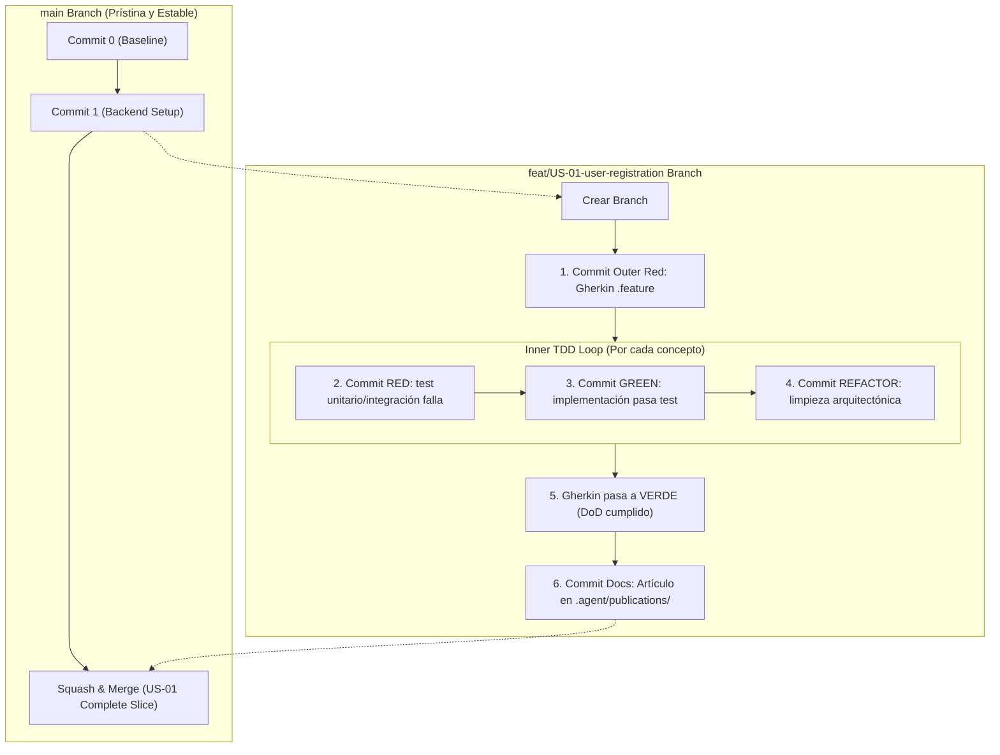
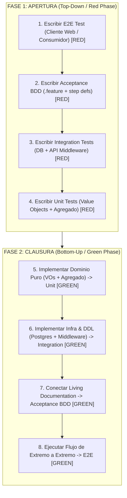

# Reglas del Ciclo de Desarrollo: Double-Loop TDD & Git Flow — Identity Service

Este documento establece el estándar obligatorio de ingeniería para el ciclo de desarrollo, la disciplina de pruebas (**Double-Loop TDD / ATDD**), la estrategia de ramas y la política de commits y merges en el repositorio `identity-service`.

---

## 1. Visión General: Double-Loop TDD y Squash Merging

El flujo de trabajo desacopla la **trazabilidad forense del proceso TDD** (que vive en la rama de la User Story) de la **limpieza y estabilidad de la rama principal** (`main`).



---

## 2. Estrategia de Ramas (Branching Strategy)

1. **Rama Base:** `main` siempre representa código compilable, con el 100% de tests pasando y documentación pública actualizada.
2. **Feature Branch por User Story:**
   - Toda implementación de una historia de usuario se desarrolla en su propia rama dedicada que nace de `main`:

     ```bash
     git checkout main
     git checkout -b feat/<US-ID>-<slug-descriptivo>
     # Ejemplo:
     git checkout -b feat/US-01-user-registration
     ```

3. **Estrategia de Integración (Squash and Merge):**
   - Para no contaminar el historial de `main` con decenas de micro-commits intermedios (`red`, `green`, `refactor`), al completar la User Story se realiza un **Squash and Merge** hacia `main`.
   - El mensaje del commit resultante en `main` sigue el estándar Conventional Commits asignado al Vertical Slice (e.g. `feat(identity): implement US-01 tenant user registration slice`).
   - La rama de la historia conserva intacto el historial detallado de la progresión TDD.

---

## 3. El Ciclo de Desarrollo Guiado por Tests en 4 Capas (Outside-In / Inside-Out)

El desarrollo de cada vertical slice se rige por un proceso bidireccional sobre la Pirámide de Pruebas: **Apertura Top-Down en ROJO (Outside-In)** y **Clausura Bottom-Up en VERDE (Inside-Out)**.



### 3.1. Fase 1: Apertura de Capas (Especificación Top-Down en ROJO)

En esta fase se declaran los contratos y expectativas ejecutables antes de escribir una sola línea de código de producción. Todas las pruebas fallan inicialmente (**ROJO**):

1. **Apertura Capa 4 (Cúspide - End-to-End):**
   - Escribir la prueba en `tests/e2e/web/` simulando la interacción completa del cliente consumidor (e.g. validación de cabecera `Origin` o formulario de autenticación).
   - Falla porque la infraestructura y controladores aún no responden.
2. **Apertura Capa 3 (Acceptance BDD):**
   - Escribir la especificación en lenguaje de negocio Gherkin (`tests/acceptance/features/`) y sus step definitions.
   - Falla porque los comandos y queries de aplicación aún no están cableados.
3. **Apertura Capa 2 (Integración):**
   - Escribir las pruebas de adaptadores en `tests/integration/` para persistencia (PostgreSQL), caché y controladores/middlewares de Express (Supertest).
   - Falla porque no existen las tablas, repositorios ni middlewares.
4. **Apertura Capa 1 (Base - Pruebas Unitarias):**
   - Escribir las pruebas unitarias en `tests/unit/` para invariantes de dominio (`Value Objects`, `AggregateRoot`) y orquestación de handlers con mocks.
   - Falla porque no existen las clases ni entidades en `domain/`.

### 3.2. Fase 2: Clausura de Capas (Implementación Bottom-Up en VERDE)

Una vez abiertos y especificados los contratos en las 4 capas, se procede a implementar el código productivo desde la base hacia la cúspide:

1. **Clausura Capa 1 (Dominio Puro):**
   - Implementar los Value Objects y Agregados en `src/contexts/.../domain/`.
   - Ejecutar `npm run test:unit` $\rightarrow$ Pasa a **VERDE**. Se sella la capa de dominio.
2. **Clausura Capa 2 (Infraestructura, Persistencia y Middlewares):**
   - Implementar scripts DDL, repositorios PostgreSQL y middlewares/controladores de Express.
   - Ejecutar `npm run test:integration` $\rightarrow$ Pasa a **VERDE**. Se sella la capa de adaptadores.
3. **Clausura Capa 3 (Aceptación BDD):**
   - Conectar la API y casos de uso con los step definitions.
   - Ejecutar la suite BDD $\rightarrow$ Pasa a **VERDE** (*Outer Green*). Se certifica la living documentation.
4. **Clausura Capa 4 (End-to-End):**
   - Ejecutar el test E2E sobre el cliente web o simulador de ecosistema $\rightarrow$ Pasa a **VERDE**.
   - Se concluye la satisfacción completa del Vertical Slice.

---

### 3.3. Micro-Ciclo TDD Atómico (Nivel Commit en Feature Branch)

Dentro de la rama, cada componente (Value Object, Entity, Handler, Adapter) se construye mediante un micro-ciclo TDD estricto y observable:

#### Paso 1: Check-in y Contexto

- Verificar que la rama actual sea `feat/US-XX-...`.
- Consultar en `US-XX.md` y `TRACEABILITY_MATRIX.md` el contrato específico a construir.

#### Paso 2: Paso ROJO (Commit RED)

- Escribir el test en `tests/...` (e.g. `tests/unit/identity/domain/test_email.ts`).
- Ejecutar el test runner en terminal (`npm run test:unit`) y **verificar que falla**.
- Registrar el commit en la rama:

  ```bash
  git add tests/...
  git commit -m "test(<scope>): add failing test for <concept> [red]"
  ```

#### Paso 3: Paso VERDE (Commit GREEN)

- Escribir el código de producción mínimo indispensable en `src/...` para satisfacer el test.
- Re-ejecutar el test runner y **verificar que pasa a verde**.
- Registrar el commit en la rama:

  ```bash
  git add src/...
  git commit -m "feat(<scope>): implement <concept> to pass test [green]"
  ```

#### Paso 4: Paso REFACTOR (Commit REFACTOR - Opcional)

- Revisar el código implementado contra [`.agent/rules/ARCHITECTURE_RULES.md`](ARCHITECTURE_RULES.md):
  - Inmutabilidad en Value Objects.
  - Aislamiento de capas (cero imports externos en `domain/`).
  - Nombres modulares y tipado fuerte.
- Re-ejecutar la suite de tests para asegurar que no hay regresiones.
- Si hubo cambios estructurales, registrar el commit:

  ```bash
  git add src/...
  git commit -m "refactor(<scope>): optimize <concept> adhering to architecture rules"
  ```

#### Paso 5: Actualización de Trazabilidad

- Actualizar el estado del criterio en [`.agent/memory/TRACEABILITY_MATRIX.md`](../memory/TRACEABILITY_MATRIX.md) marcándolo como `Completed` y registrando el commit hash correspondiente.

---

## 4. Cierre de la User Story y Publicaciones

Una vez que todos los componentes del slice han completado su Inner Loop:

1. **Verificación Integral:**
   - Ejecutar la pirámide completa de pruebas:

     ```bash
     npm test
     ```

   - Confirmar que Unit, Integration, Acceptance BDD y E2E pasen al 100%.
2. **Generación del Artículo Técnico:**
   - Redactar el artículo técnico del caso de uso en `.agent/publications/ARTICLE-<ID>-<slug>.md` siguiendo la plantilla [`.agent/templates/ARTICLE_TEMPLATE.md`](../templates/ARTICLE_TEMPLATE.md).
   - Registrar el artículo en la rama:

     ```bash
     git add .agent/publications/
     git commit -m "docs(publication): add technical article for US-XX"
     ```

3. **Pull Request & Squash Merge:**
   - Crear el Pull Request hacia `main`.
   - Ejecutar el **Squash and Merge** con el mensaje descriptivo del slice completo.
   - La rama `main` avanza limpia; la rama de la feature preserva toda la historia TDD.

---

## 5. Guardrails Operativos (Lo que NUNCA se debe hacer)

1. ❌ **PROHIBIDO encadenar commits en bucle:** El agente debe detenerse obligatoriamente al finalizar cada commit unitario y esperar la instrucción del usuario.
2. ❌ **PROHIBIDO hacer `git add .` o `git add -A`:** Cada commit debe incluir exclusivamente los archivos de test y código que le corresponden.
3. ❌ **PROHIBIDO commitear código sin tests:** Toda implementación debe estar respaldada por su paso ROJO previo y su ejecución exitosa en terminal.
4. ❌ **PROHIBIDO modificar reglas de arquitectura:** Si un test falla por violación de límites arquitectónicos, se corrige el código, nunca se debilitan las reglas de diseño.
5. ❌ **PROHIBIDO mergear directamente a `main` sin Pull Request / Squash:** Ningún código entra a `main` sin haber completado el Outer Loop y su artículo técnico correspondiente.
