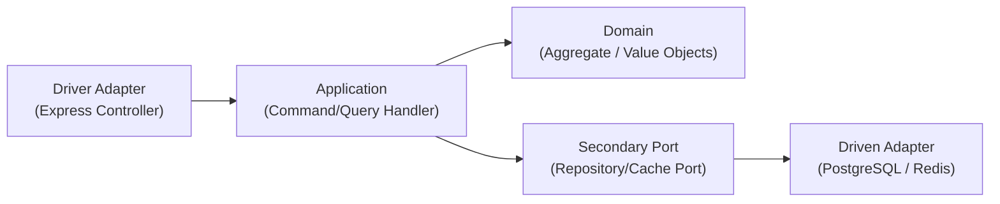

# ARTICLE-[ID]: [Título Técnico del Caso de Uso / Vertical Slice]

* **Artículo ID:** ARTICLE-[ID]
* **User Story:** [US-XX: Título de la Historia]
* **Bounded Context:** [e.g. identity]
* **Tipo de Slice:** [Command (Escritura) | Query (Lectura)]
* **Rama de Trabajo:** `feat/[US-XX-slug]`
* **Squash Commit en main:** `[commit hash]`
* **Fecha:** YYYY-MM-DD
* **Autor / Tech Lead:** [Nombre]

---

## 1. Resumen Ejecutivo y Problema de Negocio

[Descripción concisa del problema de negocio resuelto para los tenants y usuarios. Explicar qué capacidad se incorpora al sistema y cómo impacta en la experiencia o seguridad de la plataforma.]

---

## 2. Diseño Arquitectónico del Vertical Slice

Desglose de la porción vertical implementada conforme a los principios de **Arquitectura Hexagonal + DDD** y [`.agent/rules/ARCHITECTURE_RULES.md`](../rules/ARCHITECTURE_RULES.md):



### Componentes Clave del Slice
- **Punto de Entrada (Driver Adapter):** `interfaces/http/rest/v1/[context]/controllers.ts`
- **Mensaje de Aplicación:** `src/contexts/[context]/application/commands/[action]/command.ts`
- **Orquestador:** `src/contexts/[context]/application/commands/[action]/handler.ts`
- **Entidades e Invariantes:** `src/contexts/[context]/domain/entities/[aggregate]/aggregate.ts`
- **Puertos Secundarios (SPI):** `src/contexts/[context]/application/ports/[concept]/repository.ts`
- **Adaptadores de Infraestructura:** `src/contexts/[context]/infrastructure/persistence/...`

---

## 3. Decisiones de Dominio Táctico y Aislamiento Multitenant

### 3.1. Invariantes y Value Objects
[Explicar cómo se modelaron los conceptos clave como Value Objects inmutables, qué reglas de validación encapsulan y por qué evitan el uso de tipos primitivos (Primitive Obsession).]

### 3.2. Aislamiento por Tenant
[Detallar cómo se garantizó la segregación de datos del tenant en esta funcionalidad específica (validación de tokens, inyección de contexto, filtros obligatorios en repositorios y particionamiento de claves de caché).]

---

## 4. Evidencia de Pruebas (Pirámide Completa)

El desarrollo se condujo bajo **Double-Loop TDD**. A continuación se documenta la evidencia de ejecución en las distintas capas:

### 4.1. Pruebas Unitarias (Domain & Application)
- **Archivos:** `tests/unit/[context]/...`
- **Comando:** `npm run test:unit`
- **Resultado:** [Inserte snippet o confirmación de paso de tests en memoria]

### 4.2. Pruebas de Integración (Adapters & HTTP)
- **Archivos:** `tests/integration/[context]/...`
- **Comando:** `npm run test:integration`
- **Resultado:** [Validación contra base de datos y endpoints Express]

### 4.3. Pruebas de Aceptación BDD (Outer Loop Gherkin)
- **Archivo Feature:** `tests/acceptance/features/[feature].feature`
- **Escenario en Verde:**
```gherkin
Scenario: [Nombre del escenario principal validado]
  Given ...
  When ...
  Then ...
```

### 4.4. Pruebas End-to-End (UI & Frontend)
- **Archivo Spec:** `tests/e2e/web/[spec].spec.tsx`
- **Resultado:** [Validación del flujo de usuario en React y estado de contexto]

---

## 5. Lecciones Aprendidas y Concesiones (Trade-offs)

1. **Trade-off 1:** [e.g. Complejidad de crear archivos separados por Value Object vs. seguridad de tipado e inmutabilidad estricta].
2. **Trade-off 2:** [e.g. Caché en memoria inicial frente a latencia y estrategia de invalidación ante escrituras concurrentes].

---

## 6. Historial de Trazabilidad y Commits

### Historial de la Feature Branch (`feat/[US-XX-slug]`)
- `[hash]`: `test(acceptance): define gherkin scenarios for US-XX [expected red]`
- `[hash]`: `test(domain): add failing test for [concept] [red]`
- `[hash]`: `feat(domain): implement [concept] to pass test [green]`
- `[hash]`: `refactor(domain): clean up [concept] adhering to rules`
- `[hash]`: `docs(publication): add technical article for US-XX`

### Commit Final en `main` (Squash Merge)
- `[hash]`: `feat([context]): implement US-XX [slug] complete slice`

