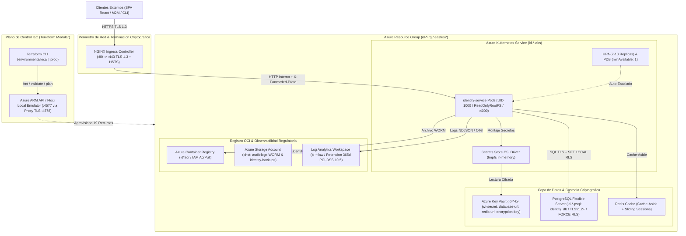

# Arquitectura Técnica — Identity Service

Este documento detalla el diseño arquitectónico, principios rectores y topología de componentes del **Identity Service**. Está orientado a desarrolladores, arquitectos y evaluadores técnicos que requieran comprender la estructura interna del repositorio.

---

## 1. Visión y Principios Rectores

El **Identity Service** es una plataforma multitenant de autenticación y autorización diseñada con los siguientes principios no negociables:

1. **Alta Cohesión por Caso de Uso (Vertical Slice Architecture):** Cada característica o caso de uso (e.g. `register_user`, `get_user_profile`) se encapsula en su propia porción vertical con modelos de datos, comandos/queries y handlers dedicados, evitando monolitos de servicio o dependencias cruzadas entre mutaciones y lecturas.
2. **Independencia del Dominio (Hexagonal / Ports & Adapters):** El núcleo de negocio reside en `src/contexts/identity/domain/` y carece por completo de dependencias de frameworks web (Express), bibliotecas de base de datos o utilidades externas. Toda interacción con el mundo exterior se canaliza a través de puertos secundarios (interfaces abstractas).
3. **Inmutabilidad y Diseño Defensivo (DDD Táctico):** Los conceptos atómicos se modelan mediante `Value Objects` inmutables (`Email`, `TenantId`) que validan sus propias restricciones en el momento de la instanciación. El `UserAggregate` encapsula el estado y solo permite transiciones a través de métodos de dominio explícitos.
4. **Segregación de Responsabilidades de Consulta y Comando (CQRS):**
   - **Command Side (Escritura):** Valida reglas de negocio complejas, aplica hashing criptográfico y persiste cambios atómicos mediante repositorios.
   - **Query Side (Lectura):** Optimizado para latencia ultrabaja, aplicando una estrategia de lectura en caché multinivel (*Cache-First* con *fallback* a base de datos).
5. **Aislamiento Multitenant First-Class:** Cada operación, token y registro persiste y valida el `tenant_id` en todas las capas del sistema.

---

## 2. Diagrama de Arquitectura

```text
+-----------------------------------------------------------------------------------------+
|                                    INTERFACES LAYER                                     |
|                                                                                         |
|   [Canal HTTP / Express]                                     [Canal Web / React]        |
|   - controllers.ts (/register, /me)                          - auth_context.tsx         |
|   - auth_middleware.ts                                       - register_form.tsx        |
|   - tenant_context_middleware.ts                             - user_profile_card.tsx    |
+-----------------------------------------------------------------------------------------+
                                           |
                                    Invoca Handlers
                                           v
+-----------------------------------------------------------------------------------------+
|                                   APPLICATION LAYER                                     |
|                                                                                         |
|          [Write Slices - Commands]                       [Read Slices - Queries]        |
|          - register_user/command.ts                      - get_user_profile/query.ts    |
|          - register_user/handler.ts                      - get_user_profile/handler.ts  |
|                                                                                         |
|                                [Secondary Ports / SPIs]                                 |
|      - UserRepositoryPort        - HashProviderPort          - CacheProviderPort        |
+-----------------------------------------------------------------------------------------+
                    |                                                |
          Implementa Puertos                                  Protege Invariantes
                    |                                                |
                    v                                                v
+---------------------------------------+       +-----------------------------------------+
|         INFRASTRUCTURE LAYER          |       |              DOMAIN LAYER               |
|                                       |       |                                         |
|  - PostgresUserRepository             |       |  - UserAggregate (entities/user/)       |
|  - MemoryCacheAdapter                 |       |  - Email VO (value_objects/email/)      |
|  - BcryptAdapter                      |       |  - TenantId VO (value_objects/tenant_id)|
|  - JwtTokenAdapter                    |       |  - DomainValidationError / ConflictError|
+---------------------------------------+       +-----------------------------------------+
```

---

## 3. Topología de Directorios Canónica

El repositorio organiza el código fuente bajo `src/` agrupado por contextos de dominio, mientras que las interfaces conductoras residen en `interfaces/` y las pruebas automatizadas en `tests/`:

```text
identity-service/
├── docs/                                     # Documentación pública y ADRs
│   ├── PRD.md                                # PRD de negocio
│   ├── ARCHITECTURE.md                       # Este documento
│   └── adr/                                  # Architectural Decision Records (0001 a 0006)
│
├── src/
│   └── contexts/
│       └── identity/                         # Bounded Context: Identity
│           ├── domain/                       # Núcleo puro (Entidades, Value Objects, Errores)
│           │   ├── entities/user/
│           │   ├── value_objects/email/
│           │   ├── value_objects/tenant_id/
│           │   └── exceptions/user/
│           ├── application/                  # Casos de uso y contratos secundarios
│           │   ├── commands/register_user/
│           │   ├── queries/get_user_profile/
│           │   ├── ports/
│           │   └── dtos/
│           └── infrastructure/               # Adaptadores de entrada/salida (DB, Caché, Hash, JWT)
│               ├── persistence/
│               ├── cache/
│               └── security/
│
├── interfaces/                               # Canales conductores (Driver Adapters)
│   ├── http/                                 # API REST con Express y middlewares
│   │   ├── middlewares/
│   │   └── rest/v1/identity/
│   └── web/client/contexts/identity/         # SPA React por Bounded Context
│       ├── domain/
│       ├── data/
│       └── ui/
│
└── tests/                                    # Pirámide de pruebas
    ├── unit/identity/                        # Tests unitarios en memoria (Domain y Application)
    ├── integration/identity/                 # Tests de adaptadores (Postgres y Express API)
    ├── acceptance/features/                  # Especificaciones BDD Gherkin
    └── e2e/web/                              # Tests de extremo a extremo de UI
```

---

## 4. Estrategia de Pruebas

La calidad del sistema se garantiza mediante una **Pirámide de Pruebas de Alta Densidad**:

1. **Unit Tests (Jest):** Ejecución instantánea en memoria. Prueban los invariantes de los Value Objects (`Email`, `TenantId`), el agregado `User` y los Handlers de aplicación usando *mocks* para los puertos secundarios.
2. **Integration Tests (Jest + Supertest):** Validan la integración real de adaptadores contra PostgreSQL y los contratos HTTP de los endpoints de Express (`POST /api/v1/auth/register`, `GET /api/v1/auth/me`).
3. **Acceptance Tests (Cucumber / Gherkin):** Documentación viva que describe el comportamiento del sistema en lenguaje ubicuo mediante escenarios *Given/When/Then*.
4. **End-to-End Tests (Playwright / React):** Validan el flujo completo desde la interfaz de usuario en React hasta la respuesta del backend y la gestión del estado global en `AuthContext`.

---

## 5. Arquitectura de Infraestructura Cloud (Azure & Paridad Local)

Además de la arquitectura interna de software (Hexagonal + Vertical Slice + CQRS), el despliegue en la nube está modelado mediante **Infraestructura como Código (Terraform modular sobre Azure Resource Manager)** y empaquetado Kubernetes (**Helm Chart v3**). En desarrollo local y CI, el plano de control de Azure se emula mediante **Floci Azure ARM** (`:4577`) detrás de un proxy TLS local (`:4578`), logrando paridad estructural sin depender de credenciales cloud activas.



### Matriz de Paridad: Entorno Local (Floci + Docker) vs Producción (Microsoft Azure)

| Componente Cloud (Azure) | Módulo Terraform | Recursos Planificados | Contraparte Local (Dev / CI) |
| :--- | :--- | :---: | :--- |
| **Azure ARM Control Plane** | `providers.tf` | — | **Floci Azure ARM** (`floci-azure-arm` `:4577` + `floci-proxy.mjs` TLS `:4578`) |
| **Resource Group** | `main.tf` (`id-local-rg`) | 1 | Espacio lógico emulado en Floci (`eastus2`) |
| **AKS Cluster & IAM `AcrPull`** | `modules/aks` | 2 | Contenedores Docker Compose + Helm Template Validation (`npm run test:helm`) |
| **NGINX Ingress (TLS 1.3)** | `deployments/ingress` | — | Contenedor `identity-ingress` (`:80` / `:443`, cert local `auth.angelpixel.local`) |
| **Azure Key Vault + 4 Secretos** | `modules/keyvault` | 6 | Variables `.env` + volúmenes CSI montados en `/mnt/secrets-store` |
| **PostgreSQL Flexible Server** | `modules/postgres` | 5 | Contenedor `identity-db` (PostgreSQL 16 + `FORCE RLS` + rol `identity_app`) |
| **Azure Container Registry** | `modules/acr` | 1 | Imagen local `Dockerfile` multi-stage Distroless/Alpine |
| **Azure Storage (WORM + Backups)** | `modules/storage` | 3 | Contenedores privados `audit-logs` e `identity-backups` en Floci |
| **Log Analytics (365d PCI-DSS)** | `modules/log_analytics` | 1 | Salida estructurada NDJSON + Prometheus `/metrics` |

> Para el walkthrough interactivo paso a paso de Terraform + Floci, Ingress TLS 1.3, Helm Chart v3 y CI/CD, consulta [Capítulo 06: Infraestructura Cloud, Kubernetes & Entrega Continua](./showcase/06-cloud-infrastructure.md).

