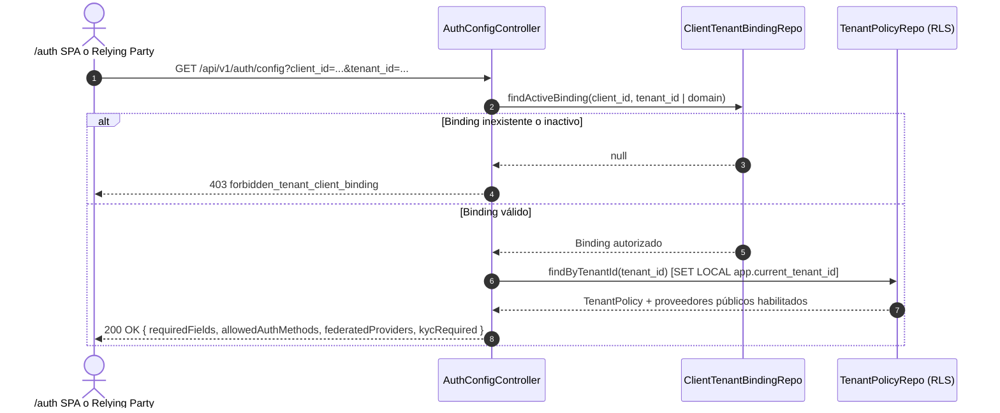

# 10. Motor de Políticas Dinámicas por Tenant y Vinculación N:M Client-Tenant

* **Status:** Accepted
* **Date:** 2026-11-22
* **Deciders:** Principal Identity & Security Architect, Equipo de Ingeniería

## Contexto y Problema

El `identity-service` debe operar como un proveedor de identidad transversal para múltiples líneas de producto y verticales SaaS B2B/B2C (por ejemplo, un e-commerce multi-tienda regulado y una plataforma de academias deportivas) sin duplicar el núcleo de identidad ([ADR-0002](0002-use-vertical-slice-and-hexagonal.md), [ADR-0003](0003-multi-tenant-isolation-strategy.md)).

Al escalar hacia un ecosistema multi-producto surgen tres problemas arquitectónicos que el modelo inicial (`EPIC-01`–`EPIC-05`) no resuelve por sí solo:

1. **Dependencia implícita de cabeceras HTTP:** Una misma instancia SaaS desplegada (`client_id`) puede atender múltiples dominios personalizados vinculados a distintos inquilinos (`tenants`). Inferir `tenant_id` únicamente desde encabezados `Origin` o `Referer` es frágil y vulnerable a suplantación si no existe una vinculación explícita y validada entre cliente, dominio e inquilino ([ADR-0004](0004-client-registry-authorization.md)).
2. **Flujos de onboarding estáticos:** Distintos verticales exigen distinto rigor en el alta y autenticación (por ejemplo, `email` + `password` básico en una academia vs. `phone` E.164 + KYC + Google OIDC en un e-commerce regulado).
3. **Confusión entre configuración de dominio y feature flags operativos:** Las reglas de negocio de cada inquilino (atributos obligatorios, métodos de autenticación permitidos, requisito KYC) son datos de dominio persistidos por tenant, no banderas de despliegue en variables de entorno.

## Drivers de la Decisión

- **Aislamiento Estricto y RLS Homogéneo ([ADR-0005](0005-postgresql-rls-strategy.md)):** Todas las políticas y vinculaciones residen en PostgreSQL bajo políticas *Row-Level Security (RLS) Fail-Closed* por `tenant_id`, con gobernanza transversal desde el Root Tenant `system` ([ADR-0009](0009-root-tenant-and-platform-governance.md)).
- **Resolución Explícita y Verificada de Contexto:** Ninguna petición de registro o login puede aceptar un `tenant_id` arbitrario para un `client_id` sin verificar un vínculo activo en base de datos.
- **Contrato Público Seguro hacia `/auth`:** El portal `/auth` y las *Relying Parties* necesitan descubrir dinámicamente qué campos y métodos mostrar para un `(client_id, tenant_id | domain)` sin exponer secretos ni filtrar la existencia de otros inquilinos.
- **Validación Simétrica Frontend/Backend:** Lo que la UI renderiza dinámicamente debe ser reforzado con la misma estrictez en los Command Handlers del dominio.

## Opciones Consideradas

1. **Políticas hardcodeadas por `tenant_id` o en `.env`:**
   * *Desventajas:* Requiere redespliegues por cada nuevo cliente o cambio de política; mezcla configuración de dominio del inquilino con variables operativas de infraestructura.
2. **Relación estricta 1:1 `client_id ↔ tenant_id` e inferencia por `Origin`:**
   * *Desventajas:* Obliga a registrar un `client_id` distinto por cada tienda o dominio de una misma aplicación SaaS multi-tenant y mantiene vulnerabilidad si falta validación cruzada de `redirect_uri`.
3. **Vinculación N:M `client_tenant_bindings` + Agregado `TenantPolicy` (RLS) + Contrato `GET /api/v1/auth/config` (Elegida):**
   * Permite que una aplicación cliente atienda uno o múltiples inquilinos/dominios autorizados y que cada inquilino defina sus capacidades dinámicas bajo aislamiento RLS.

## Decisión Tomada

Adoptar el **Motor de Políticas Dinámicas por Tenant y Vinculación N:M `Client-Tenant`** con las siguientes especificaciones:

### 1. Vinculación N:M `client_tenant_bindings` (`EPIC-02` / `US-28`–`US-29`)
- Se modela la relación N:M entre `client_applications` y `tenants` mediante la tabla puente `client_tenant_bindings`:
  ```sql
  -- Relación N:M validada entre aplicaciones cliente, tenants autorizados y dominios custom
  client_tenant_bindings (
    id UUID PRIMARY KEY,
    client_id TEXT NOT NULL,
    tenant_id TEXT NOT NULL,
    custom_domain TEXT,
    allowed_redirect_uris TEXT[] NOT NULL,
    is_active BOOLEAN NOT NULL DEFAULT true,
    UNIQUE (client_id, tenant_id)
  )
  ```
- Todo flujo en `/api/v1/auth/*` y `/api/v1/oauth2/authorize` exige `client_id` + (`tenant_id` o `domain` explícito), valida que el binding esté activo y verifica coincidencia exacta de `Origin` y `redirect_uri`. Cualquier discrepancia se rechaza con `403 forbidden_tenant_client_binding` / `400 invalid_redirect_uri` y registra el evento de auditoría `CLIENT_TENANT_BINDING_VIOLATION`.

### 2. Agregado `TenantPolicy` (`EPIC-10` / `US-30`)
- Cada `tenant_id` posee una política editable por el operador Root (`system` en `/platform`) o `Tenant Admin` autorizado (`/tenant`), persistida en `tenant_policies` bajo PostgreSQL RLS *Fail-Closed*:
  - `requiredAttributes`: `{ phone: boolean }` (extensible a otros atributos de perfil).
  - `kycPolicy`: `{ required: boolean, minLevel: 'basic' | 'biometric_liveness' }`.
  - `allowedAuthMethods`: `{ password: boolean, passkeys: boolean, federatedOidc: boolean }`.
- Los valores por defecto seguros mantienen compatibilidad retroactiva (`phone: false`, `kycPolicy.required: false`, `password: true`). Toda mutación emite auditoría `TENANT_POLICY_UPDATED`.

### 3. Contrato Público Dinámico (`GET /api/v1/auth/config`, `US-31`–`US-32`)

- El endpoint nunca expone secretos (`client_secret` de IdPs ni configuraciones internas).
- `RegisterUserCommandHandler` aplica exactamente las mismas reglas de `TenantPolicy` en servidor (por ejemplo, exigiendo teléfono E.164 cuando `requiredAttributes.phone === true` o rechazando login con contraseña si `allowedAuthMethods.password === false`).

### Consecuencias

- **Positivas:**
  - Un único despliegue de `identity-service` soporta múltiples verticales SaaS con requisitos de onboarding y seguridad diferenciados.
  - Elimina la fragilidad de depender solo de `Origin`/`Referer` para resolver el inquilino.
  - Mantiene intacta la frontera AuthN vs. AuthZ (Pasaporte Criptográfico vía JWKS) y el aislamiento PostgreSQL RLS *Fail-Closed*.
- **Negativas / Riesgos:**
  - Añade una consulta previa de configuración (`GET /api/v1/auth/config`) antes de renderizar formularios dinámicos en `/auth`; se mitiga con encabezados `ETag` / caché corta invalidada al actualizar `TenantPolicy` o `ClientTenantBinding`.
  - Las pruebas e integraciones existentes deben asegurar el binding activo cuando operen con `client_id` explícito; se mitiga manteniendo valores por defecto compatibles en los *seeders* de desarrollo.
