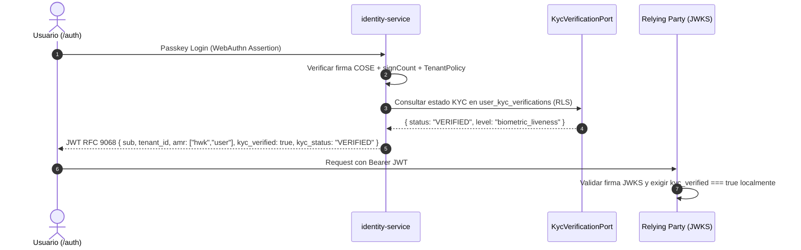

# 11. Autenticación Passwordless (WebAuthn/FIDO2) y Adaptador Desacoplado de Verificación KYC

* **Status:** Accepted
* **Date:** 2026-11-22
* **Deciders:** Principal Identity & Security Architect, Equipo de Ingeniería

## Contexto y Problema

Al expandir el `identity-service` hacia verticales regulados (e-commerce financiero, fintech) y experiencias móviles/web modernas ([ADR-0010](0010-tenant-policies-and-dynamic-onboarding.md)), surgen dos requerimientos críticos de identidad:

1. **Autenticación Biométrica / Passwordless:** Los usuarios finales deben poder autenticarse mediante capacidades nativas de sus dispositivos (Face ID, Touch ID, Windows Hello, biometría Android) sin introducir contraseñas ni exponer datos biométricos crudos al servidor.
2. **Verificación de Identidad (KYC) / Prueba de Vida por Cámara:** Ciertos inquilinos exigen verificación KYC antes de habilitar operaciones sensibles en sus aplicaciones consumidoras (*Relying Parties*). Procesar video o imágenes biométricas directamente dentro del núcleo criptográfico del IdP acoplaría el servicio a SDKs pesados y elevaría drásticamente el alcance regulatorio (GDPR, BIPA, PCI/SOC 2).

## Drivers de la Decisión

- **Zero-Biometric-PII en el IdP:** El servidor jamás almacena huellas, vectores faciales, imágenes ni video crudo; la verificación biométrica ocurre exclusivamente en el *authenticator* local del dispositivo bajo estándares abiertos (**WebAuthn / FIDO2**).
- **Arquitectura Hexagonal y Desacoplamiento ([ADR-0002](0002-use-vertical-slice-and-hexagonal.md)):** El núcleo del IdP solo orquesta estados de verificación mediante un puerto (`KycVerificationPort`), delegando el procesamiento multimedia a adaptadores/proveedores especializados.
- **Aislamiento PostgreSQL RLS *Fail-Closed* ([ADR-0005](0005-postgresql-rls-strategy.md)):** Tanto las credenciales WebAuthn como los registros de estado KYC pertenecen a un `tenant_id` específico y están protegidos por políticas RLS homogéneas.
- **Pasaporte Criptográfico RFC 9068:** Las *Relying Parties* validan localmente vía JWKS si el usuario se autenticó con llave hardware/biométrica (`amr`) y si su estado KYC está aprobado (`kyc_verified`), sin llamadas síncronas de retorno al IdP.

## Opciones Consideradas

1. **Almacenar templates biométricos o procesar imágenes KYC en Express/Node.js:**
   * *Desventajas:* Riesgo legal/regulatorio extremo por almacenamiento de biometría cruda, consumo elevado de CPU/memoria y acoplamiento del IdP a librerías de visión computacional.
2. **Delegar Passkeys y KYC completamente a un SaaS externo sin registro en el IdP:**
   * *Desventajas:* Rompe la fuente única de verdad del `identity-service`, fragmenta el aislamiento RLS por `tenant_id` e impide proyectar claims unificados en el JWT propio.
3. **WebAuthn/FIDO2 con Claves Públicas COSE + Puerto `KycVerificationPort` + Proyección en JWT RFC 9068 (Elegida):**
   * Preserva la soberanía de identidad y aislamiento RLS mientras mantiene el núcleo criptográfico liviano y extensible.

## Decisión Tomada

Adoptar la arquitectura **Zero-Biometric-PII WebAuthn/FIDO2 y Adaptador Desacoplado KYC** bajo las siguientes especificaciones:

### 1. Credenciales Passwordless WebAuthn / FIDO2 (`EPIC-11` / `US-35`–`US-36`)
- **Persistencia:** Tabla `webauthn_credentials` aislada por PostgreSQL RLS *Fail-Closed*:
  ```sql
  webauthn_credentials (
    id UUID PRIMARY KEY,
    user_id UUID NOT NULL,
    tenant_id TEXT NOT NULL,
    credential_id TEXT NOT NULL UNIQUE,
    public_key_cose BYTEA NOT NULL,
    counter BIGINT NOT NULL DEFAULT 0,
    transports TEXT[],
    device_type TEXT NOT NULL,
    backed_up BOOLEAN NOT NULL DEFAULT false,
    created_at TIMESTAMPTZ NOT NULL DEFAULT now()
  )
  ```
- **Flujo de Registro y Login:**
  - Los endpoints `/api/v1/auth/passkeys/register/{options,verify}` y `/api/v1/auth/passkeys/login/{options,verify}` generan retos criptográficos efímeros (`single-use`, TTL 5 minutos).
  - Se valida estrictamente `rp.id` y `origin` contra los dominios autorizados en `client_tenant_bindings` ([ADR-0010](0010-tenant-policies-and-dynamic-onboarding.md)).
  - En autenticación, se verifica la firma asimétrica contra `public_key_cose` y el incremento de `signCount` (registrando `PASSKEY_CLONE_DETECTED` ante retrocesos en autenticadores no respaldados).

### 2. Adaptador Desacoplado de Verificación KYC (`EPIC-11` / `US-37`)
- **Puerto Hexagonal `KycVerificationPort`:** Orquesta la máquina de estados `UNVERIFIED -> PENDING -> VERIFIED | REJECTED` sin persistir capturas de cámara ni documentos crudos en la base del IdP.
- **Persistencia:** Tabla `user_kyc_verifications` (`id`, `user_id`, `tenant_id`, `status`, `level`, `provider_ref`, `verified_at`, `expires_at`) protegida por PostgreSQL RLS *Fail-Closed*.
- **Integración Asíncrona:** `POST /api/v1/auth/kyc/sessions` inicia la sesión hacia el adaptador externo (con adaptador determinista simulado en entorno local/dev) y `POST /api/v1/auth/kyc/webhooks/result` valida firma HMAC antes de transicionar el estado y emitir auditoría.

### 3. Proyección en el Pasaporte Criptográfico JWT (RFC 9068)


### Consecuencias

- **Positivas:**
  - Cumplimiento estricto *Zero-Biometric-PII* (solo claves públicas COSE y estados verificados en PostgreSQL).
  - Separación limpia entre el núcleo AuthN/OIDC y proveedores externos de KYC / prueba de vida.
  - Consumo desacoplado por parte de las aplicaciones cliente mediante claims estándar (`amr`, `kyc_verified`, `kyc_status`) validados vía JWKS.
- **Negativas / Riesgos:**
  - En Passkeys sincronizadas en nube (`backed_up: true`), algunos autenticadores mantienen `signCount = 0`; la lógica anti-clonación debe considerar `backed_up` y `device_type` para evitar falsos positivos.
  - Los estados `VERIFIED` pueden caducar (`expires_at`); los emisores de tokens deben evaluar expiración antes de proyectar `kyc_verified: true`.
