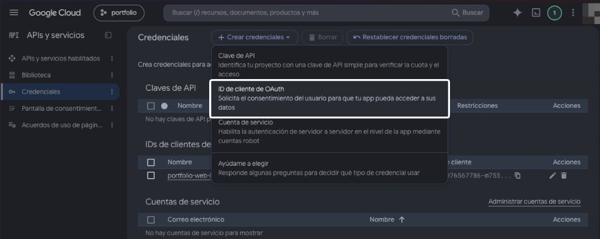
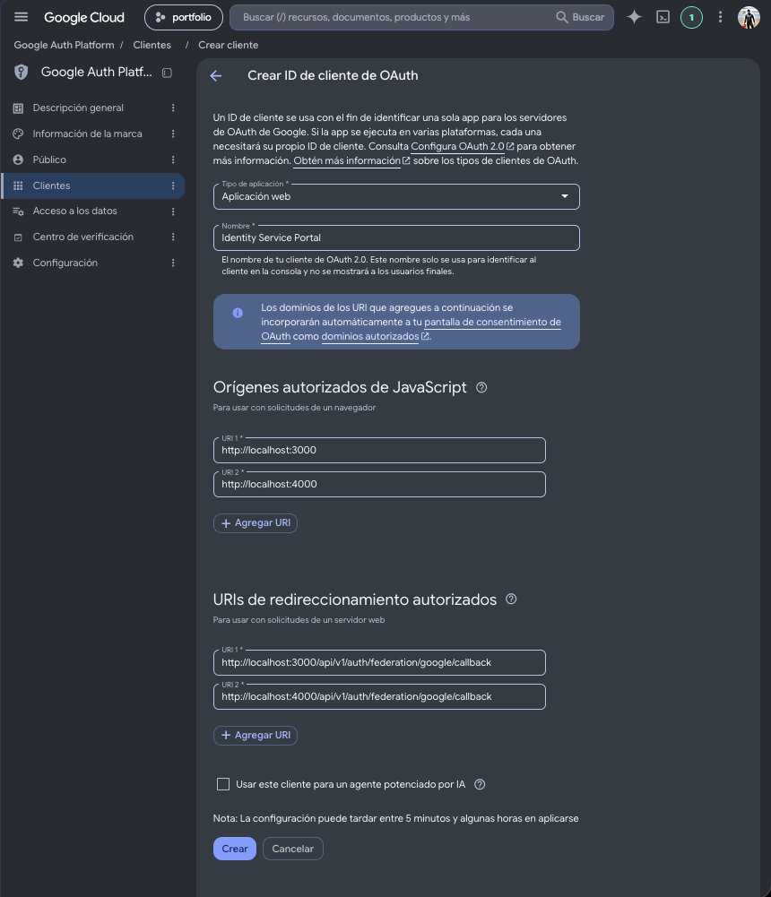
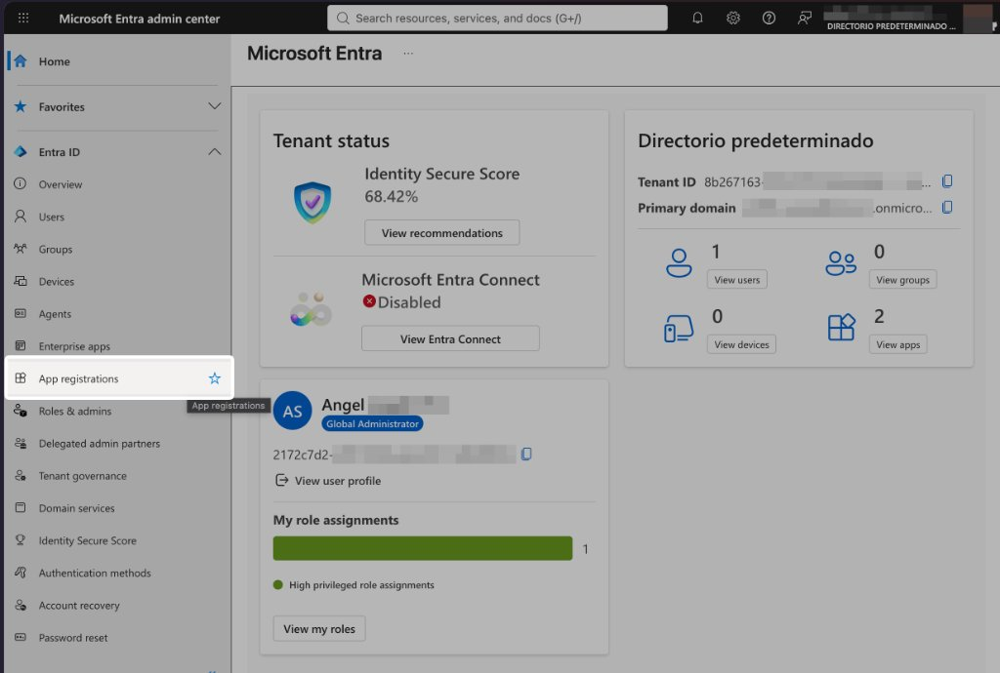
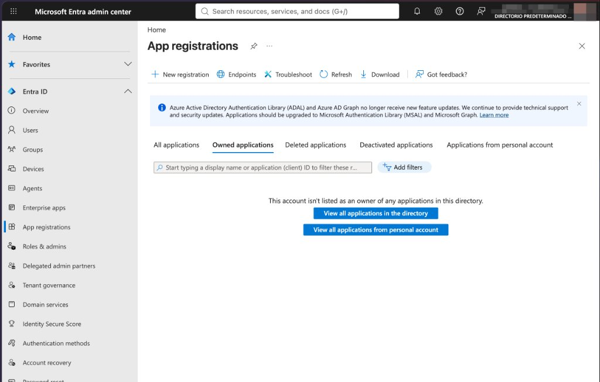
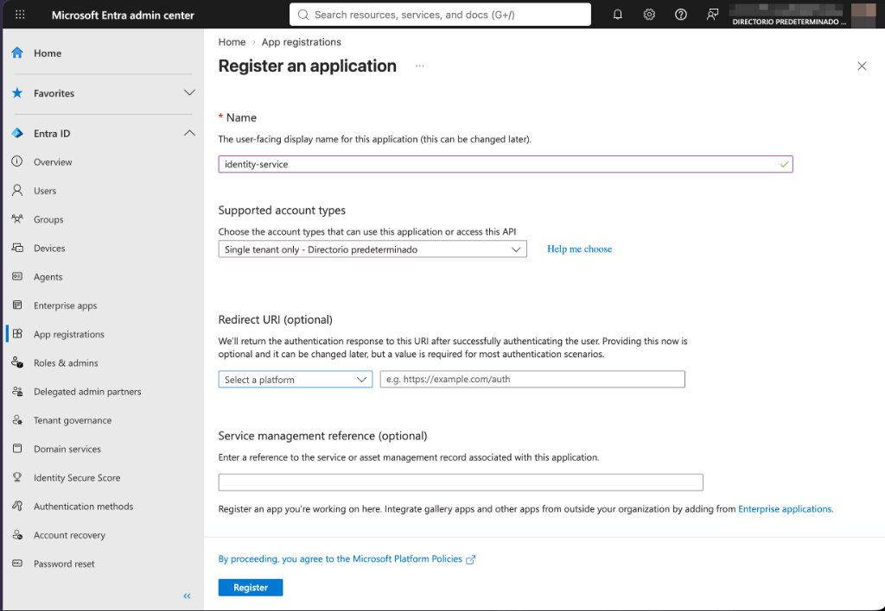

# Guía de Configuración: Credenciales OIDC Externas (Google & Microsoft Entra ID)

Esta guía explica paso a paso cómo obtener credenciales OAuth 2.0 / OpenID Connect reales en **Google Cloud Console** y **Microsoft Entra ID (Azure Portal)** para operar la federación de identidad (`US-10` y `US-11`) en modo **Live** en lugar del emulador local de desarrollo.

---

## 1. Variables de Entorno Soportadas

El servicio lee las siguientes variables desde `.env` (o secretos de Kubernetes / Azure Key Vault):

| Variable | Proveedor | Obligatoriedad | Descripción |
| :--- | :--- | :--- | :--- |
| `GOOGLE_CLIENT_ID` | Google OIDC | Para modo Live | Client ID de aplicación Web en Google Cloud. |
| `GOOGLE_CLIENT_SECRET` | Google OIDC | Para modo Live | Client Secret asociado. |
| `GOOGLE_PROJECT_ID` | Google OIDC | Opcional (metadato) | `project_id` del JSON descargado de Google Cloud. |
| `GOOGLE_AUTH_URI` | Google OIDC | Opcional (metadato) | `auth_uri` (`https://accounts.google.com/o/oauth2/auth`). |
| `GOOGLE_TOKEN_URI` | Google OIDC | Opcional (metadato) | `token_uri` (`https://oauth2.googleapis.com/token`). |
| `GOOGLE_AUTH_PROVIDER_X509_CERT_URL` | Google OIDC | Opcional (metadato) | `auth_provider_x509_cert_url` del JSON de Google. |
| `GOOGLE_REDIRECT_URI_CALLBACKS` | Google OIDC | Opcional (metadato) | Lista separada por comas de `redirect_uris` registradas. |
| `GOOGLE_JAVASCRIPT_ORIGINS` | Google OIDC | Opcional (metadato) | Lista separada por comas de `javascript_origins` registrados. |
| `MICROSOFT_CLIENT_ID` | Microsoft Entra ID | Para modo Live | Application (client) ID de Entra ID. |
| `MICROSOFT_CLIENT_SECRET` | Microsoft Entra ID | Para modo Live | Value del Client Secret (no el Secret ID). |
| `MICROSOFT_TENANT_ID` | Microsoft Entra ID | Opcional (`common`) | Tenant específico (UUID/dominio), `common`, `organizations` o `consumers`. |

> [!NOTE]
> Si estas variables no están definidas en `development`, el servidor emite una advertencia en consola al arrancar y opera con el emulador local (`devFederationHttpClient`). En `production` debes configurar credenciales reales.

---

## 2. Google Cloud Console (Google OIDC)

> [!IMPORTANT]
> **No necesitas habilitar ninguna API en "Biblioteca de APIs"** (tampoco `Cloud OAuth Service API`). Ve directamente al menú lateral **APIs y servicios** (*APIs & Services*) o **Google Auth Platform**.

1. Ingresa a [Google Cloud Console](https://console.cloud.google.com/) y selecciona o crea un proyecto.
2. Ve a **APIs y servicios → Pantalla de consentimiento de OAuth** (*APIs & Services → OAuth consent screen*, o en el nuevo menú **Google Auth Platform**):
   - En **Público** (*Audience*): elige **Externo** (*External*) o **Interno** (*Internal*, si usas Google Workspace corporativo). Si la app está en estado *Pruebas* (*Testing*), agrega tu correo en **Usuarios de prueba** (*Test users*).
   - En **Acceso a los datos** (*Data access*): haz clic en **Agregar o quitar permisos** (*Add or remove scopes*) y añade `openid`, `.../auth/userinfo.email` y `.../auth/userinfo.profile`.
3. Ve a **APIs y servicios → Credenciales → + Crear credenciales → ID de cliente de OAuth** (*Credentials → + Create Credentials → OAuth client ID*, o **Google Auth Platform → Clientes → Crear cliente**):

   

   - **Tipo de aplicación (*Application type*):** `Aplicación web` (*Web application*).
   - **Orígenes de JavaScript autorizados (*Authorized JavaScript origins*):**
     - Local: `http://localhost:3000` y `http://localhost:4000`
     - Producción: `https://<tu-dominio>`
   - **URIs de redireccionamiento autorizados (*Authorized redirect URIs*):**
     - Local (vía proxy Vite): `http://localhost:3000/api/v1/auth/federation/google/callback`
     - Local (API directa): `http://localhost:4000/api/v1/auth/federation/google/callback`
     - Producción: `https://<tu-dominio>/api/v1/auth/federation/google/callback`

   

4. Copia **ID de cliente** (*Client ID*) y **Secreto del cliente** (*Client secret*) a tu archivo `.env`:
   ```dotenv
   GOOGLE_CLIENT_ID=tu-google-client-id.apps.googleusercontent.com
   GOOGLE_CLIENT_SECRET=tu-google-client-secret
   ```

> [!TIP]
> Si deseas adjuntar capturas de estas pantallas en `docs/guides/assets/` (por ejemplo `google_oauth_client.png` y `entra_app_registration.png`), recuerda **ocultar correos, project IDs personales y secretos** antes de confirmarlas en Git.

---

## 3. Microsoft Entra ID (Azure Portal)

1. Ingresa al [Centro de administración de Microsoft Entra](https://entra.microsoft.com/) (o [Azure Portal](https://portal.azure.com/) → **Microsoft Entra ID**).
2. En el menú lateral izquierdo, ve a **Entra ID → App registrations**:

   

3. Haz clic en **`+ New registration`**:

   

   - **Name:** `identity-service`
   - **Supported account types:**
     - **`Any Entra ID Tenant + Personal Microsoft accounts`** (recomendado para `MICROSOFT_TENANT_ID=common`, permite cuentas corporativas Entra ID y cuentas personales `@hotmail.com`/`@outlook.com`), o
     - *Single tenant only* (solo si usarás un `MICROSOFT_TENANT_ID` UUID específico).
   - **Redirect URI (optional):** selecciona la plataforma **`Web`** (no `SPA` ni `Public client`, ya que el backend Express intercambia el código con `MICROSOFT_CLIENT_SECRET`):
     - Local (vía proxy Vite): `http://localhost:3000/api/v1/auth/federation/microsoft/callback`
     - Local (API directa, añadir luego en *Manage → Authentication*): `http://localhost:4000/api/v1/auth/federation/microsoft/callback`
     - Producción: `https://<tu-dominio>/api/v1/auth/federation/microsoft/callback`
   - **Service management reference (optional):** déjalo vacío (solo se usa para enlazar un registro CMDB interno).

   
3. En la pantalla **Overview** de la app registrada, copia **Application (client) ID** (`MICROSOFT_CLIENT_ID`) y opcionalmente **Directory (tenant) ID** (`MICROSOFT_TENANT_ID`).
4. Ve a **Manage → Certificates & secrets → + New client secret**, crea un secreto y copia su **Value** (no el *Secret ID*) como `MICROSOFT_CLIENT_SECRET`.
5. Ve a **Manage → Token configuration / API permissions** y verifica que `openid`, `profile` y `email` estén habilitados (asegura que el claim `email` / `preferred_username` venga en el `id_token`).
6. Configura tu `.env`:
   ```dotenv
   MICROSOFT_CLIENT_ID=00000000-0000-0000-0000-000000000000
   MICROSOFT_CLIENT_SECRET=tu-microsoft-client-secret-value
   MICROSOFT_TENANT_ID=common
   ```

---

## 4. Verificación en Vivo (API & UI)

1. Reinicia el servidor backend (`npm run dev:api` o `npm run docker:dev`). En los logs de arranque desaparecerá el warning de modo emulador para los proveedores configurados.
2. Verifica el endpoint de estado:
   ```bash
   curl -s http://localhost:4000/api/v1/auth/federation/status | jq .
   ```
   Debes obtener `"configured": true` y `"mode": "live"` para el proveedor configurado.
3. Abre [`http://localhost:3000/auth`](http://localhost:3000/auth) → pestaña **`Federación`** y confirma que los chips cambian a **`Configurado (Live)`** en tono verde.
