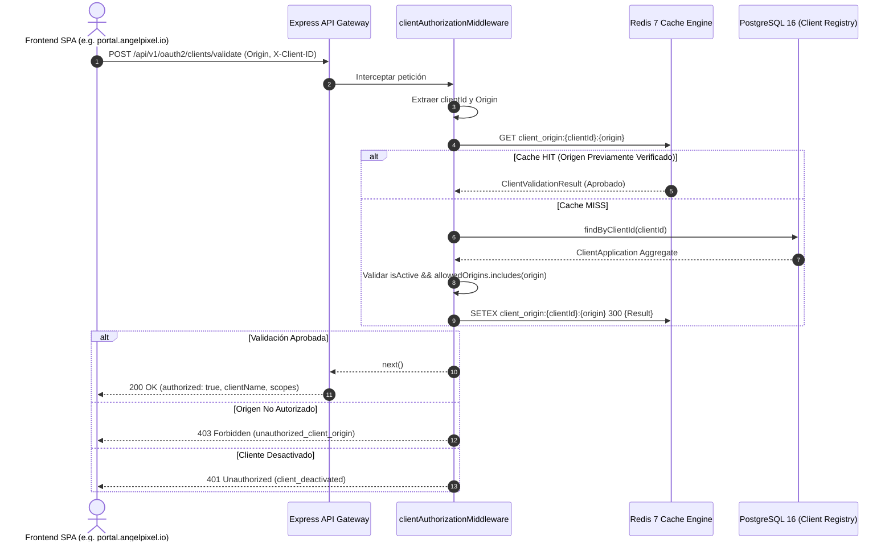

# 🌐 Epic 02: Dynamic Client Registry & Machine-to-Machine (M2M) Auth

[](http://localhost:4000/api/docs/#/OAuth2/post_api_v1_oauth2_clients_validate)
[](#)
[](#)
[](#)

Este capítulo documenta y demuestra el funcionamiento del **Épico 02: Registro Dinámico de Clientes y Autenticación Máquina a Máquina (M2M)**. En arquitecturas modernas de microservicios y SaaS distribuidos, registrar nuevas aplicaciones cliente (SPAs, apps móviles, microservicios satélite) no debe requerir redespliegues del clúster ni reiniciar servicios para autorizar nuevos dominios CORS o secretos de cliente.

---

## 📌 Historias de Usuario

| Historia | Descripción | Estado |
| :--- | :--- | :---: |
| **US-03** | Registro Dinámico de Clientes y Validación en Tiempo Real de Orígenes CORS | ✅ En Producción |
| **US-04** | Autenticación Machine-to-Machine (M2M) con OAuth2 Client Credentials | 🔄 Próximo Paso |

---

## 🛡️ US-03: Registro Dinámico de Clientes & Validación Dinámica de CORS

### 1. Arquitectura y Gobernanza de Orígenes en Tiempo Real

El endpoint `POST /api/v1/oauth2/clients/validate` y el middleware `clientAuthorizationMiddleware` implementan la directriz de arquitectura **ADR-0004 (Dynamic Client Registry)**:

1. **Catálogo de Clientes como Agregados de Dominio:** Cada cliente registrado (`ClientApplication`) encapsula sus orígenes autorizados (`allowedOrigins: OriginDomain[]`), URIs de redirección (`redirectUris`), tipos de flujo permitidos (`allowedGrantTypes`) y scopes.
2. **Cero Redespliegues (Zero-Downtime):** Las políticas CORS no se definen estáticamente en variables de entorno o archivos de configuración de Express. Cada petición valida dinámicamente la cabecera `Origin` o `Referer` contra el repositorio en base de datos PostgreSQL con aceleración por caché de segundo nivel en Redis.
3. **Mapeo Estricto de Códigos HTTP según RFCs:**
   - Origen permitido y cliente activo: **HTTP 200 OK**
   - Origen no autorizado: **HTTP 403 Forbidden** (`unauthorized_client_origin`)
   - Cliente desactivado por gobernanza: **HTTP 401 Unauthorized** (`client_deactivated`)
   - Cliente inexistente: **HTTP 404 Not Found** (`client_not_found`)
   - Ausencia de identificador: **HTTP 400 Bad Request** (`missing_client_id`)



---

### 2. Recetas Interactivas cURL Paso a Paso

Puedes probar cada una de las bifurcaciones de validación de seguridad directamente contra el entorno en ejecución:

#### Escenario A: Origen Autorizado y Cliente Activo (HTTP 200 OK)

```bash
curl -i -X POST http://localhost:4000/api/v1/oauth2/clients/validate \
  -H "Content-Type: application/json" \
  -H "Origin: https://portal.angelpixel.io" \
  -H "X-Client-ID: portal-web" \
  -d '{"clientId": "portal-web"}'
```

##### Respuesta Real Obtenida:
```json
{
  "authorized": true,
  "clientId": "portal-web",
  "clientName": "AngelPixel Web Portal",
  "clientType": "public",
  "allowedOrigins": [
    "https://portal.angelpixel.io"
  ],
  "scopes": [
    "openid",
    "profile",
    "email"
  ]
}
```

---

#### Escenario B: Intento de Suplantación desde Origen No Autorizado (HTTP 403 Forbidden)

Si un atacante aloja una aplicación maliciosa en otro dominio e intenta utilizar el `client_id` legítimo de la organización:

```bash
curl -i -X POST http://localhost:4000/api/v1/oauth2/clients/validate \
  -H "Content-Type: application/json" \
  -H "Origin: https://malicious-phishing-site.com" \
  -H "X-Client-ID: portal-web" \
  -d '{"clientId": "portal-web"}'
```

##### Respuesta de Seguridad Obtenida:
```json
{
  "error": "unauthorized_client_origin",
  "message": "Origin https://malicious-phishing-site.com is not authorized for client portal-web."
}
```

---

#### Escenario C: Intento de Uso de Cliente Revocado / Desactivado (HTTP 401 Unauthorized)

Cuando una aplicación cliente es desactivada por el equipo de seguridad o fin de ciclo de vida (`legacy-app`):

```bash
curl -i -X POST http://localhost:4000/api/v1/oauth2/clients/validate \
  -H "Content-Type: application/json" \
  -H "Origin: https://legacy.angelpixel.io" \
  -H "X-Client-ID: legacy-app" \
  -d '{"clientId": "legacy-app"}'
```

##### Respuesta de Seguridad Obtenida:
```json
{
  "error": "client_deactivated",
  "message": "Client application \"legacy-app\" is currently deactivated."
}
```

---

#### Escenario D: Identificador de Cliente Inexistente (HTTP 404 Not Found)

```bash
curl -i -X POST http://localhost:4000/api/v1/oauth2/clients/validate \
  -H "Content-Type: application/json" \
  -H "Origin: https://portal.angelpixel.io" \
  -H "X-Client-ID: cliente-fantasma" \
  -d '{"clientId": "cliente-fantasma"}'
```

##### Respuesta de Seguridad Obtenida:
```json
{
  "error": "client_not_found",
  "message": "Client application \"cliente-fantasma\" was not found in registered_clients."
}
```

> [!TIP]
> **Exploración en Swagger UI:**
> Puedes probar interactivamente este endpoint en la consola de OpenAPI:
> [`http://localhost:4000/api/docs/#/OAuth2/post_api_v1_oauth2_clients_validate`](http://localhost:4000/api/docs/#/OAuth2/post_api_v1_oauth2_clients_validate).

---

### 3. Cobertura de Pruebas Automatizadas

El middleware y el caso de uso de validación de orígenes dinámicos están certificados al 100%:

```bash
npx jest tests/integration/identity/interfaces/test_client_authorization_middleware.ts
```

- **Prueba 1:** Permite el paso cuando el cliente existe, está activo y el origen coincide.
- **Prueba 2:** Rechaza con `403 Forbidden` ante orígenes no registrados.
- **Prueba 3:** Rechaza con `401 Unauthorized` si el cliente está desactivado.
- **Prueba 4:** Retorna `404 Not Found` si el `client_id` no existe en la base de datos.
- **Prueba 5:** Retorna `400 Bad Request` ante la ausencia de `client_id`.

---

[⬅️ Volver al Hub Principal de Showcase](./README.md)
